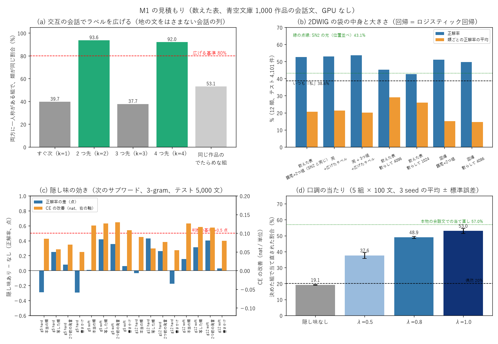
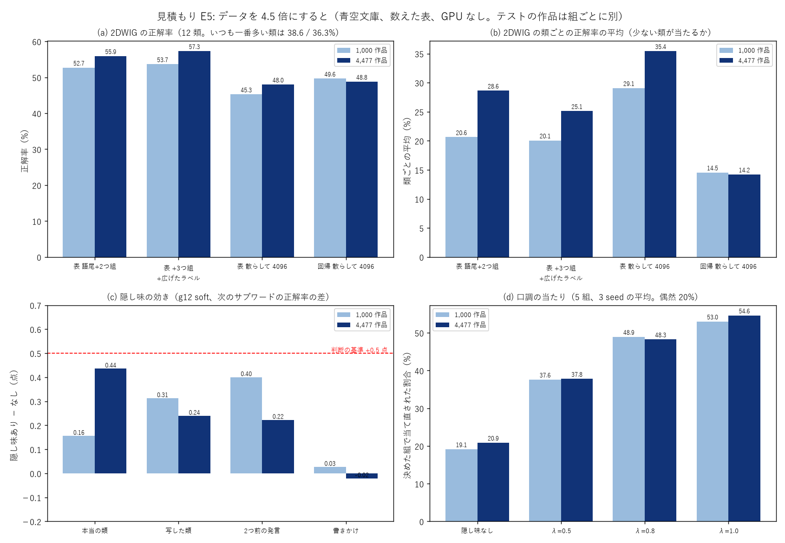
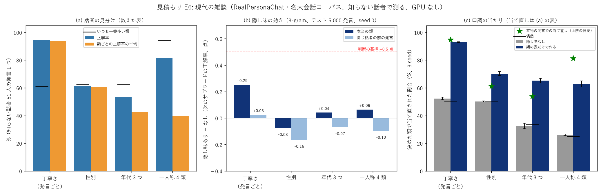

# Project_Kotoyui 実験ノート

SinWave（正弦の干渉と回折だけで学ぶ光の学習器）の部品で、日本語の会話（チャット）をする仕組みを作り、実験で確かめながら改良していく記録。数字の正本。

> ファイル配置（2026-10-23）: 会話の本体は `kotoyui.py`、光の部品は `vendor/sn2_parts_2d_v0_11_0.py`（SN2-Parts-2D から写したもの、書き換えない）。実験は `experiments/expNN_名前.py`、見積もりは `experiments/est_*.py`、条件は `experiments/sweeps/sweepNN.sh`。結果は `results/expNN.txt`（1 回 = 1 行の JSON）、図は `tools/fig_*.py` から `docs/images/` に。リポジトリ直下で実行する。本文中のスクリプト名はファイル名のみ。

## 現時点のまとめ（2026-11-03 更新。初めての人向けの説明: docs/overview.md、次のスレッドへの引き継ぎ: 非公開の置き場の docs/internal/handover_next_thread.md）

**いまの最良の構成**: kotoyui.py 0.2.0 = Sin-CNN3 から取り込んだ返事選び（重なり + 共鳴、10 択 60.7%、実験06）+ キャラクタ「言結 となり」。共鳴は `--light` で光の語板（sincnn3 の形、10 択 57.9% 対 数え上げ 59.0%、実験09）に切り替えられる。光の部品の最良は、4f 系の分担の 2DTG（次のサブワード 27.2%、2 段で読むとデジタル 520 で 26.2%、実験05）と 2DWIG（丁寧さ 96.5%、実験01）。推し量る力: 似た語の融合・2 段たどりで新しい語の組を AUC 0.79（実験13）、ただし 10 択の足しにはならない（実験12b）。

| 目標 | 状況 |
|---|---|
| M1（2026-10-26 組み替え）: 光の 2DTG ＋ 口調のスイッチ ＋ 2DWIG（丁寧さ・一人称） | 2DWIG: 丁寧さ **96.5%**（回帰 96.7%・数えた表 91.0%）、12 類 47.7%（回帰 49.2%）。2DTG: 次のサブワード 23.7%（GRU 28.3%・3-gram 30.9%）。口調のスイッチ 51 → 77%（GRU 99%・3-gram 91%）。3 seed（実験01・02）。**4f 系の分担の 2DTG 27.1%（GRU 28.5%・3-gram 30.9%）、口調のスイッチ 92.5%（実験03）。2 段で読むとデジタル 105 万 → 130 個で −0.9 点（実験04）**。seed 0。**3 seed: 4f 系の分担 27.20%、2 段で読む形（デジタル 520）26.23%（実験05）** |
| M2: 2DWYG（相手）と、文を作り続ける最小の手順で短い返事 | **短い返事が出る（kotoyui 0.1.0、Sin-CNN3 のテストボット02 を取り込み、10 択 60.7%、実験06）**。選ぶ部分を光に置き換える段階: 共鳴の光 17〜19%（実験07）→ 直して 48.0%（実験08）→ **語板で 57.9%、0.2.0 に --light で入れた（実験09）** |
| M3: 会話の中の記憶・関連性 | 未着手 |
| M4: 意図・流れ・知識・一貫性・アイディアの最初の形 | 未着手 |
| M5: 最小版 1.0.0 | kotoyui.py 0.2.0（短い返事が出る、共鳴を光の語板に切り替えられる） |

**効いた工夫**: まだない（SN2-Parts-2D で効いたものは docs/ideas.md 1 節）
**効かなかった工夫**: まだない（SN2-Parts-2D で効かなかったものは docs/ideas.md 4 節。同じ道を繰り返さない）
**追記 (10/23)**: リポジトリを作った。SN2-Parts-2D の文字・単語・サブワードの数字は CC-100（ウェブの文章）で測ったもので、青空文庫の会話文での 2DTG の数字はまだない。M1 で最初に測り直す。
**追記 (10/24)**: 持ち主の判断で Q1〜Q7 が決まった（下の「決めたこと」）。青空文庫 1,000 作品を写した。GPU は SN2-Parts-2D が使っているので、先に GPU を使わない見積もり（est_*.py）から始める。
**追記 (10/24)**: 交互の会話（2 つ先）で話者のラベルを広げると、類が同じ割合 93.6%（すぐ次 39.7%、同じ作品のでたらめな組 53.1%）。Q4 の基準 8 割を超えたので広げる（訓練のラベル 19,324 → +14,633 件）。
**追記 (10/24)**: **隠し味は「次の単位を当てる」にはほとんど効かない（正解率 +0.4 点まで、CE −0.12）が、「決めた話者の口調で文を作る」には大きく効く（口調の当たり 19.1 → 53.0%）。** 見立て（+0.5 点）は正解率では外れた。正解率は中身（何を言うか）に引っ張られ、口調の差は少数の位置（語尾・一人称）にしか出ないためと考えられる。M1 の判断の指標を、正解率から CE と口調の当たりに移すことを提案（見積もり E1〜E4）。
**追記 (10/24)**: 持ち主の判断: 光の M1 の前に、先にデータを増やす。その際、ある程度新しい作品にする必要があるかもしれない（持ち主の案）。持ち主の依頼で一時停止中。再開したら、増やすデータの候補（取得元・大きさ・ライセンス）を示して許可を得る。
**追記 (10/24)**: 持ち主の依頼で、会話データの集め方の案を docs/data_plan.md にまとめた（勧め: RealPersonaChat（CC BY-SA 4.0）・名大会話コーパス（CC BY-NC-ND 4.0）・青空文庫の残りの小説 3,478 作品）。取得は許可待ち。
**追記 (10/24)**: 持ち主の許可（D1〜D5、docs/data_plan.md）でデータを取得した。RealPersonaChat（40.9 万発言・話者 233 人）と名大会話コーパス（12.8 万発言・話者 298 人）は、話者が分かるので、一人称を 1 回でも使った話者の全部の発言に類が付く（発言の 99%。青空文庫は 13%）。ただし**現代の雑談の一人称はほぼ「私」**（RealPersonaChat の話者 217/233 人、名大会話コーパス 211/292 人）で、類は 私・あたし・俺・僕 の 4 つにほぼ限られる。青空文庫の残りの小説は取得中。
**追記 (10/25)**: 青空文庫の小説を全 4,477 作品（分類 913・新字新仮名・著作権なし）まで取得した（失敗 0、127.9MB）。会話文は 17.9 万 → 81.6 万件（4.5 倍）、一人称つきは 2.3 万 → 11.0 万件（4.7 倍）。
**追記 (10/25)**: 会話データを買う方法を 非公開の置き場の docs/internal/data_purchase.md にまとめた。持ち主の判断: 今は買わない（無料のデータで規模の線を見てから）。
**追記 (10/26)**: **データを 4.5 倍（青空文庫 4,477 作品）にしても、隠し味の正解率の効きは伸びなかった（最大 +0.44 点、基準 +0.5 点に届かず）。** 伸びたのは、隠し味なしの土台（21.3 → 22.9%）、2DWIG の数えた表（52.7 → 55.9%、+3 つ組と広げたラベルで 57.3%）、口調の当たりの少ない組（女ことば 33 → 45%）。「データを増やせば隠し味の正解率の効きが伸びる」という見立ては外れた（見積もり E5）。
**追記 (10/26)**: **現代の雑談でも、隠し味は次の単位の正解率に効かない（−0.16〜+0.25 点）。** 知らない話者の性別・年代は、発言 1 つの袋では当てずっぽう以下。一方、丁寧さ（です・ます）を決めて文を作るのは 52 → 93% で効く（見積もり E6）。持ち主の判断（2026-10-26「成果が出なさそうなら隠し味は使わない」）により、**隠し味を次の単位の予測に使うのはやめる**。
**追記 (10/26)**: 持ち主の判断で M1 を組み替えた（光の 2DTG ＋ 口調のスイッチ ＋ 2DWIG）。実験01（光の 2DWIG、袋を 64 × 64 の場に）を共通の待ち行列に予約した。
**追記 (10/26)**: **実験01: 光の 2DWIG は、丁寧さで 96.5%（回帰 96.7%、数えた表 91.0%）。学ぶ数 8,195 のうち 8,192 が光の部分。** 12 類は 47.7%（回帰 49.2%）で、少ない類に弱い（類ごとの平均 17%）。**実験02: 光の分担の 2DTG は現代の雑談の次のサブワードで 23.7%（GRU 28.3%、3-gram 30.9%）と大きく下。口調のスイッチは 51 → 77%（GRU 99%、3-gram 91%）。** SN2（CC-100）では GRU 並みだったので、見立ては外れた。
**追記 (10/27)**: 実験02c: 光の分担の 2DTG の学習を 3 倍（9000 ステップ）にすると 23.75 → 25.03%（+1.3 点）、スイッチありは 23.34 → 24.77%、口調の当たり 77 → 88%（seed 0）。**訓練の正解率も 25.5% でテストと同じくらいなので、覚えすぎではなく覚えきれていない（容量が足りない）。** GRU（28.3%）との差は 3.3 点に縮んだが残る。
**追記 (10/27)**: 持ち主の案（4f 系の非線形）で実験03 を計画し、共通の待ち行列に予約した（下の「実験03 の計画」）。
**追記 (10/27)**: 持ち主の判断: ハードの制約は当面考えない。デジタルの符号の問題（重みの 97%）は大きいので、減らす方法 1（2 段で読む）と 2（符号を学習しない）を試す（実験04）。
**追記 (10/27)**: 実験04（デジタルの符号を減らす: 2 段で読む・符号を学習しない・画素とフーリエ（ハートレー）の係数で読む = 持ち主の案）を作り、共通の待ち行列に予約した。
**追記 (10/27)**: **実験03: 4f 系 + 平方根の分担の 2DTG（担当 4）で 27.1%。板の分担（25.0%）より 2.1 点良く、GRU（seed 0 で 28.5%）との差は 1.4 点に縮んだ。** 口調のスイッチは 4f 系 2 つの足し合わせで 92.5%（3-gram 91%、GRU 100%）。3-gram（30.9%）はまだ上。seed 0。
**追記 (10/27)**: **実験04: 2 段で読む（方法 1）と、学習するデジタルを 105 万 → 130 個（1 万分の 1）に減らしても、正解率は 24.4 → 23.5%（−0.9 点）しか落ちない。** フーリエ（ハートレー）の係数で読む（持ち主の案、方法 3）は 22.5%（−1.9 点、デジタル 4,097 個）。符号を典型にそろえる（方法 2）は 10.5% で失敗。seed 0。
**追記 (10/27)**: 実験05（4f 系の分担 + 2 段で読む、3 seed。同じ seed の実験03 も回して比べる）を共通の待ち行列に予約した。
**追記 (10/27)**: **実験05: 4f 系の分担の 2DTG に 2 段で読む方式を入れると、学習するデジタルを 419 万 → 520 個（約 8,000 分の 1）にして、正解率は 27.20 → 26.23%（−0.97 点、3 seed）。** 板の分担（25.0%）より良い。学習する符号の分担は 3 seed で 27.20 ± 0.07%（GRU 28.33%）。
**追記 (11/02)**: Sin-CNN3 から会話の部品（テストボット02: 返事を材料から選ぶ 10 択 66%、状態遷移・格逆算・話題の切り替わり・キャラクタ「言結 となり」・対話者・時計のグレイン）の引き継ぎを受けた。確認の結果と取り込みの案は非公開の置き場の docs/internal/handover_from_sincnn3.md。持ち主の判断待ち（H1〜H4）。
**追記 (11/02)**: 持ち主の判断: 非公開のものは新しいフォルダ D:\AI_git\Project_Kotoyui_private（models・users・data、git の管理なし）に置く。結びの付け替えは、ことゆいの光の口調のスイッチで置き換える（Web 小説の表は持ち込まない）。
**追記 (11/02)**: 持ち主の判断: キャラクタ「言結 となり」（テスト用のプロフィール、今後増える）をそのまま使う。Sin-CNN3 の data/characters/ から D:\AI_git\Project_Kotoyui_private\data\characters\ に写した（時計グレインの表も data/ に）。長期記憶（語板）に影響を与える場合は、プロフィールごとに原版から写して使う（持ち主の案）。Sin-CNN3 の部品は、ことゆいに取り込むときに関数・モジュールにまとめ直す。
**追記 (11/02)**: kotoyui.py 0.1.0: Sin-CNN3 のテストボット02 を関数・クラスにまとめ直して取り込み、短い返事が出るようになった（M2 の最初の形）。10 択の返事選びで Sin-CNN3 と同じ成績（重なり + 共鳴 58.1%・文脈 62.4%、元 56.8・62.5%、実験06）。
**追記 (11/02)**: 持ち主の判断: 必要なデータの取得は今後も含めて許可。JMultiWOZ 1.0（CC BY-SA 4.0、25MB）を取得し、返事の選び方の数え上げに足した。10 択の返事選びは全体で 60.7%（Sin-CNN3 60.8%）、むずかしい版 38.2%（同 38.2%）（実験06）。
**追記 (11/02)**: **実験07: 「次の発言の共鳴」を光のグレイン（4f 系 + ハートレー係数で読む、符号なし）にすると、単独では 10 択で 17〜19%（数え上げの PMI 58〜60%、でたらめ 10%）で、置き換えにはまだ遠い。** 数え上げに足しても +0.1〜0.7 点。学習する符号で読んでも 25%。
**追記 (11/02)**: **実験07 の光の共鳴は、語 1 つを入れると、どの語でも出力がまったく同じだった**（差 1e-6 以下、手元で確かめた）。語をマス 1 つに置く入れ方 + 4f 系（周波数の面の板だけ = ずらしても同じ働き）+ レンズ後の明るさ、の組み合わせでは、語の場所のずれが消えるため。語が複数でも語どうしの距離しか見えない。17〜19% はほぼ、よく出る語と距離の情報だけ。直し方（語ごとに違う向きの平面波で入れる・像の面にも位相の板・レンズを通さず像の面で読む）を実験08 で比べる（共通の待ち行列に予約）。
**追記 (11/03)**: **実験08: 光の共鳴を直した。像の面にも位相の板を置き、レンズを通さず像の面のマス 1 つ = 語 1 つで読むと、単独で 10 択 18.3 → 48.0%（3 seed、光 15 万・デジタル 4,097）。大きく・長く（6 段 × 幅 8、18000 ステップ）で 50.6%。kotoyui 0.1.0 の芯（重なり + PMI）に足すと +1.3 点（ほかの会話から、3 seed とも増える）・+2.2 点（同じ会話から）。** 語ごとに違う平面波で入れる（拡散）は板なしでは効かず（19.0%）、板ありでもマスの入れ方より下（37.6%）。比べる: 光を使わない学習する低ランク（デジタル 420 万）58.8%、数え上げの PMI 59.0%。注意: 単独ではまだ PMI に 11 点届かない。足したときの増え方は 1〜2 点で、問 3,000 では 1 点前後の差は seed で揺れる大きさ。図 docs/images/exp08_09_resonance.png。
**追記 (11/03)**: **実験09: Sin-CNN3 のライブラリ sincnn3 0.1.0 の形（1 語 = 1 台の光の器、出口の明るさ = 割合、融合 = 明るさの足し算）で共鳴を作ると、単独で 10 択 57.9%（3 seed、PMI 59.0%）。** 器の式は sincnn3.LightDevice と同じ明るさが出ることを確かめた（差 0）。語 x ごとに、正の PMI を「回数 × PMI」の上位 61 語に切って器（縦 64・板 16 枚）に覚えさせ、語ごとの和 S_x を掛け戻す。表との差 0.14%。上位 125 語（縦 128）で 59.1%（seed 0）。注意: 器が覚えているのは数えた表そのもので、表に無い組を推し量る力は増えない。器の出口がどの語かの対応表（28 万）と S_x（1.6 万）はデジタル、光の数は 1,644 万と大きい（実験08 の 100 倍）。CPU で 1 本 6〜20 分（GPU 不要）。
**追記 (11/03)**: kotoyui.py 0.2.0: 次の発言の共鳴を語板の光（LightResonance、実験09 の形）で持てるようにした（`--light` / Bot(light=True)、既定は数え上げのまま）。初回に CPU で約 7 分で作り、非公開の置き場に保存（69MB）。決まった 6 つの例では、数え上げと同じ返事になった（自信の値が少し違うだけ）。テスト 8 本が通る。
**追記 (11/03)**: 実験10: 語のマスの並べ方を「次の発言に一緒に出やすい語どうしを近くに」（正の PMI の上位 2 成分）に変えても、光の共鳴は 48.0 → 48.6%（3 seed）でほぼ同じ。ハートレーで読む形も 42.2 → 42.3%（seed 0）。効かない。
**追記 (11/03)**: **実験11（推し量る力、持ち主の問い・介入の考え方は Sin-CNN3 実験63 から）: 表に無い組だけの問（約 185 問 / 3,000）では、どの方法もでたらめ並み**（PMI 1.1%、語板 0.9%、1 本の光路 9.0%、低ランク 9.9%、でたらめ 10%。光路・低ランクは点が 0 で負けないだけ）。決め手の語（正解との PMI がいちばん効く語）を似た語に入れ替える介入では、ふだん → 入れ替え → 取り除く が PMI 63.9 → 53.7 → 42.5%、語板 62.7 → 52.6 → 41.0%、1 本の光路 51.9 → 37.8 → 32.0%、低ランク 63.1 → 50.5 → 37.9%（3 seed、低ランクは seed 0）。**光路で共有すれば推し量れる、という見立ては外れた**（似た語にもそれぞれの表があるので、表の方が崩れにくい）。注意: 似た語は次の発言の傾向で選ぶので、反対の語（涼しい → 暑い）も入る。
**追記 (11/03)**: **実験12: 似た語の器を融合（明るさの重み付きの足し算、sincnn3 の FusedGrain の形）して表に無い組を補っても、表に無い組の問は増えず（2〜8%、でたらめ 10% 以下）、全体は下がる**（β 0.3・似た語 5 で −0.9 点、β 3・20 語で −7 点、表と語板の光のどちらも同じ。3 seed）。表に無い組の問を見ると、前の発言も返事も中身の語が少なく（平均 1.8 語・2.2 語、全体は 4.3・4.5 語）、「私もです」「それはやばいですね」のように語ではなく話の形でつながる返事だった。**この問は語の共鳴で推し量る問ではなく、状態遷移グレイン（話の形）の受け持ち。推し量る力を測るには、教えの会話を半分に分けて、片方にだけ出る組を当てられるかで測る方がよい（次の案）。**
**追記 (11/03)**: **実験13（推し量る力の測り直し）: 教えの会話を半分（A・B）に分け、A だけで作って「B に 3 回以上出るのに A に 1 回も出ない新しい組」（約 1.96 万組）を、同じ x の出ない組と見分ける（AUC、3 seed）。似た語の表の融合 0.787、2 段たどり（x → z → y）0.785 で、x を見ない「出やすさだけ」0.660 を大きく上回る = 本当に推し量れている。** PMI は定義から 0.500。光の光路（実験08 の最良の形）0.572・デジタルの低ランク 0.549 は、出やすさだけより下（どちらも「ふだんの出やすさとの比」で点を付けるため、よく出る語を自分で割り引いている。その分を差し引いても、似た語の融合・2 段たどりには届かない）。実験12 で融合が 10 択を下げたのは、表にある組にも足して雑音になったためと見ている。次: 融合・2 段たどりを「表に無い組だけ」に使って 10 択と合わせる。どちらも明るさの足し算・光をたどる形（sincnn3 の FusedGrain・RelationChain）で光にできる。
**追記 (11/03)**: 実験12b: 似た語の融合・2 段たどりを「自分の器に無い組だけ」に足しても、10 択は増えない（β 0.1 で −0.1〜−0.4 点、β 1 で −1.5〜−2.2 点、表・語板の光のどちらも。3 seed）。**新しい組を推し量れる力（実験13、AUC 0.79）は、10 択の返事選びの足しにはならない。** 10 択では、間違いの候補も推し量りの点を同じように得るためと、表を上位 61 語に切った損が 1 点ほどしかない（足りない組が決め手になる問が少ない）ためと見ている。
**追記 (11/03)**: **実験14（持ち主の案 ①、非公開の材料で。プログラム・報告は非公開の置き場）: 一人称の類（私・僕・俺・あたし・わし）ごとの語板を、共通の語板と明るさの重みで足しても、返事の中身の当たりは上がらない。** 現代の雑談に、非公開の小説の会話文を足して、返事の一人称で類を付けた（教えの組 157 万、類つき 私 9.0 万・俺 4.3 万・僕 1.3 万・あたし 3 千・わし 2 千）。同じ類の返事どうしの 10 択は、重みを上げるほど下がる（私 41.4 → 38.7%、俺 31.9 → 29.8%、w 0 → 0.5）。ほかの類の返事との見分けも、正しい類と違う類で足した差は −1.7〜+2.1 点（わし +7.8 点、問 89）で、決まった傾向は無い。表と光の語板はほぼ同じ成績。**人格の違いは、話の中身のつながりではなく、一人称・語尾などの表面に出る。人格に寄せるなら、共鳴ではなく、候補の絞り込み（一人称・口調、光なら 2DWIG）と文を作る側（口調のスイッチ）に入れる。** 候補をその類の返事に絞るだけで、3 人（私・丁寧／俺・くだけた／僕・丁寧）の話し方ははっきり分かれた（例 100 通りは非公開の報告）。
**追記 (11/03)**: **実験15・16（非公開の材料で。報告は非公開の置き場）: 光の 2DWIG で、一人称を隠した返事の丁寧さを 97.9%（数えた表 94.7%）、話し手の一人称の類を 54.1%（数えた表 52.9%）で当てる。** 類は 私 72%・俺 79% だが、教えの少ない 僕 8%・あたし・わし 0% は当たらない（類ごとの平均 31.9%、数えた表 48.8%）。光 8,192・デジタル 6。この判定で絞ると、人格の返事の候補が一人称つきの 2 万から 20 万に広がり、選んだ返事の 85〜90% が一人称の無い返事になった。俺・くだけたは話し方が分かれるが、私・丁寧と僕・丁寧は 100 通り中 36 通りで同じ返事（僕を見分けられないため）。Ollama（ローカル AI）への接続は tools/ollama_client.py で確かめた（8B・4 ビットで 1 返事 約 6 秒、評点 約 8 秒）。
**追記 (11/03)**: 会話コンソールの持ち主の評点 112 個（評点だけの画面）: 「〜んですね」付きの返事が 82 個（人格の重み「共感の強さ」1.0 でいつも付けていた）。👍 の割合は付き・なしとも 32%。ローカル AI（8B、4 ビット）の評点は付き 2.40・なし 2.63。持ち主の 👍・👎 と AI の評点の合い方は弱い（見分ける力 AUC 0.61。👍 の返事 2.78・👎 の返事 2.32）。kotoyui.py 0.3.0: 「〜んですね」を気持ち・困りごとの出ている発言にだけ付け、ほかは 2 割にした（Bot(empathy_plain=…)）。AI の評点での 3 通りの比べ（tools/eval_ai.py）は、いつも付ける設定の 150 問まで（Ollama を止めたため途中）。
**追記 (11/03)**: **実験17（非公開の材料で。持ち主の案「場面を絞る」「語尾の特徴的な人物」）: 20 字までの発言 79 万に絞り、直前 8 単位 + 口調の帯で次の単位を当てて文を作っても、文として通る文はほとんど作れない。** 正解率 光の 2DTG（4f 系 6 段 × 幅 8、光 39 万）27.5%・GRU 30.2%・口調ごとの 3-gram 33.2%。語尾の個性（お嬢様・老人・後輩・侍・俺様、教えの 1% 未満）を口調の帯で切り替えると、決めた語尾になった割合は 光 24.8%・GRU 45.7%・3-gram 72.4%。光は少ない類の帯をほぼ無視した（4 類で 0/15）。**少ない人格は、1 つの器に帯で教えるより、人格ごとの器を分けて足す（分担・融合）方が向いている**（口調ごとに表を分けた 3-gram は 侍 9/15・老人 8/15）。
**追記 (11/04)**: **実験18（非公開の材料で。図 docs/images/exp18_scale.png）: 光の 2DTG は、光路 1 本を大きくしても伸びず（6×8 → 8×16、光 39 万 → 105 万で 28.6 → 28.8%）、器の数を増やす分担で伸びる（8 個 32.1%・16 個 32.8%）。** GRU は 256・512・1024 で 30.2・31.4・31.5% と頭打ちで、分担の光が超えた（3-gram 33.2%）。ただし分担は各器の符号でデジタルが 419 万・839 万と重い。**人格ごとの器（学習した光路を口調ごとに写し、その口調の発言だけでさらに 2000 ステップ学ぶ）で、決めた語尾になった割合が 25% → 92%**（教え 200 文ほどの侍・500 文ほどの老人でも 13/15）。1 つの器に口調の帯で教える形は GRU 1024 でも 49%。光の「写して足す・外せる」形が、少ない人格に向いている。文として通るかはまだ（語尾はそれらしいが中身はつながらない）。
**追記 (11/04)**: **実験19（非公開の材料で。持ち主の計画 (1)「誰の話か」の物差し）: 主語がちょうど 1 つ書かれた発言の主語（私は・あなたが・彼は…）を消し、話し手・相手・第三者のどれかを当てる（3 類をそろえて 1.9 万問で学び 3,315 問で試す、でたらめ 33.3%、2 seed）。** ① 言葉の手がかりの決まり（敬語・謙譲・〜てくれる／あげる・〜たい／たがる・気持ちの言い切り・問い・頼み・伝聞）44.0%（話し手 72%・相手 49%・第三者 11%。問の 52% は手がかりが 1 つも無い）。数えた表（語尾・2 文字の袋）54.5%、光の 2DWIG（同じ袋）46.5%、光 + ① 47.5%。**発言 1 つの表面だけでは、誰の話かは半分ほどしか分からない。** 光は教えが少ない（第三者が 6 千問しかない）と数えた表に負ける。次は、前の発言の流れ（直前に出た人）と人物グレイン、文法解析（係り受け）を足す。
**追記 (11/04)**: 実験20・21（非公開の材料で。実験19 と同じ問）: **前の発言の流れも、係り受け解析の手がかりも、人称の当たりをほとんど上げない。** 前の発言の袋を足すと数えた表は 54.5 → 51.5%（下がる）、流れの手がかりの決まり（前の発言に人の名前・問い・あなた／私）を足しても 44% のまま（手がかり無しの問は 52 → 28% に減る）。光の 2DWIG は 決まりと足して 46.5 → 49.2%。GiNZA（MIT）の係り受け（文の中心の述語・助動詞・終わりの形・活用）だけで 47.3%、文字の袋と合わせて 53.2%（数えた表、上がらない）、光の 2DWIG では 46.5 → 50.5%（seed 0、光は構造の手がかりで 4 点上がる）。**いまの手がかりでは 55% 前後が天井。発言 1 つ（と直前 1 つ）では、誰の話かが決まらない問が多い**と見ている。人が見ても決まるかどうか（天井）を、ローカル AI で確かめる必要がある。
**未解決**: 天井（直前の数語だけを見る形の限界）を、話者の情報で上げられるか。会話文に一人称が出るのは 13% だけ。
**一貫した教訓**: （SN2-Parts-2D から）2DTG ごとに自分の符号を学ぶことが分担の条件。光の部分とデジタルの部分の重さを分けて数える。

## 決めたこと・未決の質問

くわしい案と理由は [docs/kickoff.md](docs/kickoff.md) 2 節。持ち主の判断（2026-10-24）:

| # | 質問 | 決めたこと | 状況 |
|---|---|---|---|
| Q1 | M1 のデータに、SN2-Parts-2D の青空文庫 1,000 作品を写してよいか | 写す（持ち主の許可）。2026-10-24 に data/aozora/（34MB、1,000 作品）を写した | 決定 |
| Q2 | 青空文庫を約 4,500 作品に増やすか。現代の会話を足すか | タイミングを見て増やしていく（持ち主の判断）。ダウンロードの前に、取得元・大きさ・ライセンスを示して許可を得る | 決定（時期は未定） |
| Q3 | 会話を作る単位 | サブワード（会話文で学び直す）。話者の見分けは文字の袋 | 決定 |
| Q4 | 一人称のない会話文に話者のラベルを広げるか | 広げ方の正しさを先に測り、8 割を超えたら広げる | 決定 |
| Q5 | 水増し | 当面しない | 決定 |
| Q6 | クラウドの GPU | 当面借りない | 決定 |
| Q7 | 外側の手順（指揮役） | 規則 + 例の検索（Python）で作り、光の部品に順に置き換える | 決定 |
| Q8 | GPU の待ち行列をタスクスケジューラに「Kotoyui GPU queue」として登録してよいか | 不要になった。2026-10-25 から持ち主の PC の全プロジェクト共通の待ち行列を使う（持ち主の依頼）。自前の待ち行列 tools/queue_runner.sh は一度も登録・使用しないまま消した | 解決 |
| Q9 | デジタルの重みをどこまで許すか | なるべく光の確率の変換で判断できる形に変えていく。ただし、長い学習のとき以外にエッジの装置で動かせる程度の負荷に収まるなら、デジタルの重みは許す（2026-11-04 持ち主の判断） | 決定 |

## 作業の約束（公開してよい部分）

- GPU を使わない計算は `CUDA_VISIBLE_DEVICES= python ...`（空にする）で起動する。
- 会話のデータ・キャッシュ・それで学んだ物・データの発言を含む例は、リポジトリの外の非公開の置き場（既定 `../Project_Kotoyui_private/`、データは `KOTOYUI_DATA`）に置く。公開する文書にデータの発言を引用しない（2026-11-03 持ち主の依頼）。
- 学習した重み・数えた表は公開しない。ライセンスに問題のない資料を取得するツールと、使う人が自分で集めたファイルを読み込むツールは tools/ で公開してよい（2026-11-03 持ち主の判断）。
- 必要なデータの取得は許可済み（2026-11-02）。取ったら、取得元・取得日・ライセンスを README・MANIFEST.json（tools/make_manifest.py）・NOTES に書く。
- 持ち主の PC の環境（GPU の待ち行列・プロジェクト間の掲示板）に関わる約束は、非公開の置き場の docs/internal/working_rules.md。

## データ（2026-10-24）

出典・ライセンスは README の「データの出典」、取り直しの確認は data/MANIFEST.json（tools/make_manifest.py）。集め方の案と持ち主の判断は docs/data_plan.md（D1〜D5 は勧めどおり、2026-10-24 持ち主の許可）。

| データ | 発言 | 話者 | 一人称つきの発言 | 話者の類で覆える発言 | 話者の類（人数） | 条件 |
|---|---|---|---|---|---|---|
| 青空文庫 1,000 作品（会話文） | 179,582 | 分からない | 23,425（13.0%） | 交互の会話で +18,212 | 発言で 私 7,057・僕 4,135・俺 3,625 …（訓練） | 著作権切れ |
| 青空文庫 全 4,477 作品（2026-10-25 取得完了。1 億 887 万字） | 816,276 | 分からない | 110,041（13.5%） | 未計算 | 発言で 私 40,822・僕 21,529・俺 20,023・わし 7,958・あたし 6,822・武士 3,443・わたくし 3,306・我々 2,396・あっし 1,889・おいら 1,691・わらわ 129・わちき 33 | 著作権切れ |
| RealPersonaChat 1.0.0 | 408,619 | 233 | 32,010（7.8%） | 407,629（99.8%） | 私 217・僕 14 | CC BY-SA 4.0、なりすまし・特定に使わない |
| 名大会話コーパス | 128,479 | 298（会話ごとの番号） | 6,599（5.1%） | 127,761（99.4%） | 私 211・あたし 39・俺 26・僕 16 | CC BY-NC-ND 4.0、加工したデータは配らない |

- 名大会話コーパスの整え方: 丸かっこの中（相手のあいづち）・＜笑い＞などの印を消し、伏せ字を「＊」にした（experiments/dialogue.py）。話し手は女性が多い（行の数で F 61,604・M 11,259）。
- RealPersonaChat は知らない人どうしの丁寧なチャット（です・ます）が中心。話者の性別・年代・人物像もついているので、一人称の代わりに性別・年代を 2DWIG の答えにする案もある（未検討）。
- 学習した重みは当面公開しない（D4）。
- **野良データの置き場 data_wild/**（2026-10-25 持ち主の依頼）: 非公式・ライセンスがはっきりしないデータはここだけに置く（git の対象外）。中身を data/・docs/・results/ の例・図・報告に写さない。そこで学習した重み・結果は名前に「wild」を付けて data_wild/ の下に置き、公開するものと混ぜない。置いたら data_wild/README.md の表に出どころを 1 行書く。

## 目標

持ち主の依頼（2026-10-23）から:
- SinWave の部品で、日本語の会話（チャット）ができる仕組みを作る。最終的に LLM を目指すわけではない。完全より完成を目指す。
- 1 つの大きな学習器にせず、小さな学習器（グレイン）を並べて融合する。
- 日本語の敬語・一人称・語尾の多さを逆手に取る。話者を見分ける 2DWIG（Who am I）、相手の 2DWYG（Who are You）、三人称の 2DWTG（Who are They）を作り、次の語を当てる 2DTG に「隠し味」として混ぜる。
- 到達点（案）: M1（話者の 2DWIG と隠し味つきの 2DTG）→ M2（2DWYG と文を作り続ける最小の手順で短い返事）→ M3（記憶・関連性）→ M4（意図・流れ・知識・一貫性・アイディア）→ M5（最小版 1.0.0、公開するかは持ち主が判断）。
- 評価の軸に、成績・計算量に加えて、アナログ（光・アナログ回路）で作りやすいか（位相だけの板、固定の ω、粗い精度、位置合わせへの弱さ）を入れる。
- 会話の出力は、自動の指標（次の語の正解率・CE・繰り返し率など）に加えて、例を並べて持ち主が読んで判断できる形でも残す（docs/samples/）。
- 当面は公開しない（リモートを設定しない）。公開できる前提で書く（MIT）。→ 2026-11-03 持ち主の判断で、履歴を作り直した新しいリポジトリとして公開する（MIT のまま）。
- 進みはゆっくりでよい。追加の依頼は始まってから出す。
- （2026-10-27 持ち主の案）スクリーンの明るさを 2 次元フーリエ変換して、符号の表と照らし合わせる（実験04 の方法 3: 64 × 64 = 4096 個の係数 1 つを答え 1 つに）。
- （2026-10-27 持ち主の判断）当面はハードの制約（アナログで作りやすいか、計算の重さ）を考えずに進める。新しい仕組みが出るかもしれないため。ただし光の部分とデジタルの部分の重さは引き続き分けて数える。
- （2026-10-24 持ち主の案）どこかの段階で、文の中のトークンが人名・組織名かを見分けるグレインを作る。
- （2026-10-24 持ち主の案）会話の内容から話者・話し相手の名前と特徴を判断し、会話が続く中で判断しながら学習（と訂正）するグレインを作る（docs/ideas.md 3 節）。

## 環境とコードの出どころ

- 装置: NVIDIA GeForce RTX 3060（12GB）、PyTorch 2.14.1+cu126、Python 3.14.7、pytest 9.1.1。fugashi 1.5.2 + unidic-lite 1.0.8、sentencepiece 0.2.2（導入済み、SN2-Parts-2D と同じ環境）。
- vendor/sn2_parts_2d_v0_11_0.py: SN2-Parts-2D の sn2_parts_2d.py v0.11.0（最後に変えたコミット 5238c39、写したときの HEAD a7f01ba、blob 83a6ad9）。中身は書き換えていない。
- docs/conversation_features.md: SN2-Parts-2D の同名の文書（a7f01ba）の写し。ここで更新する。
- SN2-Parts-2D・Sin-CNN2・Mutsumi は読んだだけで、書き換えていない。Project_Metasequoia は GPU の待ち行列があることだけ確かめた（Metasequoia-GPU-queue、2026-10-23 に実行中）。
- GPU: 2026-10-25 から 2 枚（RTX 3060 12GB × 2、150W）、全プロジェクト共通の待ち行列で使う（「作業の約束」）。

---

（実験の節はここから下に追記する）

## 見積もり E1〜E4: M1 の前に数えた表で測る（est_label_spread.py・est_wig_bag.py・est_flavor_counts.py・est_flavor_style.py、図 docs/images/est_m1.png）

docs/kickoff.md 3.5 節の見積もり。GPU を使わない（CPU、合計 約 40 分）。データは青空文庫 1,000 作品の会話文 179,582 件（列 101,520）。
作品の 15%（150 作品）をテスト。会話文の取り出し方・一人称の判定・作品の分け方は SN2-Parts-2D の exp71_wig.py と同じで、件数も一致（訓練 19,326・テスト 4,101。12 類にまとまらない一人称を除くと 19,324・4,101）。

### E1: 交互の会話でラベルを広げる（est_label_spread.py、Q4）
地の文をはさまずに続く会話文の列で、k 個先の会話文を同じ話者とみなす。両方に一人称がある組で類が同じ割合。

| 組 | 類が同じ割合 | 組の数 |
|---|---|---|
| すぐ次（k = 1、別の話者のはず） | 39.7 | 1,603 |
| **2 つ先（k = 2）** | **93.6** | 1,554 |
| 3 つ先（k = 3） | 37.7 | 671 |
| 4 つ先（k = 4） | 92.0 | 779 |
| 比べる: 同じ作品のでたらめな組 | 53.1 | 20 万 |
| 2 つ先、列の長さ 2〜3 / 4〜6 / 7 以上 | 95.5 / 95.4 / 92.3 | 177 / 499 / 878 |

- **2 つ先の会話文は 93.6% で同じ類。持ち主の基準（8 割）を超えたので、ラベルを広げる。** 列が長くても 92% を保つ（3 人以上の場面は少ない）。
- 奇数（1・3 つ先）はでたらめな組（53.1%）より低く、交互（A・B・A・B）の見立てと合う。
- 注意: 測れるのは両方に一人称がある組だけ（一人称のない会話文で同じとは限らない）。「類が同じ」は「同じ人物」より緩い（同じ類の別の人物も数える）。
- 広げられる会話文: 18,212 件（全作品）、訓練の作品で 14,633 件（一人称つき 19,324 件の 1.76 倍）。

### E2: 2DWIG の袋の中身と大きさ（est_wig_bag.py）
12 類、テスト 4,101 件。数えた表 = ナイーブベイズ（seed なし）、回帰 = 袋のロジスティック回帰（3 seed、標準誤差はどれも 0.25 点以下）。散らす = 特徴の番号を crc32 で H 個に散らす（光の場に置ける数）。

| 方式 | 袋の中身 | 大きさ | 訓練 | 正解率 | 類ごとの平均 |
|---|---|---|---|---|---|
| いつも一番多い類（私） | | | | 38.6 | 8.3 |
| SN2 の光（末尾 12 文字の位置並べ、実験72） | | | | 43.1 | |
| 数えた表（SN2 と同じ） | 語尾 1〜3 + 2 つ組 | 全部 | 本物 | 52.7 | 20.6 |
| 数えた表 | 語尾 1〜3 + 2 つ組 | 全部 | 広げた | 52.9 | 21.3 |
| 数えた表 | 語尾 1〜5 + 2 つ組 | 全部 | 広げた | 53.4 | 21.2 |
| **数えた表** | **語尾 1〜3 + 2 つ組 + 3 つ組** | 全部 | 広げた | **53.7** | 20.1 |
| 数えた表 | 語尾 1〜3 だけ / 2 つ組だけ | 全部 | 本物 | 43.9 / 51.5 | 16.2 / 19.1 |
| 数えた表 | 語尾 1〜3 + 2 つ組 | 4096 / 1024 / 256 | 本物 | 45.3 / 42.6 / 41.6 | **29.1** / 25.9 / 19.2 |
| 回帰 | 語尾 1〜3 + 2 つ組 | 全部（106 万の重み） | 本物 / 広げた | 51.1 / 51.4 | 15.2 / 15.2 |
| 回帰 | 語尾 1〜3 + 2 つ組 | 4096（4.9 万の重み） | 本物 / 広げた | 49.6 / 49.9 | 14.5 / 14.6 |

- **袋の中身を足しても、ラベルを広げても +1 点ほど（52.7 → 53.7%）。数えた表の天井は 53〜54%。**
- **4096 個に散らすと、数えた表は 52.7 → 45.3% に落ちるが、回帰は 51.1 → 49.6% でほとんど落ちない。** 光に入れる袋は 4096 個（64 × 64 の場の画素 1 つに 1 個）で足りる見込み。光が学ぶのは回帰に近い形なので、光の目標は回帰の 49.6〜49.9%。
- 散らした数えた表は、正解率は下がるが類ごとの平均が上がる（20.6 → 29.1）。ぶつかった特徴の数がならされ、少ない類にも票が入るためと考えられる（未確認）。
- 広げたラベルの効きは小さい（+0.2〜0.8 点）が、どの方式でも下がらないので使う。

### E3: 隠し味の効き — 次のサブワード（est_flavor_counts.py）
単位: SentencePiece を訓練の作品の会話文だけで学び直した（**語彙 2048 は作れない**: 青空文庫は漢字が多く、文字の網羅率 0.995 に 2,388 字が要る → 語彙 4096）。
課題: 会話文の中で直前 2 単位 → 次の 1 単位（終わり」も当てる）。後退つき 3-gram（Witten-Bell）。テストは 5,000 文（96,280 単位、seed 0 で選んだ）。混ぜる強さ λ と 2DWIG の温度（8）は調整用の作品で選んだ。
組の分け方 g5 = 私系 / 僕 / 俺系 / 女ことば / 古風、g12 = 12 類。hard = ラベルつきの会話文だけで組の表を数える、soft = 全部の会話文を 2DWIG の確率で重みをつけて数える。

| 手がかり（対象の会話文） | 隠し味なし 正解率 / CE | g5 hard | g5 soft | g12 hard | g12 soft |
|---|---|---|---|---|---|
| 本当の類（一人称つき、22,444 単位） | 19.98 / 4.980 | −0.29 / −0.085 | +0.01 / −0.121 | −0.04 / −0.090 | +0.16 / **−0.126** |
| 写した類（一人称なし、9,586 単位） | 22.15 / 4.791 | +0.25 / −0.057 | **+0.42** / −0.126 | **+0.43** / −0.059 | +0.31 / −0.117 |
| 2 つ前の発言に 2DWIG（27,471 単位） | 21.70 / 4.818 | +0.08 / −0.069 | +0.35 / **−0.129** | +0.26 / −0.076 | **+0.40** / −0.115 |
| 書きかけの部分に 2DWIG（全部、96,280 単位） | 21.34 / 4.865 | −0.29 / −0.050 | +0.06 / −0.108 | −0.18 / −0.054 | +0.03 / −0.079 |

（隠し味の欄は「正解率の差（点）/ CE の差（nat）」。CE は小さいほど良い。seed 0）

- **見立て（+0.5 点）は外れた。隠し味で次の単位の正解率は最大 +0.4 点。** ただし CE はどの手がかりでも下がる（−0.05〜−0.13 nat = 困惑度で 5〜12% 減）。
- soft（全部の会話文を 2DWIG の確率で数える）が hard より良い（ラベルのない 87% も使えるため）。組の分け方（5 組・12 類）の差は小さい。
- 書きかけの部分から話者を当てる手がかりは、正解率ではほぼ効かない（書き始めは手がかりが少ない）。2 つ前の発言の方が良い。
- 本当の類で正解率が上がらないのは意外。一人称の位置は当てやすくなるはずだが、会話文の大半は中身の単位で、組ごとの表はデータが 1/5〜1/12 になって粗くなるためと考えられる。

### E4: 口調の当たり — 決めた組の口調で文を作れるか（est_flavor_style.py、例 docs/samples/m1_est_flavor_style.md）
E3 の soft・g5 の表で、組を決めて文を作り（上位 20 個から確率に比例して選ぶ、40 単位まで）、一人称を隠して 2DWIG（本物の一人称つき会話文だけで学んだ数えた表）で組を当て直す。各組 100 文 × 3 seed。

| 条件 | 口調の当たり | 一人称が出た | 」で閉じた | 繰り返し（文字の 3-gram） |
|---|---|---|---|---|
| 隠し味なし | 19.1 ± 0.3 | 2.0 | 92.9 | 3.5 |
| λ = 0.5 | 37.6 ± 1.8 | 15.6 | 94.8 | 4.4 |
| λ = 0.8 | 48.9 ± 0.6 | 24.9 | 94.3 | 3.0 |
| **λ = 1.0（組の表だけ）** | **53.0 ± 1.6** | 29.6 | 95.7 | 3.2 |
| 比べる: 偶然 / 本物の会話文を同じ 2DWIG で当て直す | 20 / 57.0 | | | |

組ごと（λ = 1.0）: 私系 64%・俺系 64%・僕 55%・古風 49%・女ことば 33%。

- **隠し味で、決めた組の口調の文が作れる（19.1 → 53.0%）。本物の会話文での当て直し（57.0%）の 9 割に届く。** 隠し味の価値は「当てる」より「話し分ける」にある。
- 文の中身はまだ意味をなさない（3-gram の限界、例を参照）。口調（語尾・言い回し）だけが変わる。
- 注意: 当て直しも数えた表なので、表どうしで口調の手がかりが合いやすい（甘めの数字の可能性）。光の 2DTG で作った文で同じ測り方をして確かめる。

### E1〜E4 からの次の一手（提案）
1. M1 の判断の指標を、正解率から **CE と口調の当たり** に移す（正解率も記録はする）。
2. M1 の光の実験の形: 2DWIG は袋を 64 × 64 の絵（4096 個に散らす）にして入れ、目標は回帰の 49.6〜49.9%。2DTG の隠し味は soft の数え方（全部の会話文を 2DWIG の確率で重みをつけて学ぶ）、手がかりは 2 つ前の発言と、決めた組（自分の口調）。
3. データを増やす（4,500 作品）のは持ち主の判断どおり時期を見て。組ごとの表が 1/5 のデータになるので、増やすと隠し味の正解率の効きが伸びる見込み（未確認）。

## 見積もり E5: データを 4.5 倍にして E1〜E4 を測り直す（同じ 4 つのプログラムの --set all、図 docs/images/est_scale.png）

持ち主の判断（2026-10-24〜25）: 光の M1 の前にデータを増やす。青空文庫を全 4,477 作品（分類 913・新字新仮名・著作権なし）まで取得し、E1〜E4 を同じ手順で測り直した。
作品の 15% がテストなのは同じだが、**テストの作品は 1,000 作品のときと別**（作品の数が違うので選び直しになる）。数字の差には、テストの作品の違いも入る。seed 0（口調の当たりは 3 seed、回帰は 3 seed）。

| 見積もり | 1,000 作品 | 4,477 作品 |
|---|---|---|
| 会話文 / 一人称つき | 179,582 / 23,425 | 816,276 / 110,041 |
| E1 2 つ先の会話文が同じ類（すぐ次 / でたらめな組） | 93.6（39.7 / 53.1） | 92.4（38.9 / 53.6） |
| E2 2DWIG 数えた表（語尾 1〜3 + 2 つ組）正解率 / 類ごとの平均 | 52.7 / 20.6 | **55.9 / 28.6** |
| E2 同 + 3 つ組 + 広げたラベル | 53.7 / 20.1 | **57.3** / 25.1 |
| E2 同 4096 個に散らす | 45.3 / 29.1 | 48.0 / **35.4** |
| E2 回帰 4096 個に散らす | 49.6 / 14.5 | 48.8 / 14.2 |
| E2 いつも一番多い類 | 38.6 | 36.3 |
| E3 隠し味なしの次のサブワード 正解率 / CE（全部） | 21.34 / 4.865 | **22.88 / 4.574** |
| E3 隠し味の効き（g12 soft、本当の類 / 写した類 / 2 つ前 / 書きかけ） | +0.16 / +0.31 / +0.40 / +0.03 | **+0.44** / +0.24 / +0.22 / −0.02 |
| E3 CE の改善（同） | −0.126 / −0.117 / −0.115 / −0.079 | −0.121 / −0.097 / −0.096 / −0.057 |
| E4 口調の当たり（隠し味なし / λ = 1.0）、本物の会話文の当て直し | 19.1 / 53.0、57.0 | 20.9 / **54.6**、59.9 |
| E4 組ごと（λ = 1.0: 私系・俺系・僕・古風・女ことば） | 64・64・55・49・33 | 60・64・53・51・**45** |

- **見立ては外れた: データを 4.5 倍にしても、隠し味の正解率の効きは伸びない（+0.4 点前後のまま、基準 +0.5 点に届かず）。** CE の改善も同じくらい（−0.1）。
- データで伸びたのは、隠し味なしの土台（+1.5 点、CE −0.29）と、2DWIG の数えた表（+3.2 点、類ごとの平均 +8 点）。少ない類にも当たるようになった（口調の当たりの女ことば 33 → 45%）。
- 隠し味の効きが伸びないのは、組ごとの表が細かくなる分だけ、全体の表も同じくらい細かくなり、差が縮まらないためと考えられる（未確認）。正解率で見ると、口調の差が出る位置（語尾・一人称）が全体の単位の中で少ないことは変わらない。
- 回帰が伸びない（49.6 → 48.8）のは、学習を 2000 ステップに固定していて、データが増えた分を学びきれていないためと考えられる（未確認、ステップを増やして確かめる）。光の 2DWIG の目標を決める前に直す。
- 隠し味の価値は、引き続き「当てる」より「話し分ける」にある（口調の当たり 54.6%、本物の 59.9% の 9 割）。

### E5 からの次の一手（提案）
1. データの量で正解率の効きは伸びないので、**M1 の判断の指標は CE と口調の当たりにする**（E1〜E4 の提案どおり）。
2. 光の M1 に進む（GPU は共通の待ち行列で予約）。最初は 2DWIG（袋を 64 × 64 の場に）から。目標は回帰（学習を長くして測り直す）と数えた表の 48〜57%。
3. 現代の雑談（RealPersonaChat・名大会話コーパス）での同じ見積もりは、類がほぼ「私」なので、一人称の代わりに性別・年代・丁寧さを答えにする形を先に考える。

## 見積もり E6: 現代の雑談で、話者の見分け・隠し味・口調の当たり（est_modern.py、図 docs/images/est_modern.png、例 ../Project_Kotoyui_private/docs/samples/m1_est_modern_style.md）

持ち主の依頼（2026-10-26）: 現代の雑談でも見積もる。隠し味は成果が出なさそうなら使わなくてよい。
データ: RealPersonaChat・名大会話コーパス（536,950 発言、話者 529 人。名大会話コーパスの番号は会話をまたいで同じ人として数え直した）。
**知らない人で測る**: 話者の 12%（51 人）をテストにし、その人が入る対話を全部テストにした（訓練 356,365 発言、テストの話者の発言 76,599）。
答え: 丁寧さ（発言の文末が です・ます など。発言の性質）、性別・年代 3 つ（話者の属性）、一人称 4 類（話者が一番多く使った類）。
単位は SentencePiece 4096（訓練の発言だけで学んだ）、後退つき 3-gram、seed 0（口調の当たりは 3 seed）。

| 答え | A 見分け（発言 1 つ）正解率 / 類ごとの平均 / いつも一番多い類 | A 同じ話者の 20 発言をまとめて | B 隠し味の効き 本当の類 / 前の発言（点） | B CE の差 | C 口調の当たり なし → あり / 偶然 / 本物の当て直し |
|---|---|---|---|---|---|
| 丁寧さ | **94.6** / 93.8 / 61.3 | — | +0.25 / +0.03 | −0.049 / −0.031 | 52.3 → **93.0** / 50 / 94.6 |
| 性別 | 61.4 / 60.5 / 62.4 | 55.2 / 63.3 | −0.08 / −0.16 | −0.010 / −0.017 | 50.2 → 70.3 / 50 / 61.3 |
| 年代 3 つ | 53.5 / 42.6 / 62.3 | 46.0 / 41.4 | +0.04 / −0.07 | −0.015 / −0.030 | 32.4 → 65.2 / 33.3 / 53.8 |
| 一人称 4 類 | 81.6 / 39.8 / 94.1 | 41.3 / 43.8 | +0.06 / −0.10 | −0.009 / −0.029 | 26.1 → 62.8 / 25 / 81.4 |

（隠し味なしの次のサブワードの正解率は 30.4〜31.1%、CE 4.16〜4.30。青空文庫の 22.9% より高い。現代のチャットは短く決まった言い回しが多いため）

- **隠し味は、現代の雑談でも次の単位の正解率に効かない（−0.16〜+0.25 点、基準 +0.5 点に届かない）。CE の改善も青空文庫より小さい（−0.01〜−0.05）。** 持ち主の判断どおり、隠し味を次の単位の予測には使わない。
- **知らない人の性別・年代は、発言 1 つの袋では当てずっぽう以下**（性別 61.4%、いつも「女性」62.4%）。同じ人の発言をまとめると、正解率はかえって下がり、類ごとの平均だけ少し上がる。数えた表が自信を持ちすぎて、少ない類に寄るためと考えられる（未確認）。
- 一人称 4 類は 94% が「私」で、当てるのは難しい（81.6%、いつも「私」94.1%）。
- **丁寧さは発言から 94.6% で分かり、丁寧さを決めて文を作るのも 52 → 93% で効く。** ただし丁寧さは文末から決めた答えなので、見分けが易しいのは当たり前に近い（当て直しも同じ文末を見る）。言えるのは「丁寧・くだけたの切り替えが文を作る側で効く」ところまで。
- 性別・年代・一人称の口調の当たり（70・65・63%）は、当て直す表が本物の発言でも当てずっぽう並み（61・54%）なので、**口調を作れた証拠にはならない**（作った文が、表の好む言い回しに寄っただけの可能性）。
- 注意: テストの話者は 51 人・分け方 1 通り（seed 0）。話者ごとのばらつきが大きいので、数点の差は分け方で変わりうる。

### E6 からの次の一手（提案）
1. **隠し味（話者の類で次の単位の確率を混ぜる）は、予測の部品としてはやめる。** 残すのは「口調のスイッチ」: 文を作るとき、ことゆい自身の話し方（丁寧・くだけた、一人称）を決めて、その類の表（光では類ごとの 2DTG）で作る。これは E4・E6 の口調の当たりで効いた（丁寧さ 93%、青空文庫の 5 組 54.6%）。
2. 2DWIG は、現代の雑談では「丁寧さ」と、相手の口調に合わせるための手がかりとして使う。性別・年代を当てる形は、発言 1 つでは無理なので先送り。
3. M1 を「光の 2DTG（会話文での土台）+ 口調のスイッチ + 2DWIG（丁寧さ・一人称）」に組み替えて、光で回す（持ち主の判断を待つ）。

## 実験01: 光の 2DWIG — 語尾・言い回しの袋を 64 × 64 の光の場に (exp01_wig_bag.py、sweeps/sweep01.sh、図 docs/images/exp01_wig.png・how_wig.png)

着想: 持ち主の 2DWIG の案（SN2 実験71・72）と見積もり E2・E5・E6。袋を 4096 個に散らしても回帰は落ちない（E2）ので、64 × 64 の画素に 1 つずつ置く。
条件: 語尾 1〜3 + 2 つ組の袋を crc32 で 4096 個に散らし、数の平方根を振幅に。光は板 ① 16 枚 × 区画 16、窓 = 類 1 つに 1 窓、5000 ステップ、学習率 0.01 → 0。
回帰は同じ袋・同じ 5000 ステップ、数えた表は同じ 4096 個。3 seed（数えた表は 1 回）。共通の待ち行列の GPU 0、52 分。

| 課題 | 方式 | 正解率 | 類ごとの平均 | CE | 訓練の正解率 | 光の部分 | デジタル | 学習の時間 |
|---|---|---|---|---|---|---|---|---|
| 丁寧さ（現代の雑談、訓練 10 万・テスト 2 万） | いつも一番多い類 | 61.8 | | | | | | |
| 丁寧さ | 数えた表 | 91.0 | 89.6 | 0.329 | 92.8 | | 8,192 | |
| 丁寧さ | 回帰 | **96.7 ± 0.1** | 96.4 | 0.123 | 99.0 | | 8,194 | 31 秒 |
| 丁寧さ | **光の 2DWIG** | **96.5 ± 0.0** | 96.2 | **0.097** | 98.2 | **8,192** | **3** | 312 秒 |
| 12 類（青空文庫 4,477 作品、訓練 9.5 万・テスト 1.5 万） | いつも一番多い類 | 36.3 | 8.3 | | | | | |
| 12 類 | 数えた表 | 48.0 | **35.4** | 2.636 | 51.8 | | 49,152 | |
| 12 類 | 回帰 | **49.3 ± 0.1** | 27.1 | 1.627 | 65.7 | | 49,164 | 29 秒 |
| 12 類 | 光の 2DWIG | 47.7 ± 0.1 | 17.1 | **1.502** | 49.3 | 8,192 | 13 | 309 秒 |
| 12 類 | 光の 2DWIG + 広げたラベル | 47.3 ± 0.2 | 16.8 | 1.512 | 46.9 | 8,192 | 13 | 312 秒 |

（± は 3 seed の標準誤差）

- **丁寧さでは、光の 2DWIG は回帰とほぼ同じ（96.5 対 96.7%）で、CE は光の方が良い（0.097 対 0.123）。学ぶ数のほとんどが光の部分（8,192 個、デジタルは 3 個）。**
- **12 類では回帰より 1.6 点下で、少ない類に弱い（類ごとの平均 17%、回帰 27%、数えた表 35%）。** 訓練の正解率も 49% で、覚えすぎはないが、覚えきれていない（容量か学習の長さが足りないと考えられる、未確認）。
- 広げたラベル（E1）を足しても良くならない（47.7 → 47.3%）。
- SN2 の光の 2DWIG（位置並べ、1,000 作品で 43.1%）より良いが、データ（4,477 作品）とテストの作品が違うので、入れ方の効果だけを分けてはいない。
- 丁寧さは文末から決めた答えなので、見分けやすいのは当然に近い。

## 実験02: 光の分担の 2DTG ＋ 口調のスイッチ（現代の雑談） (exp02_split_style.py・textlight.py、sweeps/sweep02a.sh・02b.sh、図 docs/images/exp02_style.png、例 ../Project_Kotoyui_private/docs/samples/m1_exp02_*.md)

着想: 持ち主の判断（2026-10-26）で M1 を組み替えた。見積もり E6 で丁寧さのスイッチが効いた（数えた表で 52 → 93%）。
条件: 現代の雑談、知らない話者 51 人でテスト（3 万位置）。SentencePiece 4096、直前 4 単位 → 次の 1 単位。訓練 200 万位置。
光は SN2 実験70 の最良の形（16 個 × 板 ① 8 枚 × 区画 16、窓 32 の符号読み、担当の決め打ち、各 3000 ステップ）。スイッチは入口にもう 1 本の帯（口調ごとの向きの平面波）。
GRU は埋め込み 128・隠れ 256、12000 ステップ。3-gram は後退つき、スイッチは口調ごとの表。口調の当たりは口調ごとに 100 文を作り、文末の です・ます で判定。

| 方式 | 正解率 | CE | 口調の当たり（丁寧 / くだけた → 平均） | 」で閉じた | 光の部分 | デジタル | 学習の時間 |
|---|---|---|---|---|---|---|---|
| 光の分担の 2DTG | 23.75 ± 0.05 | 4.909 | 34 / 68 → 51.2 | 99 | 65,600 | 2,097,696 | 1,615 秒 |
| 光の分担の 2DTG ＋ スイッチ | 23.34 ± 0.08 | 4.937 | 61 / 93 → **77.2 ± 2.4** | 100 | 65,616 | 2,097,696 | 1,557 秒 |
| GRU | 28.33 ± 0.07 | 4.416 | 43 / 60 → 51.5 | 98 | | 1,873,408 | 37 秒 |
| GRU ＋ スイッチ | 29.05 ± 0.02 | 4.314 | 99 / 99 → **98.8** | 98 | | 1,873,664 | 38 秒 |
| 3-gram | **30.88** | **4.264** | 50 / 56 → 53.0 | 100 | | 表 | 16 秒 |
| 3-gram ＋ 口調ごとの表 | 30.72 | 4.315 | 87 / 94 → 90.5 | 100 | | 表 | 28 秒 |

（光と GRU は 3 seed、± は標準誤差。3-gram は 1 回）

- **見立ては外れた: 光の分担の 2DTG は、次のサブワードで GRU より 4.6 点、3-gram より 7.1 点低い。** SN2（CC-100、語彙 2048）では GRU と同じ（22.9 対 22.8%）だった。現代の雑談は短く決まった言い回しが多く、3-gram が強い土俵（E6 と同じ）。光は各 2DTG 3000 ステップで、学習が足りない可能性がある（未確認）。
- **口調のスイッチは光でも効く（51 → 77%）。ただし GRU（99%）・3-gram（91%）より弱く、特に「丁寧」に決めたとき 55〜68%。** スイッチを入れると、光の正解率は少し下がる（−0.4 点）。GRU は上がる（+0.7 点）。
- 光の学ぶ数の 97% はデジタルの符号（210 万）。光の部分は 6.6 万。SN2 と同じ弱点。
- 作った文は、口調は変わるが中身はまだ意味をなさない（例 ../Project_Kotoyui_private/docs/samples/m1_exp02_split_tag.md）。

### 実験01・02 からの次の一手（提案）
1. 光の 2DTG の学習を長く（3000 → 9000 ステップ）して、足りないだけかを確かめる。訓練の正解率も記録する。
2. 差が残るなら、SN2-Parts-2D の 4f 系 + 平方根の言葉の光路（Text4f、文字で 4-gram を上回った、SN2 実験78〜84）を試す（vendor に写すか、部品に入るのを待つかを相談）。
3. 口調のスイッチは、帯 1 本の入れ方では弱いので、口調ごとに 2DTG を持つ形（計算 2 倍）と比べる。

## 実験02c: 光の分担の 2DTG の学習を 3 倍に (exp02_split_style.py --steps 9000、sweeps/sweep02c.sh)

着想: 実験02 で光が GRU に 4.6 点負けた。学習が足りないだけか（各 2DTG 3000 ステップ）を確かめる。訓練の正解率も記録する（2 万位置）。
条件: 実験02 と同じ。各 2DTG 9000 ステップ。seed 0。共通の待ち行列の GPU 0、2 本で 249 分。

| 方式 | 学習の長さ | 正解率 | CE | 訓練の正解率 | 口調の当たり（丁寧 / くだけた → 平均） | 学習の時間 |
|---|---|---|---|---|---|---|
| 光の分担の 2DTG | 3000（実験02、3 seed） | 23.75 | 4.909 | | 34 / 68 → 51 | 1,615 秒 |
| 光の分担の 2DTG | **9000** | **25.03** | **4.813** | 25.51 | 32 / 70 → 51 | 8,040 秒 |
| 光の分担の 2DTG ＋ スイッチ | 3000（実験02、3 seed） | 23.34 | 4.937 | | 61 / 93 → 77 | 1,557 秒 |
| 光の分担の 2DTG ＋ スイッチ | **9000** | 24.77 | 4.844 | 25.69 | 78 / 98 → **88** | 6,762 秒 |
| 比べる: GRU / ＋スイッチ（実験02、3 seed） | | 28.33 / 29.05 | 4.416 / 4.314 | | 51 / 99 | 37 秒 |
| 比べる: 3-gram / ＋口調の表（実験02） | | 30.88 / 30.72 | 4.264 / 4.315 | | 53 / 91 | 16 秒 |

- **学習を 3 倍にすると +1.3〜1.4 点、口調の当たりも 77 → 88%。学習は足りていなかった。** ただし GRU との差は 3.3 点残る。
- **訓練の正解率（25.5〜25.7%）がテストとほぼ同じで、覚えすぎではなく、訓練のデータすら覚えきれていない。** 学習の長さより、光路の容量（板 8 枚 × 区画 16、窓 32）が天井を決めていると考えられる（未確認）。学習を延ばし続けても伸びは小さい見込み。
- 時間は 3000 ステップの約 4〜5 倍かかった（共通の待ち行列でほかの仕事と GPU を分けたためもある）。
- 注意: seed 0 だけ。../Project_Kotoyui_private/docs/samples/m1_exp02_split*.md は、この 9000 ステップの seed 0 の文に置き換わった。

### 次の一手（提案）
1. 容量を増やす: 板を 8 → 16 枚、または SN2-Parts-2D の 4f 系 + 平方根の光路（容量の大きい形。文字で 4-gram 超え、単語で GRU 超え、SN2 実験82〜85）を試す。
2. 3-gram が強い土俵なので、光の 2DTG と 3-gram の確率の足し合わせ（SN2 実験81〜83 で、性格の違うものを足すと伸びた）も比べる。

## 実験03 の計画: 4f 系 ＋ 光の非線形で次の言葉を当てる（持ち主の案、2026-10-27） (exp03_4f.py、textlight.py、sweeps/sweep03.sh)

なぜ: 板を重ねる分担の 2DTG は、学習を 3 倍にしても訓練すら 25.5% で覚えきれない（実験02c）。容量の大きい形が要る。
SN2-Parts-2D の 4f 系（レンズ → 周波数の面の板 → レンズ = 光が通るだけで畳み込み）を段に重ね、段の間で平方根の非線形（明るさを測って光を出し直す）を入れた光路は、
単語の課題で光路 1 本 36.1%（3-gram 36.4%）、性格の違う光路の足し合わせ 37.4%（GRU 36.9% を超えた）だった（SN2 実験84・85、3 seed）。

| 段階 | 中身 | 判断 |
|---|---|---|
| 1（予約済み） | 光路 1 本（拡散 + 4f 系 6 段 × 幅 8 + 平方根、窓 256 の符号読み）、分担の 2DTG（担当 4、4f 系 4 段 × 4）、その足し合わせ、3-gram も足した足し合わせ。口調のスイッチなし / あり、seed 0 | 比べる: 板の分担の 2DTG 25.0%、GRU 28.3%、3-gram 30.9%（同じテスト） |
| 2 | 1 で GRU に近づけば seed 1・2 で確かめる。足りなければ、幅・段・窓を増やす / 文脈の長さを変える | |
| 3 | 口調のスイッチの強さ（実験02c は 88%）を 4f 系で測り、返事を作る手順（M2）に使う光路を決める | |

- マイナス（SN2 から分かっていること）: 4f 系の分担の 2DTG は覚えすぎやすい（訓練 50%・テスト 35%）。光路 1 本は長い文脈をほとんど使えない。重みの大半はデジタルの符号（窓 256 × 答え 4096 = 105 万 / 光路）。
- 4f 系の部品は、SN2-Parts-2D の実験のプログラムを textlight.py に書き直したもの（部品の本体 sn2_parts_2d.py にはまだ入っていない。SN2 側の課題に足した）。

## 実験03: 4f 系 ＋ 平方根で次の言葉を当てる（持ち主の案） (exp03_4f.py、textlight.py、sweeps/sweep03.sh、図 docs/images/exp03_04.png、例 ../Project_Kotoyui_private/docs/samples/m1_exp03_*.md)

条件は「実験03 の計画」のとおり。seed 0。共通の待ち行列の GPU 0、2 本で 76 分。テストは実験02 と同じ 3 万位置。

| 方式 | 正解率 | CE | 訓練の正解率 | 光の部分 | デジタル | 学習の時間 |
|---|---|---|---|---|---|---|
| 比べる: 板の分担の 2DTG 9000 ステップ（実験02c） | 25.03 | 4.813 | 25.51 | 65,600 | 2,097,696 | 8,040 秒 |
| 4f 系の光路 1 本（6 段 × 8） | 24.40 | 4.750 | 24.57 | 393,316 | 1,048,577 | 505 秒 |
| **4f 系の分担の 2DTG（担当 4、4 段 × 4）** | **27.13** | 4.522 | 28.07 | 524,432 | 4,194,308 | 1,231 秒 |
| 4f 系の光路 1 本 + 分担（光だけの足し合わせ） | 27.05 | **4.484** | | | | |
| 比べる: GRU（実験02、seed 0 / 3 seed） | 28.47 / 28.33 | 4.413 / 4.416 | | | 1,873,408 | 37 秒 |
| 比べる: 3-gram（同じテスト） | **30.88** | 4.264 | | | 表 | |
| 4f 系 2 つ + 3-gram の足し合わせ | 30.71 | **4.169** | | | | |

口調のスイッチあり（同じ形 + 入口に口調の帯）: 光路 1 本 24.68%・分担 26.92%・足し合わせ 26.83%。口調の当たり（丁寧 / くだけた → 平均）: 光路 1 本 63 / 85 → 74%、**足し合わせ 88 / 97 → 92.5%**（板の分担 9000 ステップ 88%、GRU 100%、3-gram 91%）。

- **4f 系の分担の 2DTG は 27.1% で、板の分担より 2.1 点良く、GRU との差は 1.4 点（seed 0）に縮んだ。** 学習の時間も板の分担（9000 ステップ）の 1/6。
- 4f 系の光路 1 本（24.4%）は、訓練も 24.6% で、まだ覚えきれていない。分担にすると訓練 28.1%・テスト 27.1% で、SN2 で見えた覚えすぎ（訓練 50%・テスト 35%）は出なかった（データが 200 万位置と多いため、と考えられる）。
- **光どうしの足し合わせは、正解率では伸びない（27.1 → 27.1%）が、CE は良くなる（4.52 → 4.48）。** 3-gram を足すと CE 4.17（3-gram 4.26 より良い）だが、正解率は 3-gram と同じくらい（30.7%）。性格の違うものを足すと伸びる、という SN2 の結果は、CE では成り立ち、正解率では成り立たなかった。
- **口調のスイッチは、光の足し合わせで 92.5% になり、3-gram（91%）を超えた。** 「丁寧」に決めたときも 88% まで効く。
- マイナス: seed 0 だけ。デジタルの符号は分担で 419 万（学習する数の 89%）。3-gram にはまだ 3.8 点届かない（現代の雑談は短い決まった言い回しが多く、数える方式の土俵）。

## 実験04: デジタルの符号を減らす — 2 段で読む・符号を学習しない・フーリエの係数で読む（持ち主の依頼と案） (exp04_codes.py、sweeps/sweep04.sh、図 docs/images/exp03_04.png)

光路の中身はどれも実験03 の光路 1 本と同じ（4f 系 6 段 × 8 + 平方根、9000 ステップ）。seed 0。GPU 0、6 本で 73 分。

| 方式 | 正解率 | CE | 訓練の正解率 | 光の部分 | 学習するデジタル | 持つだけの表 |
|---|---|---|---|---|---|---|
| 比べる: 学習する符号（実験03 の光路 1 本） | **24.40** | **4.750** | 24.57 | 393,316 | 1,048,577 | 0 |
| **方法 1: 2 段で読む（似た単位で 64 組）** | **23.54** | 5.027 | 23.69 | 786,633 | **130** | 0 |
| 方法 1: 2 段で読む（よく出る順に 64 組） | 23.33 | 5.363 | 23.63 | 786,633 | 130 | 0 |
| 方法 3: フーリエ（ハートレー）の係数 1 つを答え 1 つに（持ち主の案） | 22.48 | 5.421 | 22.63 | 393,316 | 4,097 | 0 |
| 方法 3: 画素 1 つを答え 1 つに | 20.73 | 5.558 | 20.60 | 393,316 | 4,097 | 0 |
| 方法 2: 符号をでたらめのまま固定 | 22.01 | 6.276 | 22.25 | 393,316 | 1 | 1,048,576 |
| 方法 2: 符号を典型（窓の模様の平均）にそろえ直す | 10.53 | 6.326 | 10.88 | 393,316 | 1 | 1,048,576 |

2 段で読む方式の内訳: 組の正解率 43.7%（似た単位）/ 46.6%（よく出る順）、組が正しいときの番号の正解率 33.0% / 29.9%。

- **方法 1（2 段で読む）が一番良い: 学習するデジタルを 105 万 → 130 個（約 8,000 分の 1）にして、正解率は −0.9 点（24.4 → 23.5%）。** 光の部分は 2 本分（2 倍）になる。組の分け方は「前に来る単位が似たものどうし」の方が少し良い（CE で 0.34 良い）。
- **方法 3（持ち主の案、フーリエの係数で読む）は、符号の表なしで 22.5%（−1.9 点）。** 光路 1 本のままで済む。画素で読む（20.7%）よりフーリエの方が 1.8 点良い（係数 1 つが画面全体の模様を見るため、と考えられる）。
- 方法 2 は、でたらめに固定すると 22.0%（−2.4 点）だが表は持ったまま。典型にそろえ直す方は学習が崩れた（10.5%）。勾配と関係なく符号を動かすと、光路が追いつけないためと考えられる（未確認）。
- CE はどの方法でも学習する符号より悪い（+0.28〜+1.6）。確率の出し方（自信の付け方）が粗くなる。
- マイナス: seed 0 だけ、光路 1 本の形でだけ確かめた（実験03 で一番良かった分担の形にはまだ入れていない）。2 段で読む方式は、答えを出すのに光路 B を組の数だけ通す（評価で 64 回）。

### 実験03・04 からの次の一手（提案）
1. 一番良い組み合わせを確かめる: 4f 系の分担の 2DTG（27.1%）に、2 段で読む方式を入れる（デジタル 419 万 → 約 500）。3 seed で。
2. フーリエの係数で読む方式（光路 1 本で済む）も分担に入れて比べる。
3. 口調のスイッチ（足し合わせで 92.5%）を返事を作る手順（M2）に使う。

## 実験05: 4f 系の分担の 2DTG に「2 段で読む」を組み合わせる（3 seed） (exp05_split_two.py、sweeps/sweep05.sh・sweep05_s0〜s2.sh、図 docs/images/exp05_split_two.png)

着想: 実験03 で一番良い光（4f 系の分担、学習する符号 419 万）と、実験04 で一番良いデジタルの減らし方（2 段で読む）を組み合わせる。持ち主の依頼（方法 1）。
条件: 担当 4 つそれぞれに、光路 A（文脈 → 64 組）と光路 B（文脈 + 組 → 64 番）。中身は 4f 系 4 段 × 4 + 平方根、各 9000 ステップ。組は「前に来る単位が似たもの」。
同じ seed で実験03（学習する符号）も回した。3 seed、テストは同じ 3 万位置。共通の待ち行列の GPU 0・1 で、1 seed あたり 66〜80 分。

| 方式 | 正解率（seed 0 / 1 / 2） | 平均 ± 標準誤差 | CE | 訓練の正解率 | 光の部分 | 学習するデジタル |
|---|---|---|---|---|---|---|
| 4f 系の光路 1 本（学習する符号） | 24.40 / 24.31 / 24.18 | 24.30 ± 0.06 | 4.758 | | 393,316 | 1,048,577 |
| **4f 系の分担 4（学習する符号）** | 27.13 / 27.35 / 27.13 | **27.20 ± 0.07** | **4.512** | 28.3 | 524,432 | 4,194,308 |
| **4f 系の分担 4（2 段で読む）** | 26.20 / 26.33 / 26.17 | **26.23 ± 0.05** | 4.691 | 26.8 | 1,048,868 | **520** |
| 光路 1 本 + 分担（光の足し合わせ） | 27.05 / 27.17 / 27.13 | 27.12 ± 0.04 | 4.476 | | | |
| 光 2 つ + 3-gram の足し合わせ | 30.71 / 30.85 / 30.70 | 30.75 ± 0.05 | 4.169 | | | |
| 比べる: 板の分担 9000 ステップ（実験02c、seed 0） | 25.03 | | 4.813 | 25.5 | 65,600 | 2,097,696 |
| 比べる: GRU（実験02） | | 28.33 ± 0.07 | 4.416 | | | 1,873,408 |
| 比べる: 3-gram | 30.88 | | 4.264 | | | 表 |

2 段で読む形の組の正解率（担当ごと）: 39〜50%。

- **2 段で読む形で、学習するデジタルを 419 万 → 520 個（約 8,000 分の 1）にして、正解率は −0.97 点（27.20 → 26.23%、3 seed でばらつき ±0.05〜0.07 の約 15 倍の差）。** 光路 1 本のとき（実験04、−0.9 点）と同じくらいの落ち方。
- **デジタルをほぼなくしても、これまでの板の分担（25.0%、デジタル 210 万）より 1.2 点良い。** 学習する数のほぼ全部（1,048,868 / 1,049,388 = 99.95%）が光の部分になった。
- 光の部分は 2 倍（光路 A・B）、学習の時間も約 1.6 倍（1 seed あたり約 33 分）。CE は学習する符号より 0.18 悪い。
- GRU との差は、学習する符号で 1.1 点、2 段で読む形で 2.1 点。3-gram（30.9%）にはどちらも届かない。光の足し合わせは正解率では伸びない（27.1%）。
- 3 seed で確かめられたこと: 実験03 の分担（seed 0 で 27.1%）は 3 seed でも 27.2% で、偶然ではない。

### 次の一手（提案）
1. 2 段で読む形を、口調のスイッチ（実験03 で 92.5%）と組み合わせ、返事を作る手順（M2）の光の部品にする。
2. 3-gram との差（約 4 点）を詰める: 担当を細かく（8・16）、文脈を長く。SN2 では 4f 系の分担を細かくすると覚えすぎたが、ここはデータが多い（訓練とテストの差 1 点）ので、細かくできる見込み。

## 実験06: 10 択の返事選び — 取り込んだ選び方（kotoyui.py 0.1.0）が Sin-CNN3 と同じ成績を出すか (exp06_response_selection.py)

着想: 持ち主の判断（2026-11-02）で、Sin-CNN3 のテストボット02（tools/testbot02.py と実験115・119・120・121、コミット 9cbca0a）を kotoyui.py にまとめ直した。
変えた所: 語の解析を Sudachi → fugashi（UniDic）、材料は RealPersonaChat だけ（JMultiWOZ は許可待ち）、結びの付け替え（Web 小説の表）は持ち込まず、
キャラクタの口調に合う候補を選ぶ形と、材料から数えた過去の形（見ました → 見た）に置き換えた。表は非公開の置き場（Project_Kotoyui_private/models、約 2 分で作る）。
物差しは Sin-CNN3 実験115 と同じ 10 択（会話ごとに教え 9 : 試し 1、3,000 問、seed 0）。比べるのは Sin-CNN3 の RealPersonaChat の分（試しの会話の選び方が違う）。

| 選び方 | ほかの会話が外れ（ことゆい / Sin-CNN3） | 同じ会話が外れ（ことゆい / Sin-CNN3） |
|---|---|---|
| でたらめ | 10.3 / 9.2 | 8.7 / 10.7 |
| 語の重なり | 41.1 / 41.7 | 28.5 / 30.0 |
| 次の発言の共鳴 | 56.5 / 55.3 | 33.9 / 33.8 |
| **重なり + 共鳴** | **58.1** / 56.8 | **34.9** / 34.5 |
| + 文脈 3 発言 | **62.4** / 62.5 | 27.4 / 26.3 |
| + 口調の合い | 62.4 / 62.9 | 27.4 / 26.4 |
| 重なり + 共鳴 + 状態遷移 | 56.6 / — | 34.4 / — |

- **取り込んだ選び方は、Sin-CNN3 と同じ成績を出す（差は ±1.3 点以内）。** 語の解析を替えても、材料を雑談だけにしても変わらない。
- 状態遷移グレインを足すと、この物差しでは少し下がる（58.1 → 56.6%、34.9 → 34.4%）。Sin-CNN3 でも返事を選ぶときの軽い手がかりとして使っていて、物差しの上の効きは確かめられていない。
- 口調の合いは、RealPersonaChat がほぼ全員丁寧なので効かない（Sin-CNN3 と同じ）。
- 返事の例（kotoyui.py の決まった例、2026-11-02 14:00 の時刻で）は、雑談データの発言そのものを含むので、非公開の置き場 ../Project_Kotoyui_private/docs/examples_with_corpus.md に移した（2026-11-03 持ち主の依頼）。共感の型「〜んですね」のあとに、材料の発言（映画・北海道の話）が続く形。
- マイナス: 「子供も遅いので…」のような、プロフィール（子供なし）と食い違う候補がすり抜ける（食い違いの語の一覧が「子供が」だけ）。Sin-CNN3 の課題「別の人の体験談」と同じ。
- 次の一手: 選び方の点（重なり・共鳴・口調）を光のグレインに置き換え、この 10 択で落ちないかを測る（口調は 2DWIG、実験01 で 96.5%）。

### 実験06 の 2 回目: JMultiWOZ を足して（持ち主の許可 2026-11-02、Sin-CNN3 と同じ材料）

材料を RealPersonaChat + JMultiWOZ にして（返事の候補は雑談だけ、Sin-CNN3 と同じ）、同じ物差しで測り直した（試し 3,000 問、両方の会話から）。

| 選び方 | ほかの会話が外れ: 全体（雑談 / 案内）| Sin-CNN3 の全体 | 同じ会話が外れ: 全体（雑談 / 案内） | Sin-CNN3 の全体 |
|---|---|---|---|---|
| でたらめ | 9.7 | 9.4 | 9.4 | 10.6 |
| 重なり + 共鳴 | **60.7**（56.7 / 88.6） | 60.8 | **38.2**（35.3 / 58.2） | 38.2 |
| + 文脈 3 発言 | 64.3（61.3 / 85.6） | 65.1 | 29.4 | 28.8 |
| + 口調の合い | 64.2 | 65.5 | 29.2 | 28.9 |
| 重なり + 共鳴 + 状態遷移 | 59.9 | — | 37.8 | — |

- **材料をそろえると、全体でも Sin-CNN3 と同じ成績（差 ±1.3 点以内）。** 取り込みは正しくできている。

## 実験07: 「次の発言の共鳴」を光のグレインにする (exp07_light_resonance.py、sweeps/sweep07.sh)

着想: 持ち主の方針（返事選びの点を、少しずつ光のグレインに置き換える）。kotoyui 0.1.0 の芯の「次の発言の共鳴」（数えた PMI）を光にする最初の 1 つ。
条件: 前の発言の中身の語（よく出る 4,095 語）を 64 × 64 のマス 1 つずつに置いた光 → 4f 系 4 段 × 4 + 平方根 → ハートレー係数 1 つ = 次に出やすい語 1 つ（符号の表なし、実験04 の方法 3）。
答えは次の発言の語の分布（交差エントロピー）。候補の点 = 候補の語の「光の確率 ÷ ふだんの出やすさ」の対数の平均（0 未満は 0）。教えの組 約 40 万、9000 ステップ。
10 択は実験06 と同じ作り方（ただし問は seed ごとに選び直すので、比べるのは同じ seed の中で）。共通の待ち行列の GPU 0、4 本で 25 分。

| 選び方（10 択、ほかの会話が外れ） | seed 0 | seed 1 | seed 2 | 同じ会話が外れ（seed 0 / 1 / 2） |
|---|---|---|---|---|
| でたらめ | 9.7 | 10.5 | 10.0 | 9.4 / 10.6 / 9.5 |
| 語の重なり | 42.7 | 44.9 | 43.3 | 32.0 / 31.2 / 31.2 |
| 数え上げの共鳴（PMI） | 59.9 | 58.5 | 58.6 | 36.9 / 35.3 / 37.6 |
| 重なり + PMI（kotoyui 0.1.0 の芯） | 60.7 | 59.9 | 60.0 | 38.2 / 36.5 / 38.8 |
| **光の共鳴（単独）** | **19.3** | 17.5 | 18.2 | 17.1 / 14.7 / 14.8 |
| 重なり + 光の共鳴 | 45.0 | 45.8 | 44.5 | 33.3 / 32.2 / 31.3 |
| 重なり + PMI + 光の共鳴 | 60.8 | 60.1 | 60.7 | 38.7 / 36.7 / 39.1 |
| 比べる: 光の共鳴を学習する符号で読む（seed 0、デジタル 105 万） | 25.0 | | | 22.7 |

光の部分 131,104、デジタル 4,097（符号で読むと 1,052,673）。学習の損失 6.7〜6.9（語 4,095 の一様なら 8.3）。

- **見立ては外れた: 光の共鳴は、単独では 10 択で 17〜19%（でたらめ 10%、数え上げの PMI 58〜60%）。数え上げの置き換えにはまだ遠い。** 案内の対話（JMultiWOZ）では 39〜54% と効くが、雑談では 14〜15%。
- 数え上げに足しても +0.1〜0.7 点（ばらつきの範囲）。
- 学習する符号で読んでも 25%（ハートレーより 6 点良いが、同じく遠い）。読み方より、光路が「前の発言の語 → 次の発言の語」の対応を覚えきれていないことが主な原因と考えられる（未確認。損失 6.8 は高い）。
- 次の候補: 光路を大きく・学習を長く、直前の語で担当を分ける（分担、実験03 で効いた形）、答えを 2 段で読む（実験05）。語のマスの並べ方（よく一緒に出る語を近くに）も試す価値がある。
