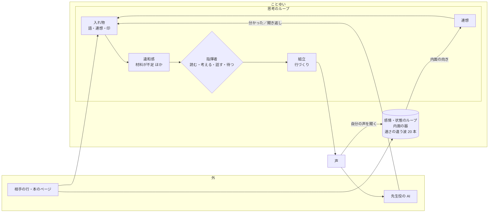
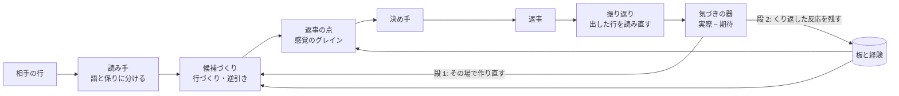
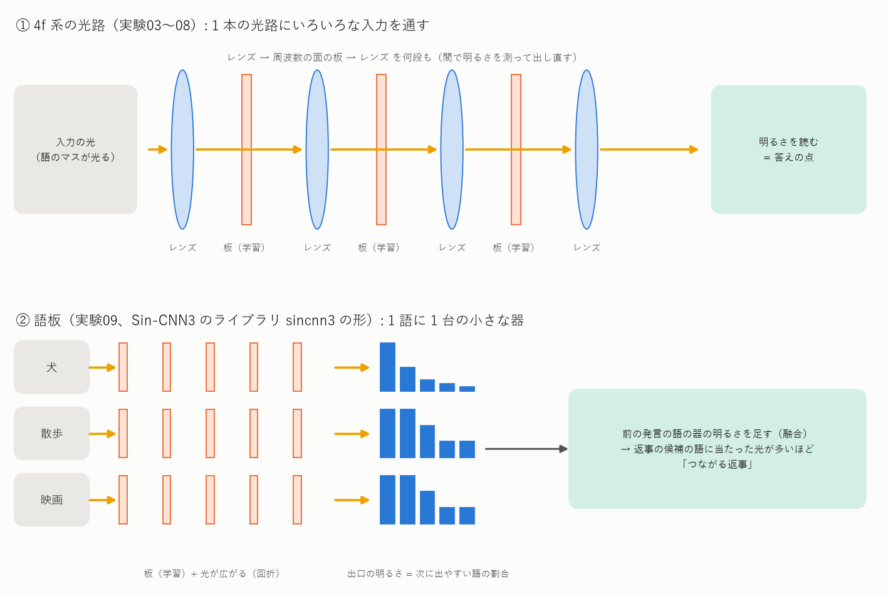

# ことゆい（Project_Kotoyui）: 自分の中で考え続け、自分から話し、少しずつ変わっていく小さな会話 AI

日本語でおしゃべりする小さな AI「言結 となり」を作る研究です。目指しているのは、人の隣でずっといられる AI です。

> ロジックでも大規模パラメータでもなく、自分で違和感や問題に気づき、自分の会話を見直し、少しずつ変わっていく AI

> **開発中です（2026-11-23 時点）。** 人と話せる段階ではありません。
> 記憶と思い出し、自分のことへの答え、述語の形づくりは、決まった試しの中で動いています。
> いまは、入力が無くても時間が流れる「内面の器」と、その上で自分から話す「思考のループ」の骨組みを作り、先生役の AI と一緒に本を読む試しを始めたところです。
> 骨組みはまだ会話の本体につないでいません。話す中身は、聞いた語の並べ直しに近い段階です。

## これは何？（三行で）

- ふつうのチャット AI は「入力 → 処理 → 出力」で止まります。ことゆいは「入力 → 内面の波が変わる → 考え続ける → 連想が生まれる → 話すかどうかを自分で決める」形を目指します。入力が無い間も内面は動き続けます。
- 語・会話の行・相手・自分を **板**（どこがどれだけ明るいか）と **波** で持ち、判断は **グレイン**（数え上げで学ぶ小さな器）が出します。大きな 1 つの学習器も、手で書いた規則の山も使いません。
- 自分の返事を読み直し、**期待との差（違和感）** に気づいたら直します。くり返した反応は経験として残ります。この **自覚と介入の環** を、この AI の知性と考えています。

## いまの目標

最初は「光の部品を並べて、材料の発言から返事を選ぶ」形で始めました（2026-10〜11 月初め）。
その後、自分で気づいて直す仕組み、記憶、自分で文を組む仕組みと進み、入力と出力の道具はひと通りそろってきました。
ただ、道具をつなぐだけでは「何のために話すか」「入力が無い時に何をしているか」が無いと分かりました。
そこで 2026-11-21 から、道具の外側の **器と時間の流れ** を先に作る向きに進めています（持ち主の案・未確定）。

| # | 目標 | 中身 | いま |
|---|---|---|---|
| 1 | 内面を持つ | 入力が無くても時間が進む器を持つ。少しずつ速さの違う波を並べ、速い波は今の話題、遅い波はしばらく前のことを持つ。調整は自分でさせ、手で置くのは止め役（上限・予算・見張り）だけにする | 🔶 骨組み（I49a）と長い文章を読ませる試し（I49b） |
| 2 | 自分から話す | 思考のループが「次の語を読む・考える・話す・待つ」を自分で選ぶ。話題が途切れても、残った波と連想から次の話を出せる | 🔶 骨組み（I49c）。話す所は文の終わりで決まり、中身は聞いた語の並べ直し |
| 3 | 考えと気持ちを分ける | 思考のループ（材料の入れ物・連想・違和感・組立）と、感情・状態のループ（器）を分けて回す | 🔶 骨組み（I49d）。気持ちから考えへの働きかけは「内面の全体の向き」だけ |
| 4 | 先生と一緒に読む | 先生役の AI 2 人とことゆいの 3 人で、静かな物語を 1 ページずつ、先を予想しながら読む。黙っていても、先生どうしのやり取りから学べる | 🔶 一歩目〜三歩目（I49e）。黙って聞くだけで「相手がどの語を拾うか」の見込みが育つ |
| 5 | 聞き返しで通じ合う | 先生が分からない時は聞き返し、ことゆいは「言いたかった向き」に近い語で言い直す | 🔶 流れは動く（I49e）。言い直しの多くは先生の言葉のくり返しで、言いたいことを言えたとはまだ言えない |
| 6 | 数えて関係を学ぶ | 「だれが・何を・どうした」の 3 つ組を本から数え、2 つから残りの 1 つを当てる | 🔶 下調べ。数えた表は当たり、量を増やすと育つ。ただし当たりの多くは 1 語の表からで、2 つを合わせた関係はまだ学べていない |
| 7 | 話す | 自然な日本語で、短くおしゃべりできる。文は材料から選ぶのではなく、語幹と流れ（た・て・いる・ない）から自分で組む | 🔶 述語の形は崩れなくなった。意味を文脈から決める所がこれから |
| 8 | 自分を持つ・相手を覚える | 自分のことを板に持って答える。話したことは分・時・日・週の板に重なり、消えずに薄れる。名前・予定・頼まれごとは別の板に残る | ✅ 決まった試しの中では動く。会話の外の試しはまだ |
| 9 | 自分で決める | 判断は板の明るさと数え上げの経験から出す。手で置くしきい値・掛け目・目印は、確かめが済んだ所から経験に替える | 🔶 一部を替えた。まだ多く残っている |
| 10 | 小さく、光の性質を使う | 小さなグレインを並べて足す形にとどめ、エッジの機器で動く大きさにする。光の器は、仮説を波として重ねて持ち、干渉で 1 つに収束させる所に入れる | 🔶 意味の波（I47・I48）で試し中。光の器そのものはまだ計算機の中の模擬 |

目指さないことも決めています。大規模言語モデルと同じ大きさや何でも答える力、手で書いた規則の山、1 つの大きな学習器にまとめること、の 3 つです。

## 原理と仕組み

### 全体の形（持ち主の案・未確定）



- 感情・状態のループ（器）は、思考のループの 1 歩ごとに 1 刻み進みます。入力が無い間も波は薄れ、静かな間は感度が上がります。
- 思考のループは、入れ物の材料で内面をまだ言い表せていない間（違和感「材料が不足」）は連想で材料を足し、減らなくなったら組み立てて話します。言ったことは自分の声として器に戻ります。
- 名札（興味・不安・好奇心 など）は先に付けません。全部の波を記録しておき、後から「その波で次の振る舞いが読めるか」で選びます。
- 骨組みの説明と数は [docs/i49_inner_vessel.md](docs/i49_inner_vessel.md)。

### 1 往復の道具（入力から返事まで）



器と思考のループより前に作った、1 往復の道具です。今の会話のボット（`intervention/past/chat_bot3.py`）はこの形で動いています。これらの道具を、上の思考のループの「連想」「違和感」「組立」の口に差し込んでいく予定です。部品の名前と環のくわしい説明は [intervention/docs/thinking_parts.md](intervention/docs/thinking_parts.md)。

### 部品

| 部品 | 何をするか | 仕組み | コード |
|---|---|---|---|
| 内面の器 | 時間の流れと自分の状態を持つ | 半減期 1〜1,024 刻みの波 20 本。聞く前に言い当て、外れ（驚き）で感度を自分で調整する。口は `tick`・`hear`・`want`・`settle` の 4 つ | `intervention/i49a_inner_vessel.py` |
| 思考のループ | 自分で読み、考え、話す | 指揮者が違和感を見て、連想・組立・話す・待つを選ぶ。実験の間は観察と調整の口があり、最後に外して固められる（`seal`） | `intervention/i49c_think_loop.py`・`i49d_two_loops.py` |
| 3 人の席と聞き返し | 先生と一緒に読む・通じるまで言い直す | 本 → 先生 A → 先生 B → ことゆい → 先生 A の順に番を回す。聞いた語が次の番に拾われたかを数えて、拾われやすさを育てる | `intervention/past/i49e_three.py`・`i49e_listen.py`・`i49e_askback.py` |
| 語板 | 語の意味を持つ | 1 語（1 つの意味）= 1 枚の板。出口の明るさが属性（色・形・動き…）の割合 | `intervention/past/i01_small_world.py`・`board_ops.py`・`lexicon/` |
| 経験の器（グレイン） | 判断を出す | 場面を記号の組にして数え上げ、「この場面でこうしたら、どうなったか」の割合を答える。すべての判断の土台 | `intervention/past/i18_combo.py` ほか |
| 気づきの器・違和感の種類 | 違和感・発見に気づく | 手のしきい値ではなく、本や自分の経験から作った期待と、実際との差で出す。迷い・自信のなさ・組の珍しさ などに分けて持つ | `intervention/past/chat_bot2.py`・`i38_novelty.py`・`i48bi_odd_kinds.py` |
| 記憶板・大事な板 | 話したことを覚える | 行の板 → 分 → 時 → 日 → 週。上の段は下の段の和で、消さずに薄れる。名前・予定・頼まれごとは相手ごとに別の板に残す | `intervention/past/memory_board.py` |
| 自分の板 | 自分のことに答える | プロフィールの「自分のこと」から、問いの語に近い所を選んで答える | `intervention/past/self_board.py` |
| 融合の板と逆引き | 述語の形を自分で組む | 語幹とここまでの流れを融合した板から次の語を出す。意味の組（過去・進行・否定・丁寧）から形を引く | `intervention/past/i42_fused_flow.py` |
| 意味の波 | 似た場面を重ねて読む | 語を位相の束（波）にし、行・場面の波を重ねる。すくった後も周波数のまま持ち、語に戻すのは最後だけ。否定は別の周波数の帯で持つ | `intervention/i47_*.py`・`i48_wave_board.py` |
| 判断の板・つなぎの板 | 手順の間違いを見つける | 答えが違った時、一手ずつ替えて解き直し、道が分かれた一手を覚える。算術と文の圧縮で確かめた | `intervention/past/i20_judge_board.py`・`i28_route_board.py` |

仕組みの説明は [intervention/docs/mechanisms.md](intervention/docs/mechanisms.md)（算術・文の圧縮）、[intervention/docs/memory_mechanism.md](intervention/docs/memory_mechanism.md)（記憶）、[docs/i48_working_parts.md](docs/i48_working_parts.md)（意味の波で効いた技術と足りない物）、デジタルの重みと手で決めた部分の一覧は [intervention/docs/digital_weights.md](intervention/docs/digital_weights.md)。

### 光の器（SinWave）

光を「模様のついた透明な板」に通すと、広がった光どうしが重なって、明るい所と暗い所ができます。板の模様を学習で決め、決まった場所の明るさを答えとして読むのが光の学習器です（いまは計算機の中の模擬）。板の「明るさで持つ」形は、この光の器と同じにしてあります。



光の器は、デジタルの計算を置き換えるためではなく、**性質を使うため** に入れます。

- **重ね合わせ**: いくつもの仮説（係り先の読み、述語の意味、似た場面）を 1 つに決めずに、波として同時に持てる。
- **干渉**: 後の文脈が入った時に、合う仮説どうしが強め合い、合わない仮説は打ち消し合う。割れたままなら違和感として早く気づける。

内面の器の波も、同じ「波で持つ」形にそろえています。

## いまどこまで動くか

### 内面と思考のループ（I49、2026-11-21〜）

| 試し | 分かったこと | まだ動かないこと・想定外 |
|---|---|---|
| 器の関門（テスト 8 本） | 上限に収まる、入力が止まると静まる、予算で止まる、同じ入力なら同じ記録になる | — |
| 長い文章を読ませる（青空文庫 5 作品、13,100 文） | 文の順を見ている（順をばらばらにすると速い波の外れが上がる）。作品の替わり目は感じる | 章の見出し（場面の切り替え）は、ふつうの文の流れとほとんど区別できていない。長く黙った後は速い波の感度が上限に張り付く |
| 自分で読み、話すループ | 語が届くと自分で読み、途切れると自分から 1 回話して静まる | 「考える」は 1 回も選ばれない。話す所は区切りと関係なく、中身は直前に聞いた語に近い |
| 考えと気持ちを分けたループ | 文の終わりで、その文の語をまとめて言い、言い終えたら休む。連想を入れると、聞いていない語が行に入る | 出る行は聞いた語の並べ直しで、「自分の考え」ではない。連想を入れると行が長くなる |
| 先生と 3 人で読む | 黙って聞くだけで、拾われやすさの言い当て（AUC）が .72 → .78 に育つ。ことゆいの行は、先生に 4〜6 割拾われる | 先生はことゆいの行をほぼ何でも拾うので、「拾われたか」は良し悪しの確かめとして弱い |
| 聞き返し | 言い直しの番の 9 割前後が「分からない → 分かった」に変わる | 言い直しの語の 8〜9 割は先生の言葉。行を別の作品の物に入れ替えると先生は 8〜9 割「分からない」と言うので、先生は中身を見てはいるが、言いたいことが通じたとは言えない |
| 2 つから残りの 1 つ | 本から数えた表は当たり、覚える量を 10 倍にすると 2〜3 倍に育つ（何を .273、どうした .244） | 語の向き（ベクトル）には関係が入っていない。2 語そろった表で答えられたのは 5〜6% だけ |

数と条件のくわしい記録は [docs/i49_inner_vessel.md](docs/i49_inner_vessel.md)。

### 会話の中での成績（自分・記憶・日本語）

測り方: 話し相手と先生の役をローカルの AI にして、20 会話 × 12 往復を seed 2 つで回します。決まった問い 18 行（「私の誕生日、知ってる？」「さっき何の話した？」など）を会話に差し込み、前の版と並べて比べます。

| 部品 | 測ったこと | 始め | いま |
|---|---|---|---|
| 大事な板と思い出し | 「覚えてる？」の問いに正しく答えた数 | 2 / 14（I40d） | 42 / 42、言い違い 0（I46j、seed 2 つの合計） |
| 記憶板 | 「さっき／この前／今日 何の話した？」に、その段の話題で答えた数 | 6 / 8（I45a） | 8 / 8（I46j） |
| 自分の板 | 自分のことを聞かれて答えられなかった割合 | 73% | 31%・37%（I41j） |
| 聞き返しへの言い直し | 「〜って？」に自分の行を言い直した数（1 回 240 往復のうち） | 0 | 24・27（I46a） |
| 融合の板と逆引き | 意味の組から述語の流れを当てる（見ていない 10 作品） | 語幹ごとの表だけ 40% | 表 91%、融合の板 82%、形まで合う 78% |

- まだできないこと: 文脈だけから述語の意味を決める（32%）、相手の行に答えていない返事が多い、知らない名詞を聞かれた時の返し。
- 回ごとの揺れが大きいので、比べる時は同じ seed 2 つで前の版と並べています。

意味の波（I47・I48）の数は [docs/i47_wave_resonance.md](docs/i47_wave_resonance.md)・[docs/i48_wave_board.md](docs/i48_wave_board.md)・[docs/i48_effects.md](docs/i48_effects.md)、最初の段の光の部品の数は [docs/overview.md](docs/overview.md) と [NOTES.md](NOTES.md)。

## ここまでの歩み

| 時期 | 段 | 中身 | 結果 |
|---|---|---|---|
| 2026-10-23〜 | 光の部品の確かめ | 話し方の見分け（2DWIG）、次の言葉（2DTG）、口調のスイッチ | ✅ ふつうの方法（回帰・GRU・3-gram）とほぼ並んだ |
| 11-02〜 | 短い返事を出す | kotoyui.py 0.1.0〜0.4.0。本物の雑談の発言から返事を選ぶ | ✅ 10 択の返事選びで約 61%。**ここで本体は止め、手直しだけにした** |
| 11-04〜 | 介入の研究を始める | 小さな世界で、語板・違和感・分ける・介入の問い・経験の器（I1〜I16） | ✅ 仕組みの土台ができた |
| 11-05〜 | 算術と文の圧縮 | 板だけで足し算・引き算・桁上り、間違った記憶の直し、文を 1 枚に縮めて戻す（I17〜I29） | ✅ 判断の板・つなぎの板・波の仮説を確かめた |
| 11-08〜 | 会話に入れる | 試しの場、返事の点、その場の作り直し（I32〜I38） | ✅ 環が会話の中で回る |
| 11-10〜 | 自分と記憶 | 自分の板、記憶板・大事な板・再記憶（I39〜I45） | ✅ 名前・予定・話題を会話をまたいで思い出す |
| 11-11〜 | 日本語を自分で組む | 融合の板と逆引き（I42）、聞き返しへの言い直し（I46） | 🔶 述語の形は崩れなくなった |
| 11-12〜 | 波で読む | 会話を意味の波にして重ねる、層、否定の帯（I47）。すくった後も周波数のまま持つ板、違和感の種類、教えるループ（I48） | 🔶 効いた技術はあるが、会話その物が通じる所までは届いていない |
| 11-21〜 | 内面と自分から話す | 内面の器、自分で読み話すループ、考えと気持ちのループ、先生と 3 人で読む、聞き返し、3 つ組の数え（I49） | 🔶 骨組みと最初の試し（上の表） |

I48 の終わりに、道具を足し続けるだけでは先が袋小路になりそうだと持ち主が判断し、立ち止まって I49 の向きに替えました。I48 までの道具は捨てずに、思考のループの口に差し込んで使う予定です。

## 今後の予定（持ち主の案・未確定）

順番と項目の正本は、持ち主と共有しているロードマップ（非公開）です。ここはその要約です。

- **内面の器を育てる**: 長く黙った後の張り付きを、器が自分で控える形に直す。場面の切り替えを掴める入力（語順つき、外れの跳ねを 1 本の波に など）を試す。
- **内面から「何について話したいか」を選ぶ**: 内面の波で内部状態が変わる → 遅い波（定在波）で自分らしさが保たれる → 記憶や連想から新しい考えが生まれる、の順に進める。「会話したい・休みたい・知りたい・前の話を続けたい」を内面から選べるかを見る。
- **思考のループに本物の道具をつなぐ**: 連想を属性の向きに、組立を行づくり（I48）に、違和感を種類ごとの波にする。
- **先生と読む・聞き返しを確かめ直す**: 先生の「分かった」が良し悪しの手がかりになる形を探す（同じ作品の別のページの行や、語順だけ崩した行との比べ）。「近くないので繰り返さない」という断り方を足す。
- **関係を数えて学ぶ**: 2 つを合わせた関係を表が覚えられるように、数える量と形を見直す。
- **日本語を自分で組む**: 相手の行に答える返事、意味（過去・進行・丁寧・否定）を文脈から決める。
- **最小版 1.0.0**: 日本語・気づき・記憶と自分の段が済み、人と数日話せた所で切ります。

物差しも決め切れていません。内面には正解が無いので、「壊れていないか」を関門にし、その先は「別の会話の後の内面と入れ替えて話題のつながりを比べる」「初めの位置が違う 2 体を振る舞いから見分けられるか」などを案として持っています（[docs/i49_inner_vessel.md](docs/i49_inner_vessel.md) の 3 節）。

## 既存の AI との違い

| | よくある形 | ことゆい |
|---|---|---|
| 流れ | 入力が来たら処理して出力する。入力が無い間は何もしない | 入力が無くても内面の波が流れ、話すかどうかを自分で決める（骨組みの段階） |
| 読み方 | 次の語を予測しながら、結果として文法らしきものを出す | 文の構造や場面を波として持ち、いちばん矛盾のない読みへ共鳴・収束させる（試しの段階） |
| 大きさ | 数十億〜のパラメータを 1 つの学習器に持つ | 役ごとの小さな板とグレインを並べて足す。1 つずつ確かめて取り替えられる |
| 学び方 | 大量の文で誤差逆伝播。学んだあとは基本変わらない | 数え上げと板の足し算。会話のたび、先生と読むたびに経験が増える |
| 間違いの直し方 | 外から学習し直すか、指示文で補う | 自分の返事を読み直し、期待との差で気づいて作り直す |
| 中身の見え方 | 重みから理由を読むのは難しい | 板の明るさ、経験の数、内面の波を全部記録して見られる |

いまの時点で大規模言語モデルに並ぶ会話ができるわけではありません。知識の広さ・文の自然さは遠く及ばず、短い返事を返せる段階です。比べたいのは大きさではなく、「少ない材料で、自分で気づいて変わる」「自分の中で考え続ける」という作りの方です。

## 試し方

```bash
pip install -r requirements.txt
python -m pytest tests            # テスト（データは要らない）
```

内面の器と思考のループの骨組みは、自作の入力で単独に動きます（データは要らない、CPU だけ）。

```bash
python intervention/i49a_inner_vessel.py --demo /tmp/i49a.npz   # 内面の器の試運転
python intervention/i49c_think_loop.py   --demo /tmp/i49c.npz   # 自分で読み、話すループ
python intervention/past/i49d_two_loops.py    --demo /tmp/i49d.npz   # 考えと気持ちを分けたループ
```

本を読ませる試し（`tools/i49b_*`・`i49c_read_words.py`・`i49e_*`）は、手元で取った青空文庫の本文と、手元で作った語の波が要ります。先生と読む試しには、先生役の AI（ローカル、または外のサービス）が要ります。

最初の段の本体（材料の発言から返事を選ぶ kotoyui.py 0.4.0）と、介入の研究のプログラムも、そのまま試せます。

```bash
python examples/quickstart.py     # 言葉の解析・光の語板・キャラクタを試す（データは要らない）
bash tools/fetch_dialogue.sh      # 会話のデータを取る（リポジトリの外に置く）
python kotoyui.py --chat --light  # 話す（初回は表と語板を作る、CPU で約 10 分）
CUDA_VISIBLE_DEVICES= python intervention/past/i01_small_world.py --seed 0   # 小さな世界で、分ける・違和感・介入の問い
```

環境と手順は [docs/quickstart.md](docs/quickstart.md)、実験の一覧は [intervention/README.md](intervention/README.md)。

## 資料とフォルダ

| 場所 | 中身 |
|---|---|
| [docs/i49_inner_vessel.md](docs/i49_inner_vessel.md) | **いまの中心**。内面の器、自分から話すループ、考えと気持ちのループ、先生と 3 人で読む、聞き返し、3 つ組の数え（I49） |
| [intervention/](intervention/README.md) | 介入の研究のプログラム（iNN_名前.py）、会話のボット（chat_bot3.py）、記憶板・自分の板、試しの場 |
| [intervention/docs/](intervention/docs/) | 仕組みの説明（思考の部品、算術と文の圧縮、記憶、デジタルの重みの一覧）と図 |
| docs/i47_*・docs/i48_* | 意味の波（I47）と、周波数のまま持つ板（I48）の説明・効いた技術・違和感の種類 |
| lexicon/・[docs/boards/](docs/boards/) | 辞書の属性から語板を作るプログラムと、その設計 |
| kotoyui.py | 最初の段の会話の本体（単独で動く 1 ファイル版、0.4.0。手直しだけ） |
| [docs/overview.md](docs/overview.md) | 最初の段の紹介（2026-11-03 時点） |
| [docs/experiments_guide.md](docs/experiments_guide.md)・[NOTES.md](NOTES.md) | 最初の段の実験のやさしい説明と、実験ノート（数字の正本） |
| [docs/quickstart.md](docs/quickstart.md)・[docs/data_format.md](docs/data_format.md) | 環境の用意と試し方、データの置き場と形 |
| assets/ | 持ち主が書いた表の見本（キャラクタ「言結 となり」のプロフィールと「自分のこと」、時計グレイン） |
| experiments/・results/ | 最初の段の実験のプログラムと結果 |
| [intervention/analysis/](intervention/analysis/README.md) | 会話の試しの記録を数える道具（記録は公開していない） |
| tools/・tests/・examples/ | データの取得・集計・図、部品ごとの確認、試し方のコード例 |
| vendor/ | SN2-Parts-2D から写した光の部品（書き換えない。[vendor/README.md](vendor/README.md)） |

関係するプロジェクト: [Sin-CNN2](https://github.com/devaf09/Sin-CNN2)（1 次元の光の学習器 SinWave。すべての元）、SN2-Parts-2D（2 次元の光の部品集）、[Sin-CNN3](https://github.com/devaf09/Sin-CNN3)（会話の部品と語板のライブラリの元）。

## 使ったら教えてください（お願い）

このプロジェクトのコードや考え方を、研究・製品・記事・授業などで使った時は、ひとこと知らせてもらえるとうれしいです。どこで役に立ったかが分かると、次に何を作るかを決める助けになります。

- 知らせ方: [Issue の「使用報告」](https://github.com/devaf09/Project_Kotoyui/issues/new?template=usage_report.md) に、何に使ったかを 1〜2 行で。公開したくない場合は、中身を書かずに「使いました」だけでも構いません。
- 論文や記事で触れる時は、[CITATION.cff](CITATION.cff) の書き方（GitHub の「Cite this repository」）を使ってください。
- これはお願いで、義務ではありません。ライセンスは MIT のままで、知らせなくても条件どおりに使えます。

## ライセンスとデータの出典

- コード・文書・assets/ の表: MIT ライセンス（[LICENSE](LICENSE)、Copyright (c) 2026 devaf09）。vendor/ のコードも同じ著作権者の MIT です。
- 学習した重み・数えた表は公開しません（会話のデータから作るため）。tools/ の取得ツールで、使う人がデータを取り、手元で作ります。
- データはリポジトリに入れていません。会話のデータ・それから作った表・例は、リポジトリの外の非公開の置き場 `../Project_Kotoyui_private/data/` に置きます（2026-11-03 から。置き場は環境変数 `KOTOYUI_DATA` で変えられます。取得は `bash tools/fetch_dialogue.sh`・`python tools/past/fetch_aozora.py`）。使っているデータ:

| データ | 取得元 | ライセンス・条件 | 使い方 |
|---|---|---|---|
| 青空文庫の小説（分類 913・新字新仮名、作品・作者とも著作権フラグなし。最初の 1,000 作品と、2026-10-24 に足した残りの作品） | [青空文庫](https://www.aozora.gr.jp/)（公式の作品一覧 list_person_all_extended_utf8.zip から。最初の 1,000 作品は SN2-Parts-2D が取得したものを持ち主の許可を得て写した。残りは tools/past/fetch_aozora.py） | 著作権の切れた作品。青空文庫の「収録ファイルの取り扱い規準」により自由に利用できる | 会話文（「」の中）を取り出して、話者の見分けと次の単位の予測に使う |
| RealPersonaChat 1.0.0（名古屋大学・京都大学） | [nu-dialogue/real-persona-chat](https://github.com/nu-dialogue/real-persona-chat)（tools/fetch_dialogue.sh） | [CC BY-SA 4.0](https://creativecommons.org/licenses/by-sa/4.0/)。話者を特定しようとしない・特定の話者へのなりすましに使わない | 現代の 1 対 1 の雑談。話者の番号つき |
| JMultiWOZ 1.0（名古屋大学ほか） | [nu-dialogue/jmultiwoz](https://github.com/nu-dialogue/jmultiwoz)（2026-11-02 取得） | [CC BY-SA 4.0](https://creativecommons.org/licenses/by-sa/4.0/) | 旅行の案内の対話。返事の選び方の数え上げ（共鳴・状態遷移・格の好み）に使う |
| MRMP 1.0.0（Multi-Relational Multi-Party Chat、名古屋大学） | [nu-dialogue/multi-relational-multi-party-chat-corpus](https://github.com/nu-dialogue/multi-relational-multi-party-chat-corpus) | [CC BY-SA 4.0](https://creativecommons.org/licenses/by-sa/4.0/)。話者を特定しようとしない・なりすましに使わない | 3 人の雑談。意味の波（I47）で、返事の流れを学ぶ・測る |
| 名大会話コーパス（国立国語研究所） | [mmsrv.ninjal.ac.jp/nucc](https://mmsrv.ninjal.ac.jp/nucc/)（tools/fetch_dialogue.sh） | [CC BY-NC-ND 4.0](https://creativecommons.org/licenses/by-nc-nd/4.0/)。非営利、加工したデータは配らない。文献: 藤村逸子・大曾美恵子・大島ディヴィッド義和（2011）「会話コーパスの構築によるコミュニケーション研究」藤村逸子・滝沢直宏編『言語研究の技法：データの収集と分析』ひつじ書房 | 現代の雑談の書き起こし。話者の番号つき |

どのデータも、取り直したものが同じか確かめられるように、取得元・取得日・ファイルの指紋を 非公開の置き場の MANIFEST.json（python tools/past/make_manifest.py）に記録しています。学習した重みは、当面公開しません（名大会話コーパスの改変禁止の条件のため。公開するときは名大会話コーパスを学習から外した版を作る）。

data_wild/（出どころ・ライセンスがはっきりしないデータの置き場）も非公開の置き場 `../Project_Kotoyui_private/data_wild/` にあり、このリポジトリの結果・例・図には使いません。

介入の研究では、このほかに持ち主が集めた Web 小説の台詞を「ふつうはこう」の期待を作る材料に使っています。この材料と、そこから作った板・記録・数は公開していません（ファイル名に `_wn` が付くもの。リポジトリには入れていません）。
