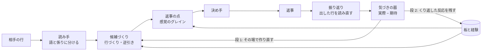
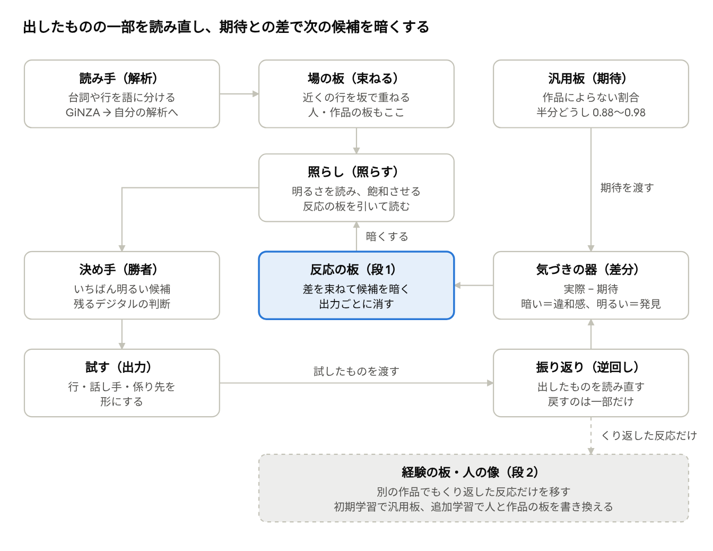
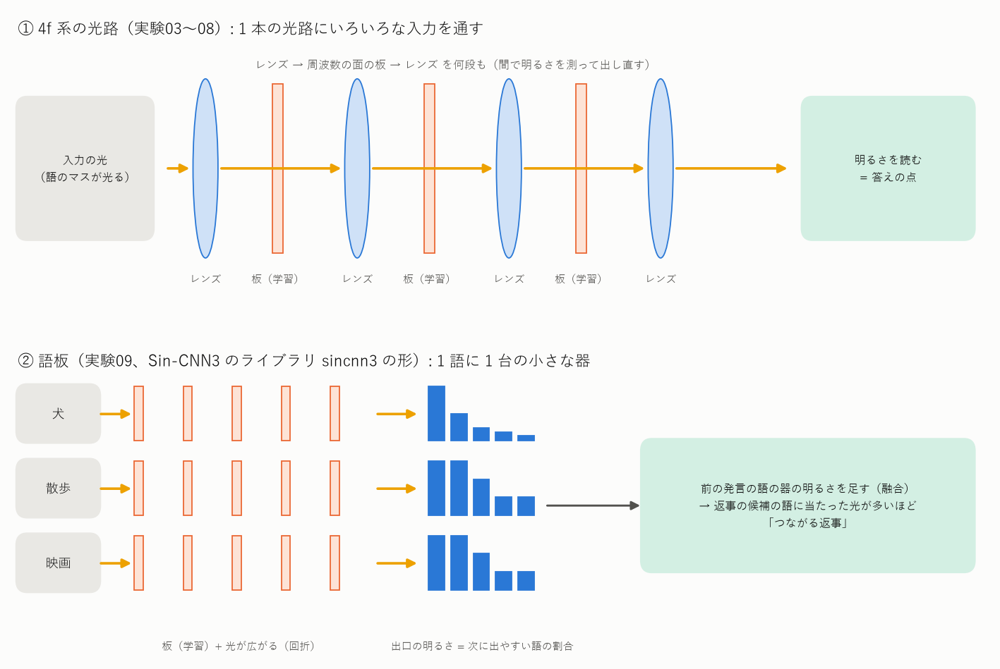

# ことゆい（Project_Kotoyui）: 自分で気づき、見直し、少しずつ変わっていく小さな会話 AI

日本語でおしゃべりする小さな AI「言結 となり」を作る研究です。目指しているのは、人の隣でずっといられる AI です。

> ロジックでも大規模パラメータでもなく、自分で違和感や問題に気づき、自分の会話を見直し、少しずつ変わっていく AI

> **開発中です（2026-11-12 時点）。** 記憶と思い出し、自分のことへの答え、述語の形づくりが動いています。いまは「日本語を自分で組む」段と、「会話を波として重ねて読む」試しを進めています。人との会話の試しはまだ先です。

## これは何？（三行で）

- 語・会話の行・相手・自分を **板**（どこがどれだけ明るいか）で持ち、判断は **グレイン**（数え上げで学ぶ小さな器）が出します。大きな 1 つの学習器も、手で書いた規則の山も使いません。
- 自分の返事を読み直し、**期待との差（違和感）** に気づいたら、その場で作り直します。くり返した反応は経験として残り、次の会話から変わります。この **自覚と介入の環** を、この AI の知性と考えています。
- 光の学習器（SinWave）の **重ね合わせと干渉** の性質を使います。いくつもの読みを波として重ねて持ち、後の文脈でいちばん強く共鳴したものに収束させます。

最初は「光の部品を並べて、材料の発言から返事を選ぶ」形で始めました（2026-10〜11 月初め）。そこで分かったことを土台に、2026-11-04 から上の形に向きを変えています（経緯は下の「ここまでの歩みと成果」）。

## 目指す姿

| # | 姿 | 中身 |
|---|---|---|
| 1 | 話す | 自然な日本語で、短くおしゃべりできる。文は材料から選ぶのではなく、語幹と流れ（た・て・いる・ない）から自分で組む |
| 2 | 自分を持つ | 自分のこと（名前・好み・今いる所・したいこと）を板に持ち、聞かれたら答える。会話で言ったことと矛盾しない |
| 3 | 相手を覚える | 話したことは行の板から分・時・日・週へ重なり、消えずに薄れる。名前・予定・頼まれごとは別の板に残り、聞かれるほど強まる |
| 4 | 気づいて直す | 自分の返事を読み直し、期待との差に気づいたら作り直す。くり返した反応は経験として残る |
| 5 | 自分で決める | 判断は板の明るさと数え上げの経験から出す。手で置くしきい値・掛け目・目印は減らし、残すのは機器の予算（振り返りの回数、書き換えてよい量）だけにする |
| 6 | 小さく、光の性質を使う | 小さなグレインを並べて足す形にとどめ、エッジの機器で動く大きさにする。光の器は、仮説を波として重ねて持ち、干渉で 1 つに収束させる所に入れる |

目指さないことも決めています。大規模言語モデルと同じ大きさや何でも答える力、手で書いた規則の山、1 つの大きな学習器にまとめること、の 3 つです。

## 原理と仕組み

### 1 往復の流れ



上の列が 1 往復の流れ、戻る矢印が見直しの道です。気づきの器が出した差は、その場の作り直し（段 1）と、板と経験への書き込み（段 2）に分かれて戻ります。部品の名前と環のくわしい説明は [intervention/docs/thinking_parts.md](intervention/docs/thinking_parts.md)。

### 部品

| 部品 | 何をするか | 仕組み | コード |
|---|---|---|---|
| 語板 | 語の意味を持つ | 1 語（1 つの意味）= 1 枚の板。出口の明るさが属性（色・形・動き…）の割合。親（上位語）の板は子の板の明るさの和 | `intervention/i01_small_world.py`・`board_ops.py` |
| 経験の器（グレイン） | 判断を出す | 場面を記号の組にして数え上げ、「この場面でこうしたら、どうなったか」の割合を答える。すべての判断の土台 | `intervention/i18_combo.py` ほか |
| 気づきの器 | 違和感・発見に気づく | 手のしきい値ではなく、本や自分の経験から作った期待と、実際との差で出す | `intervention/chat_bot2.py`・`i38_novelty.py` |
| 記憶板 | 話したことを覚える | 行の板 → 分（話題）→ 時（1 会話）→ 日 → 週。上の段は下の段の和で、消さずに薄れる。思い出しに使った所は再記憶で強まる | `intervention/memory_board.py` |
| 大事な板 | 名前・予定・頼まれごとを残す | 相手ごとに別の板に持ち、「覚えてる？」に答える。何が大事かは、後で聞かれたかどうかの経験から学ぶ | `intervention/memory_board.py` |
| 自分の板 | 自分のことに答える | プロフィールの「自分のこと」から、問いの語に近い所を選び、言い切り・これから・問い返しの形にする | `intervention/self_board.py` |
| 融合の板と逆引き | 述語の形を自分で組む | 「歩い + て → 一時の板 → + いる」のように、語幹とここまでの流れを融合した板から次の語を出す。意味の組（過去・進行・否定・丁寧）から形を引く | `intervention/i42_fused_flow.py` |
| 意味の波 | 似た場面を重ねて読む | 語を位相の束（波）にし、行の波・場面の波を重ねる。今の行と強く共鳴した場面の次の行をすくい上げる。否定は意味とは別の周波数の帯で持つ | `intervention/i47_*.py` |
| 判断の板・つなぎの板 | 手順の間違いを見つける | 答えが違った時、一手ずつ替えて解き直し、道が分かれた一手を覚える。算術と文の圧縮で確かめた | `intervention/i20_judge_board.py`・`i28_route_board.py` |

仕組みの説明は [intervention/docs/mechanisms.md](intervention/docs/mechanisms.md)（算術・文の圧縮）、[intervention/docs/memory_mechanism.md](intervention/docs/memory_mechanism.md)（記憶の最初の形）、デジタルの重みと手で決めた部分の一覧は [intervention/docs/digital_weights.md](intervention/docs/digital_weights.md)。



### 光の器（SinWave）

光を「模様のついた透明な板」に通すと、広がった光どうしが重なって、明るい所と暗い所ができます。板の模様を学習で決め、決まった場所の明るさを答えとして読むのが光の学習器です（いまは計算機の中の模擬）。板の「明るさで持つ」形は、この光の器と同じにしてあります。



光の器は、デジタルの計算を置き換えるためではなく、**性質を使うため** に入れます。使いたい性質は 2 つです。

- **重ね合わせ**: いくつもの仮説（係り先の読み、述語の意味、似た場面）を 1 つに決めずに、波として同時に持てる。
- **干渉**: 後の文脈が入った時に、合う仮説どうしが強め合い、合わない仮説は打ち消し合う。波幅がいちばん大きい仮説に収束し、割れたままなら違和感として早く気づける。

## 既存の AI との違い

| | よくある形 | ことゆい |
|---|---|---|
| 読み方 | Transformer は、次の語を予測しながら、結果として文法らしきものを出す | 文の構造や場面を波として持ち、いちばん矛盾のない読みへ共鳴・収束させる（Resonance & Algebraic Parsing。試しの段階） |
| 大きさ | 数十億〜のパラメータを 1 つの学習器に持つ | 役ごとの小さな板とグレインを並べて足す。1 つずつ確かめて取り替えられる |
| 学び方 | 大量の文で誤差逆伝播。学んだあとは基本変わらない | 数え上げと板の足し算。会話のたびに経験が増え、少ない例から変わる |
| 間違いの直し方 | 外から学習し直すか、指示文で補う | 自分の返事を読み直し、期待との差で気づいて作り直す。くり返した反応だけを板に残す |
| 記憶 | 文脈の窓に入る分だけ。長い記憶は外の検索に頼る | 段になった記憶板に重ね、消さずに薄れる。使われた記憶は強まる |
| 中身の見え方 | 重みから理由を読むのは難しい | 板の明るさと経験の数をそのまま見られる。なぜその返事かをたどれる |
| 手で決める部分 | ルール型のボットは規則を手で書く | しきい値・掛け目・目印は、確かめが済んだ所から経験に替える |
| 計算 | GPU の行列計算 | 光の干渉と回折で計算できる形（板 + 重ね合わせ）。エッジの機器で動く大きさ |

いまの時点で大規模言語モデルに並ぶ会話ができるわけではありません。知識の広さ・文の自然さは遠く及ばず、短い返事を返せる段階です。比べたいのは大きさではなく、「少ない材料で、自分で気づいて変わる」という作りの方です。

## ここまでの歩みと成果

### 歩み

| 時期 | 段 | 中身 | 成果 |
|---|---|---|---|
| 2026-10-23〜 | 光の部品の確かめ | 話し方の見分け（2DWIG）、次の言葉（2DTG）、口調のスイッチ | ✅ ふつうの方法（回帰・GRU・3-gram）とほぼ並んだ（下の表） |
| 11-02〜 | 短い返事を出す | kotoyui.py 0.1.0〜0.4.0。本物の雑談の発言から返事を選ぶ | ✅ 10 択の返事選びで約 61%。選び方の一部を光の器に置き換えた。**ここで本体は止め、手直しだけにした** |
| 11-04〜 | 介入の研究を始める | 小さな世界で、語板・違和感・分ける・介入の問い・経験の器（I1〜I16） | ✅ 仕組みの土台ができた |
| 11-05〜 | 算術と文の圧縮 | 板だけで足し算・引き算・桁上り、間違った記憶の直し（I17〜I23、I28〜I29）。文を 1 枚に縮めて戻す、曖昧な係り先の見直し（I24〜I27） | ✅ 判断の板・つなぎの板・波の仮説を確かめた |
| 11-08〜 | 会話に入れる | 試しの場（話し相手と先生のローカル AI と 20 会話 × 12 往復）、返事の点、その場の作り直し（I32〜I38） | ✅ 環が会話の中で回る |
| 11-10〜 | 自分と記憶 | 自分の板（I39・I43）、記憶板・大事な板・再記憶（I40〜I45） | ✅ 名前・予定・誕生日・話題を会話をまたいで思い出す（思い出し 42 / 42、言い違い 0）。手で置いた数の一部を経験に替えた |
| 11-11〜 | 日本語を自分で組む | 融合の板と逆引き（I42）、聞き返しへの言い直し（I46） | 🔶 進行中。述語の形は崩れなくなった。意味を文脈から決める所がこれから |
| 11-12〜 | 波で読む | 会話を意味の波にして重ねる、層、否定の帯（I47） | 🔶 試し中（下の表） |

### 光の部品の成績（最初の段）

| 部品 | 何をするか | 光の部品 | ふつうの方法 |
|---|---|---|---|
| 2DWIG | 発言が丁寧かを見分ける | 96.5% | 回帰 96.7% |
| 2DTG | 次の言葉（サブワード 4,096 通り）を当てる | 27.2% | GRU 28.3%・3-gram 30.9% |
| 口調のスイッチ | 丁寧・くだけたを切り替えて文を作る | 92.5% | 3-gram 91% |
| 共鳴の語板 | 前の発言に続く返事を 10 択で選ぶ | 57.9% | 数え上げ 59.0% |

くわしくは [docs/overview.md](docs/overview.md)（2026-11-03 時点の紹介）と [NOTES.md](NOTES.md)。

### 意味の波の成績（I47、公開されている会話コーパスで測った分）

測り方: 学びに使っていない対話で、前の行から次の行の中身の語を当てます。「当たり」は上位 10 語に次の行の語が 1 つでも入った割合、「中身」はどこにでも出る多い語を除いた再現率です。

RealPersonaChat（学び 36 万場面、試し 200 対話）:

| 方法 | 当たり | 中身 |
|---|---|---|
| ふだんの多さ（よく出る語を答えるだけ） | 0.364 | 0 |
| 隣の行での語の移り（数えるだけ） | 0.466 | 0.053 |
| 語そのまま（学ばない波） | 0.481 | 0.096 |
| **流れで学んだ波** | **0.500** | **0.100** |

同じ RealPersonaChat で、前の流れを 4 つの層（今の行・3 行・10 行・30 行）にして重ねた時（試し 500 対話、13,441 組）:

| 形 | 当たり | 中身 | 板に残る語 |
|---|---|---|---|
| 今の 1 行だけ | 0.502 | 0.101 | 88 |
| 4 層を重ねる（そろえない） | 0.525 | 0.084 | 258 |
| **4 層を、すくうたびにそろえる** | **0.530** | 0.101 | **18** |

MRMP（3 人の雑談）で、試しの 60 対話を固定し、学ぶ対話の数だけを増やした成長曲線:

| 学ぶ対話の数 | 25 | 50 | 100 | 200 | 400 |
|---|---|---|---|---|---|
| 今の 1 行だけ（当たり） | 0.175 | 0.172 | 0.186 | 0.207 | 0.208 |
| 4 層を重ねる（当たり） | 0.225 | 0.243 | 0.260 | 0.290 | 0.309 |
| 4 層を、すくうたびにそろえる（当たり） | 0.198 | 0.225 | 0.241 | 0.270 | 0.293 |
| 同（中身） | 0.027 | 0.036 | 0.048 | 0.059 | 0.063 |

RealPersonaChat で、試しの 500 対話（13,441 組）を固定した成長曲線:

| 学ぶ対話の数 | 1,000 | 2,000 | 4,000 | 8,000 |
|---|---|---|---|---|
| 今の 1 行だけ（当たり） | 0.453 | 0.468 | 0.480 | 0.491 |
| 4 層を、すくうたびにそろえる（当たり） | 0.475 | 0.495 | 0.507 | 0.521 |
| 本当の次の行を選ぶ力（流れで学んだ波） | 0.485 | 0.489 | 0.495 | 0.505 |
| 同（学ばない波） | 0.353 | 0.367 | 0.394 | 0.408 |

8,000 対話でもまだ伸びているが、倍にするごとの伸びは小さくなる。流れの学びは 1,000 対話でもう効いている。

分かったこと:

- 続いた会話では、前の流れ（今の行・3 行・10 行・30 行）を層にして重ねると、資料を増やすほど伸び続ける。今の 1 行だけでは 200 対話で頭打ちになる。
- すくうたびに強い所をそろえると、ぼやけた所が消えて板が小さくなる（百数十〜数百語 → 20 語前後）。そろえずに重ねるだけだと当たりは上がるが中身が落ちる。そろえると、中身を保ったまま当たりが上がる（RealPersonaChat で 0.502 → 0.530）。資料が少ない時ほど、中身の差は大きい（MRMP の表）。
- 否定は、流れから学ぶ波では板の上の決まった動きにならない（「分かる」と「分からない」は同じ話題で出る）。意味とは別の帯に鍵を掛けて持つと、64 行を重ねても読み分けられる（RealPersonaChat で 0.90、MRMP で 0.94。符号を返すだけの逆位相は 0.47〜0.75）。否定の行で似た場面を探すと、同じ述語が否定で居る場面が集まる（0.43 → 帯の重さ 0.5 で 0.61、1 で 0.77）。会話では肯定の問いに否定で答えることが多いので、探す時の帯は軽く（0.5）するのが良い（重さ 2 では当たりが 0.507 → 0.470 に下がる）。
- 効かなかったもの: 語の波をその場の語との共鳴で書き換える「動かす段」は、どの資料でもほとんど効かなかった。

- 資料の役目は分かれる。Web 小説の台詞（1,809 作品、試し 200 作品）では、層を重ねると当たりは 0.283 → 0.324 に上がるが、中身は今の 1 行だけ（0.040）と並ぶ程度で、流れで学んだ波も学ばない波を上回らなかった。小説の台詞は地の文で切れるためと見ている。会話コーパスで学ぶ語の波に小説 300 作品を足すと、語の数は 1.5 倍になるが、本当の次の行を選ぶ力は 0.509 → 0.396 に下がり、学ばない波（0.409）より下になった。流れから学ぶ語の波は会話コーパスだけで学び、小説は話し方・キャラ付けの判定や語の辞書に、流れとは別に使う。

試しの組が数千より少ない時、0.005 くらいの差は揺れの中です。仕組みと数のくわしい説明は [docs/i47_wave_resonance.md](docs/i47_wave_resonance.md)。

### 会話の中での成績（自分・記憶・日本語）

測り方: 話し相手と先生の役をローカル AI（Gemma）にして、20 会話 × 12 往復を seed 2 つで回します。決まった問い 18 行（「私の誕生日、知ってる？」「さっき何の話した？」など）を会話に差し込み、前の版と並べて比べます。期待を作る材料は Web 小説の台詞です（材料と会話の記録そのものは非公開）。

| 部品 | 測ったこと | 始め | いま |
|---|---|---|---|
| 大事な板と思い出し | 「覚えてる？」の問いに正しく答えた数 | 2 / 14（I40d） | 42 / 42、言い違い 0（I46j、seed 2 つの合計） |
| 記憶板 | 「さっき／この前／今日 何の話した？」に、その段の話題で答えた数 | 6 / 8（I45a） | 8 / 8（I46j） |
| 自分の板 | 自分のことを聞かれて答えられなかった割合 | 73% | 31%・37%（I41j） |
| 聞き返しへの言い直し | 「〜って？」に自分の行を言い直した数（1 回 240 往復のうち） | 0 | 24・27（I46a） |
| 同 | 言い直しのあと、また聞き返された数 | 11（I46a） | 3（I46b） |
| 融合の板と逆引き | 意味の組（過去・進行・否定・丁寧…）から述語の流れを当てる（見ていない 10 作品、19,666 個） | 語幹ごとの表だけ 40%（意味を渡さない） | 表 91%、融合の板 82%、形まで合う 78% |
| 同 | ボットの返事での述語の形の崩れ | あり | 0 |

- 手で置いた数のうち、経験から決める形に替えられたもの: 大事な板に入れる線（0.9）、自分の板の掛け目 4 つ、記憶の薄れの強さ（0.5。残す鍵の分け方は見直し中）。残っているのは、指摘の見込みの線、大事な板の入口の目印、思い出しの問いの種類分けなどです（算術と文の圧縮の分の一覧は [intervention/docs/digital_weights.md](intervention/docs/digital_weights.md)）。
- 見ていない意味の組の形は、表では作れず、融合の板だけが作れる（いまは 1 割）。
- まだできないこと: 文脈だけから述語の意味を決める（32%）、知らない名詞を聞かれた時の返し、理由の説明が話とつながらない時がある。回ごとの揺れが大きいので、比べる時は同じ seed 2 つで前の版と並べています。

## 今後の予定

段ごとに「抜ける目安」を決めて進めます。最小版 1.0.0 は、A・C・D が済み、人と数日話せた所で切ります。

| 段 | やること | 抜ける目安 | 状況 |
|---|---|---|---|
| A. 日本語を自分で組む | 聞き返しへの言い直し、逆引きを行づくりの述語全体に、意味（過去・進行・丁寧・否定）を文脈から決める、相手の言葉を受ける形、知らない名詞を聞かれた時の返し | 行づくりの述語がすべて逆引きを通り、意味は文脈から決まる | 🔶 聞き返しの言い直しが入った |
| B. 波で読む（A と並べて） | 係り先や述語の意味の仮説を波として重ねて持ち、後の文脈で収束させる。収束の強さを違和感の検出につなぐ。全部の候補を一度に照らす | 仮説を 1 つに決めずに持ち、後の文脈で収束する読みが、会話の中で動く | 🔶 意味の波の試し（I47） |
| C. 気づきを広げる | 感覚のグレイン 9 つ（新規性・介入の質・情報の豊かさ・貢献感・共鳴・審美性・好奇心・自己開示・アハ体験）と、感覚ごとの重みを経験から学ぶ | 短い安全な返事（「はい」「分からん」）が点で負け、気づきの回し先を自分で選ぶ | 新規性だけ済み |
| D. 記憶と自分を仕上げる | 薄れの強さと問いの種類分けを経験で決める、実時間で段を区切る、会話で自分について言ったことの持ち越し、相手の像を持つ | 言い違い 0 のまま記憶まわりの手の数が外れ、自分について言ったことと食い違わない | 🔶 土台は動いている |
| E. 長距離の介入 | 会話と記憶の行を圧縮した板にし、光を当てて該当する所・似ている所を探し、そこへ介入を回す | 1 つの会話での気づきが、別の日の板の間違いを直す | まだ |
| F. まとめて、人の隣へ | 成績表を 1 枚にまとめ、残った手の数を経験に替える。人との会話の試し（数日） | 日をまたいで名前・予定・話題を覚えていて、指摘が日ごとに減る | まだ |

1.0.0 のあとに回したもの: 読み手（いまは GiNZA）を自前にする、1 つの本体にまとめてエッジの機器で動かす、人となりが立ち上がる仕組み、相手の一人称や話し方に合わせた言葉遣い。

## 試し方

最初の段の本体（材料の発言から返事を選ぶ kotoyui.py 0.4.0）は、そのまま試せます。

```bash
pip install -r requirements.txt
python -m pytest tests            # テスト（データは要らない）
python examples/quickstart.py     # 言葉の解析・光の語板・キャラクタを試す（データは要らない）
bash tools/fetch_dialogue.sh      # 会話のデータを取る（RealPersonaChat・JMultiWOZ ほか、リポジトリの外に置く）
python kotoyui.py --chat --light  # 話す（初回は表と語板を作る、CPU で約 10 分）
```

介入の研究のプログラムは `intervention/` にあり、1 本ずつ単独で動きます（CPU だけで動くものが多い）。

```bash
CUDA_VISIBLE_DEVICES= python intervention/i01_small_world.py --seed 0   # 小さな世界で、分ける・違和感・介入の問い
python intervention/chat_partner.py --model echo                        # 試しの場の動作確認（話し相手なし）
```

会話の試し（chat_partner.py と chat_bot3.py）を回すには、手元で作った板と、話し相手になるローカル AI（Ollama）が要ります。環境と手順は [docs/quickstart.md](docs/quickstart.md)、実験の一覧は [intervention/README.md](intervention/README.md)。

## 資料とフォルダ

| 場所 | 中身 |
|---|---|
| [intervention/](intervention/README.md) | **いまの研究の中心**。介入の研究のプログラム（iNN_名前.py）、会話のボット（chat_bot3.py）、記憶板・自分の板、試しの場 |
| [intervention/docs/](intervention/docs/) | 仕組みの説明（思考の部品、算術と文の圧縮、記憶、デジタルの重みの一覧）と図 |
| [docs/boards/](docs/boards/) | 辞書の属性から作る語板の設計 |
| [docs/i47_wave_resonance.md](docs/i47_wave_resonance.md) | 意味の波（I47）の説明シート。仕組み（波・4 層とそろえ方・否定の帯・動かす段）、資料ごとの数、成長曲線、分かったことと次の案 |
| kotoyui.py | 最初の段の会話の本体（単独で動く 1 ファイル版、0.4.0。手直しだけ） |
| [docs/overview.md](docs/overview.md) | 最初の段の紹介（2026-11-03 時点。光の部品・似た技術との違い） |
| [docs/experiments_guide.md](docs/experiments_guide.md)・[NOTES.md](NOTES.md) | 最初の段の実験のやさしい説明と、実験ノート（数字の正本） |
| [docs/quickstart.md](docs/quickstart.md)・[docs/data_format.md](docs/data_format.md) | 環境の用意と試し方、データの置き場と形 |
| assets/ | 持ち主が書いた表の見本（キャラクタ「言結 となり」のプロフィールと「自分のこと」、時計グレイン） |
| experiments/・results/ | 最初の段の実験のプログラムと結果 |
| tools/・tests/・examples/ | データの取得・集計・図、部品ごとの確認、試し方のコード例 |
| vendor/ | SN2-Parts-2D から写した光の部品（書き換えない。[vendor/README.md](vendor/README.md)） |

関係するプロジェクト: [Sin-CNN2](https://github.com/devaf09/Sin-CNN2)（1 次元の光の学習器 SinWave。すべての元）、SN2-Parts-2D（2 次元の光の部品集）、[Sin-CNN3](https://github.com/devaf09/Sin-CNN3)（会話の部品と語板のライブラリの元）。

## 使ったら教えてください（お願い）

このプロジェクトのコードや考え方を、研究・製品・記事・授業などで使った時は、ひとこと知らせてもらえるとうれしいです。どこで役に立ったかが分かると、次に何を作るかを決める助けになります。

- 知らせ方: [Issue の「使用報告」](https://github.com/devaf09/Project_Kotoyui/issues/new?template=usage_report.md) に、何に使ったかを 1〜2 行で。公開したくない場合は、中身を書かずに「使いました」だけでも構いません。
- 論文や記事で触れる時は、[CITATION.cff](CITATION.cff) の書き方（GitHub の「Cite this repository」）を使ってください。
- これはお願いで、義務ではありません。ライセンスは MIT のままで、知らせなくても条件どおりに使えます。

## ライセンスとデータの出典

- コード・文書・assets/ の表: MIT ライセンス（[LICENSE](LICENSE)、Copyright (c) 2026 devaf09）。vendor/ のコードも同じ著作権者の MIT です。
- 学習した重み・数えた表は公開しません（会話のデータから作るため）。tools/ の取得ツールで、使う人がデータを取り、手元で作ります。
- データはリポジトリに入れていません。会話のデータ・それから作った表・例は、リポジトリの外の非公開の置き場 `../Project_Kotoyui_private/data/` に置きます（2026-11-03 から。置き場は環境変数 `KOTOYUI_DATA` で変えられます。取得は `bash tools/fetch_dialogue.sh`・`python tools/fetch_aozora.py`）。使っているデータ:

| データ | 取得元 | ライセンス・条件 | 使い方 |
|---|---|---|---|
| 青空文庫の小説（分類 913・新字新仮名、作品・作者とも著作権フラグなし。最初の 1,000 作品と、2026-10-24 に足した残りの作品） | [青空文庫](https://www.aozora.gr.jp/)（公式の作品一覧 list_person_all_extended_utf8.zip から。最初の 1,000 作品は SN2-Parts-2D が取得したものを持ち主の許可を得て写した。残りは tools/fetch_aozora.py） | 著作権の切れた作品。青空文庫の「収録ファイルの取り扱い規準」により自由に利用できる | 会話文（「」の中）を取り出して、話者の見分けと次の単位の予測に使う |
| RealPersonaChat 1.0.0（名古屋大学・京都大学） | [nu-dialogue/real-persona-chat](https://github.com/nu-dialogue/real-persona-chat)（tools/fetch_dialogue.sh） | [CC BY-SA 4.0](https://creativecommons.org/licenses/by-sa/4.0/)。話者を特定しようとしない・特定の話者へのなりすましに使わない | 現代の 1 対 1 の雑談。話者の番号つき |
| JMultiWOZ 1.0（名古屋大学ほか） | [nu-dialogue/jmultiwoz](https://github.com/nu-dialogue/jmultiwoz)（2026-11-02 取得） | [CC BY-SA 4.0](https://creativecommons.org/licenses/by-sa/4.0/) | 旅行の案内の対話。返事の選び方の数え上げ（共鳴・状態遷移・格の好み）に使う |
| MRMP 1.0.0（Multi-Relational Multi-Party Chat、名古屋大学） | [nu-dialogue/multi-relational-multi-party-chat-corpus](https://github.com/nu-dialogue/multi-relational-multi-party-chat-corpus) | [CC BY-SA 4.0](https://creativecommons.org/licenses/by-sa/4.0/)。話者を特定しようとしない・なりすましに使わない | 3 人の雑談。意味の波（I47）で、返事の流れを学ぶ・測る |
| 名大会話コーパス（国立国語研究所） | [mmsrv.ninjal.ac.jp/nucc](https://mmsrv.ninjal.ac.jp/nucc/)（tools/fetch_dialogue.sh） | [CC BY-NC-ND 4.0](https://creativecommons.org/licenses/by-nc-nd/4.0/)。非営利、加工したデータは配らない。文献: 藤村逸子・大曾美恵子・大島ディヴィッド義和（2011）「会話コーパスの構築によるコミュニケーション研究」藤村逸子・滝沢直宏編『言語研究の技法：データの収集と分析』ひつじ書房 | 現代の雑談の書き起こし。話者の番号つき |

どのデータも、取り直したものが同じか確かめられるように、取得元・取得日・ファイルの指紋を 非公開の置き場の MANIFEST.json（python tools/make_manifest.py）に記録しています。学習した重みは、当面公開しません（名大会話コーパスの改変禁止の条件のため。公開するときは名大会話コーパスを学習から外した版を作る）。

data_wild/（出どころ・ライセンスがはっきりしないデータの置き場）も非公開の置き場 `../Project_Kotoyui_private/data_wild/` にあり、このリポジトリの結果・例・図には使いません。

介入の研究では、このほかに持ち主が集めた Web 小説の台詞を「ふつうはこう」の期待を作る材料に使っています。この材料と、そこから作った板・記録・数は公開していません（ファイル名に `_wn` が付くもの。リポジトリには入れていません）。
