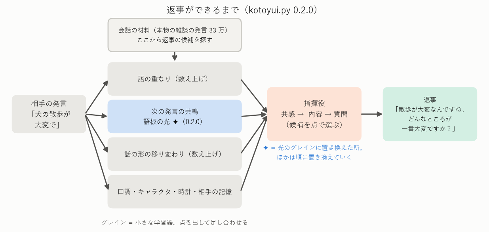
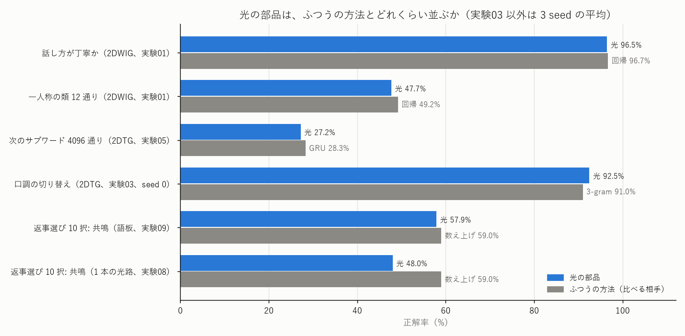

# Project_Kotoyui — 光の部品で日本語の会話をする

正弦の干渉と回折だけで学ぶ光の学習器（SinWave）の小さな部品を並べて、日本語のおしゃべり（チャット）ができる仕組みを作ります。

> **開発中です（版 0.4.0）。** 短い返事が出ます（本物の雑談の発言の中から、相手の発言に合うものを選ぶ形）。返事の選び方を、光の部品に少しずつ置き換えているところです。

**初めての方へ**: 目標・現状・使っている技術・似た技術との違いを、図と表で説明したページがあります → **[docs/overview.md](docs/overview.md)**

## これは何？（三行で）

- 光を「模様のついた透明な板」に通し、広がった光の明るさで答えを出す**光の学習器**があります。その**小さな部品（グレイン）を並べて、日本語でおしゃべりする仕組み**を作っています。
- 1 つの大きな学習器（ChatGPT のような大規模言語モデル）ではなく、「話し方を見分ける」「前の発言に続く返事を選ぶ」などの小さな部品を足し合わせる、**会話できる最小の形**を目指しています。
- 計算はいまは計算機の中の模擬（シミュレーション）ですが、どの部品も**光の装置で動かせる形**にこだわっています。



## いまできること

| 相手 | ことゆい |
|---|---|
| 犬を飼っているんですが、散歩が大変で | 散歩が大変なんですね。散歩のどんなところが一番大変ですか？ 何かお手伝いできることがあれば言ってくださいね。 |
| 最近寝不足でつらいよ | 寝不足でつらいんですね。どんなところが一番大変ですか？ 何かお手伝いできることがあれば言ってくださいね。 |

- 返事は**一から作らず、本物の雑談の発言（33 万）から選びます**（上の例は、困りごとに秘書の型で答えたもの。ふだんは「〜んですね」のあとに、材料の発言が続きます。材料の文はライセンスの都合でここには載せていません）。10 個の候補から正しい返事を選ぶテストで約 61%（でたらめなら 10%）。
- 返事の選び方のうち「次の発言のつながり（共鳴）」は、**光の器で数え上げとほぼ同じ成績**（57.9% 対 59.0%）になり、`--light` で切り替えられます。

## 光の部品の成績（ここまで）



| 部品 | 何をするか | 光の部品 | ふつうの方法 |
|---|---|---|---|
| 2DWIG | 発言が丁寧かを見分ける | 96.5% | 回帰 96.7% |
| 2DTG | 次の言葉（サブワード 4,096 通り）を当てる | 27.2% | GRU 28.3%・3-gram 30.9% |
| 口調のスイッチ | 丁寧・くだけたを切り替えて文を作る | 92.5% | 3-gram 91% |
| 共鳴の語板 | 前の発言に続く返事を 10 択で選ぶ | 57.9% | 数え上げ 59.0% |

できないこと: 新しい文を一から作る、長い話の流れを追う、知らない話題を推し量って答える（くわしくは [docs/overview.md](docs/overview.md) の 2.3）。

## 試し方（5 分）

```bash
pip install -r requirements.txt
python -m pytest tests            # テスト（データは要らない）
python examples/quickstart.py     # 言葉の解析・光の語板・キャラクタを試す（データは要らない）
bash tools/fetch_dialogue.sh      # 会話のデータを取る（RealPersonaChat・JMultiWOZ ほか、リポジトリの外に置く）
python kotoyui.py --chat --light  # 話す（初回は表と語板を作る、CPU で約 10 分）
```

```python
import kotoyui
bot = kotoyui.Bot(light=True)
reply, confidence = bot.reply(["犬を飼っているんですが、散歩が大変で"])
```

環境・手順・うまく動かないときは **[docs/quickstart.md](docs/quickstart.md)**、データの置き場と形は **[docs/data_format.md](docs/data_format.md)**。
自分で集めた会話は `python tools/import_dialogues.py 会話.txt` で足せます。ブラウザで話して 👍・👎 を付けるなら `python tools/console.py`、ローカル AI（Ollama）と並べるなら `--ai=モデル名`。キャラクタ（プロフィール・人格グレイン）と時計の表は、見本が assets/ にあり、自分の物に替えられます。

## くわしい説明

| 資料 | 中身 |
|---|---|
| [docs/overview.md](docs/overview.md) | 目標・現状・使っている技術・似た既存技術・既存にない技術（初めての方向け） |
| [docs/quickstart.md](docs/quickstart.md) | 環境の用意と試し方 |
| [docs/data_format.md](docs/data_format.md) | データの置き場と形（会話・キャラクタ・時計・作る表・結果） |
| [docs/grammar_20261104.md](docs/grammar_20261104.md) | 文法・構文をどう処理しているか（2026-11-04 時点、流れの図つき） |
| [docs/experiments_guide.md](docs/experiments_guide.md) | 実験ごとのやさしい説明 |
| [NOTES.md](NOTES.md) | 実験ノート（数字の正本） |
| [docs/kickoff.md](docs/kickoff.md) | 立ち上げのときの設計 |

## フォルダの構成

| 場所 | 中身 |
|---|---|
| kotoyui.py | 会話の本体（単独で動く 1 ファイル版） |
| assets/ | 持ち主が書いた表の見本（キャラクタ「言結 となり」・時計グレイン） |
| examples/ | 試し方のコード例 |
| vendor/ | SN2-Parts-2D から写した光の部品（書き換えない。[vendor/README.md](vendor/README.md)） |
| NOTES.md | 実験ノート（数字の正本） |
| docs/ | 説明資料・案の一覧・図（docs/images/）・会話の例（docs/samples/、青空文庫で作った分だけ） |
| experiments/ | 実験のプログラム（expNN_名前.py）、見積もり（est_*.py）、条件の一覧（sweeps/） |
| results/ | 結果（1 回 = 1 行の JSON） |
| tools/ | データの取得（fetch_*）・自分の会話の読み込み（import_dialogues.py）・会話コンソール（console.py）・ローカル AI との接続（ollama_client.py）・集計・図 |
| tests/ | 部品ごとの確認 |

## ライセンスとデータの出典

- コード・文書・assets/ の表: MIT ライセンス（[LICENSE](LICENSE)、Copyright (c) 2026 devaf09）。vendor/ のコードも同じ著作権者の MIT です。
- 学習した重み・数えた表は公開しません（会話のデータから作るため）。tools/ の取得ツールで、使う人がデータを取り、手元で作ります。
- データはリポジトリに入れていません。会話のデータ・それから作った表・例は、リポジトリの外の非公開の置き場 `../Project_Kotoyui_private/data/` に置きます（2026-11-03 から。置き場は環境変数 `KOTOYUI_DATA` で変えられます。取得は `bash tools/fetch_dialogue.sh`・`python tools/fetch_aozora.py`）。使っているデータ:

| データ | 取得元 | ライセンス・条件 | 使い方 |
|---|---|---|---|
| 青空文庫の小説（分類 913・新字新仮名、作品・作者とも著作権フラグなし。最初の 1,000 作品と、2026-10-24 に足した残りの作品） | [青空文庫](https://www.aozora.gr.jp/)（公式の作品一覧 list_person_all_extended_utf8.zip から。最初の 1,000 作品は SN2-Parts-2D が取得したものを持ち主の許可を得て写した。残りは tools/fetch_aozora.py） | 著作権の切れた作品。青空文庫の「収録ファイルの取り扱い規準」により自由に利用できる | 会話文（「」の中）を取り出して、話者の見分けと次の単位の予測に使う |
| RealPersonaChat 1.0.0（名古屋大学・京都大学） | [nu-dialogue/real-persona-chat](https://github.com/nu-dialogue/real-persona-chat)（tools/fetch_dialogue.sh） | [CC BY-SA 4.0](https://creativecommons.org/licenses/by-sa/4.0/)。話者を特定しようとしない・特定の話者へのなりすましに使わない | 現代の 1 対 1 の雑談。話者の番号つき |
| JMultiWOZ 1.0（名古屋大学ほか） | [nu-dialogue/jmultiwoz](https://github.com/nu-dialogue/jmultiwoz)（2026-11-02 取得） | [CC BY-SA 4.0](https://creativecommons.org/licenses/by-sa/4.0/) | 旅行の案内の対話。返事の選び方の数え上げ（共鳴・状態遷移・格の好み）に使う |
| 名大会話コーパス（国立国語研究所） | [mmsrv.ninjal.ac.jp/nucc](https://mmsrv.ninjal.ac.jp/nucc/)（tools/fetch_dialogue.sh） | [CC BY-NC-ND 4.0](https://creativecommons.org/licenses/by-nc-nd/4.0/)。非営利、加工したデータは配らない。文献: 藤村逸子・大曾美恵子・大島ディヴィッド義和（2011）「会話コーパスの構築によるコミュニケーション研究」藤村逸子・滝沢直宏編『言語研究の技法：データの収集と分析』ひつじ書房 | 現代の雑談の書き起こし。話者の番号つき |

どのデータも、取り直したものが同じか確かめられるように、取得元・取得日・ファイルの指紋を 非公開の置き場の MANIFEST.json（python tools/make_manifest.py）に記録しています。学習した重みは、当面公開しません（名大会話コーパスの改変禁止の条件のため。公開するときは名大会話コーパスを学習から外した版を作る）。

data_wild/（出どころ・ライセンスがはっきりしないデータの置き場）も非公開の置き場 `../Project_Kotoyui_private/data_wild/` にあり、このリポジトリの結果・例・図には使いません。
