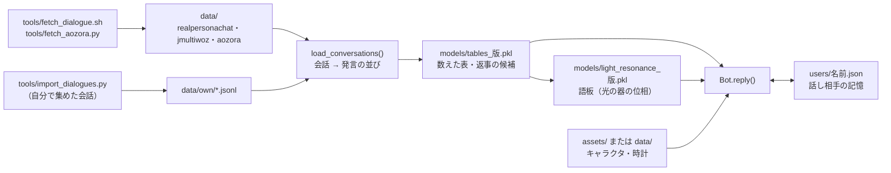

# データの構造 — どこに・どんな形で置くか

ことゆいが読み書きするファイルの置き場所と形の一覧です。会話のデータそのもの・学習した物はリポジトリに入れず、**非公開の置き場**に置きます。
使う人が自分で用意するときは、この形に合わせてください。

## 1. 置き場の全体

```text
（作業のフォルダ）
├── Project_Kotoyui/                  ← このリポジトリ（公開）
│   ├── kotoyui.py                    本体
│   ├── assets/                       持ち主が書いた表の見本（公開してよいもの）
│   │   ├── characters/               キャラクタのプロフィールと人格グレイン
│   │   └── clock_grain.json          時計グレインの表
│   ├── tools/                        データの取得・読み込み・会話コンソールのツール
│   ├── experiments/ results/ docs/   実験・結果（数字だけ）・文書
│   └── examples/                     試し方のコード例
└── Project_Kotoyui_private/          ← 非公開の置き場（git の外。KOTOYUI_PRIVATE で変えられる）
    ├── data/                         会話のデータ（KOTOYUI_DATA で変えられる）
    │   ├── realpersonachat/          RealPersonaChat（tools/fetch_dialogue.sh）
    │   ├── jmultiwoz/                JMultiWOZ（tools/fetch_dialogue.sh）
    │   ├── nucc/                     名大会話コーパス（研究の比べ用、tools/fetch_dialogue.sh）
    │   ├── aozora/                   青空文庫（tools/fetch_aozora.py）
    │   ├── own/                      使う人が自分で集めた会話（tools/import_dialogues.py）
    │   ├── cache/                    実験のキャッシュ（SentencePiece のモデルなど）
    │   ├── characters/ clock_grain.json   （あれば assets/ より優先。自分のキャラクタを置く）
    │   └── MANIFEST.json             取得元・取得日・ライセンス・指紋（tools/make_manifest.py）
    ├── models/                       数えた表・語板（kotoyui.py が初回に作る）
    ├── users/                        話し相手ごとの記憶（個人の情報）
    ├── ratings/ratings.jsonl         会話コンソールの評点（1 行 = 返事 1 つ。履歴・返事・評点・自信・設定）
    └── docs/                         公開しない文書
```

| 環境変数 | 既定 | 何を変えるか |
|---|---|---|
| `KOTOYUI_PRIVATE` | `../Project_Kotoyui_private` | 非公開の置き場全体 |
| `KOTOYUI_DATA` | `$KOTOYUI_PRIVATE/data` | 会話のデータの置き場 |



## 2. 会話のデータ（読み込む形）

### 2.1 元のデータの形

| データ | ファイル | 形 | ことゆいが使う所 |
|---|---|---|---|
| RealPersonaChat | `realpersonachat/real_persona_chat/dialogues/*.json`（1 会話 = 1 ファイル） | `{"dialogue_id", "interlocutors", "utterances": [{"utterance_id", "interlocutor_id", "text", "timestamp"}], "evaluations"}` | `dialogue_id`・`utterances[].text` |
| JMultiWOZ | `jmultiwoz/dataset/JMultiWOZ_1.0/dialogues.json`（全部で 1 ファイル） | `{会話の番号: {"dialogue_id", "dialogue_name", "system_name", "user_name", "goal", "goal_description", "turns": [{"turn_id", "speaker", "utterance"}]}}` | `turns[].utterance` |
| 自分で集めた会話 | `own/*.jsonl`（1 行 = 1 会話） | `{"id": "会話の番号", "turns": ["発言", "発言", …]}` | 全部 |
| 青空文庫 | `aozora/raw/*.zip`・`aozora/picked*.json` | 作品のテキスト（Shift_JIS）と、取った作品の一覧 | 実験（M1）の会話文だけ |
| 名大会話コーパス | `nucc/nucc/*.txt` | 書き起こし（話者の印つき） | 実験（M1）の比べだけ。本体は使わない |

### 2.2 自分で集めた会話を足す

```bash
python tools/import_dialogues.py my_chats.txt --check        # 中身を確かめる（書き出さない）
python tools/import_dialogues.py my_chats.txt --name mine    # → data/own/mine.jsonl
python kotoyui.py --rebuild                                  # 表を作り直す
```

| 入力の形 | 書き方 |
|---|---|
| `.txt` | 1 行 = 1 発言、空行で会話を区切る。行の頭の「名前: 」は外す |
| `.csv` | 列 `conversation_id`・`text`。同じ番号の行を上から順に 1 つの会話にする |
| `.jsonl` / `.json` | `{"turns": [...]}` か `{"utterances": [{"text": ...}]}` の会話（のリスト・辞書） |

`.txt` の例:

```text
A: こんにちは
B: こんにちは、元気？
A: 元気だよ。最近ラーメンにはまってて
B: いいね、どこのお店？

今日は雨だね
傘持ってきた？
```

自分で集めた会話は、**使ってよい物だけ**にしてください（他人とのチャットは、相手の許可とサービスの規約を確かめてから）。

### 2.3 読み込んだ後の形（`kotoyui.load_conversations()`）

```python
{"train": [("rpc", ["発言1", "発言2", ...]), ("jmw", [...]), ("own", [...]), ...],
 "test":  [...]}
```

- 4 発言以上の会話だけ。会話ごとに、番号の crc32 で教え 9 : 試し 1 に分ける（いつも同じ分け方）。
- 返事の候補になるのは `rpc` と `own` の発言（4〜60 文字）。`jmw`（旅行の案内）は数え上げだけに使う。

## 3. 持ち主が書く表（assets/、公開してよい見本）

### 3.1 キャラクタ（`characters/<id>.json` と `<id>.persona.json`）

| ファイル | 中身 | 主な項目 |
|---|---|---|
| `<id>.json`（プロフィール） | 事実と自己紹介の文。名前を聞かれたときなどの答えに使う | `id`・`役割`・`苗字`・`名前`・`読み`・`一人称`・`口調`・`性格`・`興味のある内容`・`好きな会話`・`嫌いな会話`・`自己紹介`（文のリスト）・`家族`・`子供`・`年齢` など |
| `<id>.persona.json`（人格グレイン） | 返事の選び方の重み | `重み`（共感の強さ・質問の多さ・話題を続ける強さ・自信のしきい値 など）・`興味の語`・`口調`（丁寧・くだけた の割合）・`変化の記録` |

- プロフィールの項目は自由に足せます。ことゆいが使うのは上の項目です（`子供` が「なし」なら、子供の話の候補を外す、など）。
- 自分のキャラクタは `Project_Kotoyui_private/data/characters/` に置くか、`kotoyui.Bot(char="パス")` / `--char=パス` で渡します。

### 3.2 時計グレイン（`clock_grain.json`）

| 項目 | 形 | 意味 |
|---|---|---|
| `刻み_分` | 数 | 時刻を何分刻みで見るか |
| `時間帯` | `[{"名前", "から", "まで", "あいさつ", "語": [...]}]` | 時間帯ごとのあいさつと、その時間帯に合う語 |
| `季節` | `{"春": [3, 4, 5], ...}` | 季節と月 |
| `季節の語` | `{"語": [月, ...]}` | その語が合う月（ほかの月は季節外れとして点を下げる） |
| `時間帯の語の強さ`・`季節外れの強さ` | 数 | 点の上げ下げの強さ |

## 4. ことゆいが作る物（非公開の置き場、公開しない）

| ファイル | 中身 | 作り方 |
|---|---|---|
| `models/tables_<版>.pkl` | 数えた表（語の組の回数・PMI・返事の候補・索引・状態遷移・格の好み・過去の形） | `kotoyui.Bot()` の初回（約 2 分）、`--rebuild` で作り直す |
| `models/light_resonance_<版>.pkl` | 語板（1 語 = 1 台の光の器の位相 1.6 万台 × 64 画素 × 16 枚）・出口の語の対応表・語ごとの和 | `--light` の初回（CPU で約 7 分） |
| `users/<名前>.json` | 話し相手の記憶: `名前`・`好きなこと`・`予定`・`困りごと`・`口調`・`話題`（語の回数）・`会った回数`・`最後に話した日`・`人物`（人物グレイン、0.4.0: 話に出た人の呼び方 → 続柄・身内・好きなこと・回数） | `--chat --user=名前` で話すと更新 |

数えた表・語板は会話のデータから作るので、データのライセンス（CC BY-SA 4.0 など）を受け継ぎます。公開しないでください。

## 5. 実験の結果（results/、公開）

1 回の実験 = 1 行の JSON（JSON Lines）。数字だけで、会話の文は入れません。

| 項目 | 意味 |
|---|---|
| `exp` | 実験の番号（"08" など） |
| 実験の引数（`seed`・`steps`・`read` など） | そのまま記録 |
| `runs` | 方法ごとの結果のリスト（例: `{"hard": false, "how": "L", "name": "光の共鳴", "top1": 0.487, "by_source": {...}}`） |
| `params_light`・`params_digital` | 学習する数（光の部分・デジタルの部分） |
| `train_s`・`total_s`・`version`・`torch` | かかった秒数・ことゆいの版・PyTorch の版 |

図は `tools/fig_*.py` が results/ から作ります（`docs/images/`）。
