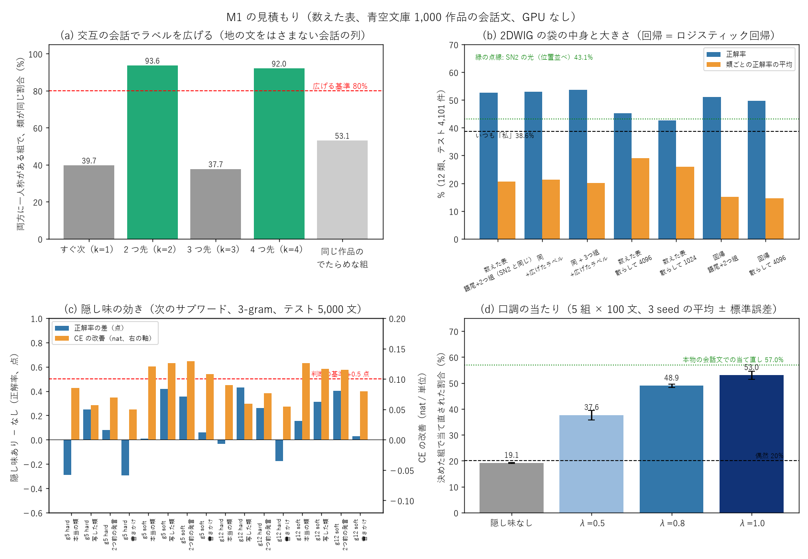
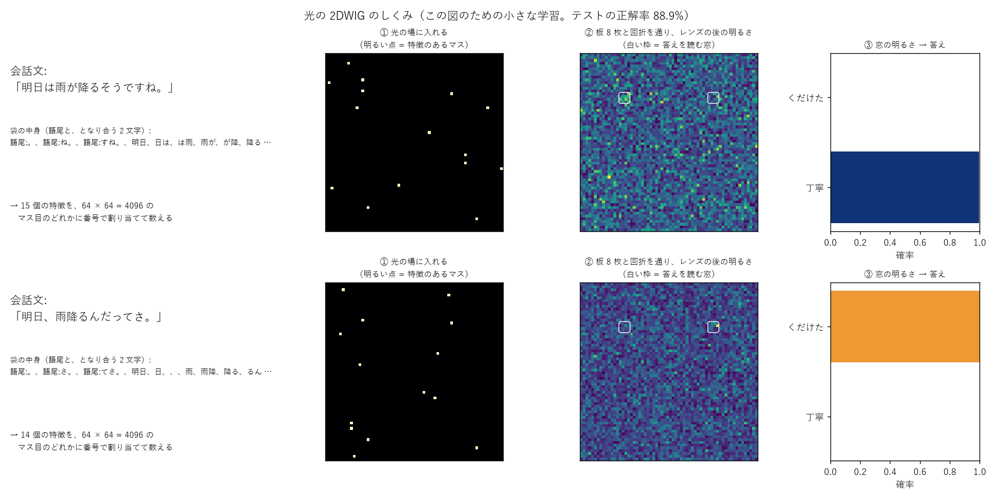
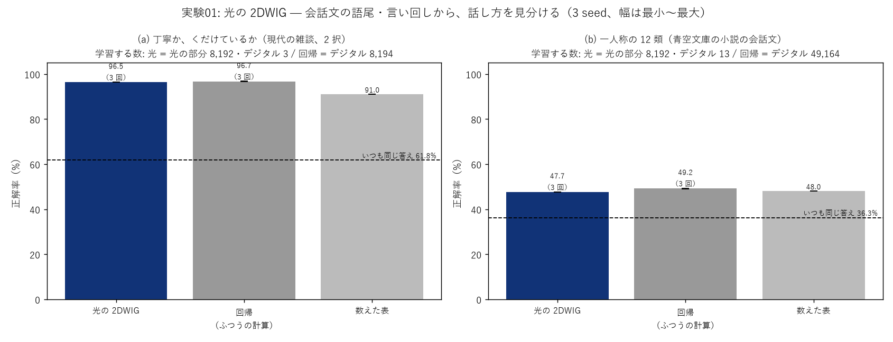
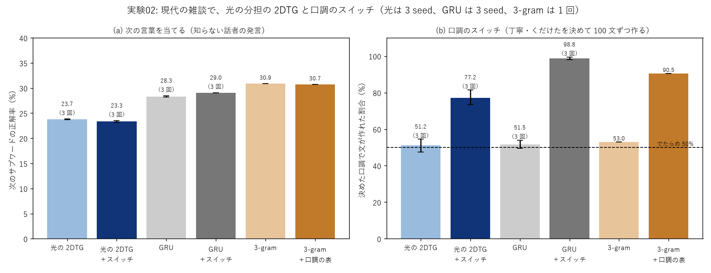
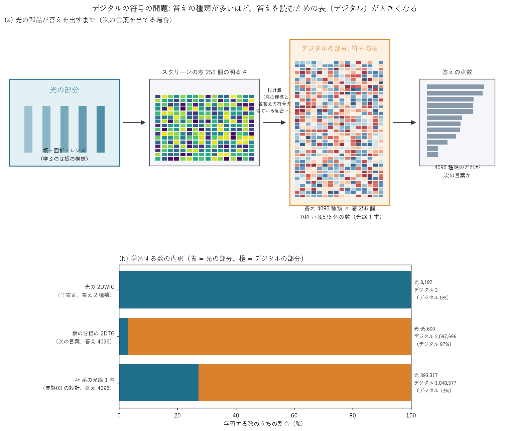

# Project_Kotoyui の実験の説明（初めて読む人向け、2026-10-26）

数字の正本は [NOTES.md](../NOTES.md)。ここでは、専門の知識がなくても追えるように、何をして、何が分かったかを順に説明します。

## 0. 三行で

- **光の学習器（SinWave）の小さな部品で、日本語のおしゃべりができる仕組み**を作っています。いまは最初の段階（M1）です。
- **「話し方を見分ける部品」は、ふつうの計算（回帰）と同じくらいの成績**が出ました（丁寧かどうかを 96.5% で当てる）。
- 一方、**「次の言葉を当てる部品」は、ふつうの計算（GRU）や数えた表（3-gram）より 5〜7 点低く**、ここが一番の課題です。「丁寧に話す・くだけて話す」の切り替えは光でも効きますが、GRU ほどではありません。

## 1. この資料を読むための言葉

| 言葉 | 意味 |
|---|---|
| 光の学習器（SinWave） | 光を、模様のついた透明な板（ガラスのようなもの）に何枚も通して、広がった光の明るさで答えを出す仕組み。板の模様を学習で決める。このプロジェクトでは、それをコンピュータの中で計算して確かめている |
| グレイン | 小さな学習器 1 つ（光の通り道 1 本）。ことゆいは、大きな学習器 1 つではなく、小さなグレインを並べて組み合わせる |
| 2DWIG（Who am I） | 「誰が話しているか」「どんな話し方か」を見分けるグレイン |
| 2DTG（Token） | 直前の言葉から「次の言葉」を当てるグレイン。担当を分けた小さな 2DTG を 16 個並べたものを「分担の 2DTG」と呼ぶ |
| サブワード | 文を切った小さな単位（「ありがとう」「ござい」「ます」など）。文を作るときは、この単位を 1 つずつ選んでつなぐ |
| 正解率 | テストの問題のうち、一番自信のある答えが当たった割合 |
| CE | 正しい答えにどれだけ自信を持てたか（小さいほど良い） |
| 比較相手 | 新しい方法の良し悪しを測るために並べる、ふつうの方法。ここでは「回帰」「GRU」（どちらもふつうのコンピュータの学習器）と「数えた表」（言葉の並びを数えて確率にした表。3-gram など） |
| いつも同じ答え | 一番多い答えを毎回言うだけの、何も考えない方法。これより良くないと意味がない |
| seed | 学習の出発点の乱数。何通りか変えて（3 seed）、偶然でないかを確かめる |
| 光の部分・デジタルの部分 | 光の学習器が学ぶ数のうち、板の模様（光でできる所）と、最後に答えを読むための数（ふつうの計算が要る所） |

## 2. 全体の流れ

| 段階 | 実験 | 問い | 一言でいうと |
|---|---|---|---|
| 準備 | 見積もり E1〜E6 | 光で回す前に、数えた表で「効きそうか」を測る | 話し方を見分ける・話し分けるのは見込みあり。話し方を混ぜて次の言葉を当てるのは見込みなし |
| M1 | 実験01 | 光で話し方を見分けられるか | 丁寧さは、ふつうの計算と同じくらい当たる |
| M1 | 実験02 | 光で次の言葉を当て、話し方を切り替えられるか | 次の言葉はまだ弱い。切り替えは効く |

## 3. 実験の一覧

判定: ◎ 大きな成果 / ○ 効いた / △ 一部・確認 / × 効かなかった

| 番号 | 名前 | 判定 | 一言の結果 |
|---|---|---|---|
| E1 | 話している人のラベルを広げる | ○ | 会話が交互に続くとき、2 つ先の発言は 93% で同じ話し方の人 |
| E2・E5 | 話し方を見分ける袋の中身 | ○ | 語尾と 2 文字の組の袋で 56〜57%（いつも同じ答え 36%） |
| E3・E5 | 話し方で「次の言葉」の当たりが上がるか（隠し味） | × | +0.4 点だけ。データを 4.5 倍にしても伸びない |
| E4 | 話し方を決めて文を作る（数えた表） | ○ | 決めた話し方の文になる割合 19% → 55% |
| E6 | 現代の雑談で同じことを | △ | 丁寧さは見分けも切り替えも効く。性別・年代は発言 1 つでは分からない |
| 01 | 光の 2DWIG | ○ | 丁寧さ 96.5%（回帰 96.7%）。12 類は 47.7%（回帰 49.2%） |
| 02 | 光の分担の 2DTG ＋ 口調のスイッチ | △ | 次の言葉 23.7%（GRU 28.3%・3-gram 30.9%）。切り替え 51% → 77% |

## 4. 各実験のくわしい説明

#### 見積もり E1〜E6「光で回す前の下調べ」

- **目的**: 光の計算は時間がかかる（1 本 5〜30 分）。先に、言葉を数えるだけの表で「この案は効きそうか」を手早く確かめる。
- **方法**: 青空文庫（著作権の切れた小説 4,477 作品）の会話文 82 万件と、現代の雑談（RealPersonaChat・名大会話コーパス、54 万発言）を使い、数えた表で測った。
- **結果**:

| 問い | 結果 |
|---|---|
| 一人称（私・僕・俺 …）のない会話文にも、話し手のラベルを付けられるか | 交互の会話なら 2 つ先の発言は 92〜94% で同じ類 → 付けられる |
| 話し方を混ぜると、次の言葉が当たりやすくなるか（隠し味） | 小説で +0.4 点、現代の雑談で −0.2〜+0.3 点 → ほとんど効かない |
| 話し方を決めて文を作ると、その話し方の文になるか | 小説（5 種類）で 19% → 55%、現代の丁寧さ（2 種類）で 52% → 93% → 効く |
| 現代の雑談で、発言 1 つから性別・年代が分かるか | いつも同じ答えより悪い → 分からない |

- **得られたもの**: 話し方の情報は「次の言葉を当てる」より「話し分ける」に使うべき、と分かった。持ち主の判断で、隠し味（話し方で次の言葉の確率を混ぜる）は使わないことにした。
- **問題点**: 数えた表どうしで測っているので、少し甘めの数字の可能性がある。現代の雑談は、知らない話者 51 人の 1 通りの分け方でしか測っていない。

#### 実験01「光で話し方を見分ける」○

- **目的**: SN2-Parts-2D（前のプロジェクト）では、光で話し手を見分けると 43% で、数えた表（53%）に負けていた。入れ方を変えて差を縮める。
- **方法**: 会話文の「語尾」と「となり合う 2 文字」を袋に入れて数え、64 × 64 のマス目（光の場）に、明るい点として並べる。それを 16 枚の板に通し、レンズで集めた光の明るさを、答えの数だけの窓で読む。下の図は、そのしくみを 2 つの例文で示したもの。

- **結果**（3 seed の平均）:

| 課題 | 光の 2DWIG | 回帰（ふつうの計算） | 数えた表 | いつも同じ答え |
|---|---|---|---|---|
| 丁寧か、くだけているか（現代の雑談） | **96.5%** | 96.7% | 91.0% | 61.8% |
| 一人称の 12 類（小説） | 47.7% | 49.2% | 48.0% | 36.3% |

- **得られたもの**: 丁寧さは、光でもふつうの計算とほぼ同じ成績。しかも光の学習器は、学ぶ数 8,195 個のうち 8,192 個が光の部分（板の模様）で、ふつうの計算が要るのは 3 個だけ。回帰は 8,194 個すべてがふつうの計算。
- **問題点**: 12 類では、光は多い類（私・僕・俺）に寄り、少ない類（わらわ・あっし など）がほとんど当たらない（類ごとの平均 17%、回帰 27%）。丁寧さは文末で決めた答えなので、見分けやすいのはある意味当たり前。

#### 実験02「光で次の言葉を当て、話し方を切り替える」△

- **目的**: ことゆいが返事を作るには、次の言葉を 1 つずつ選ぶ部品（2DTG）が要る。前のプロジェクトで一番良かった「分担の 2DTG」（直前の言葉で担当を 16 に分けた小さな光の通り道）を、現代の雑談で学ぶ。さらに「丁寧に話す / くだけて話す」を決める切り替え（口調のスイッチ）を、光の入口にもう 1 本の帯として足す。
- **方法**: 知らない話者 51 人の発言で、次のサブワードを当てる。話し方を決めて 100 文ずつ作り、文末が です・ます になっているかで、切り替えが効いたかを数える。
- **結果**（光と GRU は 3 seed の平均）:

| 方法 | 次の言葉の正解率 | 決めた話し方の文になった割合 |
|---|---|---|
| 光の分担の 2DTG / ＋スイッチ | 23.7% / 23.3% | 51% → **77%** |
| GRU（ふつうの計算）/ ＋スイッチ | 28.3% / 29.0% | 52% → 99% |
| 3-gram（数えた表）/ ＋話し方ごとの表 | 30.9% / 30.7% | 53% → 91% |

- **得られたもの**: 口調のスイッチは光でも効く（でたらめの 51% → 77%）。計算はほとんど増えない（光の入口に帯を 1 本足すだけ）。
- **問題点**:
  - 次の言葉の当たりは、GRU より 5 点、3-gram より 7 点低い。前のプロジェクト（ウェブの文章）では GRU と同じくらいだったので、現代の雑談で何かが合っていない。学習が足りない可能性があるが、まだ確かめていない。
  - 切り替えは GRU（99%）・3-gram（91%）より弱い。特に「丁寧に」と決めたときに 55〜68% しか丁寧にならない。
  - 光の学習器の学ぶ数の 97% は、答えを読むための「符号」（ふつうの計算が要る所）。光の部分は 6.6 万個だけ。
  - 作った文は、口調は変わるが、中身はまだ意味をなさない（例は ../Project_Kotoyui_private/docs/samples/m1_exp02_split_tag.md）。

## 5. まとめ

- **効いたもの**: 語尾と言い回しの袋で話し方を見分ける（光でも回帰並み）。話し方を決めて文を作る（数えた表・GRU・光のどれでも効く）。交互の会話で話し手のラベルを広げる。
- **効かなかったもの**: 話し方の情報を混ぜて次の言葉を当てやすくする（隠し味）。データを増やしても効かなかった。発言 1 つから性別・年代を当てる。
- **まだ解けていないこと**: 光で次の言葉を当てる力（GRU・3-gram に 5〜7 点負け）。少ない話し方の類の見分け。文の中身（何を言うか）。

## 6. 次にやること（挑戦したい人へ）

1. 光の 2DTG の学習を長くして、学習が足りないだけかを確かめる。
2. それでも差が残るなら、前のプロジェクトが最近作った「4f 系」という別の光の通り道（文字の課題で 4-gram を上回った）を試す。
3. 短い返事を作る手順（相手の発言に近い本物の会話を探し、その返事を手本に、口調を決めて 1 単位ずつ作る）に進む（M2）。

## 7. いまの大きな問題: 答えを読むための「デジタルの符号」（2026-10-27）

光の部品は、光の明るさをスクリーンの「窓」で読んで答えを決めます。答えが 2 種類（丁寧・くだけた）なら、窓を 2 つ置いて「明るい方が答え」で済みます。
ところが次の言葉を当てるときは、答えが 4,096 種類（サブワードの数）あります。窓を 4,096 個も置けないので、窓を 256 個に減らし、
「窓 256 個の明るさの模様」が各答えの「決まった模様（符号）」にどれだけ似ているかで点数を付けています。

この符号の表は、答え 4,096 種類 × 窓 256 個 = **約 105 万個の数**で、光ではなくふつうの計算（デジタル）で持っています。光の通り道 1 本あたりこれだけ要るので、
学習する数の大半がデジタルになります。板の分担の 2DTG（実験02）では 97%、4f 系の光路 1 本（実験03）でも 73% がデジタルです。答えが 2 種類の 2DWIG では、デジタルはわずか 3 個です。

符号を減らす 2 つの方法を試します（実験04、持ち主の依頼）。

| 方法 | 中身 | デジタルの数 |
|---|---|---|
| 1. 2 段で読む | 4,096 種類の答えを「64 組 × 組の中の 64 番」に分ける。1 本目の光路が組を、2 本目の光路が組の中の番号を、それぞれ窓 64 個（1 種類 1 窓）で読む | ほぼ 0（窓の背景光だけ） |
| 2. 符号を学習しない | 符号をでたらめのまま固定する、または答えごとの「窓の模様の平均（典型）」を符号にする。学習するのは光の部分だけ | 学習する数は 0（表は持つ） |
