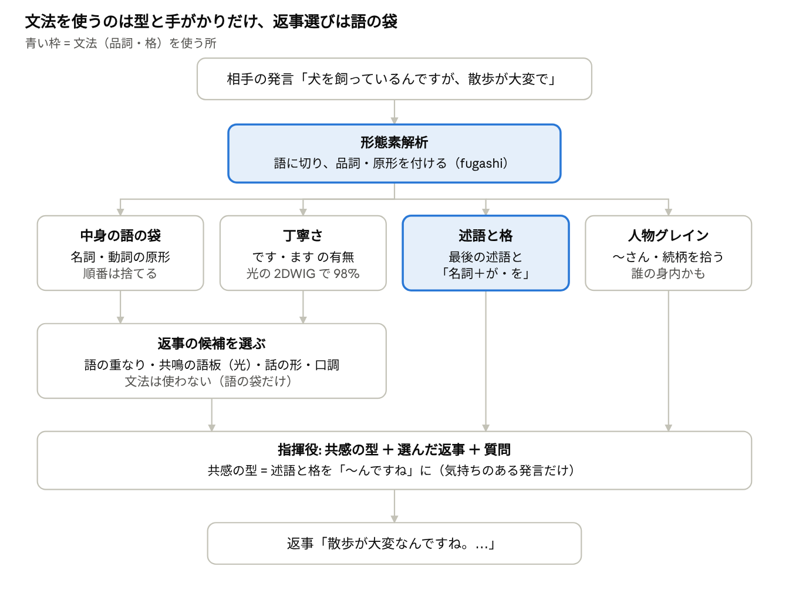

# ことゆいの文法・構文の処理（2026-11-04）

kotoyui.py 0.4.0 の時点。数字の正本は [NOTES.md](../NOTES.md)。

ことゆいは、**文を文法で組み立ててはいません**。返事は本物の雑談の発言から選び、文法は「選ぶための手がかり」と「共感の型の一言」を作るためだけに使っています。

- **ふだん動いている解析は形態素解析（語に切って品詞を付ける）まで**です。文の木（係り受け）は本体では使っておらず、実験19〜21 で手がかりとして試しただけです。
- 文法らしい処理は、決まった手順（規則）で書いた数か所です: 述語と「何が・何を」の取り出し、過去の形、丁寧さの判定、主語の人称の手がかり。
- 光の部品（2DTG）は文法を明示的には持たず、「次に来る単位」を当て続けることで、語尾や言い回しの形を覚えています。

## 全体の流れ

相手の発言はまず形態素解析され、そこから 4 つの手がかりに分かれます。文法（品詞・格）を使うのは青い枠の 2 か所で、返事の候補を選ぶ所は語の袋だけで動いています。

## 段ごとに何をしているか

例として、相手の発言「犬を飼っているんですが、散歩が大変で」がどう扱われるかを並べます。

| 段 | やっていること | 例では | どこで |
| --- | --- | --- | --- |
| 1. 形態素解析 | 発言を語に切り、品詞・原形（辞書の形）・活用を付ける（fugashi + UniDic） | 犬（名詞）・を（格助詞）・飼う（動詞）・…・大変（形状詞） | kotoyui.tokens |
| 2. 中身の語 | 名詞・動詞・形容詞などの原形だけを集める（助詞・助動詞・よくある語は捨てる） | {犬, 飼う, 散歩, 大変} | kotoyui.analyze |
| 3. 丁寧さ | 「です」「ます」の原形があれば丁寧。光の 2DWIG でも 97.9% で当たる（実験15） | 丁寧 | analyze の 2 つめの答え |
| 4. 述語と格 | 最後の述語（気持ちの語を優先）と、その直前の「名詞 + が・を・に…」を取り出す | 述語「大変」、格「散歩が」 | Bot.last_predicate・argument |
| 5. 共感の型 | 4 を「〜んですね」に入れる。過去の形は材料から数えた表で（見ました → 見た）。0.3.0 からは気持ち・困りごとのある発言だけ | 「散歩が大変なんですね」 | Bot.backtrack |
| 6. 格の補い | 「見ました」に「何を」が無ければ、「動詞 + 格 → 名詞」の出やすさの表で、会話に出た名詞から補う | （この例では使わない） | Material の格の好み |
| 7. 返事の候補を選ぶ | 2 の語で候補を引き、語の重なり・次の発言の共鳴・話の形の移り変わり・口調などの点を足す。文法は使わず、語の袋だけ | 「散歩」「犬」を含む発言 | Bot.candidates |
| 8. 人物グレイン | 「〜さん」や続柄（母・友達…）を拾い、「うちの」「私の」で誰の身内かを付ける（0.4.0） | （この例では人は出ない） | People |

つまり、文法を使うのは 4・5・6・8 の「型と手がかり」だけで、一番大事な 7 の選び方は語の袋（順番を見ない）で動いています。「単語を切り貼りしている感じ」は、この作りのせいです。

## 誰の話かを特定する流れ（実験19〜22・人物グレイン）

**発言 1 つから省かれた主語を当てるのは、人（Claude が丁寧に読んでも）でも 55% ほどで、ことゆいの数えた表（同じ 55%）はもう天井に着いています。** なので、誰の話かは会話を通して追う（人物グレイン）しかありません。

物差し: 主語がちょうど 1 つ書かれた発言（「私は」「あなたが」「彼は」…）の主語を消し、話し手・相手・第三者のどれかを当てる。3 類をそろえたので、でたらめは 33%。

| やり方 | 使う手がかり | 当たり |
| --- | --- | --- |
| 手がかりの決まり（実験19） | 敬語・謙譲、〜てくれる／あげる、〜たい／たがる、気持ちの言い切り、問い、頼み、伝聞 | 44%（問の半分は手がかり無し） |
| 数えた表（実験19） | 語尾・文字の 2 つ組の袋 | 55% |
| 光の 2DWIG（実験19） | 同じ袋 | 47% |
| ＋前の発言の流れ（実験20） | 前の発言の袋、人の名前・問い | 数えた表 52%、光 49% |
| ＋係り受け解析（実験21、GiNZA） | 文の中心の述語・助動詞・終わりの形・活用 | 数えた表 53%、光 51% |
| ローカル AI（8B、実験22） | 発言をそのまま読む | 31〜34%（ほぼ全部「相手」と答え、でたらめ並み） |
| Claude が丁寧に読んで（実験22、45 問） | 発言をそのまま読む | 56%（話し手 10/15、相手 7/15、第三者 8/15） |

天井が低い理由は 2 つあります。「朝はパンが多いです」のように、前後を読まないと誰の話か決まらない発言が多いこと。そして、消した主語が文の中心の述語の主語とは限らないこと（問の作り方の雑音）です。

そこで 0.4.0 では、人物グレインが会話に出た人を並べておき、「〜らしい」「〜って言ってた」などの手がかりがあれば、いちばん最近の第三者の話と見ます。

## 文を作る側（光の 2DTG）は文法をどう扱うか

光の 2DTG は文法の規則を持たず、**「直前の数単位 → 次の 1 単位」を当て続けて文を作ります**。文法は、その当て方の中に「この形の後にはこれが来やすい」という形でだけ入っています。

1. 文をサブワード（SentencePiece、「ありがとう」「ござい」「ます」のような小さな単位）に切る。
2. 直前 8 単位（短い文ならほぼ文の頭から）を光の場に広げ、光路を通して、次の単位 2,048 通りの点を出す。
3. 点の高い上位 20 から 1 つ選んでつなぎ、「文の終わり」が出たら止める。
4. 口調・人格は、入力の頭に付ける「帯」か、人格ごとに写して学ばせた器で切り替える。

実験17・18 で分かったこと:

- **語尾・言い回しの形は覚えられる**: 人格ごとの器で「〜でござる」「〜のじゃ」など、決めた語尾になる割合が 92%。
- **文としてのつながりは、まだ覚えられない**: 次の単位の正解率は光の分担 16 個で 32.8%（GRU 31.5%、3-gram 33.2%）。語尾はそれらしくても中身はつながらない。
- 光路 1 本を大きくしても伸びず、器の数を増やすと伸びる。

要するに、いまの 2DTG は「文の形の表面」は学べても、「誰が・何を・どうした」という文の木（構造）は持っていません。

## まだできないことと、次の一手

| まだできないこと | なぜ | 次の一手 |
| --- | --- | --- |
| 返事を選ぶときに「誰が・何を」を見る | 選ぶ所は語の袋で、文の木を使っていない | 係り受けで、相手の発言と候補の「述語 + 格」が合うかを点に足す（実験23 では 10 択は動かなかった） |
| 省かれた主語が誰かを当てる | 発言 1 つでは 55% ほどしか決まらない（上の節） | 人物グレインで会話を通して人を追う |
| 名前だけで呼ぶ人（「健太が」）を拾う | 人物グレインは「〜さん」と続柄の語だけを見る | 形態素解析の「人名」の品詞を使う |
| 文として通る文を一から作る | 2DTG は直前の数単位だけを見て、文の木を持たない | 分担で器を増やす、人格ごとの器で語尾を切り替える。「選ぶ + 少し直す」形も検討 |
| 人物グレインを光で持つ | いまはデジタルの表 | sincnn3 のホログラフィックな記憶（役割 → 人を 1 本の光に重ねる） |

## 言葉の説明

| 言葉 | 意味 | 例 |
| --- | --- | --- |
| 形態素解析 | 文をいちばん小さな意味の単位（形態素）に切り、品詞と原形を付けること | 飼って → 飼っ（動詞、原形 飼う）+ て（助詞） |
| 原形 | 辞書に載っている形 | 飼った → 飼う |
| 述語 | 文の「どうした・どうである」の部分 | 大変だ、飼っている |
| 格（格助詞） | 名詞が述語に対してどういう役かを示す助詞 | 散歩**が**、犬**を** |
| 係り受け | どの語がどの語にかかるかの木。文の中心の述語（ROOT）を根にする | 散歩が → 大変、犬を → 飼って |
| 省略された主語 | 日本語で書かない「誰が」。誰の話かは文脈から読む | 「（私は）明日行きます」 |
| サブワード | 語より小さいこともある、文を作るための単位。よく出る並びを 1 つにまとめる | ござい / ます |
| 袋（語の袋） | 順番を捨てて、どの語が入っているかだけを見る形 | {犬, 散歩, 大変} |
