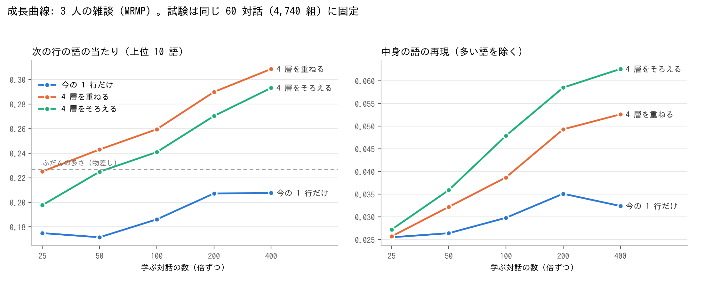
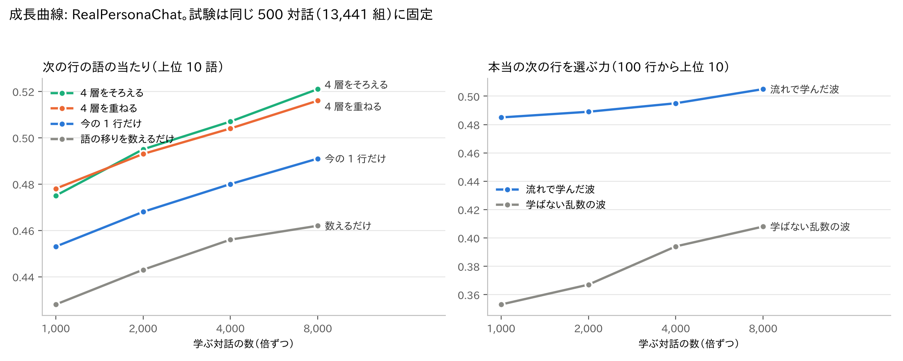

# I47: 会話を「意味の波」にして重ね合わせる試し（説明シート）

2026-11-12 時点のまとめ。道具は `intervention/i47*.py`。

## 1. ねらい

語板の属性は 1 語ずつの物で、語どうしの関係や会話の流れが入っていない。値リストや手で置く判断を減らすために、次の形を試した。

- 似た会話・似た状況を、似た「周波数」（位相の並び）にする。
- それを重ね合わせ、強く響いた所をすくい上げて 1 つの返事の材料にする。
- すくった物をまた重ねる。

## 2. 仕組み

### 2.1 意味の波（I47a、`i47_wave_resonance.py`）

1. **語の波**: 語ごとに、長さ 512 の複素数の並び（位相だけ、強さ 1）を持つ。最初は乱数（その語の「自分の印」）。
2. **流れから学ぶ**: 同じ行と前後の行に出た語の波を足し、どの語にも共通の向き（搬送波）を引いて、自分の印に混ぜる（重さ 0.6）。似た流れに出る語は位相がそろう。
3. **行の波**: 行の語の波を、珍しい語ほど重くして足した物。
4. **共鳴**: 問いの行の波と、しまってある場面（行と次の行の組）の波の内積の大きさ。
5. **すくい上げ**: 共鳴の強い 30 場面の「次の行」の語を、共鳴の強さの 2 乗で重ねる。上位 10 語を、本当の次の行の語と比べる。

物差し（比べる相手）: ふだんの多さ（よく出る語をいつも答える）、隣の行での語の移りを数えるだけ、学ばない乱数の波、語の重なりで似た行を探す方法。

測る数:

- **当たり**: 上位 10 語に、本当の次の行の語が 1 つでも入った割合。
- **中身の語**: よく出る 50 語を除いた語の再現率。場面から持ってきた中身を見る。
- **向き**: すくった波が、100 行の候補の中から本当の次の行を上位 10 に入れる割合（偶然なら 0.10）。

### 2.2 時系列の 4 層と「そろえる」（I47b、`i47b_layers_negation.py --part layers`）

重ねすぎると全体がぼやける。そこで次の形にした。

- 前の 1 行・3 行・10 行・30 行の 4 つの層で、それぞれ場面をすくう。
- **そろえる**: すくった板の強い所（平均より上）の平均を 1 にし、0 より 1 に近い所だけ残す。しきい値は置かない。
- 4 層のそろえた板を重ね、もう 1 度そろえる。

### 2.3 否定の帯（I47d、`i47d_negation_band.py`）

否定（ない・ぬ）を流れから学ばせても、決まった「否定の向き」はできなかった（I47c、`--part neg`）。そこで学ばせず、最初から別の帯として持たせた。

- 行の波 = [意味の帯 ; 向きの帯]。
- 向きの帯は述語だけ。語の自分の印に「肯定の鍵」か「否定の鍵」（乱数の位相）を掛ける。位相をずらす = 周波数をずらす。
- 読み出す時は、鍵の逆を掛けて語の印と共鳴させる。鍵が違うので、「食べる」と「食べない」を重ねても打ち消し合わない。
- 比べる相手は逆位相（否定は符号を返すだけ）。重ねると消える。

### 2.4 動かす段（I47e、`i47e_moving_step.py`）

語の波を、その場の語との共鳴で書き換えてから重ねる。重みは 2.2 のそろえ方で決める。2 つの語を 1 つにまとめた「にせの多義語」が、場面ごとに元の語に分かれるかで測る。

### 2.5 速さ

- 共鳴は `K @ q.conj()` で取る。`K.conj() @ q` は場面の波を毎回写すので、場面が数十万あると 10 倍以上遅い。
- `i47_gpu.py`: torch があれば GPU で共鳴の上位と学びの足し上げを回す。無ければ numpy。`KOTOYUI_DEVICE` で選ぶ。
- `--train_works`: 試しを固定して、学ぶ量だけを変える（成長曲線）。
- `--extra_cache`: 語の波を学ぶ時だけ、別の資料を足す。

## 3. 結果

公開できる資料の数を載せる。RealPersonaChat と MRMP（3 人の雑談）は名古屋大学の公開コーパス（CC BY-SA 4.0）。台詞が地の文で途切れる物語の資料でも同じ測定をしていて、その傾向は文で書く。

### 3.1 意味の波は、続いた会話で効く（RealPersonaChat、学び 36 万場面、試し 200 対話）

| 方法 | 当たり | 中身の語 |
|---|---|---|
| ふだんの多さ | 0.364 | 0 |
| 語の移りを数えるだけ | 0.466 | 0.053 |
| 学ばない乱数の波 | 0.481 | 0.096 |
| 語の重なりで似た行 | 0.488 | 0.099 |
| 流れで学んだ波 | **0.500** | **0.100** |

向きは、乱数の波 0.405 に対して学んだ波 0.509。

物語の資料では逆だった。学んだ波は乱数の波と並び、向きは学ぶと下がった。台詞が数行で途切れ、流れの手がかりが薄いため。

### 3.2 そろえると、中身を落とさずに当たりが上がり、板が 5 分の 1 になる（RealPersonaChat、試し 500 対話 13,441 組）

| 形 | 当たり | 中身の語 | 板に残る語 |
|---|---|---|---|
| 今の 1 行だけ | 0.502 | 0.101 | 88 |
| 4 層を重ねる（そろえない） | 0.525 | 0.084 | 258 |
| 4 層をすくうたびにそろえる | **0.530** | 0.101 | **18** |
| 今の行と 10 行の場面をそろえる | 0.521 | 0.103 | 19 |
| 30 行の層だけ | 0.419 | 0.052 | 90 |

そろえずに重ねるだけだと、当たりは上がるが中身が落ちる（よく出る語が増える）。そろえると中身を保ったまま当たりが上がる。物語の資料では、そろえる形は 1 行だけとほぼ並んだ（板は 3 分の 1）。

### 3.3 成長曲線（MRMP、試しは同じ 60 対話 4,740 組に固定）



| 学ぶ対話 | 25 | 50 | 100 | 200 | 400 |
|---|---|---|---|---|---|
| 今の 1 行だけ：当たり | 0.175 | 0.172 | 0.186 | 0.207 | 0.208 |
| 4 層を重ねる：当たり | 0.225 | 0.243 | 0.260 | 0.290 | 0.309 |
| 4 層をそろえる：当たり | 0.198 | 0.225 | 0.241 | 0.270 | 0.293 |
| 4 層をそろえる：中身 | 0.027 | 0.036 | 0.048 | 0.059 | 0.063 |

1 行だけの形は 200 対話で頭打ち。層の形は 400 対話でもまだ伸びている。学ぶ量を増やす価値は、形ごとに違う。

RealPersonaChat でも同じ測り方をした（試しは同じ 500 対話 13,441 組に固定）。



| 学ぶ対話 | 1,000 | 2,000 | 4,000 | 8,000 |
|---|---|---|---|---|
| 語の移りを数えるだけ：当たり | 0.428 | 0.443 | 0.456 | 0.462 |
| 今の 1 行だけ：当たり | 0.453 | 0.468 | 0.480 | 0.491 |
| 4 層を重ねる：当たり | 0.478 | 0.493 | 0.504 | 0.516 |
| 4 層をそろえる：当たり | 0.475 | 0.495 | 0.507 | 0.521 |
| 4 層をそろえる：中身 | 0.075 | 0.082 | 0.088 | 0.095 |
| 4 層をそろえる：板の語 | 24 | 22 | 20 | 19 |
| 向き：流れで学んだ波 | 0.485 | 0.489 | 0.495 | 0.505 |
| 向き：学ばない乱数の波 | 0.353 | 0.367 | 0.394 | 0.408 |

- 8,000 対話でもまだ伸びているが、倍にするごとの伸びは +0.016、+0.013、+0.010 と小さくなる。
- 流れの学びは少ない会話でも効く。向きは 1,000 対話でもう 0.485 あり、学ばない波との差は資料が少ないほど大きい。
- そろえる形と 1 行だけの差は、資料が増えるほど広がる（+0.022 から +0.030）。板の語は減っていく。
- 層を増やす（もっと長い流れを見る）ことを考える時は、早い方が変更が少ない。今の 4 層（1・3・10・30 行）のうち、30 行の層は単独ではいちばん弱い。

### 3.4 否定の帯は、重ねても読める（RealPersonaChat、試し 50 対話）

肯定と否定の両方で重なっている語を読み分けられるか（0.5 が当て推量）。

| 重ねた行 | 鍵の帯 | 逆位相 |
|---|---|---|
| 4 行 | 0.999 | 0.49 |
| 16 行 | 0.98 | 0.47 |
| 64 行 | 0.90 | 0.47 |

否定のある行で場面をすくった時、同じ述語が否定で居る割合（ふだんは約 0.4）と、次の行の当たり。

| 帯の重さ | 否定で居る割合 | 当たり |
|---|---|---|
| 帯なし | 0.43 | 0.507 |
| 0.5 | 0.61 | 0.504 |
| 1 | 0.77 | 0.495 |
| 2 | 0.90 | 0.470 |

会話では、肯定の問いに否定で答えることが多い。否定どうしだけを集めすぎると外れるので、場面を探す時の重さは 0.5 が良い。物語の資料でも読み分けの数は同じで、試しを 8 倍にしても変わらなかった。

### 3.5 動かす段は、今の形では効かない

にせの多義語が分かれる割合は 0.68 から 0.72（RealPersonaChat）。次の行の中身の語は、動かさない方が良い（0.096 対 0.085〜0.089）。見送り。

### 3.6 流れを学ぶ資料は、会話だけにする

RealPersonaChat で学ぶ語の波に、物語の資料 300 作品を足した（流れのすくい上げは RealPersonaChat だけ）。語の数は 1.5 倍になり、似た語は広がったが、向きは 0.509 から 0.396 に下がり、乱数の波（0.409）より下になった。

## 4. 分かったこと

| 部品 | 結論 |
|---|---|
| 意味の波（流れから学ぶ） | 続いた会話の資料で効く。途切れる資料では効かない |
| 4 層とそろえ方 | 会話で、中身を保ったまま当たりを上げ、板を 5 分の 1 にする |
| 否定の帯 | 資料や量によらず読める。場面を探す時は軽く（0.5）、読み出す時はしっかり使う |
| 否定を流れから学ぶ | 決まった向きはできない。接頭辞（未・非・不・無）は別の 1 語として固まっている |
| 動かす段 | 多義語を少し分けるが、当たりは変えない。見送り |
| 資料の役目 | 流れは会話の資料だけ。物語の資料は話し方・キャラ付けの判定と語の辞書に使う |
| 学ぶ量 | 1 行だけの形は早く頭打ち。層の形は伸び続ける |

測り方の教訓: 試しの組が数千以下だと、0.005 くらいの差は揺れ。差を言う時は試しを 1 万組以上にして確かめる。試しを固定せずに学ぶ量を変えた数は、比べられない。

## 5. まだ足りない所と次の案

- 次の行を「当てる」力は、まだ数えるだけの方法と大差がない。波の良さは、少ない語の板で同じ以上に当たることと、肯定・否定のような印を重ねたまま持てることにある。
- すくった板を返事の行づくり（逆引き）につなぐ所は、まだ作っていない。
- 頭打ちの位置はまだ見えていない（RealPersonaChat 8,000 対話でも伸びている。伸びは小さくなってきている）。
- 長く続く会話の資料が足りない。キャラクタを決めた AI どうしの会話で補う案がある。
- 「どの相手を見るか」を学ぶ所が無い。動かす段を効かせるには、ここが要る。

## 6. 動かし方

```
# 意味の波（学ぶ量を変える時は --train_works）
python intervention/i47_wave_resonance.py --cache <解析済みの資料.json> --test_works 200 --mix 0.6 --out a.json
# 4 層とそろえ方
python intervention/i47b_layers_negation.py --cache <資料> --part layers --test_works 500 --out b.json
# 否定の帯（図つき）
python intervention/i47d_negation_band.py --cache <資料> --test_works 50 --fig d.png --out d.json
# 動かす段
python intervention/i47e_moving_step.py --cache <資料> --test_works 50 --out e.json
```

資料の形: 作品（対話）のリスト。各作品に `lines`、各行に `text`（台詞は「で始まる）と `toks`（GiNZA の `i`・`lemma`・`pos`・`head`）。

## 7. 出どころ

- RealPersonaChat（名古屋大学、CC BY-SA 4.0）: https://huggingface.co/datasets/nu-dialogue/real-persona-chat
- Multi-Relational Multi-Party Chat Corpus（名古屋大学、CC BY-SA 4.0）: https://github.com/nu-dialogue/multi-relational-multi-party-chat-corpus

この文書の 3 章の数と図は、上の 2 つのコーパスから測った物で、CC BY-SA 4.0 で使える。
