# I49: 内面の骨組み（意識の器）

持ち主の案（未確定）を、外形だけ先に作った物。会話にはまだつながない。

## 1. 考え方

- 入力→出力の道具（読み手・板・波・違和感・経験）はそろってきたが、「器」と「時間の流れ」が無い。
- ドライバの作り方にならい、最低限の口を先に置き、中身は後から入れ替える。
- 名札（興味・不安 など）は先に付けない。少しずつ違う速さの波を虹のように並べて全部記録し、後から「その波で次の振る舞いが読めるか」で選ぶ。
- 手で置くのは止め役だけ（上限・予算・見張り）。調整は自分でさせる。

## 2. 最小版（`intervention/i49a_inner_vessel.py`）

| 口 | する事 |
|---|---|
| `tick()` | 入力なしで 1 刻み進む。波は薄れ、静かなほど感度が上がる |
| `hear(x)` | 入力を聞く。聞く前に今の状態で言い当て、外れ（驚き）を測る |
| `want()` | 今の状態から読める量を返す（動きの量、外れ、速い波と遅い波のずれ、感度）。したい事の候補はまだ空 |
| `settle(x)` | 自分の出した結果を一度戻す（出どころを「自分」と記録） |

- 虹: 半減期 1 刻みから 1,024 刻みまで、等比で 20 本。
- 調整の目当ては 2 つで、どちらも正解が要らない。
  - 言い当て: いつもより外れたら感度を上げる。
  - 中くらいを保つ: 波の大きさが上限の半分より小さければ感度を上げ、大きければ下げる。
- 調整の速さは、その波自身の速さをそのまま使う。計算は四則だけ（累乗と、割る側に置く階乗は、形を増やす時の選択肢として残す）。
- 見張りは数えるだけで直さない: 張り付き（上限で縮めた回数）、死んだ（全部の波がほぼ 0 の刻み）。
- 乱数は使わない。刻みごとの全部の波の大きさ・感度・外れを記録する。

## 3. 物差し（案）

1. 壊れていないか（関門）。上限に収まる、入力が無いと静まる、予算で止まる、記録からたどれる、再現できる。
2. 入れ替え比べ。別の会話の後の内面と入れ替えて、次に出す話題のつながりを比べる。
3. 自分らしさ。初めの位置が違う 2 体を、振る舞いだけから言い当てられるか。
4. 内面から先が読めるか。
5. 先生との長い会話で、外から見た脈絡と中の動きを突き合わせる（話す役と脈絡を見る役は分ける）。
6. 長い文章を読ませ、読み進むうちの変化を見る（場面の区切りでの動きと、その後に残る物）。

骨組みは 1 だけで合否を決める。どの段でも、内面の無い今の作りと並べる。

## 4. 関門の結果（`tests/test_i49a_inner_vessel.py`、8 本）

- 大きすぎる入力を 500 回入れても、波と感度は上限の中。
- 入力が止まると全部の波が薄れ、速い波ほど先に薄れる。
- `think(budget)` は予算で止まり、空なら回さない。
- 記録は刻みごとに残り、同じ入力の列なら同じ記録になる。
- 同じ入力を続けると外れが下がり、新しい入力で跳ねる。同じ入力でも、前の状態が違えば反応が違う。
- 静かな間に感度が上がる。

## 5. 試運転（自作の入力: 話題 A 60 刻み、黙る 60、話題 B 60、黙る 200、また A 30）

- 話題が替わると外れが 1.0 に跳ね、続くと下がる。
- 2 回目の A では、外れの跳ねが 0.77 で止まった（遅い波に A が残っていたため）。
- 想定外: 話題が替わった直後と黙った後に、速い波から中くらいの波が上限に張り付いた（410 刻みで延べ 399 回、遅い 9 本は 0 回）。
  静かな間に上がった感度と驚きが重なって行き過ぎる。今は止め役が抑えていて、自分の調整だけでは収まっていない。

## 6. 物差し 6 の小さな試し（I49b、`tools/i49b_read_long.py`）

青空文庫の 5 作品（見出しの注記があり、文が 1,000 以上の物を種 0 で選んだ。1 作品は 3,000 文まで）を、元の本文から区切りの印つきで読み直し、
1 文 = 1 回の hear で器（`Vessel(2048, 20, 1024)`、作りは変えない）に読ませた。数は本文を含まない。

- 入力 2 通り:
  - A: 属性の袋（float32）
  - B: 流れから学んだ意味の波（complex64）
  - 主は B で、A は比べ。入力の前処理（平均を引く など）はしない。
- 1 刻みは 0.43〜0.44 ms。張り付きは A で 0、B で速い 2 本だけ（15,000 文中 14・1）。死んだ刻みは 0。感度は上限・下限に張り付かない。
- 区切りの直後の外れ（AUC）: B で、見出し .57〜.62（半減期 3〜6 刻みの波でいちばん高い）、空き行 .55〜.58。A は .52〜.56。
- 文の順をばらばらにすると、外れが上がる: B で平均 +.017（速い波で +.04〜.05、遅い 3 本で −.001 前後）、A で +.003。B では器は順番を見ている。
- 5 作品を続けて読むと、作品の替わり目の跳ね（外れ − 前の 10 文の平均）は B で +.157、作品の中の見出しは +.032。替わり目では遅い波も跳ねる。
- 外れで数えた「戻るまでの文の数」は、どの波も 1〜2 文（外れが 1 文ごとに揺れるので、この数え方では速さの差が見えない）。
- 測り直し: 区切りの直前の状態と、k 文後の状態の向きの近さ |cos|。B の入力で、5 作品を続けて読む。区切りでない所 210 か所（種 0）と並べた。

  | 半減期（刻み） | 1 | 3 | 9 | 27 | 80 | 238 | 1,024 |
  |---|---|---|---|---|---|---|---|
  | 見出し k5 | .27 | .61 | .89 | .98 | 1.00 | 1.00 | 1.00 |
  | 区切りでない所 k5 | .27 | .61 | .89 | .98 | 1.00 | 1.00 | 1.00 |
  | 見出し k200 | .21 | .36 | .58 | .78 | .93 | .98 | 1.00 |
  | 空き行 k200 | .18 | .32 | .54 | .76 | .91 | .98 | 1.00 |
  | 作品の替わり目 k200（4 か所） | .14 | .24 | .49 | .72 | .88 | .97 | 1.00 |
  | 区切りでない所 k200 | .20 | .37 | .59 | .79 | .93 | .98 | 1.00 |

  - 速い波は数文で別の向きになり、遅い波は 200 文後も残る（作りの通り）。
  - 見出しの後と区切りでない所では、向きの替わり方はほとんど同じ。空き行の後は少し早く、作品の替わり目の後は、半減期 9〜80 刻みの波がはっきり早く替わる。
  - いちばん遅い波は、作品が替わっても 200 文では替わらない。
- いちばん速い波といちばん遅い波の向きのずれが、区切りの直後に大きいか（AUC）: 見出し .49、空き行 .62、作品の替わり目 .73（4 か所）。
- 読み: 器は、作品が替わる大きな替わり目は感じているが、作品の中の見出し（章）は、ふつうの文の流れとほとんど区別していない。
  A（属性の袋）は、どの文も似て見え、ほとんど何も見分けない。
- 想定外: 試運転で出た速い波の張り付きは、本物の文ではほとんど起きない。改ページ等の注記は 5 作品とも 0。
- 手で置いた値:
  - 1 作品の文の上限 3,000、種 0
  - 元の水準の窓 20 文、戻りの打ち切り 200 文、跳ねの前の窓 10 文
  - k の並び（1・2・5・10・20・50・100・200）
  - 区切りでない所の数（区切りと同じ 210）、区切りの直後 2 文を除く
  - 見出しと空き行が重なれば見出しに数える
- 間の試し（`--pause`）: B の入力で 5 作品を続けて読み、区切り（見出し 127・空き行 79・作品の替わり目 4）と、区切りでない所 210 か所（種 0）の前に、
  黙る刻みを差し込んだ。長さ 0・10・100・1,000 刻みを別々に回した。器は変えない。

  | 間の長さ | 張り付き（間の直後 5 文、1 文あたり） | 張り付き（それ以外、1 文あたり） | 張り付く波 | 間の終わりの感度（いちばん速い波の中央値） | 死んだ刻み |
  |---|---|---|---|---|---|
  | 0 | .001 | .001 | 速い 2 本 | — | 0 |
  | 10 | 2.54 | .21 | 半減期 1〜6 刻みの 6 本 | 6.7〜9.2 | 0 |
  | 100 | 7.03 | 5.79 | 半減期 1〜239 刻みの 17 本 | 16（上限）、半減期 13 刻みまでの波は全部上限 | 0 |
  | 1,000 | 7.16 | 7.25 | 半減期 1〜494 刻みの 19 本 | 16（上限）、ほぼ全部の波が上限 | 0 |

  - 張り付くのは聞いた時だけで、間の中（tick だけ）では 0 回。
  - 間が 100 刻み以上だと、間の直後 5 文では速い 7 本が毎回張り付く。感度が下がりきらないので、間から離れた文でも、遅い波まで張り付きが広がる。
  - 間の直後の文の外れは、速い波で 1.0（間の間に速い波が 0 まで薄れ、言い当てる物が無い）。
  - 作品の替わり目の後か、そうでない所かでは、1 か所あたりの張り付きはほとんど変わらない（間 100 で 24.5 と 32〜36、替わり目は 4 か所だけ）。張り付きの元は、話の替わりではなく、間の長さ。
- 読み: 試運転の張り付きは、長い間で感度が上限まで上がる事から来ている。本物の文章でも、10 刻みの間から起き始め、100 刻みを越えると、ほぼ全部の波に広がる。
- 手で置いた値（間の試し）: 間の長さの 4 通り、直後の文の数 5、間を差し込む所（区切りと、同じ数の区切りでない所、種 0）。
- 図（`tools/past/i49b_wave_plot.py`、記録の切り出しから描く。図と数の列はリポジトリに置かない）:
  - 間なしの 300 文では、速い波（半減期 1・9 刻み）は大きさも感度も文ごとに動き、いちばん遅い波は文に関係なくほぼ一直線。外れは 1 文ごとに大きく揺れ、速い波と遅い波でほぼ同じ形。
  - 間 100 刻みの走りでは、24 文続けて聞いた所で、いちばん速い波は 10 文ほどで自分で感度を 16 から 0.8 前後まで下げ、張り付きも止まる。
    壊れているのではなく、少しずつ寄せる調整が間に合っていない形。半減期 9 刻みあたりの波は、戻る前に次の間が来て、上限のままになる。
- 注意: この試しの間は、道具が外から差し込んだ物（決めた数の tick）。器には、自分から話す・黙るを決める口がまだ無い。
  1 刻みが本物の会話のどの長さに当たるかも決めていないので、この張り付きが実際に困る長さかは、まだ言えない（A3 で決める所）。

## 7. 自発的に話す思考ループの最小版（I49c、`intervention/i49c_think_loop.py`、持ち主の案・未確定）

器の上に、指揮者の表を 1 枚乗せた。外から語を押し込むのでなく、ループが 1 歩ごとに「次へ・考える・出力・待つ」から 1 つを自分で選ぶ。
入力は 1 語ずつ（読み手 `Words`。語 = 名前・ベクトル・印）。1 歩 = 器の 1 刻み。会話にはまだつないでいない。

- 項目と「したさ」（暫定。様子見の物）:
  - 次へ: 0.5 − 動きの量。内面が静かなら読み、沸いていれば読まない。
  - 考える: 内面のばらつき − いつもの外れ。今の内面の全体を自分に戻す（声には出さない）。
  - 出力: 感度の平均（log2）×（前に言った事からの離れ − 内面のばらつき）。考えるのと同じ事をし、外へも出す。
  - 待つ: 0。
- 実験用の口: `attach(node)`（1 歩ごとの観察）、`set(name, v)`（項目ごとの下駄を走りながら動かす。動かした事は記録に残る）、
  `seal()`（部品を外し、つまみを固める。以後は付けられず、動かせない。記録は残る）。
- 器には、状態を変えずに言い当てる `guess(x)` と、全部の波を足した向き `whole()` を足した（器の動きは変えていない）。
- 関門（`tests/test_i49c_think_loop.py`、8 本）: 自分で全部の語を順に読む、1 歩 = 1 刻みで予算で止まる、読む物が無くなると自分から話しその後は静まる、
  再現できてしたさが全部残る、つまみで振る舞いが変わる、seal の後は部品が呼ばれずつまみも動かない、ベクトルの無い語は時間だけ進む、空なら早く止まる。
- 試運転（自作の語。話題 A の語 4 つと話題 B の語 4 つ。A を 12 語、60 歩の後に B を 12 語、また 60 歩の後に A を 4 語、計 420 歩）:
  - 内訳: 次へ 28、考える 0、出力 12、待つ 380。語は届くとすぐ自分で全部読んだ。
  - 語が途切れて 7 歩ほどで、最後に聞いた話題の事を 1 回言い、その後はしばらく黙る。黙っている間も、間を空けながら時々言う（間はだんだん長くなる）。
  - 黙った後に別の話題が届くと、読みながら 1〜3 回、声をはさむ。
- 想定外:
  - 「考える」は 1 回も選ばれなかった。内面のばらつき（0.00〜0.08）が、いつもの外れ（0.7 前後）よりずっと小さく、今の式では出番が無い。
  - 声の中身は、直前に聞いた語にいちばん近い（近さ 0.7〜0.99）。今は、聞いた事の言い返しに近い。
  - 黙った後に語が届いた所で、速い波の張り付きが出る（延べ 161 回）。6 節の間の試しと同じ形。
- 手で置いた値: run の予算（歩数）、つまみ（全部 0）、表の並び順（同点の時の順）、式の中の 0.5（器の「中くらい」と同じ）。
- 本物の単語で読ませた試し（`tools/i49c_read_words.py --trial`、読み手は `WordReader`）:
  - 条件: 青空文庫の作品 1（3,000 文）、`Vessel(2048, 20, 1024)`、つまみは全部 0。読み終わった後も 500 歩回した。
  - 語のベクトル: 波の板の語の波 W の 1 行を長さ 1 にした物。前処理はしない。
  - 2 通りの扱い: skip（ベクトルの無い語は渡さない、17,048 語）と、none（ベクトル無しで渡す、56,561 語のうち 7 割がベクトル無し）。

  | 扱い | 読み終わるまでの歩 | 次へ | 考える | 出力 | 待つ | 語と語の間の待つ（平均） | 張り付き（速い 3 本） | 速い波の感度の中央値 |
  |---|---|---|---|---|---|---|---|---|
  | skip | 41,227 | 17,048 | 0 | 4,983 | 19,196 | 1.13 | 11,910・1,334・150 | 2.0 |
  | none | 114,369 | 56,561 | 0 | 14,448 | 43,360 | 0.77 | 31,459・31,325・30,626 | 14.1（上限の割合 .45） |

  - 待った所: 待つ直前の語の後の動きの量は、待たなかった所よりはっきり大きい（AUC .998・.999、したさの式の通り）。外れはむしろ少し小さい（AUC .45・.47）。
  - 出力: 読んでいる間にずっと出る（skip 4,983 回、none 14,448 回）。読み終わった後の 500 歩では、1〜2 回だけ。
    文の終わり・見出し・空き行の直後（3 語以内）の出力の割合は、でたらめに置いた時とほとんど同じ（skip で文の終わり .556 と .555）。
  - 出力にいちばん近い読んだ語は、直前の語が 10%（skip）・19%（none）、5 語以内が 11%・19%、近さの中央値 .63・.70。品詞は名詞 52%、動詞 33〜34%、形容詞 11%。
  - 死んだ刻みは、skip 0、none 1。
- 想定外（本物の単語）:
  - 試運転と違い、読み終わって語が途切れた後に、ほとんど話さない。
  - 出力は区切りとは関係なく、読む合間に数語ごとに出る。
  - none では、ベクトル無しの語が黙る刻みと同じに働き、速い 3 本の感度が上限近くに張り付く（6 節の間の試しと同じ形）。
- 手で置いた値（本物の単語の試し）: 読み終わった後の歩 500、区切りの窓 3 語、読み終わるまでの歩の上限（語の数の 20 倍 ＋ 1,000）。

## 8. 思考のループと感情・状態のループを分けた最小版（I49d、`intervention/past/i49d_two_loops.py`、持ち主の案・未確定）

7 節の指揮者は、感情・状態の量（動きの量・感度）だけで決めるので、中身と無関係な一定の調子になった。そこで 2 つに分ける。

- 感情・状態のループ: 器（I49a）。思考のループの 1 歩ごとに 1 刻み進む。
- 思考のループ: 入れ物（ばらばらの材料置き場）を持ち、指揮者が違和感を見て、回す・組立・出力を選ぶ。
  - 入れ物: 語（聞いた語）、連想（連想で見つかった語）、印（文の終わり など）。同じ名前の材料は 1 つだけ。
  - 連想: 指揮者の手前。入れ物（空なら内面）に向きが近い物を k 個引き、「材料が不足」をいちばん減らす 1 つだけを足す。本体は差し込み口（`near(vec, k)`）。
  - 違和感「材料が不足」: 入れ物の中身を足した向きと、内面の全体の向きのずれ（1 − |cos|）。入れ物が空なら 1、器が空なら 0。閾値は置かず、連想で減らなくなったら「消えた」とみなす。
  - 組立: 差し込み口（`build(tray, vessel, said)` → 行と違和感）。仮の組立は、材料を内面に近い順に並べるだけで、違和感は 3 つ（途中・材料が少ない・もう言った）。
  - 流れ: 連想で減るうちは連想 → 減らなくなったら組立 → 違和感なしなら出力（自分の声を器が聞き、入れ物は空になる）→ 違和感ありなら次の語を読む → 語も無ければ待つ。待っている間に、語が届くか、内面が動いて連想が効くようになれば、また回る。
- 試運転（自作の語。話題 A・B に 6 語ずつ、聞かせるのは 4 語ずつ。文 4 つを 40 歩おきに渡し、その後 200 歩）:
  - 360 歩の内訳: 読む 11、連想 28、組立 21、出力 7、待つ 293。張り付き 延べ 86、死んだ刻み 0。
  - 文の終わりの印が来るまでは「途中」で読み進め、印が来た所で、その文の語をまとめて出す（4 文とも）。出した後は「もう言った」で休む。
  - 休んでいる間に内面が動くと、別の話題の語が連想で 1〜2 個入り、頼まれていない行を出す（3 回。例: 話題 B の 4 語に A0 が混ざる）。
- 想定外:
  - 文の終わりで出る行は、聞いた語の並べ直しで、言い返しと同じ。仮の組立が中身を作らないので当然だが、「自分の考え」ではない。
  - 出した直後の連想は、今言った語をそのまま引き直す（内面が自分の声で満ちているため）。聞かせていない語（各話題 2 語ずつ）は、1 回も出て来なかった。
  - 初めの作りでは、「もう言った」の後に、連想と組立を毎歩くり返して休まなかった（連想 215 回）。待つ間は連想が効くようになるまで動かない形に直した。「2 回続けて減らなければあきらめる」という数は、この直しで要らなくなったので外した。
  - 頼まれていない行は、話題が混ざった物になる。良い悪いは、まだ言えない。
- 手で置いた値: run の予算（歩数）、連想で 1 回に引く数 k = 5、仮の組立の「ベクトルを持つ材料が 2 つ未満」、試運転の文の間 40 歩。
- 違和感を波で持つ（`OddWave`、持ち主の案・未確定）: 種類ごとに 1 本の向き（出て来た順に直交する向き）、強さは振幅、時間で薄れる。波の速さは器と同じ。
  持つだけで、どこにもつながない（動きは同じ）。どの波に効かせるかは決めず、`tally()` で数えてから決める。
  - 試運転での数え: 「材料が不足」は連想の歩で平均 −.25 下がり、出力の歩で +.97 上がる（入れ物が空になるため）。「途中」「材料が少ない」は、上がりと下がりが同じ動き（組立）の中で打ち消し、平均では 0 になる。
  - 器の波ごとの動きの量との相関（同じ歩）: 「材料が不足」は速い波ほど高い（.59 → .01）。「もう言った」は速い波で逆（−.68〜−.75）、遅い波で少し正（.25）。休んでいる間は器が静か、という流れの写しで、因果は言えない。
  - 終わりの時、「もう言った」は速い波 1.00・まん中 .96・遅い波 .18 で残り、ほかは消えている。
  - 手で置いた値: 違和感の強さ（組立の違和感は有れば 1）、種類の向きの割り当て方。
- 下ごしらえ（`tools/i49d_assoc.py`、作品 1 の 1,000 語、k = 5）: 連想は、波で引くと上位 5 の近さ .408・上位 1 が同じ品詞 .355・1 回 172 ミリ秒、
  属性で引くと .944・.915・12 ミリ秒（どの語どうしも近すぎる）。印は 過去 1,491・丁寧 1,936・否定 616・進行 703 個で、直前の語へ 97〜98%、文の印として 98〜99.7% 移せる。
- 違和感を出す口（`tools/past/i49d_odd.py`）: 行づくりの型（Tatoeba 5 万文、I48bi と同じ）を保存して読み込み、1 文ごとに 6 種類の値と、いつもの値の並びの中の順位の割合を返す。
  確かめ（試しの 1,000 文）: 上位 1 割の外れは 迷い .738・自信のなさ .789・組の珍しさ .694 で、`docs/i48_odd_kinds.md` の 1 節と同じ。1 文 40 ミリ秒。展開②の表は AUC .713。
- 組立の口 `Scored`: 流れは仮の組立のまま、行は行づくりで詰め物を入れて作る。行づくりの違和感は流れに使わず、違和感の波に渡すだけ。選ぶ口 `Pick`（重さの大きい順に k 個だけ残す）を足せる。
- 本物の単語での試し（`tools/past/i49d_trial.py`、青空文庫の作品 1 の初めの 300 文、渡す語 1,927、部品を 1 つずつ止めた比べ）:

  | 組 | 歩 | 連想 | 出力 | 出力のうち文の終わりの直後（そういう歩の割合） | 入れ物が 10 語以上の行 | 迷い・自信のなさの割合の中央値 | 張り付きの出た波 |
  |---|---|---|---|---|---|---|---|
  | a 連想なし・仮の組立 | 4,342 | 0 | 290 | .921（.242） | 52 | — | 1 本 |
  | b 連想なし・行づくり | 4,342 | 0 | 290 | .921（.242） | 52 | .885・.948 | 1 本 |
  | d 属性の連想・行づくり | 6,007 | 1,670 | 291 | .973（.215） | 142 | 聞いた順 .780・.835、連想あり .929・.982 | 8 本 |
  | c 波の連想・行づくり | 13,226 | 7,970 | 624 | .946（.540） | 284 | 聞いた順 .772・.826、連想あり .897・.926 | 12 本 |

  - 連想を入れると、行に入る連想の語の 83% は聞いていない語になる（自作の語の試運転とは逆）。ただし行は長くなり、行づくりの違和感は上がる。
  - c だけ出力が 2 倍（文 1 つあたり 2.08）。「もう言った」で休んだのは c の 227 回だけ。c は 1,910 秒かかる（1 歩 0.14 秒）。
- 選ぶ口の比べ（同じ 300 文、連想なし・行づくり。流れは 5 つとも同じ）:

  | 組 | 出した行の内容語（中央値） | 迷い | 自信のなさ | 組の珍しさ |
  |---|---|---|---|---|
  | b 選ばない | 5 | .885 | .948 | .824 |
  | e 拾われやすさで 3 個 | 3 | .793 | .903 | .824 |
  | g 聞いた順の初めの 3 個 | 3 | .782 | .884 | .824 |
  | f2 拾われやすさで 2 個 | 2 | .729 | .855 | .824 |
  | f5 拾われやすさで 5 個 | 5 | .846 | .926 | .824 |

  - 拾われやすさ（`tools/past/i49d_pickup.py`、会話の資料で相手の語が次の返事に出た割合）: 試しの側で、拾われた語を見分ける AUC .700（語の出た数だけ .546、聞いた順 .511。拾われた割合 .125、28.5 万語）。
- 想定外（本物の単語）:
  - 行づくりの違和感は、ほぼ行の長さで決まる。拾われやすさで選んだ行（e）と、聞いた順の初めの 3 個（g）は、ほとんど差が無い（e の方が少し高い）。行づくりの違和感では、選び方の良し悪しは見えない。
  - 組の珍しさの中央値は、どの組でも .824 ちょうど。「値 0（珍しくない）」の順位の床で、短い行には効いていない。
  - 話す所は、やはり文の終わりの印で決まる（9 割以上）。
  - 行づくりから見ると、ほとんどの行が「おかしい」側（中央値 .8〜.95）。本の文は長く、型が学んだ短い文と違うためと見ている。
- 手で置いた値（本物の単語）: 選ぶ数 k = 3・2・5、連想で引く数 5、読み終わった後に回す歩 200、歩の上限（語の数の 30 倍 ＋ 1,000）、少ない語の境 10・ならし 0.5、比べる並びの文 1 万。
- まだ無い物: 本物の連想（属性の向き）、過去・進行などの印、本物の組立（I48 の行の組み立てと違和感の札）、本物の単語での試し。

## 9. 3 人で読む案の一歩目（I49e、`tools/i49e_read_together.py`、持ち主の案・未確定）

案: 先生 2 人（子ども役）とループの 3 人で、静かな話を 1 ページずつ、展開を予想しながら読む。黙っていても学べ、発言が反映される。
一歩目は、先生 2 人だけの記録を作って数える（ループはまだ座らせない）。本文と記録はリポジトリの外。

- 条件: 青空文庫の子ども向けの物語（広く知られた作者と事件物の作者を除き、200〜600 文の 55 作品から決め打ちで 1 つ、215 文）。10 文を 1 ページ、20 ページ。
  先生 A は手元の Gemma 4 12B、先生 B はさくらの AI Engine の Qwen3.6-35B。1 ページの流れは A1（予想）→ B1（A1 を聞いて予想）→ A2（B1 を受けて一言）。
- 数:
  - 決まり（1 文・30 字以内・日本語）を守った割合 A1 95%・B1 90%・A2 95%。長さの中央値 20〜23 字、内容語 4〜5 語。答えでない物 0。全部で 66 秒。
  - 拾う割合: B1 が A1 から 19%、A2 が B1 から 41%（1 ページずらした組では、どちらも 5%）。
  - 予想の語が次のページに出た割合: A1 25%・B1 27%（2〜5 ページ先では 13%・16%）。今のページの語を除くと 9%・5%。
  - 2 人の割れ: A1 と B1 の語の重なり（Jaccard）.13、重なり 0 のページが半分。
  - 話を知っていそうか: 3 ページ以上先にだけ出る語を含む予想は A1 5%・B1 20%、固有名詞は 0。
- 想定外:
  - 予想の当たりの多くは、今のページの語のくり返し。語で「当たった」を数えるのは粗すぎる。
  - 先生 B は、予想を頼んでも 20 回中 11 回が今のページの感想だった（予想の形は 5 回）。
  - さくらの口は、seed を渡しても同じ答えにならない。Gemma は同じ答えになる。
- 手で置いた値: 1 ページ 10 文、20 ページ、30 字、温度 0.7、seed 7、答えの上限 200 トークン、2〜5 ページ先、3 ページ以上先、本の選び方（除いた作者と文の数）。

- 二歩目の下ごしらえ（`intervention/past/i49e_listen.py` の `LivePickup`、`tools/past/i49e_listen_count.py`）: 黙って聞くだけで、拾われやすさが育つか。
  番（本のページ → A1 → B1 → A2）を順に聞き、直前の番の語が今の番に拾われたかを数える。数える前に、その時の見込みで言い当てた記録を残す。
  - 記録を 5 作品・100 ページ・400 番に増やした（同じ選び方の 2〜5 番目）。
  - 言い当ての良さ（AUC、初めの見込みだけ → 聞いて育てた見込み）:

    | 初めの見込み | 番 | 全体 | 前半 | 後半 | 作品 1〜5（育てた見込み） |
    |---|---|---|---|---|---|
    | 会話の資料の表 | 全部 | .62 → .72 | .63 → .69 | .61 → .75 | .74・.61・.69・.73・.79 |
    | 会話の資料の表 | 先生どうしだけ | .59 → .62 | .63 → .62 | .56 → .62 | — |
    | 無し | 全部 | .45 → .71 | .42 → .66 | .40 → .75 | .67・.62・.68・.76・.78 |
    | 無し | 先生どうしだけ | .49 → .56 | — | — | .54・.45・.43・.52・.69 |

  - 番の種類ごと（初めの見込み無し、拾われた割合と AUC）: 本→A1 2.4%・.48 → .67、A1→B1 20%・.45 → .64、B1→A2 21%・.44 → .61、A2→本 14%・.50 → .61。
  - 想定外: 初めの見込み無しの土台が .5 より下に出た。土台が「全体の拾われた割合」1 つだけで、拾われにくいページの番を聞くと下がるため。
    「.45 → .71」は良く見えすぎる。この後、土台を話し手の組ごとの割合に直した（直した後の数は、まだ測っていない）。
  - 想定外: 会話の資料の表は、先生 A の拾い方に合わない（B1→A2 は表だけで .48）。全部の番での伸びには、番の種類ごとの拾われやすさの違いを覚えた分が混ざる。
  - 手で置いた値: 薄れる速さ（器のいちばん遅い波と同じ 1,024）、初めの見込みの重さ（聞いた 1 回ぶん）、直前の番だけを見る事、作品の順、番の順。
- 土台を直した後の測り直し（初めの見込み無し・全部の番）: .72 → .78（作品ごとの育てた見込み .74・.71・.74・.88・.82）。先生どうしだけは .47 → .55 で変わらない。
  会話の資料の表を初めの見込みにした 2 つは、前と同じ数（表が必ず値を返すので、話し手の組ごとの割合は使われない）。
- 三歩目: ことゆい（I49d の思考のループ）を 3 人目として座らせる（席 `intervention/past/i49e_three.py` の `Seat`、試し `tools/past/i49e_three_run.py`）。
  流れは 本 → A1 → B1 → こ → A2。番の途中では話さず、自分の番で、聞いた語から 3 個選んで言う。先生の役の文に「まだ赤ちゃんくらいの話し方」を足し、
  声に出した 10 回目ごとに「こう言うといいよ」の促しを頼む（持ち主の案）。初めに 5 作品 100 ページの記録を拾われやすさに聞かせ、その後 3 作品 × 20 ページ。

  | 組 | 話した割合 | こ → A2 で拾われた割合 | うち A1・B1 に無かった語だけ | 行の語の出どころ（本・A1・B1・それより前） |
  |---|---|---|---|---|
  | ア 拾われやすさで 3 個 | .97 | .563 | .301 | 56・41・49・28 |
  | イ 聞いた順の初めの 3 個 | 1.0 | .411 | .411 | 53・0・0・127 |
  | ウ 聞くだけ（行は見せない） | 1.0（声には出さない） | .144（土台） | .045 | 72・37・47・24 |

  - B1 → A2 の拾われた割合は .30・.22・.31。拾われやすさの言い当て（こ → A、初めの見込みだけ → 育てた見込み）は ア .44 → .51、イ .27 → .67。
  - 促しは ア 5 番・イ 6 番。はっきりしたお手本は 1 回だけで、多くは、ことゆいの語を使った言い直し。
  - 先生の決まり（1 文・30 字）は、A2 で下がる（ア .87、イ .48）。2 文になりやすい。
- 聞き返し役の先生の比べ（`tools/past/i49e_askback_compare.py`、ア の声に出した 58 ページ、やさしい大人の役、さくらの AI Engine の 5 モデル）:

  | モデル | 分からないと言った割合 | その時に聞き返した割合 | 意味の候補の語が本文にある割合 | 切れた答え |
  |---|---|---|---|---|
  | Qwen3.6-35B | .09 | .20 | .50 | 0 |
  | gemma-4-31B | .19 | 1.0 | .69 | 0 |
  | DeepSeek-V4.1-Flash | .24 | .93 | .67 | 0 |
  | GLM-5.3-Flash | .08 | .75 | .58 | 5 |
  | Kimi-K2.7-Code | .02 | 1.0 | .56 | 15 |
  | gemini-3.5-flash（別の口、無料枠、19 ページで回数の上限） | .37 | 1.0 | .61 | 0 |
  | gemini-3.8-flash（別の口、無料枠、答えは 5 ページだけ） | .60 | 1.0 | .59 | 0 |

  Gemini の 2 行は答えたページが少なく、目安。3.8-flash は 14 回呼んで混雑 6・時間切れ 2・上限 1。送ったのは青空文庫の本文と先生・ことゆいの行だけ。手で置いた値: 呼ぶ間の待ち 7 秒、上限に当たったら再試行しない。「分からない」と言う割合が高いことが良いかどうかは、並べ替えた行の試しをするまで分からない。

  入れ替えた行の試し（`--swap 7`、ことゆいの行だけを別の作品のページの行と入れ替えた 58 ページ）。「分からない」と言った割合:

  | 先生 | 元の行 | 入れ替えた行 | 入れ替えだけ／元だけ／両方／どちらも無し |
  |---|---|---|---|
  | gemma-4-31B | .19 | .91 | 42／0／11／5 |
  | DeepSeek-V4.1-Flash | .24 | .88 | 38／1／13／6 |
  | Qwen3.6-35B | .09 | .78 | 40／0／5／13 |

  入れ替えた行の語がたまたま本文にも出るページ（18/58）では .72〜.83、出ないページ（40）では .80〜.95。入れ替えた行でも、意味の候補の語の .38〜.46 は本文から来た（先生は話に寄せて意味を作る）。Gemini は無料枠の上限で 3 ページだけで、比べられない。別の作品の行は易しい場合で、同じ作品の別のページの行や、語順だけ崩した行はまだ測っていない。手で置いた値: 入れ替え先を決める種 7、同じ作品からは取らない。
- 想定外（三歩目）:
  - 先生 A は、ことゆいの行をほぼ何でも拾う。イ の行の語の多くは、前のページの A2（先生 A 自身の発言。話した後に聞くので、次の番の初めの材料になる）から来ていて、それでも 41% 拾われた。
    先生が言っていなかった語だけで比べると、拾われやすさで選んだ ア（.30）の方が低い。「拾ってもらえたか」は、選び方の良し悪しの確かめとしては弱い。
  - 先生 A が、ことゆいのセリフを自分で書いた事が ア・イ で各 6 回。ことゆいは「ちゃん」「さん」など、先生の呼びかけから来た語も言う。
- 手で置いた値（三歩目）: 選ぶ数 3、促しの間 10、先生への説明と促しの文、お手本の形の見分け、温度 0.7、seed 7、聞き返し役の役の文と答えの上限 2,048 トークン。

### 聞き返しのあるやり取りの流れ（`intervention/past/i49e_askback.py`、持ち主の案・未確定）

持ち主の案（原文）: 「ことゆい：なにか発言する→先生が理解できるならそのままやり取りが終わるまで会話。先生が理解できない場合は聞き返しか、ゆっくり言いたいことを促す。→こう意味？と聞く→やり取りが終わるまで会話。」

- 骨組み `Exchange(席, 先生, rounds)`。席と思考のループは変えない。
- ことゆいが言った時の内面の向き（器の全体）を「言いたかった向き」として写す。
- 先生が分かった時は、いつもの選び方（拾われやすさ）で次を言う。
- 先生が分からない時は、返事と「こういう意味？」の語を聞いて言い直す。この番だけ、選ぶ重さを「言いたかった向きへの近さ」（|cos|）に替える。先生の語が言いたかった向きに近ければ、その語を繰り返す形になる。
- 終わりは、ことゆいが言わない時（材料が少ない・前と同じ行）か、番の数に届いた時。
- 確かめは先生の「分かった」。言い直しで「分からない → 分かった」に変わった数を数える。
- 全部の番を記録する（行、分かったか、選んだ語の近さ、拾った先生の語の数）。
- 手で置いた値: 番の数 rounds（既定 4）、先生の名前。近さに切る線は置かない（順番だけ）。
- まだ無い物: 「近くないので繰り返さない」という断り方。切る線を置かないと、先生の語の中からいちばん近い物を必ず選んでしまう。

本物の先生での試し（`tools/past/i49e_askback_run.py`、先生 = 手元の gemma-4-31B を GPU 2 枚で・考えを止める、青空文庫の童話 60 ページ、A1・B1 は前の記録を聞かせ直す）。同じ条件を 2 回ずつ:

| | 近さで言い直す 1 回目 | 2 回目 | いつもの選び方で言い直す 1 回目 | 2 回目 |
|---|---|---|---|---|
| 1 番目の行が「分かった」 | .780 | .814 | .831 | .810 |
| 言い直しの番 | 14 | 12 | 8 | 12 |
| うち 分からない → 分かった | 13 | 11 | 7 | 11 |
| 言い直しの語の近さの中央値 | .275 | .275 | .226 | .246 |
| 言い直しの語のうち先生の「意味」の語 | .857 | .839 | .900 | .871 |
| 1 ページの秒の中央値 | 12.2 | 12.0 | 11.1 | 12.0 |

- 終わり方は、ほぼ全部が「言う事が無くなった」（56〜57/60）。番の数は 2 が多い（27〜34/60）。読めなかった答えは 0。
- 読み: 言い直しは通じるが、語の 8〜9 割が先生の「意味」の語で、先生の言葉のくり返しで通じた形。選び方の差は、同じ条件 2 回の揺れより小さい。近さは .23〜.28 と低く、言いたかった向きに近い語を選べたとは言えない。
- 1 番目の行の「分かった」8 割も甘い。行はページで聞いた語なので、先生は分かった気になりやすい（入れ替えの試しで、語が本文にあると「分からない」が下がったのと同じ）。今の形では、先生の返事は良し悪しの手がかりになっていない。
- 想定外: 種を固定しても、手元の先生の答えが 2 回で変わった。
- 手で置いた値: 番の数 4、選ぶ数 3、温度 0.7、種 7、答えの上限 400。
- 手元の gemma-4-31B（4 ビット、約 19GB）: GPU 12GB × 2 に全部載った（10.9GB と 8.3GB）。文脈約 3,900 トークンで出す速さ毎秒約 5 トークン、聞き返しの問い 1 回約 5 秒。さくらの同じモデルと「分かった」が 10/10 で一致（考えを止めた時）。

### 「2 つから残りの 1 つ」を問う聞き方の下調べ（`tools/i49e_triple_count.py`、持ち主の案・未確定）

持ち主の案（原文）: 「例えば先生の聞き方を、２つの要素からもう一つを問うみたいな仕組みはどうかな？算数で言うならA＋B＝？みたいな関係性を聞くみたいな」

先生も思考のループも使わない数えだけ。青空文庫の童話の文から 3 つ組（だれが・何を・どうした）を取り、1 つを隠して、そのページの内容語（約 42 語）から選ぶ。

- 一歩目（が格・を格だけ、試しの 8 作品）: 述語 5,820 のうち 3 つ組は 54、使えたのは 27。数が少なすぎて、この時の「足した向きで何を 22%」は二歩目で 6% に下がった（少ない数の偶然だった）。
- 二歩目: 主語に「は」も、目的の席に に格・で格も取る。試しは 8 作品 486 組のうち語のベクトルがそろう 176 組。覚える側は、試しの作品を除いた 895 作品（各 2,000 文まで）の 71,097 組。

1 位で当たった割合（ページの候補、176 組）:

| 選び方 | だれが | 何を | どうした |
|---|---|---|---|
| でたらめ | .026 | .026 | .026 |
| 2 語の向きを足す | .023 | .057 | .028 |
| 隣の 1 語の向き | .040 | .091 | .080 |
| 関係の無い 2 語の向き | .017 | .034 | .017 |
| ページでいちばん多い語 | .142 | .046 | .006 |
| 数えた表（2 語の表だけ） | .017 | .023 | .023 |
| 数えた表（1 語の表に下がる込み、覚える側 1/10） | .040 | .091 | .131 |
| 数えた表（1 語の表に下がる込み、覚える側 全部） | .142 | .273 | .244 |

- 読み: 語の向き（和も隣も）は、でたらめ並みか少し上。関係は今の向きには入っていない。数えた表は当たり、覚える量を 10 倍にすると 2〜3 倍に育つ。
- ただし 2 語そろった表で答えられたのは 5〜6% だけで、当たりはほぼ「1 語 → 答え」の表（述語側）から。「2 つを合わせた関係」を覚えたとは言えない。
- 「だれが」は、ページでいちばん多い語を選ぶのと同じ。表の手柄とは言えない。
- 想定外: 試しの 3 つ組の 64% が、語のベクトルを持たない語を含んでいて落ちた。
- 手で置いた値: 試しの作品 1〜8、1 ページ 10 文、1 作品 2,000 文まで、1/10 は作品 ID の並びの 10 個おき、表の下がる順（2 語 → 述語側の 1 語 → もう片方の 1 語、上の表に 1 つでもあればそれを使う）、同点は前に置く、種 7。

#### 作ってもらった会話を覚える側に足す（三歩目〜五歩目、`tools/past/i49e_make_talk.py`）

持ち主の案（原文）: 「うん、必要ならGeminiに要点を混ぜて日常会話を作ってもらうのもいいかも」

渡すのは語 1 つだけにして（3 つ組をこちらで決めて混ぜると、入れた物を数え直すだけになるため）、子どもと大人の短い会話を作ってもらう。関係は作り手に出してもらう。作った会話と表はリポジトリの外。

- 三歩目: gemma-4-31B の会話 100 本（3 つ組 425、述語の 27〜32% から取れる。童話は 1% 弱）。童話から数えた表（71,097 組）に足しても、童話の試しの当たりは変わらなかった。会話だけの表では 0〜.011。日常の語と童話の語が重ならない。
- 四歩目: 試しの側にも作った会話を置く。覚える側 500 本（2,309 組）、試し用 100 本（別の語、使えた 346 組、候補 = その会話の内容語 15〜20 語）。
- 五歩目: 試し用の 100 本を別の作り手（DeepSeek-V4.1-Flash、同じ 100 語、使えた 359 組）にして、作り手の癖を覚えただけかを見る。

1 位で当たった割合（会話の試し）:

| 選び方 | だれが | 何を | どうした |
|---|---|---|---|
| でたらめ | .060 | .060 | .060 |
| 会話でいちばん多い語 | .332 | .335 | .171 |
| 2 語の向きを足す | .032 | .084 | .107 |
| 表: 青空だけ | .119 | .113 | .113 |
| 表: 会話だけ 100 本 | .234 | .075 | .197 |
| 表: 会話だけ 250 本 | .364 | .119 | .199 |
| 表: 会話だけ 500 本 | .448 | .176 | .251 |
| 表: 青空＋会話 500 本 | .454 | .211 | .278 |
| 同じ表を DeepSeek の会話で試す（青空＋会話 500 本） | .245 | .201 | .256 |
| DeepSeek の会話でいちばん多い語 | .287 | .206 | .098 |

- 会話の本数で表は育つ。ただし試し用（同じ作り手）の 3 つ組の .598 は、覚える側に同じ 2 語の組がある（同じ 3 つ組は .041）。別の作り手では .429。
- 「どうした」は作り手をまたいでも当たる（.256、いちばん多い語 .098）。見せた 2 語の組が覚える側に無かった問いでも .247（あった問いは .309）。
- 「だれが」は作り手の癖。gemma-4-31B の会話では答えの 36% が「お父さん」（上位 5 語で .723）で、表はそれを覚えていた。別の作り手では、いちばん多い語を選ぶのに負ける。
- 「何を」は、どちらでも、いちばん多い語と同じくらい。
- 2 語そろった表で答えられた割合は .04〜.10。当たりの多くは「1 語 → 答え」の表から。
- Gemini（無料枠）は 4 本で回数の上限、うち 2 本は途中で切れた。
- 想定外: 「〇〇さん」の「さん」が主語として 25 回取れた。会話の試しでも 2 割は語のベクトルが無くて落ちた。
- 手で置いた値: 頼み方の文（10 往復、短く、だれが・何を・どうしたを省かない）、渡す語の種（7・11・12）、温度 0.7、答えの上限 2,048、覚える 500 本を切る順。

#### 似た語どうしで数を分け合う（六歩目、持ち主「学習を増やせないなぁと」）

今の表は、まったく同じ語の組を見た時しか答えられない（2 語の表で答えられないのが 9 割以上）。語の向き（似ている）と数えた表（関係）をつなぐ形を数えだけで比べた。

- a 今の表（1 語の表に下がる込み）
- b 分け合う: 2 語の表に組があればそれを使い、無ければ、覚えた 3 つ組ごとに 近さ(見せた語 1) × 近さ(見せた語 2) を足す（近さは |cos|、切る線も上位何個も置かない）
- c 答えの側も近さで分け合う
- d 波の板: 席ごとの並べ替えを掛けた結びで 3 つ組を 1 枚の板に足し込み、結びを外して近い候補を選ぶ

1 位で当たった割合（だれが｜何を｜どうした）:

| 覚える側・試し | a 今の表 | b 分け合う | c | d |
|---|---|---|---|---|
| 1/10・童話 | .040｜.091｜.131 | .148｜.125｜.125 | .046｜.051｜.034 | .028｜.034｜.034 |
| 1/10・会話（gemma-4-31B） | .130｜.055｜.133 | .434｜.130｜.231 | .107｜.029｜.116 | .119｜.081｜.090 |
| 1/10・会話（DeepSeek） | .100｜.078｜.139 | .312｜.117｜.189 | .148｜.045｜.081 | .092｜.064｜.047 |
| 全部・童話 | .142｜.273｜.244 | .193｜.148｜.136 | .063｜.074｜.040 | .051｜.057｜.040 |
| 全部・会話（gemma-4-31B） | .454｜.211｜.278 | .486｜.150｜.251 | .272｜.081｜.139 | .197｜.067｜.119 |
| 全部・会話（DeepSeek） | .245｜.201｜.256 | .390｜.153｜.209 | .223｜.064｜.106 | .117｜.072｜.081 |

- 覚える量が少ない時、b はよく効く。1/10 の量で、全部の量の a に近い所まで届く（だれが・どうした）。
- 全部の量では、だれが は上がるが、何を・どうした の 1 位は下がる（似た語を混ぜすぎてぼやける）。3 位以内は上がる所が多い（DeepSeek の会話で .407｜.276｜.398 → .724｜.354｜.479）。
- c・d は a より下。波の板に重ねて持つ形は、でたらめの少し上どまりだった。
- 想定外: 覚えた 3 つ組の 68〜70% が語のベクトルを持たない語を含み、b・c・d に使えなかった。b は残りの約 2 万 2 千組だけで a に並んでいる。
- 青空の文の形の資料は、もともと 897 作品・各 2,000 文までで作られていて、切りを外しても増えない。
- 手で置いた値: 近さ |cos|、d の並べ替えの種 7、1/10 = 作品 ID の 10 個おき＋会話の初めの 50 本。

#### 借りる段を、下がり方のどこに入れるか（七歩目）

「上の段に 1 つでも数があればそれを使う」だけで、新しい切る線や上位何個は置かない。

- a 今の表: 2 語 → 述語側の 1 語 → もう片方の 1 語
- e: 2 語 → 借りる → 述語側 → もう片方（er は、近さの代わりに近い順の順位 1, 1/2, 1/3… を掛ける）
- f: 2 語 → 述語側 → もう片方 → 借りる（白紙の時だけ借りる）
- g: 2 語 → 片方だけ借りる（述語側の語は同じ物に限り、もう片方だけ似た語で分け合う）→ 述語側 → もう片方 → 借りる

1 位で当たった割合（だれが｜何を｜どうした）:

| 覚える側・試し | a | e | er | f | g |
|---|---|---|---|---|---|
| 全部・童話（176） | .142｜.273｜.244 | .193｜.148｜.136 | .205｜.210｜.273 | .182｜.273｜.244 | .205｜.256｜.267 |
| 全部・会話 gemma-4-31B（346） | .454｜.211｜.278 | .486｜.150｜.251 | .532｜.197｜.272 | .538｜.228｜.295 | .532｜.231｜.292 |
| 全部・会話 DeepSeek（359） | .245｜.201｜.256 | .390｜.153｜.209 | .365｜.203｜.259 | .318｜.215｜.267 | .337｜.223｜.284 |
| 1/10・童話 | .040｜.091｜.131 | .148｜.125｜.125 | .125｜.102｜.176 | .131｜.136｜.193 | .136｜.148｜.188 |
| 1/10・会話 gemma-4-31B | .130｜.055｜.133 | .434｜.130｜.231 | .431｜.130｜.234 | .405｜.130｜.199 | .434｜.133｜.205 |
| 1/10・会話 DeepSeek | .100｜.078｜.139 | .312｜.117｜.189 | .315｜.148｜.228 | .309｜.125｜.209 | .323｜.128｜.212 |

- e のぼやけ（何を・どうした が下がる）は、借りる段を後ろに置く（f・g）か、順位の重み（er）でほぼ消える。
- g は 9 つのうち 8 つで a 以上。ただし問いは 176〜359 個で、だれが 以外の全部の量での差（1〜3 点）は揺れの内。はっきり上がったと言えるのは、だれが と、覚える量が 1/10 の時。
- g の「片方だけ借りる」段で答えた問いだけの 1 位は .233〜.591。最後の「借りる」段は .000〜.255（白紙の時なので低い）。
- 語のベクトルを持たない語（覚える側 71,097 組の中）: 異なり 16,545、延べ 67,461（名詞 52%・動詞 36%・固有名詞 12%）。上位 20 語で延べの .335。この語を含む 3 つ組は 48,560。
- 想定外: 童話の 何を は、どの形でも a を越えなかった。
- 手で置いた値: 段の順番、近さ |cos|、順位の重み 1/順位。

### 関係の表（`intervention/i49e_relation.py`、ことゆいの部品の骨組み・未確定）

七歩目でいちばん良かった下がり方（g）を、聞きながら育つ部品にした物。

- `Relation(vec_of, half=1024)`。`learn(3 つ組)` で数える（足すだけ）。`tick()` で時間が進み、数は消さずに薄れる（速さは器のいちばん遅い波と同じ 1,024）。
- `ask(隠す席, 3 つ組, 候補)` は、2 語 → 片方だけ借りる → 述語側 → もう片方 → 借りる の順に、数のある最初の段で答える。どの段にも数が無ければ答えない（白紙）。
- 語の向きを持たない語は、同じ語としてしか使えない（借りられない）。
- 問いと、どの段で何と答えたかは全部記録する。
- 手で置いた値: 下がる順、近さ |cos|、薄れる速さ。切る線・上位何個・乱数は置かない。
- まだ無い物: 3 つ組を番から取り出す所（今は外の道具が文の形から取る）、思考のループとのつなぎ（問われた時に、この表の答えを入れ物の材料にする口）。

#### 本物の文での確かめ（`tools/i49e_relation_run.py`、CPU 165 秒、先生は使わない）

1. 突き合わせ: 七歩目と同じ覚える側と試しで回すと、同じ点を前に置く数え方の 1 位と、答えた段の内訳は、g と 9 つ全部で同じ。部品の `答え`（同じ点なら候補の並びで先の物）で数えると少し上になる（全部: 童話 .222｜.261｜.267、gemma-4-31B .538｜.234｜.304、DeepSeek .343｜.223｜.287）。違いは同じ点の扱いだけ。
2. 速さ（`ask` 1 回、覚える側 7 万組余り）: 「借りる」の段は中央値 0.015〜0.017 秒、ほかの段は 0.0001 秒前後。
3. 聞きながら育つ形: 白紙から、作った会話 600 本（覚える用 500 ＋ 試し用 100、この順）を 1 本ずつ読む。3 つ組ごとに 3 席を `ask` → 答え合わせ → `learn`、1 本ごとに `tick`。100 本ごとの 1 位／白紙（答えられない）の割合:

| 形 | 1〜100 | 〜200 | 〜300 | 〜400 | 〜500 | 〜600 |
|---|---|---|---|---|---|---|
| 借りる・薄れあり | .385／.108 | .460／.037 | .429／.024 | .459／.023 | .413／.017 | .451／.018 |
| 借りる・薄れなし | .385／.108 | .459／.037 | .427／.024 | .458／.023 | .414／.017 | .449／.018 |
| 借りない・薄れあり | .324／.307 | .414／.178 | .391／.142 | .422／.132 | .388／.115 | .423／.096 |
| 借りない・薄れなし | .324／.307 | .414／.178 | .391／.142 | .422／.132 | .389／.115 | .422／.096 |
| 青空を先に・借りる・薄れあり | .431／.009 | .473／.006 | .439／.003 | .483／.006 | .442／.002 | .457／.005 |

- 白紙から聞くだけで 1 位は育つ。借りると白紙が早く減る（2 つ目の 100 本で .037）。借りる形と借りない形の 1 位の差は、初め .06、終わり .03 で小さい。
- 100 本ごとの揺れ（.41〜.46）は、区切りごとに会話が違うため。最後の 100 本は試し用で、別の語から作った会話。
- 借りる・薄れあり の最後の 100 本の段: 2 語 .336、片方だけ借りる .310、もう片方 .237、借りる .078、述語側 .022、白紙 .018。
- 想定外: 薄れあり／なし の差がほぼ無い（600 刻みで数は 0.67 倍になるが、候補の中の順位はほとんど変わらない）。薄れが効くかは、もっと長く聞かせないと分からない。
- 手で置いた値: 100 本ごとの区切り、薄れなしの half 1e12、`tick` は会話 1 本ごとに 1、候補 = その会話の内容語。

### 物差し（連続する属性の軸）は語を順番どおりに並べるか（`tools/past/i49e_axis_order.py`、下調べ・未確定）

持ち主の問い「連続性のある属性について、内部の偏りと答えから方向を想定できるものはあるか」の下調べ。数えだけ（CPU 5 秒）。

- 軸: 属性の板の B 帯に両側がそろう反対の組 10 本。語の軸の値 = 片方の割合 − もう片方の割合。
- 答え合わせ: 結果を見る前に道具に書いた、順番の明らかな名詞の組 176 組（軸ごと 14〜20）。でたらめは .5。
- a 属性の板の軸 ／ b 語の波で表裏を残す（内積の実部）／ c 語の波の絶対値（今の近さと同じ）。

| 軸 | a（当たり・外れ・同点） | b | c |
|---|---|---|---|
| 全体 | .694（86・38・32） | .566（94・72・0） | .536（89・77・0） |
| 大きい/小さい | .474（9・10・0） | .650 | .700 |
| 高い/低い | .882（15・2・2） | .500 | .500 |
| 長い/短い | .667（12・6・1） | .550 | .350 |
| 新しい/古い | .667（4・2・4） | .615 | .539 |
| 強い/弱い | .500（4・4・8） | .688 | .375 |
| 多い/少ない | .333（3・6・3） | .333 | .500 |
| 重い/軽い | 1.000（9・0・8） | .421 | .421 |
| 熱い/冷たい | 1.000（13・0・3） | .444 | .611 |
| 明るい/暗い | .800（8・2・2） | .833 | .667 |
| 広い/狭い | .600（9・6・1） | .688 | .750 |

- 属性の板の軸は、全体ではでたらめより上（同点を除いて 124 組中 86）。高い・重い・熱い・明るい でよく並ぶ。ただし同点が 32 組あり、多くは両方の語の値が 0。
- 語の波は、表裏を残しても全体 .566 で、でたらめとの差は揺れの端くらい。絶対値は .536 で、でたらめ並み。
- 軸ごとの組は 10〜20 なので、1 本の軸の数字は ±.2 ほど揺れる。
- 想定外: 「大きい」が属性の板で .474。「大きな・小さな」はどの名詞にも付くので、割合の差が大きさの順にならないと見ている。「多い」はどの測り方でも .33〜.50（数の多さは名詞そのものの性質でないので、組の作り方が悪かった可能性がある）。
- 手で置いた値: 軸の組、答え合わせの語の組、名詞として引く事、波の軸の向き（前の側の語の向きの平均 − 後ろの側の平均）。

### 違和感 → 内面の波（`intervention/past/i49f_odd_to_vessel.py`、持ち主の案・未確定、骨組みだけ）

持ち主の案の流れ「入力 → 内面波×連想 → 違和感 → 内面波へちょっと反映 → 介入 → 内面波へちょっと影響 → 違和感 → 問題なければ出力、違和感ありなら戻る」のうち、今の作りに無い矢印は 2 本（違和感 → 器、介入 → 器）。その 1 本目。

- `OddToGain`: 思考のループの実験用の口に付ける部品。付けなければ今までと同じ動き。
- 器が「外れ」でしている事と同じ形: 違和感がいつもより強いと感度を上げ、弱いと下げる。`gain *= 1 + a * (今の違和感 − その波が持っている違和感)`。「いつも」は違和感の波そのもの、速さは器の波の速さ。新しい数は置かない。
- 違和感は強さだけで向きを持たないので、器の波の向きは動かさない。
- 手で置いた値: 違和感の種類をまとめる時に平均を取る事。
- 自作の小さな世界では、話した数も流れも変わらず、遅い波の感度だけ少し上がった。
- 本物の文での比べ（`tools/past/i49f_odd_run.py`、3 人で読む試しと同じ 60 ページ、先生は呼ばない、CPU 225 秒）。なし ／ あり:
  - 話した番 58 ／ 58。話した行は 58 番とも同じ。した事の内訳も同じ（7,617 歩）。
  - 器の張り付き 3,046 ／ 168。どちらもいちばん速い波だけ。死んだ刻み 0 ／ 0。
  - 感度の終わり（速い波・まん中・遅い波）1.72・4.83・4.09 ／ 1.40・4.77・4.69。
  - 違和感の平均の強さ: 材料が不足 .221 ／ .218、ほかは同じ。
  - 倍率が 1 から離れた大きさ: 平均 .030、最大 .403。速い波 .177、まん中 .005、遅い波 .0002。
  - 読み: 今の作りでは、組立と出力の決め方が感度に左右されないので、行は 1 つも変わらない。変わったのは速い波の張り付きだけ。「途中」の違和感がほぼ毎歩出ていて波がそれに慣れているため、いつもより弱い歩が多く、速い波の感度を下げる向きに働いたと見ている。
  - 想定外: 行が 1 つも変わらなかった事。張り付きの減り方が大きかった事（3,046 から 168）。
  - この比べで手で置いた値: 拾う数 3、器の形（2,048 次元・20 本・いちばん遅い波 1,024）、部品を固めずに回した事。
- まだ無い物: 介入 → 器 の矢印、「違和感が下がらなくなったら止まる」の止め方、向き（属性の板の物差し）とのつなぎ。

### 足し算 A＋B＝C で、覚える途中の反応を見る（`tools/past/i49g_add_count.py`、持ち主の案・未確定）

持ち主の案: もっとシンプルな仕組みで試す。1 桁の A＋B＝C で、C が出るまでの反応の変化を学習と共に見る。2 桁まで育つかを見る。思考の波は最初と最後を記録する。

数は文字の並び（"7"、"12"）。関係の表（`Relation`、変えない）に (A, B, C) を 1 問ずつ「問う → 答え合わせ → 覚える」。乱数なし、1 秒ほど。語の向きは 2 通り: なし ／ 数え歌（"0 1 2 … 18" の隣どうしを数えた向き）。

1 桁の 100 問:

| | なし | 数え歌 |
|---|---|---|
| 1 周目の当たり | 0 | 0 |
| 1 周目の外れの大きさ（25 問ごと） | 4.3 → 4.1 → 4.1 → 4.3 | 3.7 → 1.8 → 1.1 → 1.0 |
| 2 周目からの当たり | 1.00（全部「2 語」の段） | 1.00 |
| 見せていない 20 問の当たり | 0 | 0 |
| 見せていない 20 問の外れの大きさ | 3.2 | 1.0 |

- 表は、聞いた問いは 1 回で覚える。聞いていない問いは 1 つも当たらない。足し算では「片方が同じで、もう片方が違う」問いの答えは必ず違うので、下がって答える段は必ず外れる。
- 数え歌の向きがあると、外れが「1 つ違い」まで近づく。当たりにはならない。

2 桁（10〜99 どうしから 900 問）:

| 1 桁を覚えた数 | 25 | 50 | 75 | 100 |
|---|---|---|---|---|
| 数をそのまま 1 語として問う | 0（白紙） | 0 | 0 | 0 |
| 桁に分けて 1 の位から問う | .04 | .19 | .50 | 1.00 |

- 「桁に分ける」は、分け方と繰り上がりの運び方を道具が手で与えた時の数。表が持つのは 1 桁の事実だけ。つまり 2 桁に要る事実は 1 桁の 100 問で足りていて、足りないのは手順（文字を桁に分ける、繰り上がりを運ぶ）。

思考の波（器 20 本と違和感の波。1 問 = A を聞く → B を聞く → 表の答えを自分で言う → 正解を聞く → 違和感を波へ → 覚える）:

| | なし 1 周目 | なし 4 周目 | 数え歌 1 周目 | 数え歌 4 周目 |
|---|---|---|---|---|
| 正解を聞いた時の外れ・速い波 | .92 | .10 | .50 | .09 |
| 同・まん中の波 | .79 | .75 | .61 | .58 |
| 同・遅い波 | .79 | .77 | .61 | .60 |
| 違和感の波「答えが違った」・速い波 | 1.00 | 0 | 1.00 | 0 |
| 同・遅い波 | .06 | .05 | .06 | .05 |
| 感度・速い波 | .87 | .48 | .36 | .30 |

- 覚えた事が波に出るのは、いちばん速い波だけ（自分の答えを言った直後に同じ物を聞くので外れが小さい）。まん中と遅い波は、問いの数の混ざりを見ていて、覚える前後でほとんど変わらない。
- 違和感の遅い波は、全部当たるようになった後も 300 問では消えない（.06 → .05）。
- 張り付き 0、死んだ刻み 0。最初の問い・1 周目の終わり・最後の問いの波の丸ごとの記録は、リポジトリの外（npz）。
- 想定外: 途中の当たりが育つ曲線にならなかった（0 か 1）。見せていない問いが 1 つも当たらなかった。
- 手で置いた値: 問いの順（37 飛ばし）、取り分ける 20 問、数え歌の窓（隣 1 つ）、周の数 4、器に聞かせる向き（向きなしの時は数ごとに別々の向き）、桁に分ける手順。

答える前の違和感（正解は使わない。80 問を覚えた後）:

| | 見せた 80 問 | 見せていない 20 問 |
|---|---|---|
| 借りた（2 語の段でなく下の段で答えた） | 0 | 1.00 |
| 迷い（2 番目の点 ÷ 1 番目の点）なし | 0 | .99（.99〜.99） |
| 迷い 数え歌 | 0 | .86（.48〜.98） |

- 足し算の試しでは、違和感も介入もつないでいない（問う → 答える → 正解を聞く → 覚える、だけ）。違和感の材料は表の記録に有り、足し算では見せた問いと見せていない問いを線なしで分ける。
- ただしこれは、見せた問いが必ず 1 つの答えしか持たない足し算だからきれいに分かれる。文の 3 つ組では、借りた段でも当たる問いが多く、同じようには分かれない。
- 違和感が立った後の直し方（2 つの候補の間を取る、など）は、どの部品にも無い。

本物の語の波の板の「数」の向き（`tools/past/i49g_number_vecs.py`、CPU 4 秒）:

- 0〜18 のうち板に有る数: 半角 3 個（1・2・3）、全角 0 個、漢数字 6 個（零・一・三・六・七・十八）。語の波の板は会話の内容語から作っていて、数は品詞が別なので、ほとんど入っていない。
- 半角の 1・2・3 だけ見ると、近さは 差 1 が .25、差 2 が .11、数でない名詞とは .09。ただし組は 1〜2 しか無い。漢数字は差 1 が .008 で、並びは見えない。
- 見せていない 20 問: 板の向きで当たり 0、外れの大きさ 2.5（向きなし 3.2、数え歌 1.0）。
- 読み: 板には数がほとんど無いので、「近い数ほど似ているか」は決められない。
- 手で置いた値: 0〜18 の範囲、漢数字の書き方、比べの名詞 20 語、名前で引く事。

### 借りる時に、ずれも一緒に運ぶ（`intervention/past/i49g_shift.py`、気づいた後の直し方の案・未確定）

関係の表は、聞いた事の無い 4＋3 に、隣の 3＋3＝6 をそのまま借りて外す。「4 は 3 の次」と「片方が次にずれると答えも次にずれる」を数えて覚えていれば、「6 の次で 7」と運べる。

- 並び: 数え歌 "0 1 … 18" を聞いて、(n, 次, n+1) を関係の表に入れる。
- ずれの決まり: 事実を聞くたびに、片方の席だけが違う聞いた事のある事実と比べ、その席のずれ（次・前）に対する答えのずれ（次・前・同じ・ほか）を数える。
- 答え方: 聞いた事のある組はそのまま。無ければ、片方が 1 歩ずれた事実の答えを、決まりの数の割合でずらして票を入れる。ずらせる事実が無ければ、関係の表の下がり方に任せる。
- 語の向きは使わない。

| | ずれを運ぶ（数え歌を聞いた） | 数え歌を聞いていない | 関係の表だけ（数え歌の向き） |
|---|---|---|---|
| 見せていない 20 問の当たり | 1.00 | 0 | 0 |
| 白紙から 1 周目、25 問ごとの当たり | 0 → .84 → 1.00 → 1.00 | 0 → 0 → 0 → 0 | 0 → 0 → 0 → 0 |
| 1 周目全体（初めて聞く 100 問） | .71 | 0 | 0 |

- 数えた決まり（80 問を覚えた時）: 左が次 → 答えが次 54 回、左が前 → 前 54 回、右も同じ。外れた例は 0。
- 同じ部品を引き算（A ≧ B の 55 問）に当てると、見せていない 11 問は全部当たり。決まりは「右が次 → 答えが前」と逆向きに数えられた。決まりは置いた物でなく数えた物。
- 掛け算（100 問）では、見せていない 20 問のうち 2 問（.10。1 歩だけ運ぶ形の時は 6 問）。決まりの数えは「ほか」が 43 回で、ずれでは運べない。
- 想定外: 初めの 25 問を聞いただけで、次の 25 問の .84 が当たった。
- 突っ込み: 「ずれを運ぶ」という仕組みそのものは手で置いた。1 歩ずれると答えも 1 歩ずれる関係（足し算・引き算）にだけ効く。文の関係に通じるかは分からない。数え歌を聞いた事は前提。
- 手で置いた値: ずれを 1 歩だけ見る事、票 = 決まりの割合 × 事実の数。

#### 何歩も運ぶ（数え足し）と、並びを自分で埋める

- 何歩も運ぶ: 1 歩で届かなければ、聞いた事のある事実に着くまで片方ずつ 1 歩ずつ戻り、戻った歩の分だけ答えを運ぶ。いちばん近い事実だけを使う。
- 並びを埋める（`Shifter(fill=True)`）: 聞いた答えが並びに居ない語の時、その問いを自分で運んでみる。最後の 1 歩だけが「x の次を知らない」で止まり、その席が空いていれば、聞いた答えをそこに座らせる。埋めた並びは、決まりの数には入れない。

新しい数が 1 回だけ出る（持ち主の案「一度でも 9 がどこかで出てくれば、その後の 9 を理解する」。0〜8 だけの世界 = 数え歌 0〜8、足して 8 までの 45 問）:

| 9 の出方 | 9 を使う見せていない問い |
|---|---|
| 出る前 | 0／10 |
| 並びとして 1 回（「8 の次は 9」） | 10／10 |
| 答えとして 1 回（4＋5＝9）、埋めない | 0／9 |
| 答えとして 1 回、埋める | 9／9 |

続けて 10〜16 も答えとして 1 回ずつ見せると、埋める形はどの数でも全部当たり（10／10、11／11、… 16／16）、並びを 8 つ埋めた。埋めない形は 9 で 0／9、10〜12 で 3・2・1 問、13 から先は 0（聞いた事のある名前を表の下がり方で言い当てた分）。

50 までを覚えて、50 より上を計算する（持ち主の案。足して 50 以下の 1,326 問を覚え、足して 51〜99 の 532 問を問う。数は 1 語のまま、桁に分けない）:

| | 当たり | 覚え書き |
|---|---|---|
| 数え歌を 0〜99 まで聞いている | 1.00 | 運んだ歩の平均 27.6、最大 49 |
| 数え歌は 0〜50 まで | 0 | 51 より上の数の名前を知らない |
| 数え歌は 0〜50。答えの小さい順に、問う → 正解を聞く → 覚える。並びを埋める | .88 | 初めて出る数の 49 問は必ず外れる。もう出た数の問いは .97。並びを 49 個埋めた |
| 同じで、混ぜた順 | .36 | 4 つに分けると .08 → .37 → .47 → .53。並びを 33 個埋めた |

- 読み: 50 より上が解けるのは、桁の仕組みを分かったからでなく、1 歩ずつ数えて足したから。遠い問いほど歩が要る。桁に分ける事はしていない。
- 混ぜた順で伸びが遅いのは、80 が 79 より先に出ると座らせる席がまだ無いため。次にその数が出るまで座れない。
- 想定外: 答えの小さい順なら、名前を知らない 49 個の数を全部自分で並べた。
- 突っ込み: 「ずれを運ぶ」「席が空いていたら座らせる」は手で置いた仕組み。足し算・引き算のように 1 歩 → 1 歩の関係だけ。数を 1 語のまま扱うので、文字（桁）の読みは何も試せていない。
- 手で置いた値: いちばん近い事実だけを使う事、いちばん数の多い決まりだけを使う事、問いを 7 問に 1 問にした事、混ぜる飛ばし方。

#### 数え歌を文字で見て、並びの決まりを数える（`intervention/past/i49g_digits.py`、桁を教えずに見つける案 A・未確定）

持ち主の方針: 前の板だけの足し算（I17〜I23）にはつながず、桁を別の方法で見つける。

- 数を文字の並びとして見る（"47" は "4" と "7"）。意味は教えない。数え歌の隣どうしを右からそろえて 1 文字ずつ比べ、その場所の字が「同じ・次・なった字そのもの」のどれだったかを数える。
- 手がかりは (自分の字, 右隣の字) → 右隣の字だけ → 自分の字だけ。数のある最初の手がかりで決める。
- 聞いた事の無い数の「次」は、場所ごとにこの決まりを当てはめて作る。

数え歌を 0〜n まで聞いた後、n から 98 までの数の「次」を自分で作れたか:

| n | 正しく作れた | 覚え書き |
|---|---|---|
| 9 | 0／90 | 2 文字の数を 1 つも見ていない |
| 10 | 81／89 | 19 の次を「10」と作る（9 → 10 しか見ていない） |
| 19 | 72／80 | 同じ間違い |
| 20 | 72／79 | 19 の次、29 の次… を作れない（9 → 10 と 19 → 20 が 1 回ずつで決められない） |
| 30 | 69／69 | 全部 |
| 50 | 49／49 | 全部 |

- どの n でも 99 の次は作れない（9 の次の字を知らない）か、「10」と間違える。
- 50 までを覚えて 50 より上を計算する数えで、数え歌が 0〜50 までの時は 0 だった。文字の決まりで 51〜99 の並びを自分で作ってから問うと 1.00（532 問）。
- 想定外: 30 まで聞けば足りた。20 では「決められない」と止まり、間違った名前は作らなかった。
- 突っ込み: 数を文字の並びとして見る事と、右からそろえる事は置いた前提。見つけたのは「数の名前の作り方」で、足し算のやり方（繰り上がり）ではない。足し算はまだ 1 歩ずつの数え足し。
- 手で置いた値: 右からそろえる事、手がかりの順、いちばん数の多い答えを使い、同じ数なら作らない事。
- ほかの案（未着手）: 足し算の事実を文字で見て、どの手がかりで答えの字が 1 つに決まるかを数える（繰り上がりを見つける）。数え歌を器に聞かせ、速い波と遅い波で 1 の位と 10 の位が分かれるかを見る。

#### 当たり外れだけ返す（正解は言わない）

ここまでの足し算の数えは、毎問、正解そのものを聞かせて覚えさせている。「違う」は違和感の波に入るだけで、覚え方には使っていない。
先生が「合ってる」「違う」だけを返し、ことゆいが違うと言われたら次の候補を言い、合ってると言われた答えだけを覚える形（白紙から 1 桁の 100 問を 1 周）:

| 25 問ごと | 数え歌あり: 1 回目で当たり | 言った答えの数の平均 | 数え歌なし: 1 回目で当たり | 言った答えの数の平均 |
|---|---|---|---|---|
| 1〜25 | .04 | 9.1 | .04 | 10.2 |
| 26〜50 | .84 | 2.3 | 0 | 11.6 |
| 51〜75 | 1.00 | 1.0 | 0 | 12.8 |
| 76〜100 | 1.00 | 1.0 | 0 | 14.3 |
| 全体 | .72 | 3.4 | .01 | 12.2 |

- 候補の順: ずれを運んだ票の多い順 → 関係の表の点の多い順 → 残りは最初に言った答えから数え歌で近い順（数え歌が無ければ候補の並び順）。
- 正解を言わなくても、数え歌があれば、探り当てた答えから決まりを数えて育つ。数え歌が無いと、毎回ほぼ総当たり。
- 突っ込み: 候補は「聞いた事のある数の名前」に限る。名前を 1 度も聞いていない数（0〜8 の世界の 9）は、当たり外れだけでは言い当てられない。「違う」と言われた答えは覚えていない（同じ問いにまた同じ順で言う）。
- 手で置いた値: 候補の順。
- 途中の物: `intervention/past/i49g_digits.py` の `CharSum`（足し算の事実を文字で見て、答えの字を決める手がかりを数える案 B）。50 以下を覚えて 51〜99 を問うと .79。左に字が無い所の扱いが足りず、まだ数えの途中。

#### 引き算と、初めて見る印「−」（持ち主の案）

持ち主の案: 引き算の歌を知らなくても引き算ができるか。初めて引き算の式を見て、「−」を正解不正解の答えだけでどう認識するか。
問いは足し算の 100 問を逆にした物（C − B = A）。先生は 合ってる／違う だけ返す。事実は印ごとに別に持つ。

引き算だけを白紙から（聞いた数え歌は上りの 0〜18 だけ）:

| 25 問ごと | 1 回目で当たり | 言った答えの数 | 並びを逆向きに問えない時: 1 回目で当たり | 言った答えの数 |
|---|---|---|---|---|
| 1〜25 | .04 | 6.6 | .04 | 9.6 |
| 26〜50 | .76 | 2.5 | 0 | 8.2 |
| 51〜75 | 1.00 | 1.0 | 0 | 9.3 |
| 76〜100 | 1.00 | 1.0 | 0 | 10.4 |

- 下りの数え歌は聞いていない。「前」は、上りの並びを逆向きに問って出している（次が x になる語）。それを止めると、決まりは「右が次 → ほか」としか数えられず、育たない。
- 数えた決まり: 左が次 → 答えが次（90 回）、右が次 → 答えが前（81 回）。足し算とは逆向きの決まりを自分で数えた。

席の入れ替え（`intervention/past/i49g_flip.py`）: 探り当てた新しい印の事実の席を入れ替えた物が、もう知っている事実に有るかを、6 通り全部で数える。問われたら、当たりの割合で票を入れる。

足し算を覚えた後に、初めて「−」の式を見る（1 問目は 10−7）:

| 覚えている足し算 | 1 問目に言った答えの数 | 2〜10 問目 | 全体の 1 回目で当たり | 言った答えの数の平均 |
|---|---|---|---|---|
| 100 問 | 16 | 全部 1 | .99 | 1.15 |
| 80 問 | 16 | 全部 1 | .98 | 1.21 |
| 0 問 | 4 | 8、2、5、9、3、6、10、4、8 | .69 | 2.87 |

- 1 問目: まず「＋」として 17 と言い、違うと言われ、数え歌で近い順（18、16、15、…）に探して 16 個目で 3 に着いた。
- その 1 つで「(C, B, A) の席を入れ替えた (A, B, C) が足し算に有る」を 1 回数え、2 問目から 1 回目で当たった。100 問の後の数え: 入れ替え CBA と BCA が 有った 100・無かった 0、ほかの 4 通りは 有った 10・無かった 90。
- 足し算を 80 問しか覚えていない時は、入れ替えで出せない問いを、引き算の中で数えたずれの決まりで補った。
- 想定外: 探り当てた 1 問だけで切り替わった。
- 突っ込み: 「席の入れ替えを見る」という見方そのものは手で置いた。印ごとに事実を別に持つ事、知らない印をまず知っている印として答える事も置いた。「−」を見分けたのではなく、「＋ として答えたら違うと言われた」所から始まっている。1 つで切り替わるのは、足し算と引き算の間に例外が無いため。
- 手で置いた値: 答えを言う順（入れ替えの票 → ずれの票 → 知っている印として → 表の点 → 近い順）、票 = 当たりの割合 × 事実の数。

- 数字の直し（11-23）: ずれを運ぶ部品が、数え歌の並び (n, 次, n+1) を事実と同じ表に入れていたため、下がって答える時に「a の次」が答えの候補に混ざっていた。並びを別の表に分け、何歩も運ぶ時は次と前を差し引いてまとめて運ぶ形に直した（途中で並びの端を越えて止まらないように）。上の表は直した後の数。読みは変わらない。

#### 印ごとに事実を持つ部品と、足し算・引き算を混ぜる数え（`intervention/past/i49g_signs.py`）

- 印ごとに事実を別に持つ: 3＋7＝10 と 10−7＝3 は別々の関係の表に入れる。同じ表だと「5 と 3 の答え」が 8 と 2 の 2 つになるため。数え歌はどの印にも同じ物。印どうしのつながりは、席の入れ替えで数える（両向き）。
- 答えを言う順（先生が 合ってる／違う だけ返す時）: 席の入れ替えの票 → その印でずれを運んだ票 → ほかの印として答えた物（その印の事実がまだ 1 つも無い時だけ）→ その印の表の下がり方 → 最初に言った答えから数え歌で近い順 → 残りを候補の並び順。

白紙から、＋ の 100 問と − の 100 問を混ぜた 200 問（混ぜ方は乱数、種は 0 に固定。持ち主の案が「ランダムに」のため）:

| 50 問ごと | 1 回目で当たり | 言った答えの数の平均 | ＋ だけ | − だけ |
|---|---|---|---|---|
| 1〜50 | .64 | 3.56 | .55 | .71 |
| 51〜100 | .92 | 1.08 | .88 | .96 |
| 101〜150 | .96 | 1.04 | .96 | .95 |
| 151〜200 | .96 | 1.04 | .92 | 1.00 |
| 全体 | .87 | 1.68 | .84 | .90 |

- 比べ: ＋ だけの 100 問 .72・3.35 回、− だけの 100 問 .70・2.78 回。混ぜた方が、片方で探り当てた事実がもう片方に効くので早い。
- 当たった時の手: 席の入れ替え 130、ずれを運ぶ 52、近い順 8、候補の並び順 10。
- 入れ替え方の数えは、混ぜると 有った 51・無かった 49 ほどになる（相手の印の事実をまだ知らない時に探り当てた分が「無かった」に入るため）。それでも正しい入れ替えがいちばん多い。

3 桁から 2 桁を引く 1 問（123 − 45。1 桁の ＋ と − を上と同じ流れで覚えた後）:

| 聞いている数え歌 | 1 回目に言った答え | 覚え書き |
|---|---|---|
| 0〜18 | 言えない | 123 も 45 も 78 も、名前を知らない |
| 0〜50。先の名前を文字の決まりで自分で作る | 当てずっぽう（候補の並び順） | 名前は 99 までしか作れない。123 を知らないので運べない。78 は 79 個目に言う |
| 0〜130 | 78（当たり） | 1 桁の事実まで 141 歩戻り、その分だけ運んだ |

- 読み: 解けるかどうかは、数の名前（並び）を知っているかで決まる。知っていれば、1 桁の事実から 1 歩ずつ数えて届く。桁で引いてはいない。
- 手で置いた値: 混ぜ方の種、答えを言う順、問いを 123 − 45 にした事。

### 関係の表の下がる順を、当たり外れの数で決める（`intervention/i49h_tally.py`、`tools/i49h_tally_run.py`、算数の知見を文に当てる 1 つ目・未確定）

算数の試しでは「見方ごとの当たり外れの数」が効いた。関係の表（I49e）の下がる順（2 語、片方だけ借りる、述語側、もう片方、借りる）は手で置いたものなので、段ごとの当たり外れを数えて順を決める版を作り、元の表と比べた。

- 選ぶ: 当たりの割合がいちばん高い段の答えを使う。
- 合わせる: 段ごとの答えを、当たりの割合で重みをつけて足す。

600 本の会話を 1 本ずつ流し、8,229 問を「答える前に問う」で数えた（PC、CPU だけ 409 秒）。

| 1 位の当たり | 元の表 | 選ぶ | 合わせる |
|---|---|---|---|
| まっさらから（全体） | .4321 | .4309 | .4319 |
| だれが | .573 | .572 | .568 |
| 何を | .309 | .302 | .308 |
| どうした | .415 | .419 | .420 |
| 青空文庫を先に入れてから（全体） | .4533 | .4484 | .4527 |

答えが変わった問いの内わけ:

| | 変わった数 | 良くなった | 悪くなった | z |
|---|---|---|---|---|
| まっさら・選ぶ | 186 | 88 | 98 | −0.73 |
| まっさら・合わせる | 248 | 123 | 125 | −0.13 |
| 青空文庫あり・選ぶ | 150 | 55 | 95 | −3.27 |
| 青空文庫あり・合わせる | 317 | 156 | 161 | −0.28 |

最後に数えた、段ごとの当たりの割合（まっさらから）:

| 席 | 2 語 | 片方だけ借りる | 述語側 | もう片方 | 借りる |
|---|---|---|---|---|---|
| だれが | .746 | .636 | .611 | .550 | .524 |
| 何を | .454 | .433 | .424 | .239 | .299 |
| どうした | .573 | .517 | .494 | .363 | .402 |

- 読み: 良くなっていない。まっさらからの差は揺れの内。青空文庫を先に入れた時の「選ぶ」は揺れの外で悪い。数えた順は手で置いた順とほぼ同じで、違うのは「何を」「どうした」で もう片方 と 借りる が逆になる所だけ。手で置いた順は、数えても大きくは外れていなかった。
- 想定外の反応:
  - 当たりの割合は「その段に答えが有った問い全部」で数えていて、「上の段に答えが無い時」に限っていない。借りる段はいつも答えが有るので割合が保たれ、選ぶ版は借りる段へ寄り（.12 → .32）、青空文庫ありで悪くなった。
  - 合わせる版は、答えの出どころがほとんどの問い（7,924）で変わるのに、当たりは同じだった。
  - 青空文庫を先に入れると、この版は元の表のおよそ 20 倍遅い（130 秒）。
- 手で置いた値: 100 本ごとの区切り、half 1,024、z ＝（良 − 悪）÷ √（良 ＋ 悪）。
- 次の案（未確定）: 上の段に答えが無い時だけ数える形に直す。または、向きを持たない語を空席に座らせる方へ移る。

### 向きの無い語を、座り方の近さで空席に座らせる（`intervention/past/i49i_seat.py`、`tools/past/i49i_seat_run.py`、算数の知見を文に当てる 2 つ目・未確定、骨組みだけ）

向き（語板のベクトル）を持たない語は、同じ語としてしか使えず、似た語の数を借りられない。算数で知らない数を「聞いた事実の空いている所」に座らせたのと同じ考えで、語の座り方（どの席で、どの語と一緒に聞かれたか）を数え、座り方が似ている 2 語を近いとみなす。

- 近さ: 2 語の「（自分の席, 相手の席, 相手の語）→ 聞いた数」の cos。
- 使う所は 2 通り: どちらかの語に向きが無い時だけ（無い語）／ 向きが有る語どうしでも |cos| と大きい方（全部）。
- 手で置いた値: 座り方の数え方、近さを cos にした事、使う所の 2 通り。座り方の数は薄れさせていない。

600 本の会話、8,229 問（I49h と同じ材料と流れ。PC、CPU だけ 169 秒）。見せた 2 語のどちらかに向きが無い問いは 1,054 問（12.8%）。

| 1 位の当たり | 元の表 | 無い語 | 全部 |
|---|---|---|---|
| まっさらから（全体） | .4321 | .4352 | .4357 |
| 　向きの無い語を含む問い | .3786 | .3985 | .3966 |
| 　ほかの問い | .4400 | .4406 | .4414 |
| 　答えられない | 3.62% | 2.10% | 2.10% |
| 青空文庫を先に入れてから（全体） | .4533 | .4534 | .4550 |
| 　向きの無い語を含む問い | .4175 | .4127 | .4156 |
| 　ほかの問い | .4585 | .4594 | .4608 |
| 　答えられない | .51% | .23% | .23% |

| 元の表との違い | 良くなった | 悪くなった | z |
|---|---|---|---|
| まっさら・無い語 | 32 | 7 | +4.0 |
| まっさら・全部 | 62 | 33 | +2.98 |
| 青空文庫あり・無い語 | 45 | 44 | +0.11 |
| 青空文庫あり・全部 | 82 | 68 | +1.14 |

- 読み: まっさらからでは、揺れの外で良くなった。ただし伸びは全体で 0.3 ポイントと小さい。効いたのは向きの無い語を含む問い（.379 → .399）。青空文庫を先に入れると、差は揺れの内で、向きの無い語を含む問いは少し下がった。
- 想定外の反応:
  - 向きの無い語を含む問いは 12.8% だった。先に「3 つ組の 7 割に関わる」と見込んでいたが、この流れの問いの数え方では、ずっと少ない。
  - 無い語 と 全部 で、どの段で答えたかの内訳がぴったり同じ。全部 は座り方の近さを 25 倍多く使い、当たりも変えるが、段は変えない。
  - 増えたのは「片方だけ借りる」と「借りる」で、「述語側」が減った（まっさら .012 → .006）。
  - 遅くならなかった（青空文庫ありの 全部 で 16 秒）。
- 手で置いた値（比べの側）: 100 本ごとの区切り、half 1,024、z の式。

## 10. 足りない物の一覧と、矢印つきの思考のループの図（2026-11-23 夜、持ち主の頼み）

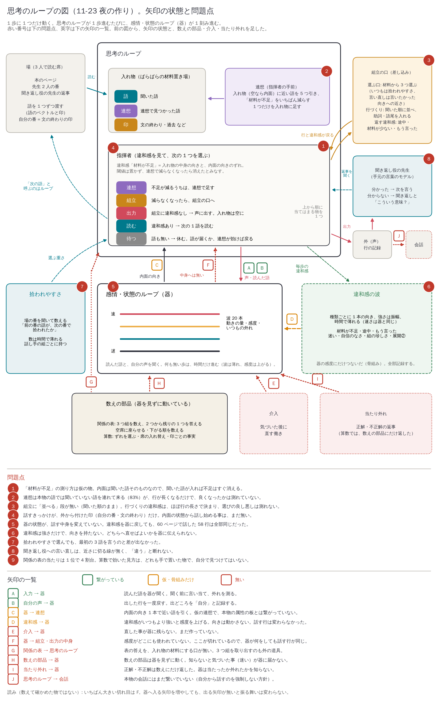

図は `tools/past/fig_i49_loop.py` で描く（手で書いた図。数は入れていない）。

### 問題点

1. 器（内面の波）の状態が、話す中身を変えていない。違和感を器に戻しても、60 ページで話した 58 行は全部同じだった。
2. 話す所は、ほぼ文の終わりの印で決まる（9 割以上）。読み終わった後は、ほとんど話さない。
3. 違和感は強さだけで、向きを持たない。どちらへ直せばよいかを器に伝えられない。
4. 行づくりの違和感は、ほぼ行の長さで決まる。材料の選び方の良し悪しが見えない。
5. 関係の表の当たりは 1 位で 4 割台。算数から当てた 2 つの直しは、変わらないか 0.3 ポイントだった。
6. 算数で効いた見方（並び、ずれを運ぶ、席の入れ替え、印ごとの事実）は、どれも手で置いた物。
7. 知らないと気づく所（迷い）までは出来ているが、気づいた後に直す仕組みが弱い。
8. 手で置いた値がまだ多い。
9. 向きを持たない語がある（問いの 12.8%）。数の語は語板にほとんど無い。
10. 連想に脈絡が無い（持ち主の指摘）。内面の向きに近い語を引くだけで、文のどの席に入る語かを見ていない。「学校で友達と ?? した」の ?? に、勉強やゲームを選ぶ理由を持たない。関係の表は 2 語から残りを絞れるが、席が 3 つだけで、連想とは繋がっていない。

### 必要な部品

1. 介入から器への矢印（未着手）
2. 器の状態を、組立と出力の決め方に効かせる口
3. 向きを持つ違和感、または「何が足りないか」を一緒に運ぶ物
4. 「違和感が下がらなくなったら止まる」止め方
5. 文から 3 つ組を自分で取り出す所
6. 関係の表の答えを、思考のループの入れ物に材料として入れる口（席を見る連想）
7. 本物の連想と本物の組立を、思考のループの差し込み口に入れる事
8. 過去・進行などの印
9. 「近くないので繰り返さない」という断り方
10. 桁の見つけ方（途中）

### 器との繋がり

| 矢印 | 今の状態 |
|---|---|
| A 入力 → 器 | 繋がっている |
| B 自分の声 → 器 | 繋がっている |
| C 器 → 連想 | 仮の連想だけ |
| D 違和感 → 器 | 骨組みあり。感度だけ動く |
| E 介入 → 器 | 無い |
| F 器 → 組立・出力の中身 | 無い |
| G 関係の表 → 思考のループ | 無い |
| H 数えの部品 → 器 | 無い |
| I 当たり外れ → 器 | 無い |
| J 思考のループ → 会話 | 繋いでいない |

読み（数えて確かめた物ではない）: いちばん大きい切れ目は F。器へ入る矢印を増やしても、出る矢印が無いと振る舞いは変わらない。

## 11. 語を鍵にした数の表を持たず、向きのずれだけで答える（I49j、`intervention/i49j_shift_vec.py`、`tools/i49j_shift_vec_run.py`、持ち主の案・未確定）

持ち主の案: 語板の波を値（表）と紐づけているのが、脈絡の無さの元ではないか。王 − 女王 ＝ 亭主 − 女房 のように向きの差が中身を決める形を、値の表無しで、調整だけで作れないか。

算数の「ずれを運ぶ」を向きでやる形で試した。3 つ組は覚えず、述語側の語ごとに向きを足して持つだけ（述語側の 1 語を鍵にした小さな表は残る）。

- ずれ: 「答えの向き − もう片方の語の向き」を足して平均し、問いのもう片方の語の向きに足す。そこに近い候補を答える。
- 真ん中: 「答えの向き」だけを足して平均する。もう片方の語は見ない（ずれが効くのかを分ける比べ役）。
- 近さ: 何も覚えず、もう片方の語の向きに近い候補を答える。

600 本の会話、8,229 問（I49h と同じ材料と流れ。PC、CPU だけ 144 秒）。

| 1 位の当たり | 関係の表 | ずれ | 真ん中 | 近さ |
|---|---|---|---|---|
| まっさらから（全体） | .432 | .231 | .271 | .034 |
| 　答えられない | 3.6% | 25.9% | 23.9% | 2.4% |
| 　答えた問いだけ | .448 | .312 | .356 | .035 |
| 　述語側は聞いた・2 語の組は初めて（2,937 問） | .421 | .266 | .332 | .039 |
| 　2 語の組を前に聞いた（3,481 問） | .503 | .322 | .361 | .033 |
| 青空文庫を先に入れてから（全体） | .453 | .143 | .269 | .034 |
| 　述語側は聞いた・2 語の組は初めて（3,624 問） | .416 | .127 | .275 | .036 |

- 読み: 3 つとも関係の表よりはっきり下（揺れの外）。初めての組でも表に届かない。今の語板の向きでは、表を持たない形はまだ使えない。
- 想定外の反応:
  - 「ずれ」は、もう片方の語を見ない「真ん中」より下だった。見せた語の向きを足すと、かえって外れる。今の向きでは「答え − もう片方」のずれが、述語ごとにそろっていない。
  - 「ずれ」だけ、青空文庫を先に入れると大きく下がった（.231 → .143）。多くの組のずれを平均すると、打ち消し合うと見ている。
  - 「近さ」は .034。向きが近い語を選ぶだけでは、ほとんど当たらない（連想に脈絡が無い、という指摘を数で見た形）。
  - 数えは速い（どれも 1 秒未満。関係の表は青空文庫ありで 12 秒）。
- 手で置いた値: 述語側の決め方、平均を取る事、近さを cos の実部にした事、100 本ごとの区切り、z の式。
- 言える事と言えない事: 駄目だったのは「今の語板の向きのまま、ずれを足す」形。向きの方を調整すれば使えるかは、まだ試していない。

## 12. 語の向きを、座り方から足し算で作り直す（I49k、`intervention/i49k_seat_vec.py`、`tools/i49k_seat_vec_run.py`、持ち主の案「語板を再設計する必要があるかも」から・未確定）

今の語板の向きは、差に意味が乗るように作られていない（11 節）。語の向きを「一緒に座った語の元の向きを、席の組ごとに決まった回し方で回して足した物」に作り直し、11 節の比べをやり直した。向きは青空文庫の 3 つ組だけから作り、会話を流す間は変えない。

600 本の会話、8,229 問、青空文庫を先に入れてから（PC、CPU だけ 179 秒）。作り方は 数（聞いた数のまま）と 偏り（たまたまより多い分だけ）の 2 通りで、差は 1 ポイント未満だったので、数の方を載せる。

| 1 位の当たり | 語板の向き（11 節） | 作った向き |
|---|---|---|
| 関係の表（借りる時の近さに使う） | .453 | .443 |
| ずれ | .143 | .220 |
| 真ん中 | .269 | .311 |
| 近さ | .034 | .049 |

- 会話の内容語 2,963 語のうち、語板の向きが有るのは 2,849 語、作った向きが有るのは 1,609 語（54%）。語板に無くて作った向きで補えた語は 17 語。
- 作った向きどうしの |cos| の中央値は .046（つぶれてはいない）。
- 読み: 表を持たない 3 つの形は、どれも作った向きの方が上がった。ただし関係の表（.453）にはまだ遠い。関係の表の方は 1 ポイント下がったが、下がった分は作った向きを持たない語が増えた所から来ていて、3 語とも向きが有る問いに限ると .481 と .486 でほぼ同じ。
- 想定外の反応:
  - 作った向きを持つ語が 54% しか無い。青空文庫の 3 つ組に出ない会話の語が多い（材料の足りなさ）。
  - 近さの「どうした」の席は .003。座り方で作ると、席が違う語どうし（名詞と動詞）は似ないため、見せた名詞の近くに述語は来ない。
  - ずれは、作った向きでも真ん中より下（.220 と .311）。差は 11 節より縮んだ。
  - 数 と 偏り でほとんど変わらなかった。
- 手で置いた値: 回し方（ずらす数）、重さの 2 通り、元の向きを長さ 1 にそろえる事、目安に使う組の数 2,000。

### 材料の量を変える（`tools/past/i49k_amount_run.py`、持ち主の案「学習の資料不足の検証も必要かも」）

青空文庫の 3 つ組を、8 つおき・4 つおき・2 つおき・全部で使い、同じ流れで数えた（PC、CPU だけ 161 秒）。

| 量（3 つ組の数） | 作った向きを持つ内容語 | 関係の表 | 真ん中 | ずれ |
|---|---|---|---|---|
| 1/8（8,888） | 35.2% | .449 | .295 | .179 |
| 1/4（17,775） | 42.6% | .449 | .305 | .199 |
| 1/2（35,549） | 49.3% | .451 | .309 | .206 |
| 全部（71,097） | 54.3% | .453 | .311 | .220 |

- 読み: 関係の表は量によらずほぼ平ら。真ん中は伸びが縮んでいく（+1.0、+0.4、+0.2）ので、作りの限りに近い。ずれ と 向きを持つ語の割合は、2 倍ごとにまだ伸びている（材料不足の形）。ただし、ずれの伸びの多くは「答えられる問いが増えた」分（答えられない 37% → 24%）。
- 向きを持つ語の割合は 2 倍ごとに 5〜7 ポイントずつ。この伸び方のままなら、青空文庫を増やすだけで会話の語を埋めるには、今の何百倍も要る計算になる。
- 想定外の反応: 関係の表は、材料が 1/8 でも .449 で、全部との差が 0.4 ポイントしか無い。ずれの伸びが途中で一度小さくなった（刻みが 4 つだけなので揺れの内かもしれない）。
- 材料を増やす道: 今の解析済みの文は 897 作品・30 万文で、道具の引数を変えても増えない。増やすには、まだ解析していない作品を解析し直す必要がある（重い処理、時間は未計測）。
- 手で置いた値: 量の刻み、何個おきに取るかの取り方。

## 13. 位相で席を回す形、表なしで解く形、行のうねりで作る向き（I49l、`intervention/i49k_seat_vec.py` の bind と Unbind、`intervention/past/i49l_line_vec.py`、`tools/past/i49l_phase_line_run.py`、持ち主の案・未確定）

持ち主の案 2 つを、12 節の続きで試した。

- 位相差で表す: 席の区別を、並びをずらす代わりに、周波数ごとに違う角度で位相を回す形にした（bind="位相"）。
- 表なしで解く（Unbind）: 語を鍵にした表をまったく持たない。問いの見せた 2 語を、隠した席から見た回し方で回して足し、作った向きがそれに近い候補を答える。聞くたびに向きに足していく形（育つ形）も数えた。
- 行のうねり（LineVec）: 1 行を聞くたびに、行の語の向きを全部足したうねりを作り、行の中の語に足す。全部の周波数を足す形と、その行でいつもより強い周波数だけ足す形。この試しでは、青空文庫の 3 つ組 1 つを 1 行とみなした。

600 本の会話、8,229 問（PC、CPU だけ 217 秒）。

聞きながら育つ形（表なしで解く）:

| 1 位の当たり | 関係の表 | 解く・ずらす | 解く・位相 |
|---|---|---|---|
| まっさらから（全体） | .432 | .368 | .370 |
| 　述語側の語も初めての問い（1,811 問） | .315 | .311 | .310 |
| 　2 語の組を前に聞いた問い（3,481 問） | .503 | .411 | .415 |
| 　答えられない | 3.6% | 1.5% | 1.5% |
| 青空文庫を先に入れてから（全体） | .453 | .342 | .342 |

100 本ごとの 1 位（まっさらから）: 関係の表 .385 .460 .429 .459 .413 .451、解く・位相 .357 .402 .372 .387 .364 .339。

向きを止めた形（青空文庫だけから作る。比べる元の関係の表は .453）:

| 向きの作り方 | ずれ | 真ん中 | 近さ | 解く | 向きどうしの近さの中央値 |
|---|---|---|---|---|---|
| 座り方・ずらす | .220 | .311 | .049 | .236 | .046 |
| 座り方・位相 | .219 | .312 | .050 | .237 | .045 |
| 行のうねり・全部 | .145 | .243 | .076 | | .246 |
| 行のうねり・強い所 | .126 | .246 | .072 | | .183 |

- 読み:
  - 表なしで解く形は、まっさらから .37 で、今までの表なしの形（.22〜.31）より上。関係の表（.43）よりは 6 ポイント下で、揺れの外。初めて聞く述語の問いに限ると、表とほぼ同じ（.311 と .315）。
  - 位相で回しても、並びをずらしても、どの数もほぼ同じ（差 0.5 ポイント以内）。回し方の違いは、この数え方では見えない。
  - 行のうねりで作ると、ずれ・真ん中は下がり、近さだけ少し上がる。向きどうしが互いに似てくる（中央値 .046 → .246）。
  - 強い所は、周波数の 45% だけ足して、全部とほぼ同じ当たりだった。少ない周波数で済む、という所は数に出た。
- 想定外の反応:
  - 解く形は、聞くほど下がる。100 本ごとの最後の区切りがいちばん低く、青空文庫を先に入れるとまっさらからより下（.342 と .370）。1 本の向きに重ねる数が増えるほど混ざって取り出しにくくなる。関係の表とは逆。
  - 座り方で作った向きでは .003 だった「どうした」の席の近さが、行のうねりでは .067・.105 に戻った。行で一緒に出る名詞と動詞が近くなるため。
  - 解く形は、答えられない問いがほとんど無い（1〜2%）。
- 手で置いた値: 位相の傾き、ずらす数、解く形の近さを cos の実部にした事、うねりから自分の分を除く事、「いつも」をそれまでの全部の行の平均にした事、3 つ組を 1 行とみなした事、100 本ごとの区切り、z の式。
- 言える事と言えない事: 表を持たずに .37 までは行く。ただし材料が増えると混ざって下がるので、このままでは育たない。混ざりを減らす工夫（よく出る語の分を引く、など）はまだ試していない。行のうねりは、本当の行（文）ではなく 3 語の組で試した物なので、行が長い時の動きは分からない。

### 混ざりを減らす試し 1: たまたまの分を引く（`SeatVec(center=True)`）

作った向きから「足した回数 × どの語にも足された向きの平均」を引いてから解く形を、同じ流れで数えた（PC、152 秒）。

| 1 位の当たり | 関係の表 | 解く・位相 | たまたまの分を引く |
|---|---|---|---|
| まっさらから | .432 | .370 | .365 |
| 青空文庫を先に入れてから | .453 | .342 | .337 |

- 読み: 変わらない（わずかに下）。聞くほど下がる形も残った（最後の 100 本: .339 と .326）。
- 想定外の反応: 引いても混ざりが減らなかった。下がる理由は、どの語にも共通の成分ではない所にあると見ている。足すだけの向きは「A とも B とも座った」と「A と B の組と座った」を区別できない。材料が増えるほど、候補のどれもが見せた語のどちらかとは座っているようになり、見分けが効かなくなる、というのが次の見立て（未確認）。
- 手で置いた値: たまたまの分を、席の組を分けずに全部まとめた平均にした事。

### 混ざりを減らす試し 2: 一緒に座った 2 語を束ねた向きも足す（`SeatVec(pair=True)`）

一緒に座った 2 語を、周波数ごとに掛け合わせて（位相を足して）1 本に束ねた向きも足す形（PC、158 秒）。

| 1 位の当たり | 関係の表 | 解く・位相 | 組も束ねる |
|---|---|---|---|
| まっさらから（全体） | .432 | .370 | .375 |
| 　2 語の組を前に聞いた問い | .503 | .415 | .427 |
| 　2 語の組は初めての問い | .421 | .353 | .354 |
| 青空文庫を先に入れてから（全体） | .453 | .342 | .347 |

- 読み: 0.5 ポイント上がった（揺れの内かもしれない）。上がったのは、同じ組をもう一度聞いた問いだけ。初めての組には運べていない。関係の表との差は大きいまま。
- 想定外の反応: まっさらからでは、聞くほど下がる形が少し弱まった（最後の 100 本 .339 → .350）。青空文庫を先に入れた時は弱まらない（.293 → .290）。見立て（組を表せないから下がる）は、当たっていても一部だけ。
- 手で置いた値: 束ね方（周波数ごとに掛ける）、束ねた向きと 1 語ずつの向きを同じ重さで足した事。

### 11〜13 節のまとめ（2026-11-23 夜）

| 形 | まっさらから | 青空文庫あり | 語を鍵にした表 |
|---|---|---|---|
| 関係の表 | .432 | .453 | 持つ |
| 解く・組も束ねる | .375 | .347 | 持たない |
| 解く・位相 | .370 | .342 | 持たない |
| 真ん中（作り直した向き） | | .311 | 述語の 1 語だけ |
| ずれ（作り直した向き） | | .220 | 述語の 1 語だけ |
| ずれ（今の語板の向き） | .231 | .143 | 述語の 1 語だけ |
| 近さだけ（今の語板の向き） | .034 | .034 | 持たない |

- 分かった事: 表を持たず、足し算と共振だけで .37 までは行く。初めて聞く述語では表と同じ。位相で回すか並びをずらすかは効かない。行のうねりは、少ない周波数で済むが、当たりは下がる。
- 分からない事: 表なしの形が、材料を増やすと下がる理由。共通の成分を引いても、組を束ねても、ほとんど直らなかった。

## 14. 単語ではなく属性でそろえる（I49m、`intervention/i49m_attr_base.py`、`tools/i49m_attr_run.py`、持ち主の案・未確定）

持ち主の案: 単語ではなく属性でそろえる。単語 1 つに 1 つの属性を選ばず、属性の周波数全体を使うか、属性の内容ごとに位相差を持つ。

13 節の「表なしで解く形」の元の向きを、語の波から属性の割合に差し替えた。属性 1 つに周波数 1 本を割り当て（属性は 1,997 個）、語が持つ属性の割合をそのまま強さにする。席は位相の回し方で持つ。つまり 強さ ＝ 属性の割合、位相 ＝ 席。

600 本の会話、8,229 問、聞きながら育つ形（PC、CPU だけ 180 秒）。

| 1 位の当たり | まっさらから | 青空文庫を先に |
|---|---|---|
| 関係の表（語の波の近さで借りる。比べる元） | .432 | .453 |
| 解く・語の波（13 節） | .370 | .342 |
| 解く・属性 | .408 | .398 |
| 解く・属性・たまたまの分を引く | .398 | .395 |
| 解く・属性・組も束ねる | .404 | .387 |
| 解く・属性（話題の帯を除く） | .408 | .400 |
| 関係の表（属性の近さで借りる） | .427 | .446 |

問いの種類ごと（まっさらから）:

| | 関係の表 | 解く・語の波 | 解く・属性 |
|---|---|---|---|
| 述語側の語も初めて（1,811 問） | .315 | .310 | .340 |
| 述語側は聞いた・2 語の組は初めて（2,937 問） | .421 | .353 | .406 |
| 2 語の組を前に聞いた（3,481 問） | .503 | .415 | .446 |
| 答えられない | 3.6% | 1.5% | 0.5% |

100 本ごとの 1 位（まっさらから）: 関係の表 .385 .460 .429 .459 .413 .451、解く・属性 .391 .430 .401 .441 .402 .387。

- 会話の内容語 2,963 語のうち、属性の向きを持つのは 2,439 語（語の波は 2,849 語）。属性の向きどうしの |cos| の中央値は .097。
- 読み:
  - 属性にすると、表なしで解く形が 4〜6 ポイント上がった（.370 → .408、.342 → .398）。関係の表との差は 2.4 ポイントまで縮んだが、まだ揺れの外（z −4.9）。
  - 初めて聞く述語の問いでは、表と並んだ（.340 と .315。1,811 問なので、この差は揺れの内）。初めての組でも .406 と .421 で近い。
  - たまたまの分を引く・組も束ねる・話題の帯を除く は、どれも上積みにならなかった。
  - 関係の表の借りる近さを属性にすると、少し下がった。属性の向きを持つ語の方が少なく、借りられない語が出るため。
- 想定外の反応:
  - 答えられない問いがほぼ無くなった（0.5%、0.1%）。
  - 聞くほど下がる形は、属性でも残った（最後の 100 本 .387、青空文庫を先に入れると .398 に下がる）。語の波の時よりはゆるやか。
  - 話題の帯（語あたり 73 個）を除いても、ほとんど変わらなかった。強く出すぎる心配は当たらなかった。
- 手で置いた値: 品詞の対応、同じ名前の語の選び方、割合をそのまま強さにする事、位相の傾き、近さを cos の実部にした事、100 本ごとの区切り、z の式。板に固有名詞と副詞の行は無く、その品詞の語は同じ名前の初めの行を使っている。
- 言える事と言えない事: 属性でそろえる方が、語の波でそろえるより良い。表を持たない形としては今までで一番。ただし材料を増やすと下がる所は直っていないので、長く育てられるかはまだ分からない。

### 聞くほど下がる理由の見立て 1: 候補の向きの長さで割るため（外れ）

見立て: 解く形は候補の作った向きの長さで割る（cos）ので、たくさん聞いた語ほど不利になり、材料が増えるほど負ける。そこで、割らない形と、長さの平方根で割る形を数えた（`Unbind(norm=...)`、PC、258 秒）。

| 1 位の当たり（解く・属性） | まっさらから | 青空文庫を先に |
|---|---|---|
| 長さで割る（14 節の形） | .408 | .398 |
| 長さの平方根で割る | .351 | .308 |
| 長さで割らない | .310 | .275 |

- 読み: 見立ては外れ。割るのをゆるめるほど、はっきり下がる。まっさらからでは、聞くほど下がる形もむしろ強まった。割らないと、たくさん聞いた語がどの問いでも上に来る。
- 想定外の反応: 下がり方は「だれが」より「何を」の席に寄っていた（.307 → .154）。割らない形では、前に聞いた組の問いの方が、初めての組の問いより低くなった（.297 と .337）。
- 分かった事: 長さで割るのは要る。聞くほど下がる理由は、まだ分かっていない。試して外れた見立ては 3 つ（共通の成分、組を表せない、長さで割る）。
- 手で置いた値: 割り方の 3 通り（割る、平方根、割らない）。

### 聞くほど下がるのは、どの問いで外れるからか（`tools/i49m_why_drop.py`、下調べ）

属性で解く形を流しながら、問いごとに候補の数・競う相手の数（作った向きを持つ候補）・正解の順位などを記録した（PC、164 秒）。

まっさらから、100 本ごと:

| 区切り | 候補の数 | 競う相手の数 | 正解が向きを持つ割合 | 1 位 | 正解が向きを持つ問いの 1 位 | 順位 ÷ 相手の数 |
|---|---|---|---|---|---|---|
| 100 | 17.6 | 7.4 | .68 | .391 | .575 | .139 |
| 200 | 17.2 | 9.0 | .78 | .430 | .550 | .126 |
| 300 | 17.9 | 10.9 | .83 | .401 | .482 | .143 |
| 400 | 15.8 | 10.1 | .86 | .441 | .516 | .140 |
| 500 | 18.7 | 12.2 | .86 | .402 | .468 | .139 |
| 600 | 20.3 | 13.8 | .88 | .387 | .439 | .125 |

正解がそれまでに聞かれた回数ごとの 1 位（まっさらから）: 0 回 .000（1,484 問）、1〜3 回 .456、4〜15 回 .452、16〜63 回 .475、64 回以上 .571。

- 読み（前の見方の直し）: 「聞くほど混ざって取り出しにくくなる」という 13 節・14 節の見方は、当たっていなかった。
  - 順位を相手の数で割った値は .139 → .125 で、平らか少し良くなっている。相手が増えた中での並べ方は悪くなっていない。
  - 下がって見えるのは、競う相手が 7.4 から 13.8 に増えるため。初めのうちは、向きを持つ候補が少なくて当てやすいだけだった。
  - 1 位の上下は、その区切りの会話の候補の数とよく合う（候補がいちばん少ない 400 で山、いちばん多い 600 で最低）。材料の側の事情も入っている。
  - よく聞いた語ほど当たる（64 回以上 .571）。混ざって悪くなる形ではない。
- 見つかった穴: 正解がまだ一度も聞かれていない問いが 1,484 問（18%）あり、必ず外れる。候補の作った向きを見る形なので、聞いた事の無い候補は比べられない。
- 想定外の反応:
  - 青空文庫を先に入れると、64 回以上聞いた正解の 1 位（.426）が、4〜15 回（.443）より下になる。青空文庫でよく聞いた語の座り方は、会話での座り方と合っていないように見える。
  - 外れた時の 1 位は、聞くほど「見せた語と座った事のある語」になる（座っていなかった割合 .36 → .16）。もっともらしい相手に負ける形に変わる。
  - 関係の表は、候補が多い区切りでも下がらない（600 で .451）。相手の多さに弱いのは表なしの形の方。
  - 席では「何を」がいちばん弱い（順位 ÷ 相手の数 .16〜.25、ほかは .08〜.15）。
- 手で置いた値: 100 本ごとの区切り、回数の区切り（0・1〜3・4〜15・16〜63・64 以上）。
- 次の試し（`Unbind(side=...)`、数えはこれから）: 見せた語の作った向きを回し戻して、隠した席に来る語の属性を言い当て、候補の属性と比べる形。聞いた事の無い候補も比べられるので、上の穴（18%）に当たる。

### 見せた語の側から、隠した席の属性を言い当てる形（`Unbind(side=...)`）の結果

| 1 位の当たり | まっさらから | 青空文庫を先に |
|---|---|---|
| 関係の表（比べる元） | .432 | .453 |
| 解く・属性（候補の側から。14 節の形） | .408 | .398 |
| 解く・属性・見せた語の側から | .311 | .280 |
| 解く・属性・両方を足す | .407 | .392 |
| 解く・語の波（13 節の形） | .370 | .342 |
| 解く・語の波・両方を足す | .387 | .371 |

- 読み: 属性では良くならなかった。見せた語の側だけだと大きく下がり（特に「何を」.174）、両方を足すと元と同じか少し下。語の波では、両方を足すと 2〜3 ポイント上がった。
- 中身: 属性で両方を足すと、3 語とも向きが有る問いは上がり（.409 → .420）、初めて聞く述語の問いは下がり（.340 → .311）、差し引きで同じ。席では「だれが」が上がり（.505 → .528）、「どうした」が下がる（.413 → .395）。
- 想定外の反応: 聞いた事の無い候補も比べられるようにすれば穴（18%）が埋まる、という見込みは、全体の数には出なかった。穴の問いだけでどうだったかは、この道具では数えていない。
- 手で置いた値: 見せた 2 語の言い当てを、それぞれ長さ 1 にそろえてから足す事、2 つの点を同じ重さで足す事。

### 14 節のまとめ（2026-11-23 夜）

- 表を持たない形でいちばん良いのは「属性で解く（候補の側から）」で、まっさらから .408。関係の表は .432。
- 試して効かなかった物: たまたまの分を引く、2 語を束ねる、話題の帯を除く、長さの割り方を変える、見せた語の側から言い当てる。
- 分かった事: 聞くほど下がって見えたのは、競う相手が増えるため。並べ方そのものは悪くなっていない。
- まだ分かっていない事: 表との差 2.4 ポイントがどこから来るか。「何を」の席がいちばん弱い理由。青空文庫で聞いた座り方が会話に合わない理由。

## 15. 1 行に出た語だけで波を作る（I49n、`SeatVec(bind="なし").hear_line`、`tools/i49n_line_words_run.py`、持ち主の案・未確定）

持ち主の案: 品詞は骨組みに、過去形などはスライドと印に任せるとして、連想ではまず単語を充実させる。1 つの行に含まれる単語だけで、同じ実験をする。

形: 席は見ない。同じ行に出た内容語どうしを、そのまま足して語ごとの波を作る（位相の回転なし）。調整は足すだけで、強さや位相を直接書き換える事はしない。問いは今までと同じ（600 本の会話、8,229 問、3 つ組の 1 語を隠して当てる）。始め方は 3 つ。まっさら、青空文庫の 3 つ組を先に、青空文庫の本当の 1 文を先に（271,618 行、1 行の内容語は平均 8.09 語）。

| 1 位の当たり | まっさらから | 青空の 3 つ組を先に | 青空の本当の行を先に |
|---|---|---|---|
| 関係の表（比べる元） | .432 | .453 | （.453。3 つ組を聞かせた値） |
| 解く・属性（席あり。14 節の形） | .408 | .398 | （.398。同上） |
| 行の語・属性 | .329 | .314 | .222 |
| 行の語・語の波 | .244 | .218 | .150 |

席ごと（だれが・何を・どうした）:

| | まっさらから | 3 つ組を先に | 本当の行を先に |
|---|---|---|---|
| 行の語・属性 | .347 .266 .374 | .300 .287 .356 | .190 .197 .279 |
| 行の語・語の波 | .225 .224 .284 | .175 .241 .237 | .062 .211 .176 |

1 語の波に足された語の数:

| 行の語・属性 | まっさらから | 3 つ組を先に | 本当の行を先に |
|---|---|---|---|
| 中央値 | 0 | 6 | 256 |
| 9 割の所 | 9.8 | 106.8 | 5,455.8 |
| 最大 | 1,324 | 3,801 | 280,363 |
| 200 を超える語 | 0.2% | 5.5% | 53.0% |
| 1,000 を超える語 | 0.03% | 0.64% | 32.6% |
| 波を持つ語 | 49.7% | 71.4% | 88.3% |

- 読み 1: 席を見ない形は、まっさらからでも席ありより 8 ポイント低い（.329 対 .408）。表との違いは z −19.3。席を位相の回転で分ける事が、この問いでは効いている。ただし、この問いは席を当てる作りなので、席を見ない形に不利な物差しでもある。
- 読み 2: 波に乗る語の数が多い始め方ほど低い（属性 .329、.314、.222。語の波 .244、.218、.150）。本当の行を先にすると、半分の語が 200 を超え、3 割が 1,000 を超える。自作の波の試し（200 で .91、500 で .36、1,000 で .14）で崩れた所を越えている。ただし、始め方ごとに材料の種類も違う（3 語の組と、平均 8 語の文）ので、下がった分のうち、乗りすぎの分と、材料が合わない分は、この数では分けられない。
- 読み 3: 本当の行を先にした時は、100 本ごとの値がほぼ平ら（属性 .196 から .229、語の波 .148 から .151）。会話で足す分が、先に乗った分に埋もれている形に見える。
- 読み 4: 語の波の「だれが」がいちばん崩れた（.225、.175、.062）。主語になる語は多くの行に出るので、乗る数が多くなるためだと考えているが、確かめてはいない。
- 想定外の反応: 本当の行を先にすると、3 語とも向きが有る問いの方が全体より低い（属性 .192 対 .222、語の波 .126 対 .156）。向きを持つ語ほど多く乗っていて悪い、という形。語の波だけ、答えられない問いが 3.8% に増えた（ほかは 0.1%）。まっさらからでは波を持つ語が半分なのに、答えられない問いは 0.3% しかない。波の無い候補も点 0 で並び、先頭から選ばれていると見られる。
- 手で置いた値: 内容語（名詞・動詞・形容詞）だけを行の語にする事（語を選ぶ所では品詞を見ている）、1 行の中で同じ語は 1 回に数える事、足す重さは全部 1、位相の回転なし、作品ごとの文の上限（道具の `--cap`）。
- まだやっていない事: 乗りすぎを抑える形（強い所だけ使う、よく出る語の重さを偏りで下げる、古い分を薄める）。会話に近い材料の行で同じ数え。席を当てない問い（行の残りの 1 語を当てる問い）での比べ。

## 16. 小さい自作の世界での総当たり（I49q、`tools/past/i49q_small_world.py`、`tools/past/i49q_small_world_mix.py`、持ち主の案・未確定）

持ち主の案: 語ごとに専用の周波数を足し続ければ、ズレは起きないのではないか。位相がそろう事と、1 本では足りない事が分かったので、小さい実験を総当たりでやってみる。

### 語 1 つに周波数 1 本（位相 1 つ）の例

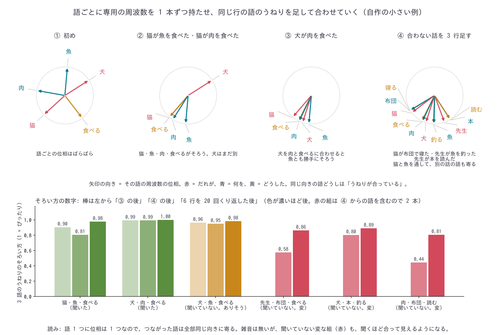

自作の 6 行。乗りすぎの雑音は起きないが、つながった語が全部同じ向きに寄る。聞いていない「犬・魚・食べる」は 0.96（似た語に広がる良い面）。聞いていない変な組「先生・布団・食べる」は 1 回ずつで 0.58、20 回くり返すと 0.86。引き裂かれるのではなく、まとめて寄る形だった。

### 総当たり 1: 位相の本数、足し方、遠ざけ方（混ぜ物なし）

世界: 話が 160 個、輪になって隣の話と語を分け合う。語 802、聞かせる文 3,519 行、乱数なし。数字は「当て」（聞いていないがありそうな文の 1 語を隠して、同じ席の語全部から選ぶ。まぐれは約 0.02）。席の回しなし。

| 語 1 つの位相の本数 | 1 | 2 | 4 | 8 | 16 |
|---|---|---|---|---|---|
| 今の波に足す（5 回くり返し） | .05 | .45 | .97 | .99 | 1.00 |
| 同上 + ほかの語を遠ざける | .30 | .89 | .98 | .99 | .99 |
| 同上 + 共通の分を引く | .36 | .45 | .77 | .95 | .99 |
| 元の波を足す（I49k〜n の形） | .04 | .13 | .37 | .73 | .97 |
| 元の波 + たまたまの分を引く | .06 | .14 | .45 | .82 | 1.00 |
| 元の波 + 夜に数え直す（偏り） | .03 | .17 | .43 | .77 | .98 |

- 読み: いちばん効くのは位相の本数。本数が少ない時は「遠ざける」が効く。「今の波に足す」は 4 本以上で潰れず、「元の波を足す」より良い。
- 想定外の反応: 席の回しを入れると「遠ざける」が効かない（2 本で .89 が .07）。理由は分かっていない。「共通の分を引く」「夜に数え直す」は良くならなかった。

### 総当たり 2: 1 行に関係の薄い語を混ぜる

同じ世界の 1 行に、よく出る 5 語と遠い話の語を混ぜる。席は見ない。数字は「当て」で、左が 64 本、右が 1,024 本。

| 1 行に混ぜた語の数 | 0 | 2 | 5 | 10 |
|---|---|---|---|---|
| 今の波に足す | 1.00 / 1.00 | .99 / 1.00 | .79 / .95 | .51 / .67 |
| 同上 + ほかを遠ざける | 1.00 / 1.00 | .99 / 1.00 | .73 / .98 | .10 / .11 |
| 元の波を足す | 1.00 / 1.00 | .99 / 1.00 | .46 / .89 | .07 / .03 |
| 同上 + たまたまの分を引く | 1.00 / 1.00 | 1.00 / 1.00 | .89 / .90 | .05 / .03 |
| 周波数を寄せる | 1.00 / 1.00 | .57 / .64 | .25 / .43 | .09 / .15 |
| 同上 + ほかから離す | .08 / .06 | .46 / .57 | .17 / .38 | .12 / .11 |

- 読み: 崩れるのは混ぜ物のせいで、本数を増やしても直らない。「元の波を足す」は 10 語混ぜると 1,024 本でもまぐれまで落ちる（15 節の、本当の行で大きく下がった形と同じ）。混ぜ物にいちばん強いのは「今の波に足す」。理由（何度も一緒に出る語は寄り合い、たまたまの語は打ち消し合う）は考えであって、確かめていない。
- 想定外の反応: 「遠ざける」は混ぜ物 10 語で壊れた（.67 が .11）。「周波数を寄せる」は今の作りでは良くなかった。
### 総当たり 3: 属性の数だけ周波数を持つ形、外れた時に周波数を足す形（`tools/past/i49q_small_world_attr.py`）

| 1 行に混ぜた語の数 | 0 | 5 | 10 |
|---|---|---|---|
| まんべんなく 256 本・今の波に足す | 1.00 | .86 | .65 |
| 細かい属性 163 本・聞かせない | 1.00 | 1.00 | 1.00 |
| 細かい属性 163 本・今の波に足す | 1.00 | .91 | .19 |
| 中くらいの属性 43 本・聞かせない | .76 | .76 | .76 |
| 中くらいの属性 43 本・今の波に足す | 1.00 | .77 | .21 |
| 粗い属性 13 本・聞かせない | .22 | .22 | .22 |
| 粗い属性 13 本・今の波に足す | .69 | .33 | .15 |
| 初め 16 本・外れた時に足す | 1.00 | .67 | .43 |

- 読み: 属性が粗い時は、きれいな文を聞かせると大きく伸びる（13 本で .22 が .69、43 本で .76 が 1.00）。混ぜ物の多い文を聞かせると、良い属性を壊す（163 本で 1.00 が .19）。細かい属性が聞かなくても当たるのは、この世界では話そのものを属性にしたためで、当然の結果。
- 外れた時に足す形は、ここで置いた決まりでは足しすぎた（上限の 2,048 本まで使い切り、行ごとの丸暗記に近い）。外れの決め方が厳しすぎた。案そのものを確かめた事にはなっていない。

### 総当たり 4: 今の共振が強い相手ほど多く足す（`tools/past/i49q_small_world_gate.py`）

混ぜ物を、足す時の共振の強さで見分けられるかを見た。ほぼ変わらなかった（まんべんなく 256 本、混ぜ物 10 語: そのまま .647、共振の強い相手ほど多く .653、行の中で平均より強い相手だけ .58）。属性を元にしても同じ。

- 読み: 1 行に関係の薄い語が 10 語、本当の相手が 2 語で、同じ組のくり返しが少ないと、足し方の工夫では分けられなかった。相手を絞るのは、係り受け（3 つ組）の側の役目だと見ている。15 節の、席を見ない形が席ありより 8 ポイント低い事と合う。

- 手で置いた値: 世界の形（話ごとに人 4・物 3・動き 3、3 分の 1 を聞かせない）、くり返しの回数、遠ざける強さ（足した数と同じだけ平均を引く）、混ぜる語の選び方、周波数を寄せる時の動かす幅（聞いた回数で割る）、属性のまとめ方、外れの決め方（同じ席の上位 5 位）、共振で付ける重さの形。
- 注意: この世界はきれいに作った物で、本物の文の難しさを全部は持っていない。ここで良かった形が本物の文で良いかは、18 節の数えで見る。
- 次の案（持ち主、未確定）: 属性の数だけ周波数を持つ。外れが続く語には、違和感をきっかけに、介入として周波数を足す。

## 17. 乗りすぎの分と、材料の分を分ける（I49o、`tools/past/i49o_line_load_run.py`）

15 節では、乗る語の数と材料の種類が一緒に変わっていた。ここでは、本当の行を聞かせる量を 4 段に変え、乗りすぎを抑える形を 2 つ（たまたまの分を引く、よく出る語を軽くして足す）並べた。数字は 1 位の当たり（600 本、8,229 問）。

| 行の語・属性 | 聞かせた行 | 乗った数の中央値 | そのまま | 引く | 軽く | 引く・軽く |
|---|---|---|---|---|---|---|
| まっさらから | 0 | 0 | .329 | .256 | .308 | .256 |
| 青空の 3 つ組を先に | 71,097 | 6 | .314 | .262 | .313 | .255 |
| 本当の行 64 行に 1 行 | 4,245 | 6 | .278 | .250 | .274 | .240 |
| 本当の行 16 行に 1 行 | 16,977 | 17 | .265 | .233 | .265 | .229 |
| 本当の行 4 行に 1 行 | 67,905 | 65 | .251 | .213 | .256 | .211 |
| 本当の行 全部 | 271,618 | 256 | .222 | .186 | .225 | .194 |

語の波を元にした形は、どの始め方でも属性より 6〜8 ポイント低い（そのまま: .244、.218、.203、.188、.176、.150）。

- 読み 1（材料の分）: 乗った数がほぼ同じ所（中央値 6）で比べると、3 つ組を先に .314、本当の行 64 行に 1 行 .278。本当の行の方が 3.6 ポイント低い。1 行に約 8 語あり、関係の薄い語どうしも同じ波に入るため、と見ている。
- 読み 2（乗りすぎの分）: 本当の行を増やすほど下がる（.278、.265、.251、.222）。乗った数の中央値は 6、17、65、256。
- 読み 3: 「軽く」は、乗る数が多いほど効くようになるが、大きさは ±0.5 ポイントほど（z は −6.5、−0.5、−1.5、0.0、+2.1、+1.4）。乗りすぎは、よく出る語を軽くするだけでは直らない。
- 読み 4: 「引く」は、どの始め方でも 3〜7 ポイント下げた。崩れるのは主に「だれが」（まっさらから .346 が .154）。
- 16 節の小さい世界の結果（混ぜ物を入れると、本数を増やしても崩れる）と合う。
- 想定外の反応: 全体で約 80 分かかった。ほとんどは、版ごとに 27 万行を聞かせ直す所。語の波の「だれが」は .225 から .062 まで崩れ、「何を」は .22 前後でほとんど動かなかった。
- 手で置いた値: 量の 4 段、軽くする重さの形 log(1 + 聞いた行の数 ÷ その語が出た行の数)。

## 18. 語の波そのものを、聞くたびに動かす形（I49p、`intervention/past/i49p_live_vec.py`、`tools/past/i49p_live_run.py`、持ち主の案・未確定）

16 節の小さい世界では、「今の波に足す」（語の波そのものが寄っていく形）が、混ぜ物にいちばん強かった。本物の文（600 本、8,229 問）で同じ形を数えた。元の向きは属性（1,997 本）と語の波。数字は 1 位の当たり。

| | まっさらから | 青空の 3 つ組を先に | 本当の行 16 行に 1 行を先に |
|---|---|---|---|
| 関係の表（比べる元） | .432 | .453 | （.453） |
| 解く・属性（席あり、14 節） | .408 | .398 | （.398） |
| 行の語・属性（元の向きを足す、15 節） | .329 | .314 | .265 |
| 今の波・属性 | .222 | .185 | .123 |
| 今の波・属性・遠ざける | .211 | .148 | .095 |
| 今の波・属性・席 | .348 | .236 | .302 |
| 今の波・属性・席・遠ざける | .356 | .318 | .286 |
| 今の波・語の波 | .199 | .143 | .093 |
| 今の波・語の波・遠ざける | .203 | .137 | .101 |

- 読み 1: 本物の文では、「今の波に足す」は良くならなかった。席なしでは、元の向きを足す形より 10 ポイント以上低い（.222 対 .329）。小さい世界の結果は、本物の文には当てはまらなかった。
- 読み 2: 先に聞かせるほど大きく下がる（属性・席なしで .222、.185、.123）。100 本ごとの値も、後ろほど下がる版が多い（語の波で .226 から .153）。聞くたびに波を動かすので、前に覚えた分がずれていく形に見える。
- 読み 3: 席を入れると大きく上がる（まっさらから +12.6 ポイント、本当の行 +17.9 ポイント）。まっさらからの .348〜.356 は、席を見ない行の語（.329）より上だが、席ありの解く（.408）には届かない。
- 読み 4: 遠ざけるの効き方は、始め方で逆になる。席あり・3 つ組を先にでは大きく上がり（.236 が .318）、席あり・本当の行では下がる（.302 が .286）。席なしではほぼ下げる。
- 想定外の反応: 数える前の見込み（3 つ組や会話だけなら良くなる）は外れた。「今の波・属性・席」は、3 つ組を先にすると「どうした」が .302 から .180 まで下がり、遠ざけるを足すと .283 に戻る。動詞の波どうしが寄り集まり、遠ざけるでほどける形に見える。
- 小さい世界と違った理由として考えている事（確かめていない）: 小さい世界は、同じ組をくり返し聞く（5 回）うえ、語の使われ方が話ごとにきれいに分かれている。本物の会話は、同じ組をほとんどくり返さず、1 つの語が多くの話に出る。寄せる形は、くり返しが無いと、寄せた分だけ元の区別を失う。
- 手で置いた値: 足す前に長さ 1 にそろえる事、遠ざける強さ（足した数と同じ）、元の向きを持たない語は 0 から始める事、本当の行を飛ばして取る数（16）。
- 数えの確かめ: 今の波は自分の元の向きを含むので、席を回さない時に「見せた語そのもの」を答えに選ぶ穴が無いかを疑い、見せた語を答えにしない版を足して数え直した。値は同じだった（差は 0〜2 問）。流す道具が、候補から見せた 2 語をはじめから外しているため。上の表の数字はそのままで良い。

### 14〜18 節の数字をまとめた図（`tools/past/fig_i49_real_compare.py`）

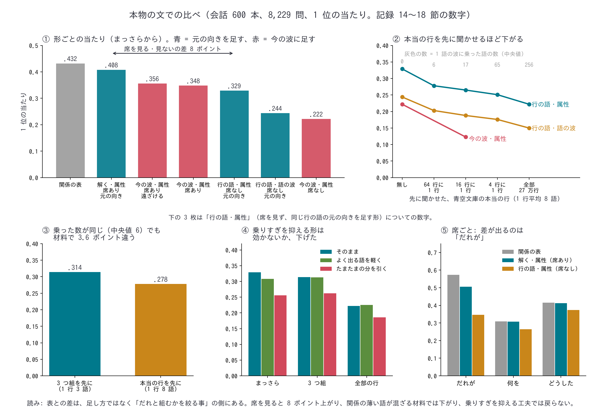

表との差は、足し方ではなく「だれと組むかを絞る事」の側にある、という読み。席を見ると 8 ポイント上がり、関係の薄い語が混ざる材料では下がり、乗りすぎを抑える工夫では戻らない。席ごとに見ると、差が出るのは「だれが」。

## 19. 理由の図と、本物に近づけた小さい世界（I49q の続き）

持ち主の求め: 理由を知りたい部分が多いので、なるべく図を出せるようにする。

### 関係の薄い語が混ざると、なぜ当たらなくなるか（`tools/past/fig_i49q_why_mixing.py`）

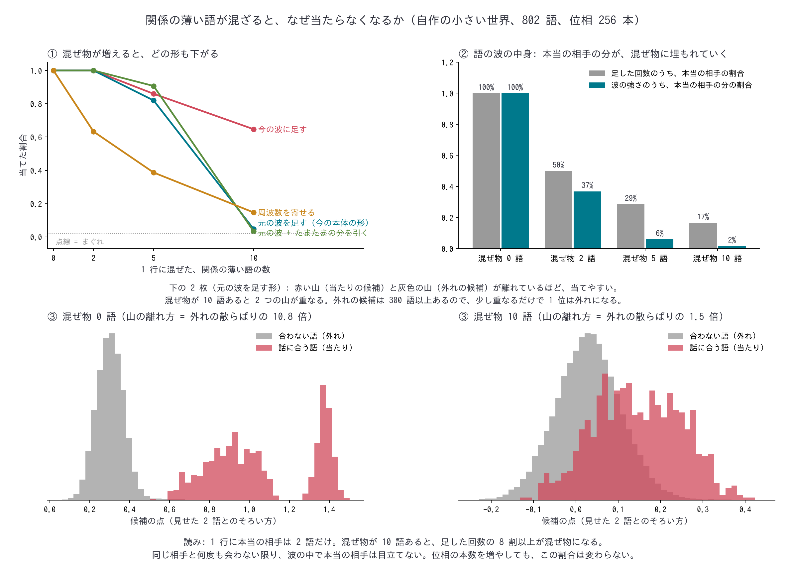

1 行に本当の相手は 2 語だけ。混ぜ物が 10 語あると、足した回数のうち本当の相手は 17%、波の強さで見ると 2%（よく出る語は何度も足されて強くなる）。候補の点の山は、混ぜ物なしでは当たりと外れが離れ（外れの散らばりの 10.8 倍）、10 語混ぜると重なる（1.5 倍）。外れの候補は 300 語以上あるので、少し重なるだけで 1 位は外れになる。位相の本数を増やしても、この割合は変わらない。

### 本物の数えに寄せた小さい世界（`tools/past/i49q_small_world_stream.py`）

16 節の世界は、同じ文を 5 回くり返し聞かせてから試す作りで、きれいすぎた。ここでは、会話 600 本 × 3 つ組 14 個を 1 回だけ流し、聞く前に 1 語を隠して当てる。候補はその会話に出る語（平均 23 語）。語は何個かの話にまたがり、よく出る語が混ざる。見せた語そのものは答えにしない。語 842、3 つ組 8,400（違う組 5,814）。

| 形 | 当て |
|---|---|
| 関係の表 | .216 |
| 元の向きを足す・席あり | .205 |
| 今の波に足す・席あり | .207 |
| 元の向きを足す・席なし | .163 |
| 今の波に足す・席なし | .122 |

- 位相の本数（64、256、1,024）では変わらない。足りないのは本数ではなく、聞いた回数の側。
- 表がいちばん上、席ありが次、席なしが下、という並びは、本物の文（14・15・18 節）と同じ。「今の波に足す・席あり」が「元の向きを足す・席あり」と並ぶ点は、本物（.35 対 .41）と違う。

### 外れた時に周波数を足す形（`tools/past/i49q_small_world_grow.py`、持ち主の案・未確定）

「元の向きを足す・席あり」の上に、外れた 3 つ組ごとに新しい周波数を 1 本足し、その 3 語をその上でそろえる。上限を使い切ったら、古い順に同じ周波数へ重ねる。

| 足す周波数の上限 | 16 | 64 | 256 | 1,024 | 4,096 | 16,384 |
|---|---|---|---|---|---|---|
| 当て | .185 | .186 | .188 | .192 | .206 | .212 |

足さない時は .205、関係の表は .216。

- 読み: 上限が少ないと、重なった分が雑音になって、足さない時より下がる。聞いた 3 つ組の数（8,400）に近い本数を持って、やっと表に近づく。この作りでは、足した周波数は表と同じ働き（聞いた組をそのまま覚える）しかしていない。
- 想定外の反応: 「外れた時だけ足す」と「毎回足す」が、ほぼ同じになった（8,400 行のうち 8,300 行で足した）。3 つの席のどれか 1 つでも外れると足す決まりなので、ほぼ毎回足す事になった。
- 足りない物: 足した周波数を、似た語にも広げる仕組み（1 本を 1 つの組だけで使わず、同じ使われ方の語で分け合う）。そこが無いと、足すほど表に戻るだけになる。
- 手で置いた値: 世界の形と語の選び方の式、足した周波数の上での席の位相（3 等分）、元の点と足した分の点をそのまま足す事、上限の本数。

## 20. 席の印（I49r、`SeatVec(mark=True)`、`tools/past/i49r_seat_mark_run.py`）

着想: 関係の表と解く形の差は、席ごとに見ると「だれが」で大きい（.573 対 .505）。表は「その席によく座る語」を数えで持っているが、解く形には無かった。そこで、席ごとに決まった 1 本の波（席の印）を、その席で聞くたびに語の波へ足す。探す時は、隠した席の印も足す。表は持たず、足すだけ。

| 1 位の当たり | まっさらから | 青空の 3 つ組を先に |
|---|---|---|
| 関係の表 | .432 | .453 |
| 解く・属性（席あり） | .408 | .398 |
| 解く・属性・席の印 | .411 | .397 |
| 解く・語の波（席あり） | .370 | .342 |
| 解く・語の波・席の印 | .400 | .374 |

問いごとに直接比べた数（良くなった・悪くなった・z）:

| | まっさらから | 青空の 3 つ組を先に |
|---|---|---|
| 属性: 席の印なし → あり | 158・137、z +1.2 | 218・233、z −0.7 |
| 語の波: 席の印なし → あり | 439・193、z +9.8 | 588・330、z +8.5 |

- 読み 1: 語の波を元にした形では、席の印がはっきり効いた（+3.0、+3.1 ポイント）。効いたのは主に「だれが」（.426 が .499、.358 が .467）。聞くほど下がる形もゆるんだ（まっさらからの最後の 100 本で .339 が .383）。
- 読み 2: 属性を元にした形では、変わらなかった（揺れの内）。属性の割合には、その席によく座る語の傾き（人らしさ、動きらしさ）が初めから入っていて、印を足しても重なるだけ、と見ている。確かめてはいない。
- 読み 3: 語の波 + 席の印は、まっさらからでは属性（席あり）にほぼ並んだ（.400 対 .408、直接の z −1.95）。青空を先にでは、まだ差がある（.374 対 .398、z −5.0）。
- 読み 4: 表との差（まっさらから 2.1 ポイント、青空を先に 5.5 ポイント）は、席の印では埋まらなかった。「だれが」の差（.573 対 .511）は残っている。表が持っていて解く形に無い物は、席の常連の数えだけではない。
- 想定外の反応: 席の印は「何を」をわずかに下げる（語の波で .299 が .293、.323 が .303。属性で .307 が .301、.315 が .298）。
- 手で置いた値: 席の印の波の作り方（席の番号と周波数の番号から決めた位相）、印を足す重さ 1、探す時に印を足す重さ 1。

## 21. 表との差は、どの問いで出ているか（I49s、`tools/past/i49s_where_gap.py`）

同じ流れで、関係の表と解く形（属性・席あり）の両方に答えさせ、表が答えに使った段ごとに当たりを並べた。

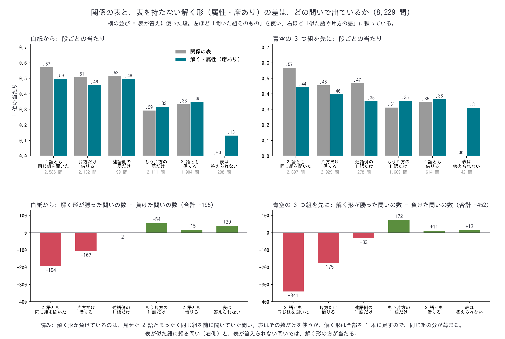

| 表が使った段 | 問い | 表 | 解く | 解くが勝った数 − 負けた数 |
|---|---|---|---|---|
| まっさらから: 2 語とも同じ組を聞いた | 2,585 | .571 | .496 | −194 |
| 片方だけ借りる | 2,132 | .506 | .456 | −107 |
| 述語側の 1 語だけ | 99 | .515 | .495 | −2 |
| もう片方の 1 語だけ | 2,111 | .292 | .317 | +54 |
| 2 語とも借りる | 1,004 | .333 | .348 | +15 |
| 表は答えられない | 298 | .000 | .131 | +39 |
| 青空の 3 つ組を先に: 2 語とも同じ組を聞いた | 2,697 | .568 | .442 | −341 |
| 片方だけ借りる | 2,929 | .455 | .396 | −175 |
| 述語側の 1 語だけ | 278 | .468 | .353 | −32 |
| もう片方の 1 語だけ | 1,669 | .312 | .355 | +72 |
| 2 語とも借りる | 614 | .347 | .365 | +11 |
| 表は答えられない | 42 | .000 | .310 | +13 |

- 読み 1: 解く形が負けているのは、表が「2 語とも同じ組を聞いた」「片方だけ借りる」で答えた問い。表が聞いた組そのものを使える所で、差が出ている。席では、2 語・だれが がいちばん大きい（まっさらから .746 対 .606）。
- 読み 2: 表が片方の語や似た語に頼る問いと、表が答えられない問いでは、解く形の方が当たる。
- 読み 3（数えから出る見込み。試していない）: 表が上の 3 段で答える所は表のまま、下の段と答えられない所だけ解く形の答えに替えると、まっさらから .432 が約 .445、青空を先に .453 が約 .465 になる。
- なぜ負けるかの考え（確かめていない）: 表は、同じ組の数が有ればそれだけを使う。解く形は、聞いた事を全部 1 本の波に足して比べるので、同じ組を聞いた分が、ほかの相手と聞いた分に薄められる。属性を元にした向きは「似た語は同じ向き」なので、語そのものを区別する力が弱い事も効いていると見ている。
- 席の印は、どの段でもほぼ同じだった。
- 想定外の反応: 青空を先にすると、表が答えられない問いは 42 問しか無いが、その 42 問でも解く形は 31% を当てる。述語側の段は小さいが、青空を先にでは解く形が大きく負ける（.468 対 .353）。
- 手で置いた値: 無し（比べる 2 つの形の物だけ）。

## 22. 共振の揺らぎの余地（I49t、`tools/past/i49t_room_run.py`）

共振は一位だけを答えにするので、揺らぎが出にくい。揺らぎを入れる前に、余地がどれだけ有るかを数えた。同じ流れ（8,229 問、候補は平均 18 語）で、関係の表と解く形（属性・席あり）の点の並びを見た。

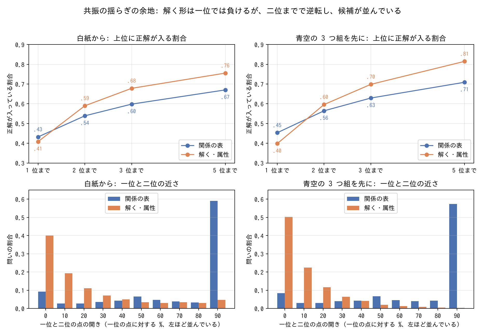

| 始め方 | 形 | 1 位まで | 2 位まで | 3 位まで | 5 位まで | 一位の 9 割以上の候補の数 |
|---|---|---|---|---|---|---|
| まっさらから | 関係の表 | .432 | .539 | .598 | .670 | 1.13 |
| まっさらから | 解く・属性 | .408 | .590 | .679 | .756 | 1.57 |
| 青空の 3 つ組を先に | 関係の表 | .453 | .565 | .629 | .709 | 1.11 |
| 青空の 3 つ組を先に | 解く・属性 | .398 | .596 | .699 | .815 | 1.82 |

- 読み 1: 解く形は一位では表に負けるが、二位までで逆転し、下の順位ほど差が開く。席ごとの三位まででも 3 席とも解く形が上（だれが .845 対 .764、何を .536 対 .463、どうした .655 対 .568、まっさらから）。
- 読み 2: 一位と二位の開きは、形が逆。表は「一位だけが抜けている」問いが 57〜59%。解く形は「開きが一位の点の 1 割未満」の問いが 40〜50%、3 割未満までで 7〜8 割。
- 読み 3: 解く形は、正解を上位には入れているが、並んだ候補の中から選ぶ所で落としている。内面の波で選び直す、文全体で掛け合わせる、のどちらにも余地が有る形。
- 読み 4: 見せた 2 語と席が同じ問いがまた出たのは 3,481 問で、その 58.8% は正解が前と違った。2 語だけからは決めきれない問いが、会話の側にもともとそれだけ有る。
- 注意: 表の点は数、解く形の点は波の重なりで、点の物差しが違う。「開き」の比べは物差しの違いも含む。順位で数えた「何位までに入るか」は物差しによらない。
- 想定外の反応: 青空を先にすると、解く形の一位は下がる（.408 から .398）のに、五位までは上がる（.756 から .815）。並びがさらに平らになる（9 割以上の候補 1.57 から 1.82）。表の「開きが 1 割未満」の 8〜9% が同点かどうかは分けていない。
- 手で置いた値: 「近い」の区切り（一位の 9 割）、開きを分ける 10 個の区切り。

## 23. 並んだ上位から、話の流れで選び直す（I49u、`intervention/i49u_flow_pick.py`、`tools/i49u_flow_run.py`）

I49t の続き。元の答え方は変えずに、上位の候補だけを「流れの波」で選び直した。流れの波は、この話でそれまでに聞いた 3 つ組の語の、属性の向きを足した物（内面の波の代わりに置いた物）。乱数は使わない。

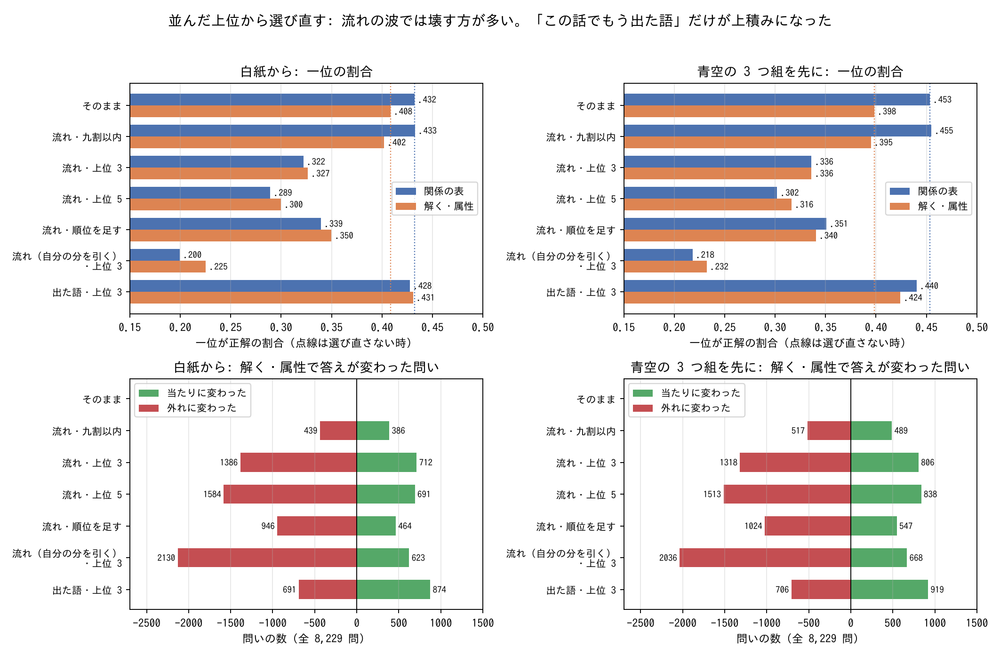

| 版 | まっさらから 表 | 解く | 青空を先に 表 | 解く |
|---|---|---|---|---|
| そのまま | .432 | .408 | .453 | .398 |
| 流れ・九割以内 | .433 | .402 | .455 | .395 |
| 流れ・上位 3 | .322 | .327 | .336 | .336 |
| 流れ・上位 5 | .289 | .300 | .302 | .316 |
| 流れ・順位を足す | .339 | .350 | .351 | .340 |
| 流れ（自分の分を引く）・上位 3 | .200 | .225 | .218 | .232 |
| 出た語・上位 3（比べ役） | .428 | .431 | .440 | .424 |

- 読み 1: 流れの波で選び直す版は、全部下がった。当たりに変わる問いより、外れに変わる問いの方が 2 倍ほど多い。「何を」がいちばん崩れる（表・上位 3 で .309 から .185）。
- 読み 2: 上積みになったのは、比べ役の「上位 3 の中で、この話で一番最近に出た語」を解く形に使った時だけ（.408 から .431、.398 から .424。当たりに 874・外れに 691、919・706）。まっさらからでは表（.432）とほぼ並ぶ。青空を先にでは、まだ表（.453）の下。表に使うと少し下がる。
- 読み 3: I49t の余地（3 位までに .68〜.70）のうち、取れたのは 2 ポイント強。
- なぜ流れの波が効かないかの考え（確かめていない）: 話の語の属性を全部足した波は「この話らしい語」を指すだけで、席も相手も見ない。候補はどれも同じ話の語なので、どれも話らしく、選ぶ手がかりにならない。自分の分を引くとさらに悪いのは、効いていたのが「その語自身がもう出た」事だけだった、という見立てと合う。
- 予想との違い: 流れの波で選び直せば上がると見ていたが、外れた。
- 想定外の反応: 自分の分を引く版が、引かない版より 10 ポイントほど悪い。九割以内は、表では答えが 300 問ほどしか変わらない（表は一位が抜けているため）。
- 手で置いた値: 上位の数 3 と 5、九割、流れを足す重さ 1、話ごとに空に戻す事。
- 測り方の注意: 候補は「その話の内容語」なので、「もう出た語」の効きは、この測り方に寄った物かも知れない。

## 24. 2 つの席を同時に隠す問いと、掛け算で選ぶ形（I49v、`tools/past/i49v_two_hidden_run.py`、持ち主の案・未確定）

持ち主の言葉:「１位を出さずに候補を文章全体で掛け算にするとより良い結果が出そうな気がする。でも文字数が増えると計算が増える。」

今までの問いは 1 席だけを隠すので、掛け算の効きを測れない。3 つ組の 1 語だけを見せ、残りの 2 席を当てさせる問いにした（8,229 問）。席ごとの上位 k 個だけを残し、組ごとに「相手を見せた時の自分の点」を両側で出して掛ける。

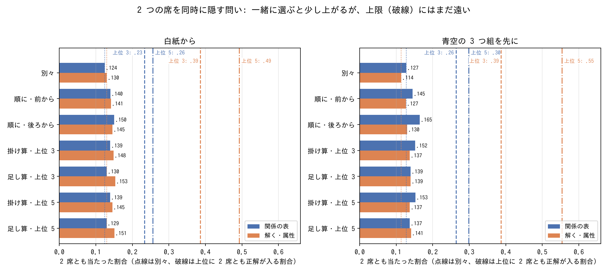

| 2 席とも当たり | まっさらから 表 | 解く | 青空を先に 表 | 解く |
|---|---|---|---|---|
| 別々（席ごとに 1 位） | .124 | .130 | .127 | .114 |
| 順に・前から | .140 | .141 | .145 | .127 |
| 順に・後ろから | .150 | .146 | .165 | .130 |
| 掛け算・上位 3 | .139 | .148 | .152 | .137 |
| 足し算・上位 3 | .130 | .153 | .139 | .139 |
| 掛け算・上位 5 | .139 | .145 | .153 | .137 |
| 足し算・上位 5 | .129 | .151 | .137 | .141 |
| 上位 3 に 2 席とも正解が入る（上限） | .233 | .386 | .264 | .387 |
| 上位 5 に 2 席とも正解が入る（上限） | .256 | .492 | .298 | .554 |

- 読み 1: 2 席を一緒に選ぶと、どの版も「別々」より上がる（1.5〜4 ポイント）。掛け算の案の向きは合っている。
- 読み 2: ただし掛け算である事は決め手ではない。表では「片方を先に決めて、それを見せて次を選ぶ」形（順に・後ろから）が一番良く、解く形では足し算が掛け算より少し上。
- 読み 3: 上位 3 と上位 5 で差がほぼ無い。残す数を増やしても良くならないので、計算は上位 3 で足りる（1 問あたりの問う回数は 6〜13 回）。
- 読み 4: 上限との開きが大きい。解く形は上位 3 に 2 席とも正解が入る問いが .39 有るのに、取れているのは .15。上位に入れる力は有るが、組を選ぶ力が足りない。1 席の時（22 節）と同じ形。
- 読み 5: 「だれが」だけを見せる問い（何を・どうしたを隠す）が一番難しい（.07〜.13）。
- 想定外の反応: 表は掛け算、解く形は足し算の方が良く、向きが逆。表の点は数なので 0 が多く、掛け算で「片方が 0 の組」を消せるのが効くと見ている。解く形の点は 0 になりにくく、掛けても足しても並びがあまり変わらない（確かめていない）。「後ろから」が「前から」より良い事も見込んでいなかった。
- 手で置いた値: 残す数（3 と 5）、負の点を 0 にする事、同じ語を 2 席に置かない事。
- 測り方の注意: 3 つ組だけの話なので、「文全体」と言っても 2 席まで。もっと長い並びでは試していない。

## 25. 正しい物と、正しいと言える物を両方数える（I49w、`tools/i49w_also_right_run.py`）

持ち主の問い:「正誤チェックについて、正しい物と正しいと言えるもの、両方をカウントする方法って思いつく？」

同じ問い（同じ席、同じ見せた 2 語）で実際に使われた語を全部集めて、正解の集まりにした。答えを「正しい物（この文の正解）」「正しいと言える物（別の所で同じ 2 語と一緒に使われていた語）」「どちらでもない」に分ける。採点のための集まりなので後の話の分も入れる（覚える側には渡さない）。

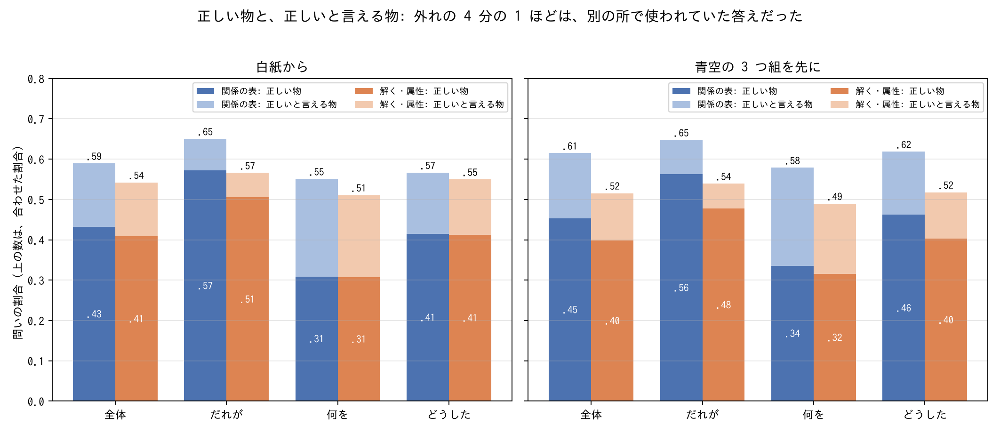

| | 正しい物 | 正しいと言える物 | 合わせて |
|---|---|---|---|
| まっさらから: 関係の表 | .432 | .157 | .589 |
| まっさらから: 解く・属性 | .408 | .134 | .542 |
| 青空を先に: 関係の表 | .453 | .162 | .615 |
| 青空を先に: 解く・属性 | .398 | .117 | .516 |

（集まりは話と青空。話だけにしても 0.1〜0.7 ポイントしか変わらない。）

- 読み 1: 今まで外れに数えていた答えのうち、表で 28%、解く形で 23% は、正しいと言える物だった。
- 読み 2: 正解が 2 つ以上有る問いは 26%。候補の中の正解の数は平均 1.4。
- 読み 3: 「何を」の伸びが一番大きい（表 .309 から .551、解く形 .307 から .511）。「何を」が一番弱く見えていたのは、正解が 1 つに決まらない席だから、という面が大きい。合わせて見ると 3 席の差は小さくなる（表で .65 / .55 / .57）。
- 読み 4: 表との差は縮まらず、広がった（まっさらから 2.4 から 4.7 ポイント）。解く形の外れが「正しいと言える物」に寄っている、という見込みは当たらなかった。
- 弱い所: まだ誰も書いていない正しい組は拾えないので、下限の数。集まりは 600 本の話から作るので、話が増えれば「正しいと言える物」は増える。
- 想定外の反応: 青空の 3 つ組を集まりに足しても、ほとんど増えない（正解の数の平均 1.40 から 1.41）。青空の組は、話の候補と重ならない。
- 手で置いた値: 無し（「同じ問い」を席と見せた 2 語で決める事だけ）。
- 道具の直し: 「・」を含む名前を dict() の引数に書いていて、Python 3.11 で読めなかった。文字列のキーに直した（数え方は同じ）。

## 26. 見せた 2 語の点を、足すか掛けるか（I49x、`tools/past/i49x_and_run.py`）

持ち主の脈絡の案（未確定）:「語が増えるたび、原理的には状況が収束して対応する語が減っていくはず」。
収束は「どの語とも合う物だけ残す」動きだが、今の解く形は見せた 2 語の波を足すので「どちらかと合う物」も残る。そこが絞りきれない理由かも知れない、という見立てを確かめた。見せた語ごとに別々に点を出し、合わせ方を変えた（1 席を隠す、今までの問い）。

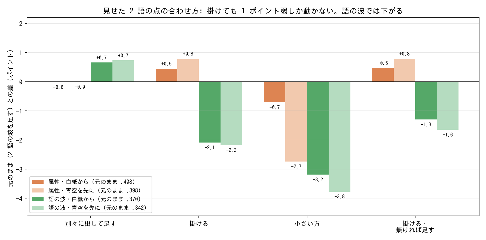

| 正しい物 | 属性・まっさらから | 属性・青空を先に | 語の波・まっさらから | 語の波・青空を先に |
|---|---|---|---|---|
| 元のまま（2 語の波を足す） | .408 | .398 | .370 | .342 |
| 別々に出して足す | .408 | .398 | .377 | .350 |
| 掛ける | .413 | .406 | .349 | .321 |
| 小さい方 | .401 | .371 | .338 | .305 |
| 掛ける・無ければ足す | .413 | .406 | .357 | .326 |

- 読み 1: 見立ては、ほぼ外れた。属性では掛けると 0.5〜0.8 ポイント上がるだけ（上がるのは「どうした」）。語の波では 2 ポイント下がる。
- 読み 2: 絞りきれない理由は「足しているから」ではなさそう。点の合わせ方を変えても、並びがあまり変わらない。
- 読み 3: 語の波で掛けると下がるのは、片方の語との点が 0 以下の候補が全部消えるため（答えなしが 1.5% から 3.4%）。語の波は「聞いた事が有るか」で点が決まるので、片方としか聞いていない正解を消してしまう。
- 「正しいと言える物」を合わせた数も、同じ向きに動いた。
- 想定外の反応: 属性の「別々に出して足す」は、元のままと小数 3 桁まで同じ。小さい方は、掛けるよりずっと悪い。
- 注意: 差は 1 ポイント前後。当たりが変わった問いの数を出していないので、ばらつきの内かどうかは分からない。
- 手で置いた値: 負の点を 0 にする事。

説明の図（数は説明のために作った例）。掛けると「片方の語とだけ合う候補」は消えるが、そういう候補は足した時にも 1 位にはなりにくい。落としているのは「両方の語と合う候補どうし」の選び分けで、そこは足しても掛けても並びが変わらない。

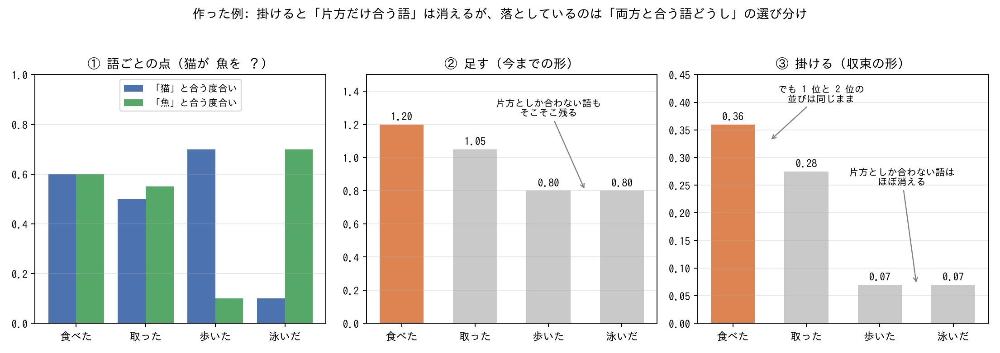

## 27. 正解が上位なのに 1 位になれない問いで、何が 1 位を取っているか（I49y、`tools/past/i49y_who_wins_run.py`）

解く形（属性・席あり）で、正解が 2〜3 位だった問い（まっさらから 2,218 問、青空を先に 2,472 問。全体の 27〜30%）を集め、1 位を取った語と正解を比べた。

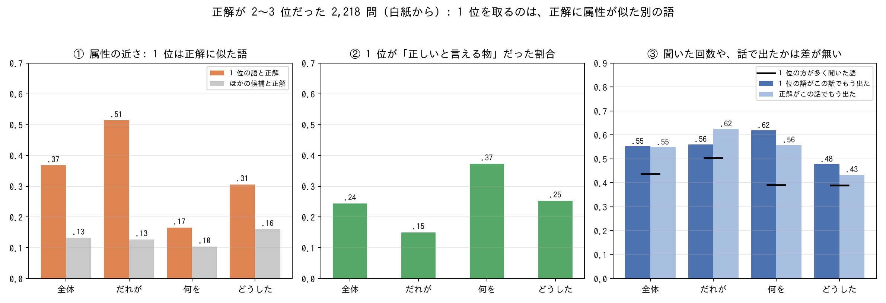

| まっさらから | 全体 | だれが | 何を | どうした |
|---|---|---|---|---|
| 1 位の語と正解の、属性の近さ | .37 | .51 | .17 | .31 |
| ほかの候補と正解の、属性の近さ | .13 | .13 | .10 | .16 |
| 1 位が正しいと言える物だった | .24 | .15 | .37 | .25 |
| 1 位の方が多く聞いた語だった | .44 | .50 | .39 | .39 |
| 1 位の語がこの話でもう出た／正解がもう出た | .55 / .55 | .56 / .62 | .62 / .56 | .48 / .43 |

（青空を先にもほぼ同じ形。近さ .36 対 .13、正しいと言える物 .19。）

- 読み 1: 1 位を取っているのは、正解に属性が似た別の語。近さは、ほかの候補の約 3 倍。「だれが」で一番強い（.51）。属性の向きは似た語を同じ向きにするので、似た語どうしを選び分けられない。21 節の考えと合う。
- 読み 2: 「聞いた回数の多い語が勝っているだけ」という疑いは外れた。1 位の方が多く聞いた語だったのは 44% で、半分より少ない。
- 読み 3: 1 位が「正しいと言える物」だったのは 2 割ほど（下限の数）。「何を」だけは 37% と高い。「何を」は 1 位の語が正解にあまり似ていない（.17）ので、似た語の取り違えより、正解が決まらない事の方が効いている。
- 読み 4: この話でもう出たかどうかは、1 位の語と正解でほぼ同じ。
- 想定外の反応: 青空を先にすると、「どうした」で 1 位の方が少なく聞いた語だった割合が上がる（.58 から .68）。青空で多く聞いた語に負けているのではない。
- 手で置いた値: 「上位」を 3 位までとする事。

## 28. 仮の板（薄れる板、席ごとの板）で選び直す（I49z、`tools/past/i49z_board_run.py`、持ち主の案・未確定）

持ち主の言葉:「語はなく、前の文章の属性だけを緩く持ってて、古い属性は消え、近い属性と重要な属性と何度も出る属性だけど保持する板を前に置く」「では仮の板ではなく流れを添わせる必要があるのか」

板 = 前に聞いた 3 つ組の語の属性の向きを足した物。3 つ組を聞くたびに薄れる。席ごとの板は、その席に前に来た語の属性だけを持つ板を 3 枚持つ形（こちらで足した形。流れを添わせる一番小さい形のつもり）。「重要」は入れていない。解く形（属性・席あり）の答えを、板に一番近い候補に替える。

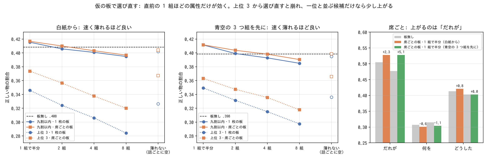

| 正しい物 | まっさらから | 青空を先に |
|---|---|---|
| 板無し | .408 | .398 |
| 九割以内・1 枚の板・1 組で半分 | .415 | .412 |
| 九割以内・席ごとの板・1 組で半分 | .417 | .412 |
| 九割以内・席ごとの板・2 組 / 4 組 / 8 組で半分 | .410 / .403 / .397 | .404 / .398 / .390 |
| 九割以内・席ごとの板・薄れない（話ごとに空） | .404 | .399 |
| 上位 3・1 枚の板・1 組で半分 | .346 | .349 |
| 上位 3・席ごとの板・1 組で半分 | .374 | .363 |

- 読み 1: 「古い属性は消える」は効いた。速く薄れるほど良く、1 組で半分が一番良い。薄れない板は板無しと同じか少し下。直前の 1 組ほどの属性だけが手がかりになり、古い物は邪魔になる。
- 読み 2: ただし上積みは小さい（0.8〜1.3 ポイント）。「出た語で選び直す」（23 節、.431 / .424）には届かない。
- 読み 3: 席ごとの板は、1 枚の板より良い。上位 3 から選ぶ版で差が大きい（.346 対 .374）。一位と並ぶ候補だけを選び直す版では差が小さい（0.1〜0.5 ポイント）。
- 読み 4: 上位 3 から選び直すと、どの板でも崩れる（3〜12 ポイント下がる）。板は、一位とほぼ並んだ候補の決め手にしか使えない。
- 予想との違い: 効くなら「何を」、効きにくいのは「だれが」と見ていたが、逆だった。上がったのは「だれが」（.505 から .528、.477 から .528）で、「何を」は少し下がった。直前の文の「だれが」が続く（同じ人の話が続く）事を、板が拾っていると見ている。
- 想定外の反応: 上位 3 の版では、薄れを遅くするほど「どうした」が大きく崩れる（.326 から .204）。
- 注意: 当たりに変わった数・外れに変わった数を出していないので、1 ポイント前後の差がばらつきの内かどうかは分からない。薄れる速さの並び（1 組 > 2 > 4 > 8）は、8 通りの組み合わせ全部で同じ向きだった。
- 手で置いた値: 薄れる速さ（4 通り並べた）、九割、上位 3。

## 29. 行の折り畳みの決まりを、仮の板に入れる（I49za、`FlowPick(usual=…)`、`tools/i49za_fold_run.py`、持ち主の案・未確定）

持ち主の言葉:「前作った行の折り畳みもつかえるといいんだけどなぁ」

記憶板（I40b）は、上の段に畳む時に「ふだんの見込みより明るい鍵」だけを残し、残りは半分に薄める。同じ決まりを、鍵を属性に替えて仮の板に入れた。ふだん = 今までに聞いた全部の語の属性の平均（席ごとの板なら、その席の平均）。

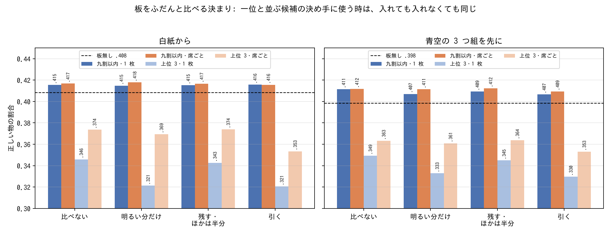

| 正しい物（1 組で半分に薄れる板） | まっさらから | 青空を先に |
|---|---|---|
| 板無し | .408 | .398 |
| 九割以内・席ごと・比べない | .417 | .412 |
| 九割以内・席ごと・明るい分だけ | .418 | .411 |
| 九割以内・席ごと・残す・ほかは半分 | .417 | .412 |
| 九割以内・席ごと・引く | .416 | .409 |
| 上位 3・1 枚・比べない | .346 | .349 |
| 上位 3・1 枚・明るい分だけ | .321 | .333 |

- 読み 1: 折り畳みの決まりは、上積みにならなかった。一位と並ぶ候補の決め手に使う時、比べない版との差は ±0.2 ポイントの内。
- 読み 2: 板そのものの効きは、ばらつきの外に出た。まっさらからで 当たりに 521・外れに 444（z +2.5）、青空を先にで 674・559（z +3.3）。
- 読み 3: 上位 3 から選ぶ 1 枚の板では、「明るい分だけ」「引く」ではっきり下がる（.346 から .321）。崩れるのは「だれが」（.503 から .430）。板が拾っていたのは「人である」のような、どの話にも出る大まかな属性で、それを除くと手がかりが消える、と見ている。
- 予想との違い: 「どの話にも出る属性が板を占めて邪魔をしている。除けば効く」と見ていたが、逆だった。大まかな属性こそが効いていた。
- 想定外の反応: 薄れが遅い板（4 組で半分）の時だけ、決まりを入れると「どうした」が少し戻る（.236 から .256〜.285）。古い属性を抑える働きは、残る量が多い時にだけ見える。
- 折り畳みの決まりが向く所の考え（確かめていない）: 記憶板では、長い間（日・週）に何を残すかを決めるのに使った。今の板は直前の 1 組しか効かないので、残す物を選ぶ場面が無い。話をまたぐ長い板（話題・相手ごと）を作る時に、もう一度試す値打ちが有る。
- 手で置いた値: 薄れる速さ、九割、上位 3、「ほかは半分」の半分。

## 30. いいとこ取りの形（I49zb、`intervention/i49zb_mix.py`、`tools/i49zb_mix_run.py`、持ち主の案・未確定）

持ち主の言葉:「一度いいとこどりをした仕組みを一度作ってみてもいいかも。」

今までの数えで、それぞれが強かった所だけを使う。表が上の段（聞いた組そのもの・片方だけ借りる・述語側）で答えられる問いは表、ほかは波で解く形（属性・席あり）。解く形の答えは、選び直しを通せる。

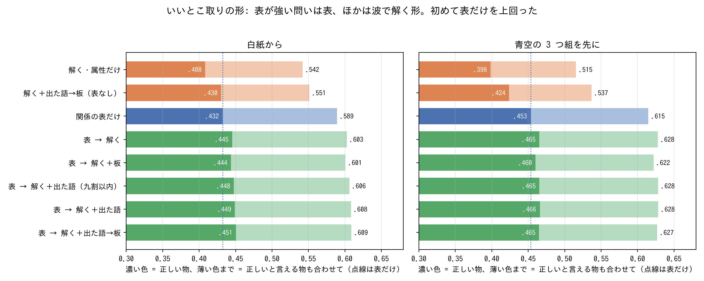

| | まっさらから 正しい物 | 合わせて | 青空を先に 正しい物 | 合わせて |
|---|---|---|---|---|
| 関係の表だけ | .432 | .589 | .453 | .615 |
| 解く・属性だけ | .408 | .542 | .398 | .516 |
| 解く＋出た語→板（表なし） | .430 | .551 | .424 | .537 |
| 表 → 解く | .445 | .603 | .465 | .628 |
| 表 → 解く＋板 | .444 | .601 | .460 | .622 |
| 表 → 解く＋出た語（九割以内） | .448 | .606 | .465 | .628 |
| 表 → 解く＋出た語 | .449 | .608 | .466 | .628 |
| 表 → 解く＋出た語→板 | .451 | .609 | .465 | .627 |

- 読み 1: 表 → 解く は、表だけを上回った（まっさらから +1.3 ポイント、当たりに 349・外れに 240、z +4.5。青空を先に +1.2、353・256、z +3.9）。21 節で数えから出した見込み（.445 / .465）と同じ値になった。
- 読み 2: 選び直しを足すと、まっさらからではもう少し上がる（.451、z +5.8）。青空を先にでは、ほぼ変わらない。板は、青空を先にでは少し下げる。
- 読み 3: 上がるのは主に「何を」（.309 から .344、.335 から .365）。「だれが」は表のまま。
- 読み 4: 表を使わない形（解く＋出た語→板）は、まっさらからでは表と並んだ（.430 対 .432、z −0.4）。青空を先にでは、まだ 3 ポイント下。
- 解く形の答えを使う問いは、まっさらからで 41%（3,377 問）、青空を先にで 28%（2,322 問）。
- 大事な注意: 「表に任せる段」は、同じ 600 本の話で数えた結果（21 節）を見て決めた。同じ材料で決めて同じ材料で測っているので、上がり幅は甘めに出ている恐れが有る。別の話で確かめるまでは、決まった成果とは言えない。
- 想定外の反応: 板を足すと、青空を先にでは下がる（.465 から .460）。1 席の時（28 節）は青空を先にの方が板が効いたので、向きが逆。表が上の段を取った後に残る問いでは、板が効く「だれが」の問いが少ないためと見ている（確かめていない）。
- 道具の見え方: 「答えが変わった数」は、解く形の答えを選び直した数だけを数えている。表から解く形への入れ替えは入っていない。
- 手で置いた値: 表に任せる段の組、上位 3、九割、薄れる速さ 1 組。

### 30.1 表に任せる段を、手で置かずに数えて決める（I49zc、`Mix(upper=None)`）

上の注意（同じ材料で段を決めた）を外すため、段を手で置かない形にした。段ごとに、表と解く形のどちらが当たってきたかを答え合わせのたびに数え、それまでに多く当たった方を使う（同じなら表）。数えは、その問いより前の分だけ。

| | まっさらから 正しい物 | 合わせて | 青空を先に 正しい物 | 合わせて |
|---|---|---|---|---|
| 関係の表だけ | .432 | .589 | .453 | .615 |
| 表 → 解く（段を手で置く） | .445 | .603 | .465 | .628 |
| 数えて選ぶ | .444 | .602 | .464 | .626 |
| 数えて選ぶ＋出た語 | .446 | .595 | .463 | .623 |
| 数えて選ぶ＋出た語→板 | .448 | .602 | .463 | .623 |

- 読み 1: 手で置かなくても、ほぼ同じ所に着いた（.444 / .464）。表だけからは、当たりに 269・外れに 169（z +4.8）、325・238（z +3.7）。先の「甘めに出ている恐れ」は、ほぼ当たらなかった。
- 読み 2: 数えが示した分け方は、手で置いた分け方と同じ向き（2 語・片方だけ借りる・述語側は表、もう片方・借りる・答えられないは解く形）。
- 読み 3: 手で置いた形より 0.1 ポイントほど低いのは、数えが溜まる前の初めの方で、表のまま答えているため。
- 段ごとの当たり（まっさらから、表・解く形・問い）: 2 語 1,476・1,282・2,585、片方だけ借りる 1,079・972・2,132、述語側 51・49・99、もう片方 616・670・2,111、借りる 334・349・1,004、答えられない 0・39・298。
- 想定外の反応: 出た語で選び直すと、「2 語」の段でも解く形が表にほぼ並ぶ（1,461 対 1,476）。青空を先にでは、選び直しを足すと少し下がる（.464 から .463）。
- 手で置いた値: 同じ数の時に表を使う事。選び直しを足す版は、上位 3、九割、薄れる速さ 1 組。

## 31. 仮の板に、語そのものの波を持たせる（I49zd、`tools/past/i49zd_word_board_run.py`）

28 節の仮の板は属性を持っていた。一方、効いていた選び直しは「その話で既に出た語を選ぶ」という決まりで書いた形（23 節）だった。板に語そのものの波を持たせれば、この決まりを書かずに同じ働きが出るかを確かめた。板の中身は語の波、解く側は属性のまま。18 版、8,229 問、560 秒。

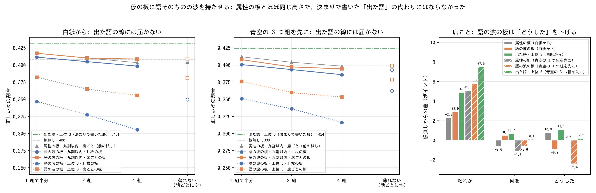

| | まっさらから 正しい物 | 合わせて | 青空を先に 正しい物 | 合わせて |
|---|---|---|---|---|
| 板無し | .408 | .542 | .398 | .516 |
| 出た語・上位 3（決まりで書いた形） | .431 | .553 | .424 | .539 |
| 属性の板・九割以内・席ごと・1 組で半分（28 節） | .417 | | .412 | |
| 語の波の板・九割以内・席ごと・1 組で半分 | .417 | .551 | .408 | .526 |
| 語の波の板・九割以内・1 枚・1 組で半分 | .411 | .544 | .400 | .518 |
| 語の波の板・上位 3・席ごと・1 組で半分 | .382 | .501 | .376 | .487 |
| 語の波の板・上位 3・1 枚・1 組で半分 | .347 | .464 | .351 | .458 |

- 読み 1: 語の波の板は、属性の板とほぼ同じ高さ（.417 / .408）で、出た語・上位 3（.431 / .424）には届かなかった。決まりを波で置き換える事は、この形ではできていない。
- 読み 2: 板無しからの上がりは、席ごとの板で z +2.2 / +2.1。1 枚の板では z +0.7 / +0.5 で、揺れの内。
- 読み 3: 上位 3 から選び直すと、ここでも崩れる（.35 から .38）。属性の板よりは崩れ方が少し小さい。
- 読み 4: 速く薄れる方が良いのは同じ。ただし語の波の板では、薄れない版が 2 組・4 組の版より上に来る（属性の板では下の方だった）。
- 席ごと: 上がるのは「だれが」（.505 から .534、.477 から .535）。「どうした」は下がる（.413 から .404、.403 から .379）。属性の板では「どうした」は下がらなかった。
- 見立て（確かめていない）: 出た語の決まりは「同じ語かどうか」だけを見る。語の波の板は、板に乗った語の波を足し合わせた物との近さで選ぶので、似た波を持つ別の語にも点が入り、同じ語だけを選ぶ働きにならない。「どうした」が下がるのは、直前の組の述語と同じ述語に引かれるためと見ている。
- 想定外の反応: 1 枚の板では効き目が揺れの内に落ちた。薄れない版の順位が属性の板と逆になった。
- 手で置いた値: 九割、上位 3、薄れる速さ（1・2・4 組）。

## 32. 仮の板の語を、足さずに並べて一斉に走査する（I49ze、`FlowPick(board="並べる")`、`tools/past/i49ze_row_board_run.py`）

持ち主の言葉:「並べて一斉に走査もOK」。31 節の見立て（足した波との近さでは、似た語にも点が入る）を確かめるため、聞いた語の波を 1 本ずつ並べて持ち、重さだけを薄れさせた。近さは、重さ × 候補との近さ の一番大きい物。19 版、8,229 問、1,679 秒。

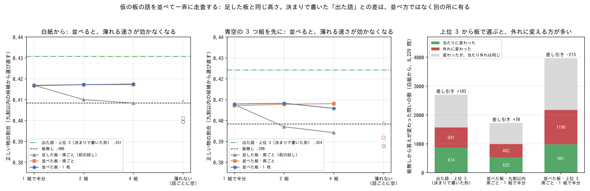

| | まっさらから 正しい物 | 合わせて | 青空を先に 正しい物 | 合わせて |
|---|---|---|---|---|
| 板無し | .408 | .542 | .398 | .516 |
| 出た語・上位 3（決まりで書いた形） | .431 | .553 | .424 | .539 |
| 足した板・九割以内・席ごと・1 組で半分（31 節） | .417 | .551 | .408 | .526 |
| 並べた板・九割以内・席ごと・1 組で半分 | .417 | .550 | .407 | .525 |
| 並べた板・九割以内・席ごと・4 組で半分 | .417 | .551 | .408 | .526 |
| 並べた板・九割以内・1 枚・4 組で半分 | .418 | .553 | .406 | .524 |
| 並べた板・九割以内・席ごと・薄れない | .401 | .537 | .392 | .512 |
| 並べた板・上位 3・席ごと・1 組で半分 | .382 | .501 | .374 | .485 |

- 読み 1: 並べても、足した板と同じ高さ（.417 / .407、z +2.0 から +2.4）。出た語・上位 3（.431 / .424）には届かない。31 節の見立て（足すから似た語に点が入る）は、差の理由ではなかった。
- 読み 2: 並べると、薄れる速さが効かなくなる（1・2・4 組で ±0.3 ポイントの内）。足した板では、遅いほど下がっていた。1 枚と席ごとの差も消える。古い語が混ざらなくなるためと見ている。
- 読み 3: 薄れない版（話ごとに空、重さは全部同じ）は、板無しより下（z −1.8 から −2.8）。当たりに変わる数が減り（521 から 364）、外れに変わる数は同じ（453、438）。新しい語ほど重い、という順が要る。
- 読み 4: 上位 3 から選ぶと、ここでも下がる（z −3.9 から −14.6）。答えが変わる問いが 4,000 近くに増え、外れに変える方が多い（981 対 1,196）。出た語の決まりは、上位 3 に出た語が無ければ一位のまま動かさない。板は、出た語が無くても一番近い語に替えてしまう。差はここに有ると見ている（確かめていない）。
- 席ごと: 31 節と同じ。「だれが」が上がり（.505 から .534）、「どうした」が下がる（.403 から .378）。
- 想定外の反応: 並べ方を変えても、足した板と小数 3 桁まで同じ所に着いた。薄れない版が板無しより下になった。
- 重さ: 話をまたいで長く残る版（2 組・4 組）が重い（1 版 44 から 105 秒。1 組は 7 から 26 秒）。1 回目は、波を聞くたびに積み直す作りで 30 分を超えて止まり、作りを直して数え直した（数は同じ）。
- 手で置いた値: 九割、上位 3、薄れる速さ。

## 33. 板が崩れていた理由を分ける（I49zf、`FlowPick(gate=…)`、`tools/past/i49zf_gate_run.py`）

32 節の見立て（板は、出た語が無い時も答えを替えてしまう）を確かめた。並べた板・上位 3 から選ぶ形に、条件を 1 つずつ足した。17 版、8,229 問、3 回に分けて数えた（843・336・343 秒）。

| 並べた板・上位 3・1 組で半分 | まっさらから 正しい物 | 合わせて | 青空を先に 正しい物 | 合わせて |
|---|---|---|---|---|
| 板無し | .408 | .542 | .398 | .516 |
| 関門無し・1 枚・持ち越す | .365 | .482 | .366 | .475 |
| 関門無し・1 枚・話ごとに空 | .394 | .516 | .395 | .506 |
| 出た語が有る時だけ（決まり）・席ごと・持ち越す | .416 | .540 | .411 | .526 |
| 同じ波だけ・1 枚・持ち越す | .370 | .490 | .380 | .493 |
| 同じ波だけ・1 枚・話ごとに空 | .405 | .528 | .407 | .522 |
| 同じ波の重さで選ぶ・1 枚・持ち越す | .385 | .504 | .386 | .498 |
| 同じ波の重さで選ぶ・1 枚・話ごとに空 | .417 | .541 | .413 | .528 |
| 同じ波の重さで選ぶ・席ごと・話ごとに空 | .421 | .545 | .416 | .532 |
| 出た語・上位 3（決まりで書いた形） | .431 | .553 | .424 | .539 |

関門の意味: 「同じ波だけ」は、板に同じ波（近さが 1）が並んでいる候補の中だけから選ぶ。語の表は引かない。「同じ波の重さで選ぶ」は、選ぶ時も似た波の分を見ず、同じ波の重さ（新しさ）だけで比べる。

- 読み 1: 崩れの一番大きい理由は、板を話をまたいで持ち越す事だった。話ごとに空に戻すだけで +3 ポイント（.365 から .394、.366 から .395）。同じ波だけの版でも同じ（.370 から .405）。前の話に出た語まで「出た語」として拾ってしまう。
- 読み 2: 32 節の見立ても当たった。出た語（同じ波）が候補に無い時は動かさない、とすると上がる（.394 から .405）。
- 読み 3: 似た波の分を見ない方が良い（.405 から .417）。似た語が直前に出ていると、古く出た語の点が上がってしまう。31 節で外れた見立ては、ここでは少し効いていた。
- 読み 4: 波だけで書いた一番良い形（席ごと・同じ波の重さ・話ごとに空）は .421 / .416（z +2.7 / +3.7）。板の版の中では一番上で、板無しを越える。
- 読み 5: それでも、決まりで書いた形（.431 / .424）には届かない。「1 枚・同じ波の重さ・話ごとに空」は決まりと同じ値になる見込みだったが、ならなかった（.417 対 .431）。差はほぼ「どうした」（.393 対 .424）。「だれが」と「何を」は同じ。
- 見立て（確かめていない）: 述語には、語の波を持たない語か、違う語なのに同じ波になる語が有る。決まりは語の名前で見るので、そこで差が出る。
- 薄れる速さ: 話ごとに空に戻すと、1 組と 4 組の差が消える（.4047 と .4044）。話が短く、薄れが効く前に終わる。
- 想定外の反応: 小さいテストでは決まりと同じ答えになった形が、本番の材料では同じにならなかった。重さが全部同じ版（薄れない）は .343 まで下がった。同じ重さの時に、float32 の丸めで選ぶ語がぶれている恐れが有る（確かめていない）。
- 持ち主の案（話をまたいで薄れながら残る板）への意味: 今の材料では、話をまたぐと下がる。600 本の話が同じ語を使い回していて、前の話の語が今の話の手がかりにならないため。続いた会話の材料なら違う結果になり得る。
- 手で置いた値: 上位 3、薄れる速さ、同じ波と見なす丸めの幅（1e-4）、話の区切り（材料の区切りをそのまま使う）。

## 34. 波は固定のまま、読む時の振幅だけを誤差で直す（I49zg、`intervention/i49zg_amp_read.py`、`tools/past/i49zg_amp_run.py`）

持ち主の案（未確定）:「波動・干渉の物理構造を守りつつ、パラメータ（周波数・位相・振幅）の調整には誤差逆伝播を解禁する」。「段階分けで進めて」との返事を受けた、第 1 段の試し。今までの決まり（数えて足すだけ）から外れるので、採用ではなく、効くかどうかの数え。

動かすのは、周波数（属性）ごとの読む時の振幅だけ。初めは全部 1、0 以上。周波数、位相、覚えた波は動かさない。答え合わせの後に直す。聞く前に問う 1 周だけで、何周も回さない。13 版、8,229 問、509 秒。

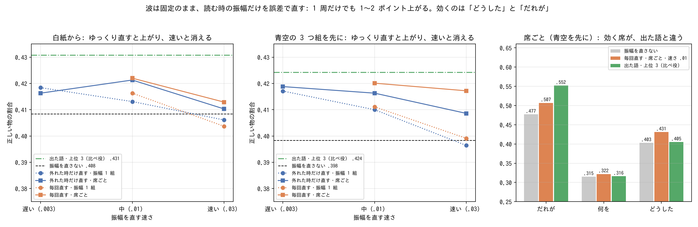

| | まっさらから 正しい物 | 合わせて | 青空を先に 正しい物 | 合わせて |
|---|---|---|---|---|
| 振幅を直さない（今までの形） | .408 | .542 | .398 | .516 |
| 外れた時だけ直す・振幅 1 組・速さ .003 | .418 | .555 | .417 | .540 |
| 外れた時だけ直す・席ごと・速さ .01 | .421 | .555 | .416 | .540 |
| 毎回直す・席ごと・速さ .01 | .422 | .558 | .420 | .542 |
| 毎回直す・席ごと・速さ .03 | .413 | .547 | .417 | .535 |
| 外れた時だけ直す・振幅 1 組・速さ .03 | .406 | .536 | .396 | .511 |
| 出た語・上位 3（比べ役） | .431 | .553 | .424 | .539 |
| 外れた時だけ直す・席ごと・.01 ＋ 出た語・上位 3 | .430 | .549 | .426 | .545 |

- 読み 1: 振幅だけでも上がる。一番上は 毎回直す・席ごと・.01 で、まっさらから +1.4 ポイント（当たりに 492・外れに 380、z +3.8）、青空を先に +2.2 ポイント（601・422、z +5.6）。
- 読み 2: 直す速さに敏感。遅い方（.003、.01）が良く、.03 では効きが消える版が有る。.03 では一番大きい振幅が 5 から 9 まで伸びる。
- 読み 3: 席ごとに振幅を分けた方が良い。「毎回」と「外れた時だけ」の差は小さい。
- 読み 4: 効く席が、板や出た語と違う。「どうした」が上がる（青空を先に .403 から .431）。板は「どうした」を下げていた。「だれが」も少し上がる（.477 から .507）。
- 読み 5: 出た語と重ねても、積み上がりは小さい（まっさらから .430、出た語だけ .431。青空を先に .426、出た語だけ .424）。「合わせて」は青空を先にで .545 まで上がる。
- 振幅の広がり: 平らに近いまま（上位 1 割の振幅が占める割合は 11 から 15%）。0 に落ちた振幅は 0.4 から 4.4%。少数の属性に頼る形にはなっていない。
- 注意 1: 10 版の中で一番良い物を選んだ値なので、上がり幅は甘めに出ている。速さを変えても同じ向き（.003 と .01 はどれも板無しより上）なので、効き目そのものは有ると見ている。
- 注意 2: 直す速さは手で置いた値で、少し大きいと効きが消える。数えて決める形にはなっていない。
- 想定外の反応: 1 周だけでは効きが小さいと見込んでいたが、板（+1 ポイント前後）より大きく上がった。青空を先にの方が上がりが大きい。道具の「答えが変わった数」は選び直しの分だけを数えるので、振幅の版では 0 と出る（当たり・外れに変わった数は正しい）。
- 手で置いた値: 直す速さ、temp .05、初めの振幅 1、0 以上に切る事、上位 3。

## 35. いいとこ取りの形に、振幅を直す形を入れる（I49zh、`tools/past/i49zh_mix_amp_run.py`）

34 節で解く形だけなら 1〜2 ポイント上がった。段を数えて表と解く形を選ぶ形（30.1 節）の解く側に入れて、積み上がるかを見た。7 版、8,229 問、490 秒。

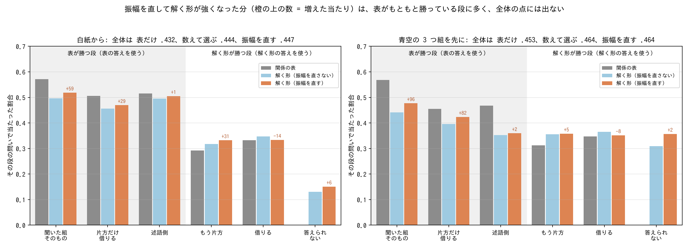

| | まっさらから 正しい物 | 合わせて | 青空を先に 正しい物 | 合わせて |
|---|---|---|---|---|
| 関係の表だけ | .432 | .589 | .453 | .615 |
| 数えて選ぶ | .444 | .602 | .464 | .626 |
| 数えて選ぶ＋出た語 | .446 | .595 | .463 | .623 |
| 数えて選ぶ・振幅を直す（毎回・席ごと・.01） | .447 | .604 | .464 | .626 |
| 同じ＋出た語 | .447 | .587 | .461 | .620 |
| 数えて選ぶ・振幅を直す（外れた時・席ごと・.01） | .446 | .603 | .461 | .621 |
| 数えて選ぶ・振幅を直す（毎回・席ごと・.003） | .446 | .605 | .463 | .625 |

- 読み 1: 積み上がらなかった。数えて選ぶ形に入れても .444 から .447、.464 から .464。2 つの版を直に比べると、良くなった問い 164・悪くなった問い 145（z +1.1）、150・148（z +0.1）で、揺れの内。
- 読み 2: 解く形そのものは強くなっている。ただし増えた当たりは、表がもともと勝っている段に多い（聞いた組そのもの +59・+96、片方だけ借りる +29・+82）。そこは表の答えを使うので、全体には出ない。解く形の答えを使う段では、増え方が小さい（もう片方 +31・+5、借りる −14・−8）。
- 読み 3: つまり、振幅を直して良くなるのは「聞いた事の有る組を思い出す」問いで、「聞いた事の無い組を当てる」問いではない。表が既に持っている力を、解く形が後から追いかけている形。
- 読み 4: 表を使わない形にとっては意味が有る。解く形だけで、聞いた組そのものの段の当たりが .496 から .519、.442 から .477 に上がり、表（.571、.568）との差が縮む。
- 想定外の反応: 解く形が強くなったのに、青空を先にでは表を使う問いが増えた（6,107 から 6,257）。理由は読めていない。出た語を重ねると「合わせて」が下がる（.604 から .587）。
- 手で置いた値: 直す速さ、temp .05、上位 3、同じ数の時に表を使う事。

## 36. 小さい世界で、語の位相を誤差で動かす（I49zi、`tools/past/i49zi_small_grad.py`。持ち主の案の第 2 段、未確定の試し）

第 2 段（周波数・位相を動かす）を、まず小さい自作の世界（I49q の world）で確かめた。良し悪しの判断ではなく、動かすと何が起きるかを見るための数え。小さい世界の結果は、本番の材料に当てはまらなかった事が有る（I49p）ので、ここの数は「向き」だけを見る。

答え方は解く形と同じ。直すのは外れた時だけで、正解の点を上げ、選んだ語の点を下げる向きへ、長さをそろえた 1 歩。話 10・40（語 52・202）× 位相 4・8・16 本 × 1 周・5 周 × 直す速さ .01・.03・.1。228 通り、344 秒。

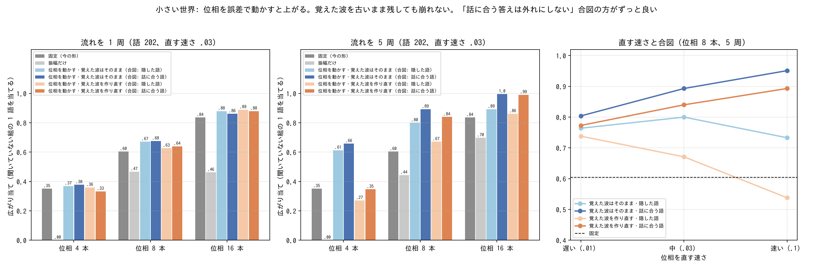

語 202・直す速さ .03 の、広がり当て（聞いていないがありそうな組の 1 語を当てる）:

| | 4 本・1 周 | 8 本・1 周 | 16 本・1 周 | 4 本・5 周 | 8 本・5 周 | 16 本・5 周 |
|---|---|---|---|---|---|---|
| 固定（今の形） | .351 | .604 | .836 | .351 | .604 | .836 |
| 振幅だけ（合図: 話に合う語） | .000 | .467 | .462 | .000 | .444 | .698 |
| 位相・覚えた波はそのまま（合図: 隠した語） | .369 | .671 | .880 | .613 | .800 | .893 |
| 位相・覚えた波はそのまま（合図: 話に合う語） | .378 | .676 | .862 | .658 | .893 | .996 |
| 位相・覚えた波を作り直す（合図: 隠した語） | .360 | .627 | .889 | .271 | .671 | .862 |
| 位相・覚えた波を作り直す（合図: 話に合う語） | .333 | .640 | .880 | .347 | .840 | .991 |

合図の意味: 「隠した語」は、選んだ語が隠した語と違えば直す（本番の流れと同じ）。「話に合う語」は、選んだ語が話に合わない時だけ直す（正しいと言える答えは、外れにしない）。

- 読み 1: 位相を動かすと上がる。1 周では +2 から +7 ポイント、5 周では大きく上がる（8 本で .604 から .893）。位相の本数が足りない所ほど効く。
- 読み 2: 覚えた波を古い位相のまま残しても、崩れなかった。作り直す形より良い事が多い。「動かすと前に足し込んだ波とずれて崩れる」という私の突っ込み（I49p からの見込み）は、小さい世界では外れた。
- 見立て（確かめていない）: 古いままの形は、狙い（見せた 2 語）の側だけを通して直すので、覚えた波が動かない的になる。作り直す形は、的も一緒に動く。I49p は誤差を見ずに聞くたびに寄せる形で、ここは外れた時だけ誤差の向きへ動かす形。そこが違う。
- 読み 3: 合図が大きく効く。話に合う別の語を選んだ時まで外れとして直すと、速さを上げるほど下がる（8 本・5 周・作り直す・速さ .1 で .538、固定 .604 より下）。正しいと言える答えを外れにしない合図では、速いほど上がる（.951）。
- 読み 4: 振幅だけの形は、小さい世界では下がる。ここの周波数は意味を持たない位相の並びで、本番（周波数 = 属性）とは事情が違う。34 節の結果を打ち消す物ではない。
- 読み 5: 覚え当て（聞いた組）と広がり当て（聞いていない組）は、一緒に上がる。聞いた組だけに合わせ過ぎる形にはなっていない。
- 本番への意味: (1) 本番は 1 周で、合図は「隠した語」だけ。小さい世界で一番効きの小さい組み合わせに当たる。(2) 正しいと言える答えの集まり（29 節の採点）を合図に使えば、「話に合う語」に近づけられる。(3) 何周も回すのは、今の測り方（聞く前に問う）と別の物になる。
- 想定外の反応: 覚えた波を古いまま残す形が崩れなかった事。振幅だけの形が位相 4 本で 0 まで落ちた事（振幅が 0 以上の切りで消える）。
- 手で置いた値: 世界の形、位相の本数、周の数、直す速さ、長さをそろえた 1 歩。

## 37. 本番の材料で、語の位相を誤差で動かす（I49zj、`intervention/i49zj_phase_read.py`、`tools/past/i49zj_phase_run.py`。第 2 段、未確定の試し）

36 節の小さい世界で一番良かった形（外れた時だけ、見せた 2 語の位相を誤差の向きへ動かす。覚えた波は作り直さない）を、本番の解く形に入れた。語ごと・属性ごとに位相のずれを持つ（初めは 0）。属性の割合（強さ）は変えない。1 周だけ。10 版、8,229 問、446 秒。

| | まっさらから 正しい物 | 合わせて | 青空を先に 正しい物 | 合わせて |
|---|---|---|---|---|
| 直さない（今までの形） | .408 | .542 | .398 | .516 |
| 振幅だけ（34 節の一番上） | .422 | .558 | .420 | .542 |
| 位相・合図 隠した語・速さ .03 | .424 | .564 | .412 | .535 |
| 位相・合図 隠した語・速さ .1 | .420 | .552 | .395 | .517 |
| 位相・合図 隠した語・速さ .3 | .397 | .521 | .365 | .477 |
| 位相・合図 聞いた組・速さ .03 | .417 | .557 | .412 | .537 |
| 位相・合図 聞いた組・速さ .3 | .397 | .523 | .360 | .480 |
| 位相（.1）＋振幅・合図 隠した語 | .427 | .562 | .423 | .546 |
| 位相（.1）＋振幅・合図 聞いた組 | .427 | .563 | .429 | .557 |
| 出た語・上位 3（比べ役、34 節） | .431 | .553 | .424 | .539 |

合図「聞いた組」: 選んだ語が、同じ席・同じ見せた 2 語でそれまでに聞いた事の有る語なら、外れにしない。聞いた事の有る組は、答え合わせのたびに数えて持つ（先の話の中身は使わない）。

- 読み 1: 位相だけでも、ゆっくり（.03）なら上がる（+1.5、z +4.1。青空を先に +1.4、z +3.2）。振幅だけの形と同じくらい。
- 読み 2: 速くすると崩れる（.3 で −1 から −4 ポイント、z −2.2 から −7.4）。位相のずれの平均が .10 ラジアンを越えると、覚えた波と合わなくなる。36 節の小さい世界では速いほど良かったが、本番では逆だった。私の初めの突っ込み（動かすと覚えた波とずれる）は、速く動かした時には当たっていた。
- 読み 3: 位相と振幅を一緒に直す形が一番上（.427 / .429。直さない形から z +4.2 / +6.3）。青空を先にでは、決まりで書いた「出た語」（.424）と並ぶ所まで来た。一緒に直すと、位相だけでは下がった速さ（.1）でも下がらない。
- 読み 4: 合図の差は小さい。小さい世界では大きく効いたが、本番では ±0.7 ポイントの内。本番では、聞いた事の有る組に当たる外れが少ないためと見ている（位相を直した回数は 3,248 から 2,587 に減るだけ）。
- 席ごと: 位相で上がるのは「だれが」（.505 から .540）。「何を」は動かない（.307 から .304）。振幅は「どうした」に効くので、合わせると両方が上がる。
- 注意 1: 10 版から一番良い物を選んだ値なので、上がり幅は甘め。「振幅だけ」と「位相＋振幅」を直に比べた数は取っていない（.422 対 .427、.420 対 .429）。
- 注意 2: 直す速さに敏感で、手で置いた値。いいとこ取りの形（表と組む）では、まだ数えていない。35 節では、振幅で上がった分は表と組むと消えた。
- 想定外の反応: 小さい世界と本番で、速さと合図の向きが逆になった。位相と振幅を一緒にすると、速さへの敏感さが減った。
- 手で置いた値: 直す速さ（位相、振幅）、temp .05、長さをそろえた 1 歩。

## 38. 位相と振幅を直す解く形を、表と組んだ形と出た語に重ねる（I49zk、`tools/i49zk_mix_phase_run.py`）

37 節の一番上（位相 .1・合図 聞いた組・振幅 毎回・席ごと・.01）を、段を数えて表と解く形を選ぶ形（30.1 節）と、出た語の選び直しに重ねた。8 版、8,229 問、475 秒。

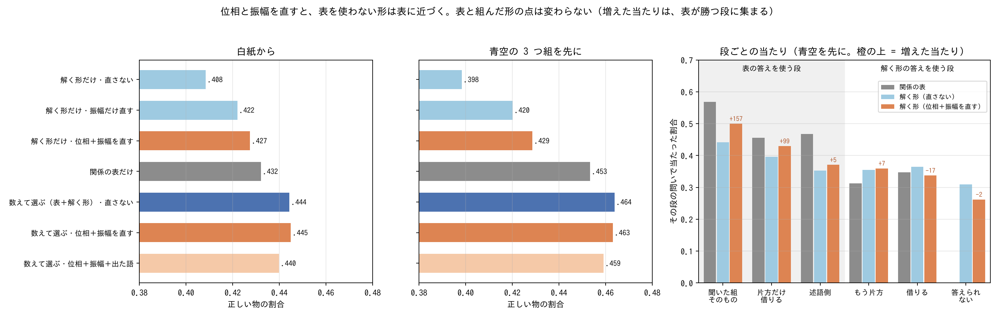

| | まっさらから 正しい物 | 合わせて | 青空を先に 正しい物 | 合わせて |
|---|---|---|---|---|
| 解く形だけ・直さない | .408 | .542 | .398 | .516 |
| 解く形だけ・振幅だけ | .422 | .558 | .420 | .542 |
| 解く形だけ・位相＋振幅 | .427 | .563 | .429 | .557 |
| 解く形だけ・位相＋振幅＋出た語 | .425 | .544 | .427 | .545 |
| 関係の表だけ | .432 | .589 | .453 | .615 |
| 数えて選ぶ・直さない | .444 | .602 | .464 | .626 |
| 数えて選ぶ・位相＋振幅 | .445 | .603 | .463 | .624 |
| 数えて選ぶ・位相＋振幅＋出た語 | .440 | .572 | .459 | .619 |

同じ問いで片方だけ当たった数（直の比べ）:

| 比べ | まっさらから 良くなった・悪くなった・z | 青空を先に |
|---|---|---|
| 解く形: 直さない → 位相＋振幅 | 785・629・+4.2 | 912・663・+6.3 |
| 解く形: 振幅だけ → 位相＋振幅 | 586・542・+1.3 | 638・568・+2.0 |
| 数えて選ぶ: 直さない → 位相＋振幅 | 223・218・+0.2 | 211・217・−0.3 |
| 数えて選ぶ: 直さない → 位相＋振幅＋出た語 | 434・471・−1.2 | 278・317・−1.6 |

- 読み 1: 表を使わない形は、表に近づいた。まっさらからでは .427 対 .432（表との差 z −1.0、揺れの内）。青空を先にでは、まだ 2.5 ポイント下（.429 対 .453、z −4.6）。
- 読み 2: 位相を足した分は、振幅だけの形から +0.5 から +0.9 ポイント。直の比べは z +1.3 / +2.0 で、揺れの境目。位相の効き目は、振幅の効き目ほど確かではない。
- 読み 3: 表と組んだ形には、積み上がらない（z +0.2 / −0.3）。35 節と同じ形。増えた当たりは、表の答えを使う段に集まる（聞いた組そのもの +133・+157、片方だけ借りる +32・+99）。解く形の答えを使う段では増えない（もう片方 +15・+7、借りる −21・−17）。
- 読み 4: 出た語を重ねると下がる（解く形だけで −0.2 から −0.3、数えて選ぶで −0.4 から −0.5）。34 節でも積み上がりは小さかった。誤差で直した解く形と、出た語の選び直しは、同じ問いを取り合っていると見ている（確かめていない）。
- まとめ: 誤差で直す形が良くするのは「聞いた組を思い出す」力で、表が既に持っている力と同じ物。「聞いた事の無い組を当てる」力は、振幅でも位相でも増えていない。今の一番良い形は、変わらず 数えて選ぶ（.444 / .464）。
- 想定外の反応: 出た語を重ねた 数えて選ぶ では、まっさらからで解く形を使う問いが倍近くに増え（2,431 から 4,369）、聞いた組そのものの段で解く形が表を越えた（1,480 対 1,476）。それでも全体は下がった。
- 手で置いた値: 直す速さ（位相 .1、振幅 .01）、temp .05、上位 3、同じ数の時に表を使う事。

## 39. 誤差で直した後も、属性が近い語に負ける形は残っているか（I49zl、`tools/past/i49zl_who_wins_after_run.py`）

持ち主の言葉:「属性が近いとわからなくなる問題はまだ残ってるよね？」。25 節（I49y）と同じ数えを、直さない／振幅だけ直す／位相＋振幅を直す の 3 つの形でやり直した。8,229 問、302 秒。

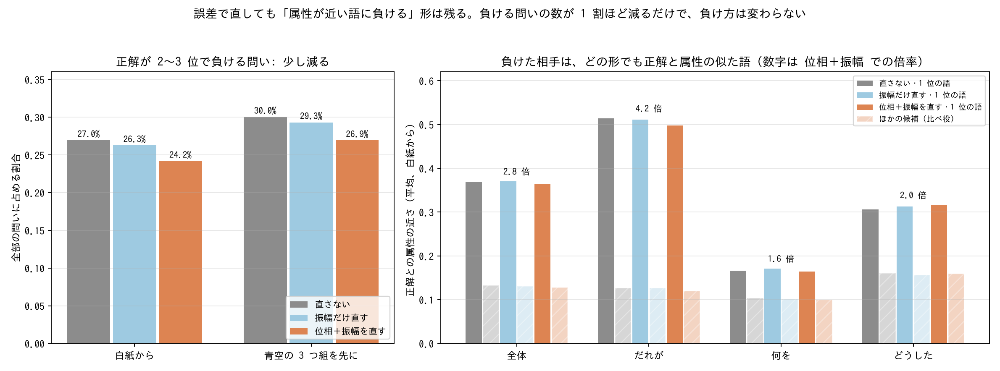

| | 正解が 2〜3 位で負ける問い（まっさらから） | 1 位と正解の近さ | 正解とほかの候補の近さ | 青空を先に 負ける問い | 1 位と正解の近さ | ほかの候補 |
|---|---|---|---|---|---|---|
| 直さない | 27.0% | .368 | .133 | 30.0% | .363 | .131 |
| 振幅だけ直す | 26.3% | .370 | .131 | 29.3% | .363 | .130 |
| 位相＋振幅を直す | 24.2% | .364 | .128 | 26.9% | .355 | .133 |

- 答え: 残っている。負ける問いは 1 割ほど減る（27.0% から 24.2%、30.0% から 26.9%）が、負け方は変わらない。1 位を取るのは、どの形でも正解と属性の似た語（ほかの候補の 2.8 倍の近さ。「だれが」では .50 対 .12 で 4 倍）。
- 位相＋振幅の後は、1 位が「この話でもう出た語」である割合が上がる（.55 から .60、.48 から .52）。正解がもう出ていた割合は下がる（.55 から .48）。直した形が取り戻したのは、正解がもう話に出ていた問いが多い、という形。
- 1 位が「正しいと言える物」だった割合は、少し上がる（.244、.250、.262）。
- 道具の誤り（私）: 初めの版は、位相を動かす形だけ、動かした後の波で近さを測っていた。どの語どうしの近さも下がるので「似た語に負ける形が減った」ように見えた（.37 から .10）。動かす前の属性で測り直すと、.36 のままだった。上の表は直した後の数。
- 手で置いた値: 「上位」を 3 位までとする事、直す速さ。

## 40. 属性の波に、語ごとの固有の位相を足す（I49zm、`intervention/i49zm_two_channel.py`、`tools/i49zm_two_channel_run.py`。持ち主の案、未確定の試し）

持ち主の言葉:「一つの波の中に属性の波だけではなく、語そのものを判断区別できる直交の位相、固有の位相を混ぜるまたは 2 チャンネルで持たせる仕組みはどうかな？、語板と属性の波を別々にくらべず、属性で大枠、固有位相で既知との一致」。
語の波を「属性の波（長さ 1）」と「語ごとの固有の位相（初めて聞いた順に黄金比で置く。長さ 1 × 混ぜ具合）」をつないだ 1 本にして、解く形（席あり）にそのまま渡した。乱数は使っていない。8,229 問、12 版、1,457 秒。

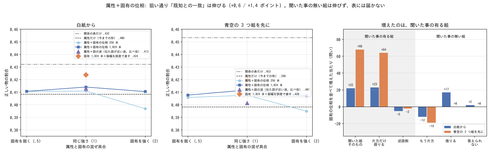

| 形 | まっさらから 正しい物 | 青空を先に 正しい物 |
|---|---|---|
| 関係の表（比べる相手） | .432 | .453 |
| 属性だけ（元） | .408 | .398 |
| 固有 256 本、混ぜ .5 / 1 / 2 | .411 / .411 / .397 | .406 / .408 / .395 |
| 固有 1,024 本、混ぜ .5 / 1 / 2 | .411 / .414 / .411 | .408 / .412 / .407 |
| 属性＋語の波（固有の代わり） | .413 | .401 |
| 固有 1・1,024 本＋読む時の振幅 | .424 | .420 |
| 数えて選ぶ（属性だけ） | .444 | .464 |
| 数えて選ぶ（固有 1・1,024 本） | .444 | .461 |

- 上がる。ただし小さい。属性だけとの直の比べは、まっさらから 383 勝 336 敗（z +1.75、揺れの内）、青空を先に 450 勝 339 敗（z +3.95）。
- 上がったのは、聞いた事の有る組の段。当たりの数は、聞いた組そのもの +22 / +68、片方だけ借りる +23 / +64。逆に「もう片方」は −12 / −19。固有の位相は「前に聞いた語との一致」を強める働きで、持ち主の見立ての通りに動いた。聞いた事の無い組には効かない。
- 席で見ると「だれが」が上がり（.505 → .535、.477 → .515）、「どうした」は少し下がる（.413 → .403、.403 → .396）。
- 固有の位相が 256 本で混ぜ具合 2 だと、元より下がる（.397 / .395）。本数が少ないと語どうしの固有の位相がぶつかり、それを強く混ぜると属性の大枠が負ける、という見立て。1,024 本なら混ぜ 2 でも下がらない。
- 固有の位相の代わりに、もとの語の波を使うと、青空を先にでは上がらない（.401）。直交に置いた位相の方が良い。
- 読む時の振幅（34 節）とは重なる（固有からの直の比べ z +3.3 / +2.6）。位相＋振幅の形（.427 / .429、37 節）は超えない。
- 表（.432 / .453）には届かない（直の比べ z −4.0 / −7.7）。表と組んだ形にも積み上がらない（.444 → .444、.464 → .461、z 0 / −1.3）。34〜38 節と同じで、良くなるのは表がもともと勝つ段。
- 「属性が近い語に負ける」問題に、この形が直に効いたかは、まだ数えていない（39 節の数えを、この形でやり直せば分かる）。
- 想定外: 青空を先にの版が重かった（1 版 39〜160 秒）。「どうした」が下がった。
- 手で置いた値: 混ぜ具合、固有の位相の本数、振幅を直す速さ（.01）、temp .05。

## 41. 属性＋固有の位相の形で、属性が近い語に負ける問いは減ったか（I49zn、`tools/past/i49zn_who_wins_two_run.py`）

39 節と同じ数えを、属性だけ／属性＋固有の位相（混ぜ 1・1,024 本）／さらに読む時の振幅、の 3 つの形でやり直した。近さは、どの形でも属性の波どうしで測る。8,229 問、294 秒。

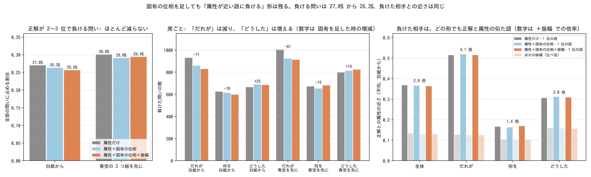

| | 正解が 2〜3 位で負ける問い（まっさらから） | 1 位と正解の近さ | ほかの候補 | 青空を先に 負ける問い | 1 位と正解の近さ | ほかの候補 |
|---|---|---|---|---|---|---|
| 属性だけ | 27.0% | .368 | .133 | 30.0% | .363 | .131 |
| 属性＋固有の位相 | 26.3% | .366 | .130 | 29.0% | .364 | .132 |
| 属性＋固有の位相＋振幅 | 25.6% | .363 | .130 | 29.4% | .359 | .131 |

- 答え: ほとんど減らない。負ける問いは 27.0% から 26.3%（30.0% から 29.0%）。位相＋振幅を誤差で直す形（24.2% / 26.9%、39 節）より減りが小さい。負けた相手は、どの形でも正解と属性の似た語（ほかの候補の 2.8 倍の近さ）。
- 席で分かれる。「だれが」は減る（930 → 859、1,003 → 922）。「どうした」は増える（664 → 689、797 → 813）。40 節の席ごとの当たりと同じ向き。
- 1 位が「この話でもう出た語」である割合が上がる（.55 → .58、.48 → .51）。固有の位相は、前に聞いた語を強く推す。それが正解なら当たり、似た別の語なら負ける、という形（見立て）。
- 手で置いた値: 「上位」を 3 位までとする事、混ぜ具合、固有の位相の本数、直す速さ。

## 42. 全部の問いと答えをテキストに出し、ローカル AI に違和感を見てもらう（I49zo、`tools/past/i49zo_dump_answers.py`。持ち主の案、未確定の試し）

持ち主の言葉:「全部テキストに出して、試しにローカルAI君に違和感をチェックしてもらうのどうかな？」「この実験の難点が正解の考え方だよね」。
全部の問い（8,229 問 × 2 つの始め方）と 5 つの形の答えを、1 つのテキストに出した（リポジトリの外）。そのうち「属性だけ」と「属性＋固有の位相」で答えが違った問い（1,458 / 1,569 問）から等間隔に 400 問を取り、古い答えを入れた組・新しい答えを入れた組・正解の組に、ローカル AI（gemma4 の 12b、温度 0）が「出来事として自然か」を 1〜5 で付けた。各 255 秒ほど。点が読めなかった数は 0。

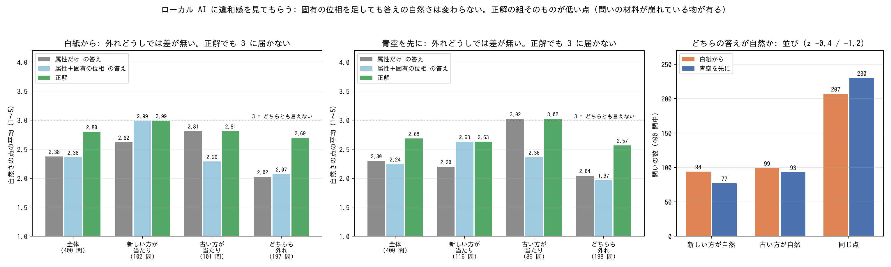

| | 属性だけ の答え | 属性＋固有の位相 の答え | 正解 | 新しい方が自然 / 古い方が自然 / 同じ |
|---|---|---|---|---|
| まっさらから 400 問 | 2.38 | 2.36 | 2.80 | 94 / 99 / 207（z −0.4） |
| うち、どちらも外れ 197 問 | 2.03 | 2.07 | 2.70 | 46 / 47 / 104 |
| 青空を先に 400 問 | 2.30 | 2.24 | 2.68 | 77 / 93 / 230（z −1.2） |
| うち、どちらも外れ 198 問 | 2.05 | 1.97 | 2.57 | 35 / 46 / 117 |

- 違和感の点で見ても、2 つの形は並び。外れどうしで「固有の位相の方がましな答え」という事は無い。当たった方が自然と見られる、というだけ（新しい方が当たり z +2.6 / +2.1、古い方が当たり z −3.4 / −3.2）。
- 想定外: 正解の組でも平均 2.8 / 2.7 で、「どちらとも言えない」の 3 に届かない。行を見ると、理由は 3 つ有る。
  1. 問いそのものが崩れている物が有る。文を 3 つ組に切る所で、形式名詞や副詞や語のかけらが席に入っている。正解しても意味の無い問い。
  2. 外れに数えているのに、自然な答えが有る。「正しいと言える物」の集まり（I49w）の外にも、成り立つ答えが有る。
  3. その席に座れない語（副詞、敬称のかけら）を答える問いが、どちらの形にも目立つ。候補に入っている事が問題。
- 物差しとしてのローカル AI は粗い（助詞の合わない組に 4 を付ける事が有る）。持ち主の目を補うだけで、正解ではない。
- 手で置いた値: 取る問いの数（400）、1〜5 の物差し、問いの文面、モデル。
- 次に数えられる事: 正解の組の点が低い問い（1〜2）を除いた時に、今までの順位（表、解く形、数えて選ぶ）が変わるか。

## 43. 切り出しを通さない材料で数え直す（I49zp、`tools/i49zp_text_talks_run.py`。材料は持ち主のテキスト、リポジトリには入れない）

42 節の続き。学習に使っていた 3 つ組そのものを同じ物差し（ローカル AI、1〜5）で見ると、自作の話の 3 つ組は平均 2.74（1〜2 点が 56%）、青空の 3 つ組は 1.47（91%）だった。文は普通で、文から 3 つ組を切り出す所が崩れていた: 「に」「で」の語が「何を」の席に入る、名前や複合語の最後だけが残る、形式名詞が席に入る、「〜を大切にする」の類で「する」だけが残る。
持ち主の言葉:「切りだしが間違ってる部分がおおいから、最初から文章を別のAIに作ってもらうのはだめかな？」「これを手直しして使えないかな」「連番になっているから、使うときはシャッフルと抜き出しでテストおねがいね。」

材料: 「A が B を C する」の文が 1 行ずつ並んだテキスト 2,079 行。形態素の切り出しは使わず、「が」「を」の位置で切る。直さずに外した行: 「を」が無い 469、ほかの助詞が入る 71、「の」でつないだ語 88、「〜をする」32。話の区切りは決まりで入れた（出てくる人が替わる所）。194 話、3 つ組 1,415 個、4,245 問（1 組につき 3 問）。話の順は乱数を使わずに 3 通りに並べ替え、元の順と合わせて 4 回数えた。まっさらからだけ。49 秒。

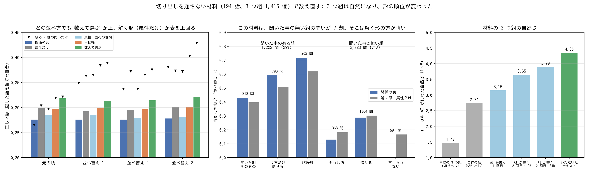

| 形 | 元の順 | 並べ替え 1 | 並べ替え 2 | 並べ替え 3 | 後ろ 2 割（並べ替え 1〜3） |
|---|---|---|---|---|---|
| 関係の表 | .276 | .276 | .276 | .278 | .349 / .337 / .380 |
| 解く形・属性だけ | .299 | .292 | .295 | .300 | .363 / .372 / .373 |
| 属性＋固有の位相 | .286 | .286 | .279 | .281 | .365 / .337 / .372 |
| 属性＋固有の位相＋振幅 | .298 | .299 | .296 | .301 | .384 / .365 / .403 |
| 数えて選ぶ | .319 | .313 | .314 | .321 | .389 / .376 / .429 |

- 材料の 3 つ組の自然さは 4.35（1〜2 点は 13%）。AI に文と 3 つ組を一緒に書いてもらう試しは、頼み方を直す前 3.15、直した後 3.65（12B）と 3.90（31B）で、語の種類が少なかった（「だれが」12〜14 種類。このテキストは 314 種類）。
- 形の順位が変わった。今までの材料では 表 > 解く形 だったが、この材料では 解く形（属性だけ）> 表（直の比べ z +2.7〜+3.9、4 回とも）。数えて選ぶは、4 回とも一番上（表との直の比べ z +9.1〜+10.4）。
- 理由（図の中央）: この材料は、聞いた事の無い組の問いが 71% を占める（今までの材料は、同じ語を使い回す話で、聞いた組の問いが多かった）。聞いた事の有る組の段は表が強く、聞いた事の無い組の段は解く形が強い。段ごとの強さは今までと同じで、問いの割合が違う。
- 固有の位相は、この材料では属性だけより下（z −1.6〜−4.4）。「前に聞いた語を推す」働きは、聞いた事の無い組が多い材料では裏目に出る。40 節の上がり幅は、材料の偏りに助けられていた。読む時の振幅を足すと、属性だけと並ぶ所まで戻る。
- 全体の点は .28〜.32 で、今までの材料（.41〜.44）より低い。候補の数は同じくらい（話ごとの語 16.1）。低い理由の見立ては 2 つ: 聞いた事の無い組が多い事、属性を持たない語が 32% の行に入っている事（「だれが」の席に集まる。代名詞、職業の名、物語の中の名）。
- 想定外: 後ろ 2 割の点は、元の順では低く（.27〜.32）、並べ替えると上がる（.34〜.43）。元の順は場面が順に並んでいて、後ろの場面に新しい語が固まっているため（持ち主の指摘の通り）。
- PC 側の誤り: 初めの回は、テキストの写しの改行が崩れていて、どの行も話の区切りと読まれ、話が 0 になった。写しを直してやり直した。
- 手で置いた値: 区切りの決まりの数（8・4・12・6）、後ろ 2 割、並べ替えの 3 通り、外す決まり、形の中の値。

### 43 節の続き: 修正版と、合わせた物（同じ道具、同じ日）

持ち主が、空行で場面を区切った修正版（2,212 行、195 場面）をくれた。持ち主の言葉:「プロンプトで生成する場合は定期的にスレッドを作り替えないと、出力が生成物に影響を与え始める＆ループに陥りやすいから、シチュエーションを一緒に渡すといいのかも。」
道具は、空行の有るテキストは空行だけで切るように直した。修正版 195 話・3 つ組 1,926 個（自然さ 4.35、1 点は 200 のうち 4）、前の版と合わせると 389 話・3,341 個。同じ行は 165 行だけ。

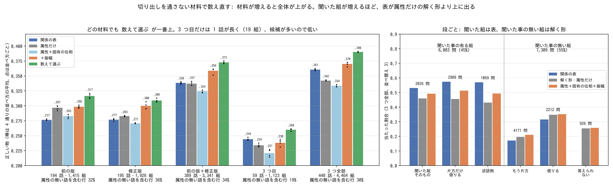

| 形（4 通りの並べ方の平均） | 前の版 | 修正版 | 合わせた物 |
|---|---|---|---|
| 関係の表 | .277 | .277 | .338 |
| 解く形・属性だけ | .297 | .283 | .337 |
| 属性＋固有の位相 | .283 | .271 | .324 |
| 属性＋固有の位相＋振幅 | .299 | .300 | .359 |
| 数えて選ぶ | .317 | .309 | .373 |

- どの材料でも変わらなかった事: 数えて選ぶが一番上（表との直の比べ z +7.8〜+12.1）。固有の位相は属性だけより下（z −3.1〜−4.9）。
- 上の「解く形が表を上回る」は、前の版だけの事だった（私の言い過ぎ）。修正版では揺れの内（z +0.8〜+1.5）、合わせた物では並び（z −0.8〜+0.2）。言えるのは「崩れた材料では表が 2〜5 ポイント上だったが、切り出しを通さない材料では並ぶ」まで。
- 読む時の振幅を足した形は、修正版と合わせた物で、表と属性だけの両方より上に出た（.300 対 .277・.283、.359 対 .338・.337）。この組の直の比べは、まだ数えていない。
- 材料が倍になると、全体が 6 ポイントほど上がる。聞いた事の有る組の問いが 29% から 38% に増えるため。
- 修正版は、主語が場面ごとの職業の人になり、属性を持たない語を含む行が 36% に増えた（「だれが」の席で 485 回）。「何を」「どうした」の当たりは低い（表で .20 と .15）。1 話の語が 19.8 と多く、候補が多い。
- 手で置いた値は 43 節と同じ（区切りの決まりは、空行の無いテキストだけに使う）。
- 追記（合わせた物での直の比べ、4 通りの並べ方）: 属性＋固有の位相＋振幅 は、表に勝つ（z +4.0〜+6.1）、属性だけにも勝つ（z +5.1〜+7.9）。表を使わない形が、表を確かな差で上回ったのは、これが初めて。数えて選ぶ（解く側は属性だけ）は、その上（z +3.2〜+5.5）。振幅を直す形は、今までの決まりから外れる試しで、採用は未定。直す速さ（.01）は手で置いた値。

### 43 節の続き 2: 3 つ目のテキストと、3 つ全部（同じ道具、同じ日）

持ち主が 3 つ目のテキスト（1,275 行、20 行ずつの 63 場面）をくれた。同じ場面の重なり 4 つは外した。3 つ目だけで 59 話・3 つ組 1,123 個（自然さ 4.32）、3 つ全部で 448 話・4,464 個。3 つ目の 161 行は、前の 2 つと同じ文。図は上の物を 5 通りの材料に描き直した。

| 形（4 通りの並べ方の平均） | 3 つ目だけ | 3 つ全部 |
|---|---|---|
| 関係の表 | .244 | .361 |
| 解く形・属性だけ | .234 | .342 |
| 属性＋固有の位相 | .221 | .334 |
| 属性＋固有の位相＋振幅 | .238 | .370 |
| 数えて選ぶ | .260 | .390 |
| 数えて選ぶ・振幅の形と | .259 | .395 |

- 3 つ全部が、切り出しを通さない材料での今までの一番上。数えて選ぶは表に z +12.0〜+12.6。振幅の形と組むと、さらに z +1.2〜+3.0（並べ替えた 3 通りでは揺れの外）。
- 想定外: 3 つ全部では、解く形・属性だけが表より下に出た（z −4.6〜−5.5）。前の 2 つを合わせた時は並びだった。聞いた事の有る組の問いが 38% から 45% に増え、そこは表が強いため。「材料が増えるほど表が有利になる」と読める。
- 固有の位相だけでは、ここでも属性だけより下（z −2.4〜−3.9）。振幅を直すと属性だけを越え（z +7.9〜+10.2）、表も越える（z +1.9〜+3.3）。
- 3 つ目だけは点が低い（数えて選ぶ .26）。1 話が 19 組・語 34.6 と長く、候補が多い。属性の無い語を含む行は 19% で、3 つの中で一番少ないのに低いので、ここでは候補の数の方が効いている。
- 手で置いた値は 43 節と同じ。

## 44. 席を増やす（I49zq・I49zr、`intervention/past/i49zq_frame.py`、`tools/past/i49zr_frame_run.py`。持ち主が選んだ次の段階の 1 つ目）

次の段階として、3 つ組（だれが・何を・どうした）から、席の数を決めない枠（が・を・に・で・と・へ・から・どうした）に進む。持ち主が候補 1 として選んだ物。

- 部品: 関係の表を作り直した FrameTable（見せた席のうち m 個が同じ語の枠を数える。段は「全部同じ」「m 個同じで残りは似た語」「m 個同じ」の順）、波で解く形を作り直した FrameSolve（席の組ごとに位相の傾きを変えて重ねる。席が 3 つなら今までの形と同じ波になる）、数えて選ぶは今までの Mix をそのまま使う。
- 材料: 43 節と同じ 3 つのテキスト（リポジトリには入れない。例の行も載せない）。行を、助詞の位置で切る（形態素の切り出しは使わない。行は外すだけで、直さない）。451 話・枠 5,314。席ごとの枠の数は を 4,682、に 549、で 48、から 17、へ 12、と 5。席が 2 つの枠 131、3 つ 5,053、4 つ 130。
- 数え方は 3 通り。三つの席（が・を・どうした だけの枠 4,552。今までの部品も並べる）、全部の席、席を見せない（同じ枠を覚えるが、問う時に足した席を見せない）。

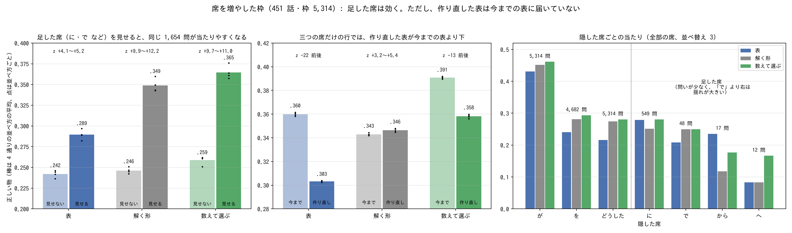

| 4 通りの並べ方の平均（正しい物） | 表 | 解く形 | 数えて選ぶ |
|---|---|---|---|
| 三つの席・今までの部品 | .360 | .343 | .391 |
| 三つの席・作り直した部品 | .303 | .346 | .358 |
| 全部の席 | .297 | .335 | .347 |
| 足した席が有る枠の 1,654 問・見せない | .242 | .246 | .259 |
| 同じ 1,654 問・足した席を見せる | .289 | .349 | .365 |

- 足した席は効く。「に」「で」などの語を見せると、同じ問い（が・を・どうした を当てる）が、解く形で +10 ポイント（z +9.9〜+12.2）、数えて選ぶで +11 ポイント（z +9.7〜+11.0）、表で +5 ポイント（z +4.1〜+5.2）当たりやすくなる。
- 想定外: 作り直した表は、三つの席だけの行で、今までの表より大きく下（.303 対 .360、z −22 前後）。そのため作り直した数えて選ぶも下（z −13 前後）。今までの表は「どの席が同じ語だったか」で段を分けている（近い席が同じ、述語側、もう片方）。作り直した表は「同じ語が m 個」でまとめてしまい、どの席が同じだったかを区別していない。これが落ちた所と見ている（まだ確かめていない）。次に直す。
- 作り直した解く形は、今までの解く形より少し上（z +3.2〜+5.4）。理由は確かめていない。
- 足した席そのものを当てる問い（「に」549 問）は .25〜.28 で、「を」と同じくらい。「で」より右は問いが 50 より少なく、揺れが大きい。
- 見せる席が 1 つだけの問い（262 問）は、ほとんど当たらない（.06〜.07）。
- 切り方の粗さ（PC で見た目安）: ひらがなの後の助詞が切れずに どうした の中に残る行が 26 前後、語の途中で切る行が 2、様子の語が どうした に残る行、「〜をする」80 行（どうした が「する」になる。43 節では外していた行）。
- 手で置いた値: 席の並び、助詞と見る決まり（すぐ前がひらがなでなく、後ろに 2 字より多く残る）、表の段の順、表の半減期 1024、並べ替えの k、後ろ 2 割。

### 44 節の続き: 表を「どの席が同じ語だったか」で分ける（I49zs、FrameSeatTable。同じ材料、同じ日）

上の落ち込みの直し。段を（同じ語だった席の組, 残りを似た語で借りるか見ないか）に分ける。同じ語の数が多い段が先、という所は前と同じ。同じ数の段どうしの順は手で置かず、答え合わせのたびに段ごとの 1 位が当たったかを数え、それまでに多く当たってきた段を先に使う。図は上の物を描き直した。

| 4 通りの並べ方の平均（正しい物） | 表・席ごと | 数えて選ぶ・席ごと | 比べる相手 |
|---|---|---|---|
| 三つの席 | .359 | .392 | 今までの表 .360、今までの数えて選ぶ .391 |
| 全部の席 | .347 | .383 | 作り直しの表 .297、数えて選ぶ .347 |
| 足した席が有る枠の 1,654 問・見せない | .252 | .267 | |
| 同じ 1,654 問・足した席を見せる | .310 | .386 | |

- 三つの席だけの行では、今までの表に並んだ（z −0.4〜−1.1）。数えて選ぶも今までの物に並ぶ（z +0.7〜+1.2）。落ち込みの原因は「どの席が同じ語だったかを区別していなかった事」で合っていた。今までの表が手で置いていた段の順（近い席が先、述語側が次）は、当たりを数えるだけで同じ所まで届く。
- 全部の席では、表が .297 から .347（z +23〜+25）、数えて選ぶが .347 から .383（z +15.5〜+16.5）。今の 5 つの形の中で、数えて選ぶ・席ごとが一番上。
- 足した席を見せた時の伸びも、数えて選ぶ・席ごとが一番大きい（.267 から .386、z +11.0〜+12.8）。
- 隠した席ごと（並べ替え 3、数えて選ぶ・席ごと）: が .479、を .345、どうした .326、に .346、で .271（48 問）。
- 言えない事: 今までの部品を越えたわけではない。三つの席では並んだだけ。席を足した分の得は、足した席が有る枠（全体の 14%）に限られる。
- 数え直しでの小さな揺れ: 今までの表の「合わせて」が、1 つの並べ方で .4420 と .4421 に分かれた。同点の時の選び方が、集まりの並び順に左右されている所が有ると見ている（確かめていない）。
- 掛かった時間は 384 秒（形が 3 つの時は 113 秒）。
- 手で置いた値: 同じ語の数が多い段を先に使う事、同じ当たりの時の順（借りる方、席の並びの早い方）。ほかは 44 節と同じ。

## 45. 選び直しを、切り出しを通さない材料で数え直す（I49zt、`tools/past/i49zt_repick_clean_run.py`）

持ち主の問い:「材料が悪かった可能性のある実験は過去にある？」。I49e から I49zn までは、全部が崩れた 3 つ組の材料で数えた物。まだ数え直していない中で一番怪しい「もう出た語で選び直す」（I49u）と薄れる仮の板（I49z）を、43 節の 3 つのテキスト（448 話・4,464 組、13,392 問）で数え直した。

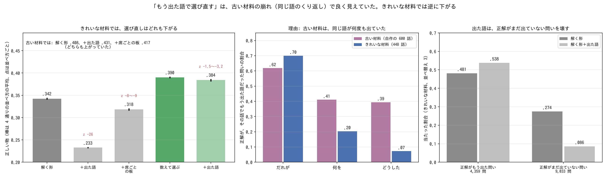

| 形（4 通りの並べ方の平均、正しい物） | きれいな材料 | 直の比べ | 古い材料（白紙から） |
|---|---|---|---|
| 解く形・属性だけ | .342 | | .408 |
| ＋出た語（上位 3） | .233 | z −25.7〜−26.0 | .431 |
| ＋席ごとの薄れる板 | .318 | z −8.2〜−9.4 | .417 |
| ＋出た語→板 | .229 | z −25.6〜−25.9 | |
| 数えて選ぶ | .390 | | .444 |
| 数えて選ぶ＋出た語 | .384 | z −1.5〜−3.2 | |
| 数えて選ぶ＋出た語→板 | .384 | z −1.7〜−2.8 | |

- 古い材料で「今ある選び直しの中で一番効く」としていた出た語は、きれいな材料では 11 ポイント下がる。薄れる板も 2 ポイント下がる。数えて選ぶに重ねても、上がらない（少し下がる）。
- 理由: 正解が、その話でもう出た語だった問いの割合が違う。古い材料は だれが .62、何を .41、どうした .39。きれいな材料は だれが .70、何を .20、どうした .07。古い材料は「何を」「どうした」で同じ語が何度も出ていた。
- 出た語は、正解がもう出た問いでは上がる（.48 → .54）が、まだ出ていない問いを壊す（.27 → .09）。上位 3 に出た語が 1 つでも有れば、それに替えてしまうため。きれいな材料では、まだ出ていない問いが 67% を占める。
- 「だれが」だけなら、きれいな材料でも出た語は悪くない（.467 → .466、数えて選ぶでは .494 → .521）。同じ人の話が続く、という手がかりは「だれが」の席に限れば残っている。
- 言えない事: 古い材料で同じ語がくり返されたのが、切り出しの崩れ（名前の最後だけが残る、など）のせいか、自作の話そのものの作りのせいかは、分けていない。
- 直す所: experiments_index の「もう出た語で選び直す」「薄れる仮の板」「いいとこ取りの形の 3」は、古い材料だけの結果として読む。
- 手で置いた値: 上位の数 3、九割、板の薄れる速さ（1 組で半分）、並べ替えの k、後ろ 2 割。掛かった時間 73 秒。

## 46. 「属性が近い語に負ける」を、切り出しを通さない材料で数え直す（I49zu、`tools/past/i49zu_who_wins_clean_run.py`）

45 節と同じ問いからの、数え直しの 2 つ目。I49y・I49zl・I49zn の数え（正解が上位 3 に居るのに、1 位を別の語に取られる問い）を、同じ 448 話・13,392 問で数えた。古い材料では正解そのものが崩れていたので、負けの一部は材料のせいかもしれない、と疑った。

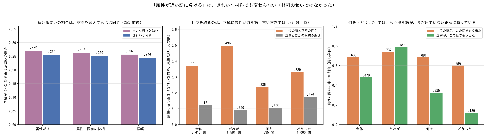

| 形 | 負けた問いの割合（古い材料） | きれいな材料（2 通りの並べ方の平均） | 1 位と正解の近さ／正解とほかの候補の近さ |
|---|---|---|---|
| 属性だけ | 27.0% | 25.4% | .37 ／ .12 |
| 属性＋固有の位相 | 26.3% | 25.0% | .37 ／ .12 |
| ＋振幅 | 25.6% | 24.4% | .38 ／ .12 |

- 疑いは外れ。負ける問いの割合も、近さ（古い材料では .37 対 .13）も、材料を替えてほぼ同じ。「1 位を取るのは、正解に属性が似た別の語」は、材料のせいではなかった。固有の位相でも振幅でも、ここは減らない、という所も同じ。
- 席ごとでは「だれが」が一番はっきりしている（近さ .50 対 .09）。人どうしの選び分けで負けている。
- 新しく見えた事: 負けた問いで、1 位の語がこの話でもう出ていた割合は 68%。「何を」「どうした」では、正解がもう出ていたのは 32% と 12% だけなのに、1 位の語は 68% と 60% がもう出た語。解く形は、選び直しを付けなくても、この話でもう聞いた語の方へ寄っている。理由は確かめていない（その場で覚える形なので、聞いたばかりの組が強く出るため、と見ている）。
- 1 位の方が多く聞いた語だったのは 48%（古い材料では 44%）。「聞いた回数の多い語が勝つ」わけではない、という I49y の結論も同じ。
- 道具の粗さ: 途中の表示に、並べ方の名前ではなく古い名前（白紙から、など）が出る。記録の数は正しい。
- 手で置いた値: I49zn と同じ（上位を 3 位までとする事、混ぜ具合、固有の位相の本数、直す速さ）。掛かった時間 50 秒。

## 47. 席を増やすと、「属性の似た語に負ける」問いは減るか（I49zv、`tools/past/i49zv_frame_who_wins_run.py`）

44 節で、足した席を見せると同じ 1,654 問が当たりやすくなった。その理由を「似た語を選び分ける手がかりが増えたから」と読んだ（私の読み。持ち主にもそう伝えた）。それを、波で解く形で、正解の順位の移り方として数えた。

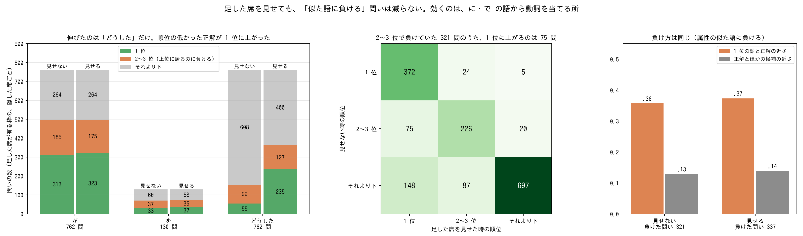

| 元の順（並べ替え 1 もほぼ同じ） | 見せない | 見せる |
|---|---|---|
| 正解が 1 位 | .242 | .360 |
| 正解が 2〜3 位（上位に居るのに負ける） | .194（321 問） | .204（337 問） |
| それより下 | .564 | .437 |
| 負けた問いの、1 位と正解の近さ ／ 正解とほかの候補の近さ | .36 ／ .13 | .37 ／ .14 |

- 読みは外れ。2〜3 位で負ける問いは減らない（321 → 337、並べ替え 1 では 324 → 358）。負け方も同じ（属性の似た語に負ける）。
- 伸びたのは「どうした」の席だけ（1 位が 55 → 235）。「が」（313 → 323）と「を」（33 → 37）は変わらない。順位の低かった正解が 1 位に上がった分（148 問）が、伸びの大半。
- つまり、足した席が効くのは「に・で の語から、動詞を当てる」所。人どうし・物どうしの選び分けには効いていない。「属性の似た語に負ける」壁は、席を増やしても残る。
- 手で置いた値: 上位を 3 位までとする事、並べ替えの k（0 と 1）。掛かった時間 3 秒。

## 48. 2 語の組を、広げてから掛けて束ねる（I49zw、`intervention/i49zw_dense_pair.py`、`tools/i49zw_dense_pair_run.py`。持ち主がもらった助言から、未確定の試し）

助言（持ち主が伝えてくれた物）:「波動計算（ホログラフィック表現／循環畳み込み）で「2語の組み合わせ」を掛け算で表現するには、先にFFT等で全周波数にエネルギーを拡散させた密な複素スペクトルに変換してから要素積を取る必要があるんじゃないか？」
持ち主の言葉（進め方）:「結果に急がないようにね、ゆっくり確認しながら進めよう」。それで、点より先に前提を確かめた。

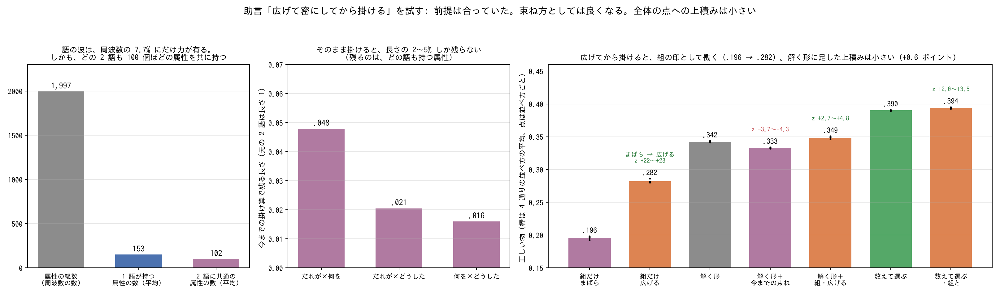

**前提の確かめ（今の波はまばらか）**
- 属性の総数（周波数の数）1,997。1 語が持つ属性は平均 153 個（最大 799）。力の有る所は 7.7%。助言の言う「密でない」は合っている。
- 私が先に言った説明は半分外れ。「共通の属性が無いので何も残らない」と言ったが、実際はどの 2 語も 100 個ほどの属性を共に持ち、何も残らない組は 0%。ただし残る長さは元の 2〜5% だけ。残るのは、どの語も持つ属性で、組の印にはならない、という所は同じ。

**束ね方**
属性の波を 8,192 本の並びに置き直し（席ごとに違う置き方）、FFT で広げてから要素ごとに掛ける。元の並びの側では畳み込みになり、「語 A の属性 i と語 B の属性 j の組」ごとに力が立つ。組の印どうしの近さは、2 語の近さの掛け算になる（小さい世界の関門で確かめた: 似た語どうしの組は近く、片方だけ同じ組は遠く、席を入れ替えると別の印）。

| 形（4 通りの並べ方の平均、正しい物） | 数 | 直の比べ |
|---|---|---|
| 組だけ・まばら（今までの掛け算） | .196 | |
| 組だけ・広げる | .282 | まばら → 広げる z +22.0〜+23.3 |
| 解く形 | .342 | |
| 解く形＋今までの束ね | .333 | z −3.7〜−4.3 |
| 解く形＋組・広げる（点を 1 対 1 で足す） | .349 | z +2.7〜+4.8 |
| 数えて選ぶ | .390 | |
| 数えて選ぶ・組と | .394 | z +2.0〜+3.5 |

- 束ね方としては、助言の通りに良くなる。組の印だけで答えた時、.196 から .282。今までの束ねは解く形に足すと下がったが、広げた束ねは足すと上がる。
- ただし上積みは小さい（解く形に +0.6 ポイント、数えて選ぶに +0.4 ポイント）。組だけでは解く形（.342）に届かない。
- まだ確かめていない事: 1 語の属性が 153 個なので、2 語の組は 2 万通りを越える属性の組になる。それを 8,192 本に置いているので、違う組が同じ場所に重なっているはず。本数を増やした時に上がるかは、数えていない。属性の大きさをそろえていない事（割合のまま）の効き目も、数えていない。
- 手で置いた値: 本数 8,192、置き直しの決め方（席ごとの奇数）、印の長さを 1 にそろえる事、点を足す重さ 1 対 1。掛かった時間 76 秒。

### 48 節の続き: 本数だけを変える（8,192 → 32,768。同じ道具、同じ日）

「違う属性の組が同じ場所に重なっているので、上積みが小さいのではないか」を確かめた。変えたのは本数だけ。

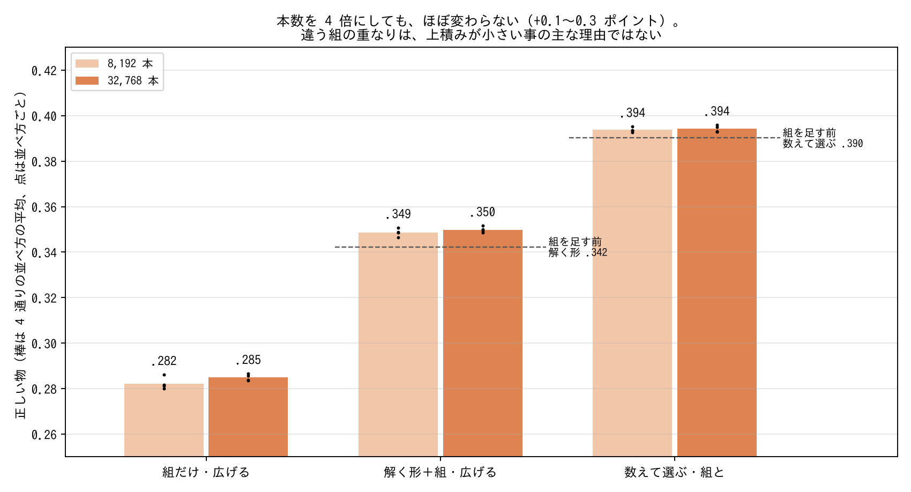

| 形（4 通りの並べ方の平均） | 8,192 本 | 32,768 本 |
|---|---|---|
| 組だけ・広げる | .282 | .285 |
| 解く形＋組・広げる | .349 | .350 |
| 数えて選ぶ・組と | .394 | .394 |

- 本数を 4 倍にしても、ほぼ変わらない。重なりは、上積みが小さい事の主な理由ではない。
- ほかの 4 つの形は、8,192 本の時と全く同じ数（道具が同じ事の確かめ）。掛かった時間 133 秒、メモリの山はおよそ 2.6 GB（PC 全体の空きから見た目安）。
- 残っている読み（確かめていない）: 組の印の近さは「2 語の近さの掛け算」で、これは関係の表の「借りる」の段や、見せた 2 語の点を掛ける形（I49x、+0.5〜0.8 ポイント）と同じ種類の手がかり。新しい手がかりではないので、上積みが小さいのかもしれない。
- まだ数えていない事: 属性の大きさをそろえた時（助言の「密な複素スペクトル」のもう半分）。

### 48 節の続き 2: 大きさのそろえ方だけを変える（同じ道具、同じ日。8,192 本）

助言のもう半分（密な複素スペクトル = 力を全部の本に配る）の確かめ。変えたのは大きさだけ。先に小さい世界で、3 通りとも組の印として働く事を確かめた（似た組は近く、片方だけ同じ組は遠い。「位相だけ」はどの本も同じ大きさになる）。

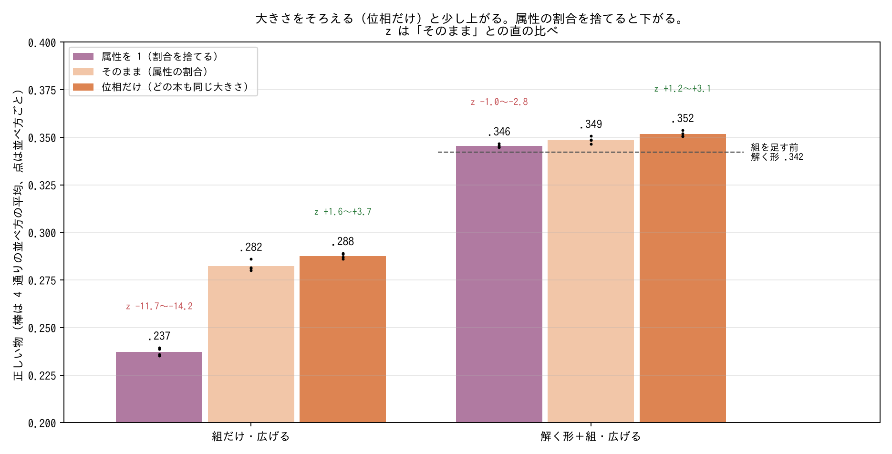

| 形（4 通りの並べ方の平均） | 属性を 1 | そのまま | 位相だけ |
|---|---|---|---|
| 組だけ・広げる | .237 | .282 | .288 |
| 解く形＋組・広げる | .346 | .349 | .352 |

- 位相だけ（広げた後、どの本も大きさ 1 にする）は、少し上がる。組だけで z +1.6〜+3.7、解く形に足した形で z +1.2〜+3.1。「何を」の席の上がりが一番大きい（+.01 前後）。助言の向きは合っているが、大きさは小さい。
- 属性の割合を捨てて全部 1 にすると、組だけの形ははっきり下がる（z −11.7〜−14.2）。割合には意味が有る。
- 「そのまま」の 2 つの形は、初めの数えと全く同じ数（道具が同じ事の確かめ）。
- ここまでのまとめ: 解く形 .342 に、広げて位相だけにした組を足して .352（+1.0 ポイント）。束ね方は直ったが、「属性の似た語に負ける」壁を越える大きさではない。
- 手で置いた値: 48 節と同じ。大きさ 1 にそろえる事。掛かった時間 75 秒。

### 48 節の続き 3: 組の印は、どの種類の問いで効いたか（--level_check、同じ日）

「上積みが小さいのは、組の印が解く形と同じ経験を別の見方で読んでいるだけだから」という私の読みの確かめ。解く形と、解く形＋組（位相だけ）を同じ問いで比べ、問いを関係の表の段で分けた。全部の段を足した数は、前の数えと合っていた（.3415 と .3507、.3421 と .3538）。

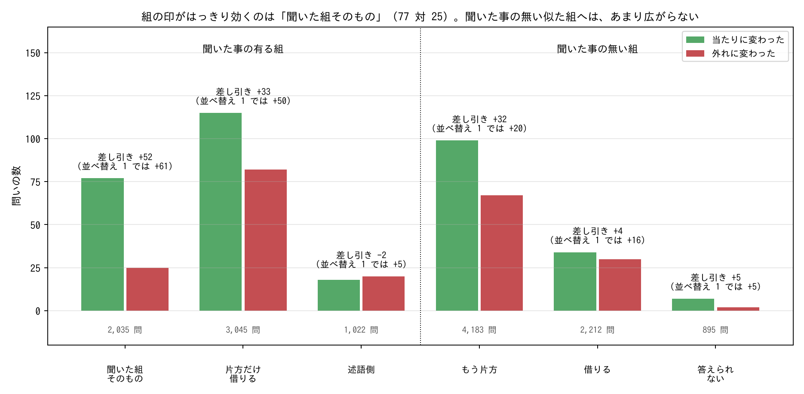

| 段（元の順） | 問い | 当たりに変わった | 外れに変わった | 差し引き（並べ替え 1） |
|---|---|---|---|---|
| 聞いた組そのもの | 2,035 | 77 | 25 | +52（+61） |
| 片方だけ借りる | 3,045 | 115 | 82 | +33（+50） |
| 述語側 | 1,022 | 18 | 20 | −2（+5） |
| もう片方 | 4,183 | 99 | 67 | +32（+20） |
| 借りる | 2,212 | 34 | 30 | +4（+16） |
| 答えられない | 895 | 7 | 2 | +5（+5） |

- 読みは半分外れ。組の印がはっきり効くのは「聞いた組そのもの」の問い（77 対 25、z +5 前後）。組の印は、聞いた組を思い出す働きを足している。解く形だけでは、聞いた組を使う力が弱かった（I49s）所に当たる。
- 聞いた事の無い組（もう片方・借りる・答えられない）への広がりは小さい。入れ替わりは多いが、差し引きは小さい。「似た組に通じる印」という狙いは、点としてはほとんど出ていない。
- 数えて選ぶに足した時の上積みが小さい（+0.4 ポイント）理由も、これで説明が付く。聞いた組そのものは、もう関係の表が答えているため。
- 介入の板への意味: 教えた組そのものを思い出す鍵としては使える。似た組への広がりは、期待し過ぎない。

## 49. 介入の板（I49zx、`intervention/i49zx_teach_board.py`、`tools/i49zx_teach_board_run.py`。介入の設計案の 1 つ目の段階、未確定の試し）

持ち主の言葉:「この辺から介入の仕組みをこれに合わせて設計してほしい。」設計案はロードマップの「介入の仕組みの設計案」。ここはその 1 つ目の段階。
- 介入 = 答えた後に、外から届く「合っている・違う（違うなら正しい語）」。I48 の決まりを引き継ぎ、本体に混ぜず別の板に持つ。外せば元に戻る。違った答えは暗い側へ弱く（1/1,000）。薄れるだけで、消さない。
- 板の鍵は、見せた 2 語の組の印（48 節の、広げてから掛けて大きさをそろえた物）。本体との合わせ方は重さを置かず、板が答えを持った問いでどちらが当たってきたかを数えて決める（同じなら本体）。
- 数え方: 本体は数えて選ぶ。本体は今まで通り全部の 3 つ組を聞く。介入は、等間隔に決めた割合の問いでだけ届く（教える役は、試しのための代わりとして材料の正解）。

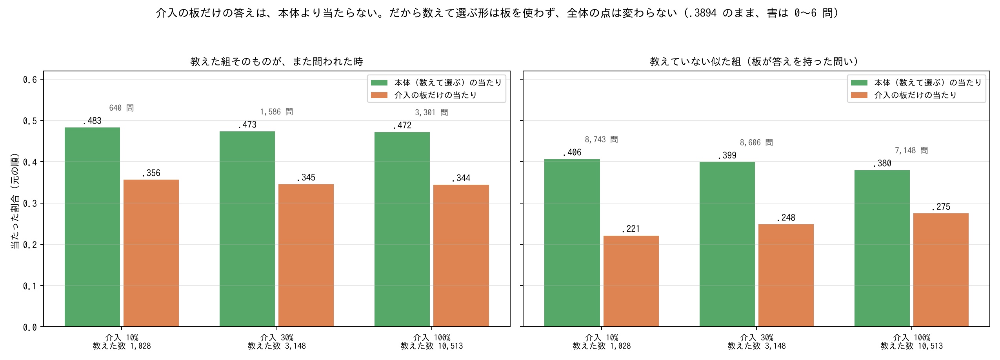

| 元の順 | 介入 10% | 介入 30% | 介入 100% |
|---|---|---|---|
| 全体: 本体 → 板を付けた形 | .3894 → .3893 | .3894 → .3893 | .3894 → .3894 |
| 当たりに変わった ／ 外れに変わった（害） | 0 ／ 2 | 4 ／ 6 | 0 ／ 0 |
| 教えた組そのもの: 本体の当たり ／ 板だけの当たり | .483 ／ .356 | .473 ／ .345 | .472 ／ .344 |
| 似た組: 本体の当たり ／ 板だけの当たり | .406 ／ .221 | .399 ／ .248 | .380 ／ .275 |

- 確かめられた事: 板を付けても本体の答えは 1 つも変わらない（取り消し）。害はほぼ無い（0〜6 問）。
- 効き目は無い。板だけの答えは、教えた組そのものでも本体より当たらない（.35 対 .48）。数えて選ぶ形は、当たってきた方を使うので、板を使わないままになった。
- 理由（1 つ目は数から言える、2 つ目は読み）: (1) 同じ 2 語の組に、違う答えが何度も付く（教えた組そのものでも、板の当たりは .35 止まり）。組の印だけでは答えが 1 つに決まらない。(2) この数え方では、本体が全部の 3 つ組を聞いているので、介入が運ぶ事は本体がもう知っている。設計案の突っ込みに書いた「答え合わせで覚えるのと何が違うのか」が、そのまま出た。
- 次に見る所: 介入が意味を持つのは、本体が聞いていない事を教える時。人が教える動作試験（`tools/i49zx_teach_try.py`）で、本体が外す問いに正しい語を教えて、前後を見る。
- 手で置いた値: 暗い側の強さ 1/1,000、板の薄れる速さ 1,024、本数 8,192、介入の割合、同じなら本体。掛かった時間 140 秒。

### 49 節の続き: 人が教える動作試験（`tools/i49zx_teach_try.py`、同じ日）

持ち主の言葉:「今の実験が一通り終わったら介入の動作試験をしてみようか」。本体（数えて選ぶ）に 43 節の材料を全部聞かせた後、私が作った 10 問に答えさせ、持ち主が合っている・違うを教えた。問いは私が作った物なので、ここに載せる。

- 教える前: 10 問とも、持ち主の判定は「合っている」（2・8・9 は 2 番目の候補も合っている）。これは介入の前の、本体だけの答え。10 問のうち 5 問は材料で聞いた組そのもので、当たりやすい試験だった（全体の数えでは当たりは 39%）。
- 教えを介入の板に入れ、教えていない 5 問を足して、板の答えを見た:

| 問い | 本体の答え | 教え | 板の上位 |
|---|---|---|---|
| 先生が 本を （？） | 読む | 合っている。書く も | 読む 1.80、書く 1.17 |
| 母が 手紙を （？） | 読む | 合っている。書く も | 読む 1.35、書く 1.17 |
| （？）が パンを 食べる | 子供 | 合っている。客 も | 客 1.00、子供 1.00 |
| 父が 本を （？）（教えていない・似た問い） | 読む | | 読む 1.17、書く .75 |
| 父が 手紙を （？）（教えていない・似た問い） | 読む | | 読む 1.26、書く 1.09 |
| 店員が 水を （？）（教えていない・似た問い） | 飲む | | 飲む .87 |
| 学生が 歌を （？）（教えていない・遠い問い） | 歌う | | 読む .79、書く .41 |
| 猫が 水を （？）（教えていない・遠い問い） | 飲む | | 食べる .09、飲む .07 |

- 動いた事: 教えた組は板がそのまま答える。「この語も合っている」は 2 番目として残る。教えていない似た問いへも広がる（父が 本を → 読む・書く）。板を外した答えは、15 問とも教える前と同じ（取り消し）。
- 想定外（害）: 遠い問いで、板が違う答えを強く出した。「学生が 歌を」に 読む .79。片方の語（学生）が同じなだけで、教えた「学生が 本を → 読む」に引かれている。小さい世界の関門では、片方だけ同じ組の近さは 0 だった。本物の属性では、どの 2 語も 100 個ほどの属性を共に持つ（48 節）ので、「本」と「歌」の組の印が似てしまう。これが、数えの方で板の当たりが低かった（.22〜.28）理由の 1 つと見ている（確かめていない）。
- 今の形では、板はまだ当たりの数えが無いので、最後の答えは本体のまま（歌う）。害は表に出ていないが、板の選び分けが粗い事は直す所。
- 次に直す 1 つ: 組の印を作る前に、どの語も持つ属性を引く。

### 49 節の続き 2: 組の印を作る前に、どの語も持つ属性を除く（I49zy、`intervention/i49zw_dense_pair.py` の usual・rare、同じ日）

前の続きの「次に直す 1 つ」。形は 2 つ作った。どちらも、材料でその席に出た語（1 語 1 回）から数えて作る。

- 引く: 語の属性の波（長さ 1）から、その席の語の平均（いつもの属性）を引く。
- めずらしさ: 属性ごとに「1 − その属性を持つ語の割合」を掛ける。引き算をしないので、まばらなまま。
- どちらも、広げて掛けた後に大きさをそろえない（そろえると、小さな世界で似た組への広がりが消えた）。

小さな世界（自作、どの語も持つ属性が多い 20 語）では、ねらい通りに動いた（8,192 本）:

| 形 | 同じ組 | 片方が似た語 | 両方が似た語 | 片方だけ同じ | 両方違う |
|---|---|---|---|---|---|
| 今まで（大きさをそろえる） | 1.00 | .41 | .13 | .07 | .06 |
| 引く | 1.00 | .56 | .23 | −.34 | −.14 |
| めずらしさ | 1.00 | .57 | .26 | .00 | .00 |

小さな世界で分かった事: 引く形は波が密になるので、本数が少ないと近さが崩れる（1,024 本では 両方が似た語 が負になった。65,536 本では 2 語の近さの掛け算と合う）。

実物（43 節の材料、属性 1,997 個）で、同じ 15 問・同じ教えを 3 つの形で比べた:

| 問い（教えていない） | 今まで | 引く | めずらしさ |
|---|---|---|---|
| 父が 本を （似た問い） | 読む 1.17（近さ .42） | 読む .58（.41） | 読む .95（.45） |
| 父が 手紙を （似た問い） | 読む 1.26（.92） | 読む 1.05（.95） | 読む 1.23（.96） |
| 店員が 水を （似た問い） | 飲む .87（.87） | 飲む .69（.69） | 飲む .66（.66） |
| 学生が 歌を （遠い問い） | 読む .79（.38） | 読む .59（.40） | 読む .83（.47） |
| 猫が 水を （遠い問い） | 食べる .09（.07） | 読む .02（.02） | 読む .07（.06） |

（かっこの中は、教えた組の印との一番の近さ。「今まで」の表は前の続きと数まで同じ。板を外した答えは、どの形でも 15 問とも元のまま。）

- 外れ: 直しても「学生が 歌を」は 読む のまま。近さも .38 → .40 / .47 で下がらない。
- 理由の確かめ（語どうしの近さを直接数えた。図）: 「を」の席で 本-歌 の近さは、そのまま .49、引く .40、めずらしさ .45。本-手紙（.54 / .41 / .44）と同じ高さで、ふつうの組の上から 10% の所（.32 / .13 / .17）よりずっと上。つまり、属性の上で 本 と 歌 がもともと近い。前の続きの読み「どの語も持つ属性のせいで印が似る」は、この問いについては外れ。
- 直しが効いた所: 「が」の席では 学生-父 が .53 → .06 / .24、猫-客 が .14 → −.31 / .04 に離れた。父-母（.97 → .95）、猫-犬（.62 → .61）は近いまま。どの語も持つ属性は、を の席で 1,799 個のうち 108 個（半分より多くの語が持つ物）で、めずらしさを掛けても波の長さは平均 .81 残る。
- 今の読み（まだ読み）: 組の印は「2 語の近さの掛け算」として決まり通りに動いている。板が 本 と 歌 を分けられないのは、鍵の作り方ではなく、属性の表で 2 語が近い所から来る。ここを分けるのは、聞いた組そのもの（本体の表）か、暗い側の教え（「学生が 歌を → 読む は違う」）の役目になる。
- 手で置いた値: いつもの属性・めずらしさを、材料でその席に出た語 1 語 1 回で作る事。大きさをそろえない事。8,192 本。

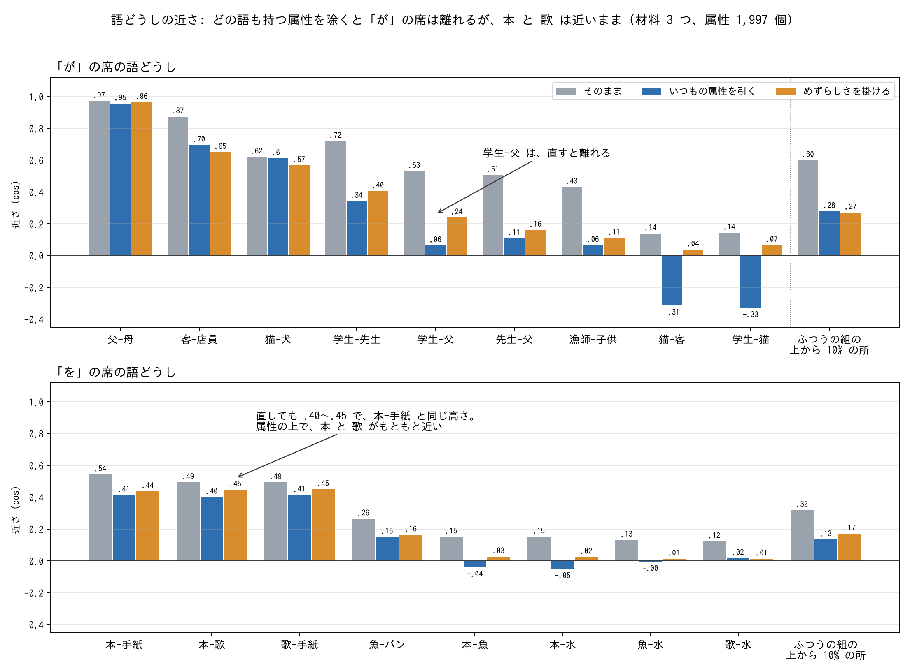

持ち主の問い「教師の資料に歌、読むが近い文はあった？」への数え（同じ日）:

- 材料（448 話・4,464 組）に、を=歌 で どうした=読む の 3 つ組は 0。同じ話の中に両方が出る話も 0。を=歌 の 3 つ組のどうしたは、全部 歌う。（学生, 本, 読む）の 3 つ組も 0 で、これは持ち主が教えた事。
- 本-歌 の近さは材料からではなく、内容語の板の 1 つの属性「の部分: 著作」から来る。歌 はこの属性を割合 1.0 で持ち、2 語の割合の積は .417 で 2 番目の属性の 11 倍。この属性を持つのは「を」の席の語の 1.9% なので、どの語も持つ属性を除いても残る。本-手紙 も同じ属性が一番（.208）。
- 読み（まだ読み）: 板の鍵は属性の表を信じるので、属性の表の 1 つの強い印が、教えの届く先を決めてしまう。属性の側から「関連している」は分かっても、「遠い・違う」は分からない。

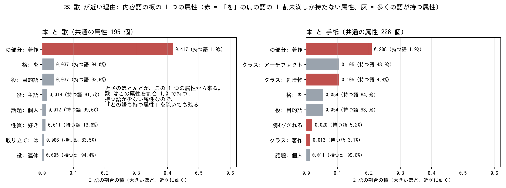

### 49 節の続き 3: 「板のこの答えは違う」を止める側に持つ（I49zz、`TeachBoard.deny`、同じ日。未確定の試し）

持ち主の言葉:「関連ではなく、間違ている、もしくは遠い、を認識する介入の設計はどうだろうか？」。設計案（ロードマップの追記 2）の 1 つ目の部品だけを作った。

- 形: 板が広げて出した答えに「違う」と教えられたら、その問いの組の印を、その語の「止める側」に重さ 1 で足す。板の点 = 明るい側 − 暗い側 − 止める側。本体には触らない。暗い側（本体の間違いを 1/1,000 で覚える）とは別。
- 小さな世界（本 と 歌 が 1 つの強い属性を分け合う世界）: 遠い問いは止まり（.57 → −.43）、教えた組は残る（1.00 → .43）。似た語への巻き込みも出る（.81 → .25）。
- 実物: 前の 15 問に、私が作った 4 問（学生が 手紙を・雑誌を、先生が 歌を、父が 歌を。どれも教えていない）を足し、「学生が 歌を に、板の 読む は違う」を 1 回だけ教えた。鍵の形は今まで（めずらしさでも同じ向き）。

| 問い | 読む の点（前 → 後） | 書く の点 | 板の答え（前 → 後） |
|---|---|---|---|
| 学生が 歌を（違うと教えた） | .79 → 0 以下 | .41 | 読む → 書く |
| 先生が 歌を（教えていない） | .77 → .14 | .54 | 読む → 書く |
| 父が 歌を（教えていない） | .70 → .28 | .55 | 読む → 書く |
| 学生が 手紙を（教えていない） | 1.05 → .64 | .67 | 読む → 書く（外れに替わった） |
| 学生が 雑誌を（教えていない） | .84 → .81 | .37 | 読む → 読む |
| 学生が 本を（教えた） | 1.81 → 1.43 | .81 | 読む → 読む |
| 父が 本を（教えていない） | 1.17 → 1.02 | .75 | 読む → 読む |

- 動いた事: 「違う」は、教えた問いだけでなく、教えていない 歌 の問い 2 つにも届いて 読む を止めた。板を外した答えは 19 問とも元のまま。
- 想定外 1: 読む が止まると、次の語（書く）が出てくるだけで、板は 歌う にならない。「違う」は語 1 つを止める教えなので、板が広げた語の数だけ教えが要る。
- 想定外 2（設計案の突っ込みの通り）: 手紙 を巻き込んだ。学生が 手紙を の 読む が 1.05 → .64 に下がり、書く（.67）をわずかに下回った。雑誌 は巻き込まれなかった（.84 → .81）。
- 読み（まだ読み）: 「違う」（その語が違う）と「遠い」（この問いは板の出番ではない）は、別の教えにした方がよい。遠い問いでは、語を 1 つずつ止めるのではなく、板がその組に答える事そのものを止める形が合う。
- 手で置いた値: 止める側の重さ 1（明るい側と同じ）。8,192 本。

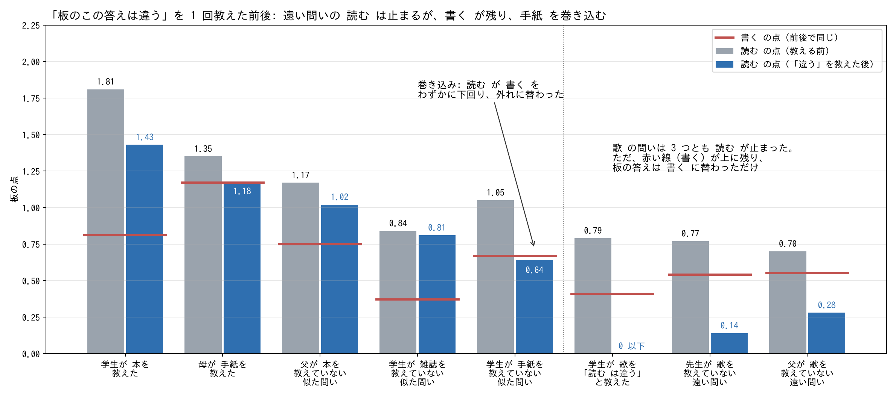

### 49 節の続き 4: 止める強さを手で置かない（`TeachBoard(stop="出した分")`、同じ日。未確定の試し）

持ち主の言葉:「手打ち出ない方法で決めれるならそれがいいんだけど、方法があるかな？」。挙げた形は 3 つ（出した分だけ引く／止めた答えと止めない答えの当たりを数えて使うか決める／教えの回数で決める）。1 つ目だけを作った。

- 形: 「違う」と教えられた時、板がその問いでその語に出している点と同じ量だけ、止める側に足す。教えた問いの点はちょうど 0 になり、点が 0 以下ならもう足さない。置く値は無い。
- 決まりとの関係: 出した答えと教えの差の分だけ直す形なので、誤差で直すやり方の親戚（決まりから外れる試し、採用は未定）。直すのは外付けの板だけで、本体には触らない。本体の間違いを薄く覚える暗い側（1/1,000）はそのまま。
- 道具の誤りと直し: 1 回目は、動作試験の道具が「違う」を合っている教えより先に板へ入れていて、板が空で出した分が 0 になり、何も効かなかった（PC 側の気づき）。「違う」を教えの後に入れる順に直した（強さ 1 の結果は、順を直しても板の答えは同じ、点の差は .01）。
- 同じ 19 問・同じ教え（鍵の形は今まで。めずらしさでも同じ向き）:

| 問い | 読む の点: 教える前 | 強さ 1 | 出した分 | 書く の点 |
|---|---|---|---|---|
| 学生が 歌を（違うと教えた） | .79 | 0 以下 | 0 | .41 |
| 先生が 歌を（教えていない） | .77 | .14 | .27 | .54 |
| 父が 歌を（教えていない） | .70 | .28 | .37 | .55 |
| 学生が 手紙を（教えていない） | 1.05 | .64（書く に負ける） | .73（読む のまま） | .67 |
| 学生が 雑誌を（教えていない） | .84 | .81 | .81 | .37 |
| 学生が 本を（教えた） | 1.81 | 1.43 | 1.51 | .81 |

- 動いた事: 遠い問いの 読む は、強さ 1 の時と同じ 3 問で 書く の下まで下がる。手紙 の巻き込みは無くなった（読む .73 対 書く .67。差は小さい）。教えた問いの点の下がりも小さい。
- 残る事: 板の答えが 歌う ではなく 書く に替わる所は同じ。19 問の手試しで、数えではない。
- 手で置いた値: 無し（止める量）。鍵の形と 8,192 本は前のまま。

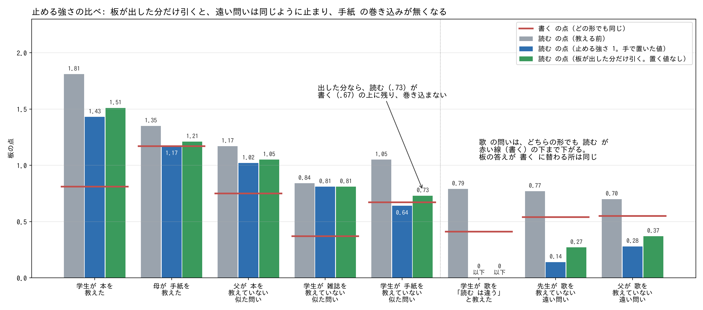

### 49 節の続き 5: 「遠い」の教え（I49zza、`TeachBoard.far`、同じ日。未確定の試し）

「違う」は語 1 つを止める教えで、止めても次の語（書く）が出てきた（続き 3・4）。「遠い」は、語ではなく問いそのものを止める。

- 形: 「この問いは遠い（板の出番ではない）」と教えられたら、板がその問いで正の点を出している語の全部を、それぞれ出した分だけ止める側に足す。教えた問いでは、どの語の点も 0 になる。置く値は無い。本体には触らない。
- 小さな世界: 教えた問いで 読む も 書く も 0 になり、教えた組は残る（弱くはなる）。
- 同じ 19 問で、「学生が 歌を は遠い」を 1 回だけ教えた（鍵の形は今まで。「×読む」は入れていない）:

| 問い | 読む の点（前 → 後） | 書く の点（前 → 後） | 板の答え（前 → 後） |
|---|---|---|---|
| 学生が 歌を（遠いと教えた） | .79 → 0 | .41 → 0 | 読む → 板は答えない |
| 先生が 歌を（教えていない） | .77 → .27 | .54 → .28 | 読む → 書く（ほぼ同じ点） |
| 父が 歌を（教えていない） | .70 → .37 | .55 → .38 | 読む → 書く（ほぼ同じ点） |
| 学生が 手紙を（教えていない） | 1.05 → .73 | .67 → .50 | 読む → 読む |
| 学生が 雑誌を（教えていない） | .84 → .81 | .37 → .36 | 読む → 読む |
| 学生が 本を（教えた） | 1.81 → 1.51 | .81 → .66 | 読む → 読む |

- 動いた事: 教えた問いでは板が黙り、本体の答え（歌う）だけが残る。止めた語は 4 つ。手紙 は 読む が上のまま（.73 対 .50。「×読む」の時の .73 対 .67 より差が広い。書く も一緒に下がるため）。板を外した答えは 19 問とも元のまま。
- 残る事: 教えていない 歌 の問い（先生が・父が）は、点が半分ほどに下がるだけで、板はまだ答える。めずらしさの鍵では 読む のまま（.42 対 .41、.52 対 .50）。1 回の「遠い」が届くのは、近さの分だけ。
- 読み（まだ読み）: 「遠い」は教えた問いをきれいに止め、似た遠い問いは弱める。全部を止めるには、歌 の問いごとに教えるか、板の弱い答えを本体に勝たせない仕組み（当たりを数えて決める。設計案の 2）が要る。今の Taught は、板の当たりが本体を上回るまで板を使わないので、弱く残った答えは表には出ない。
- 手で置いた値: 無し（止める量）。

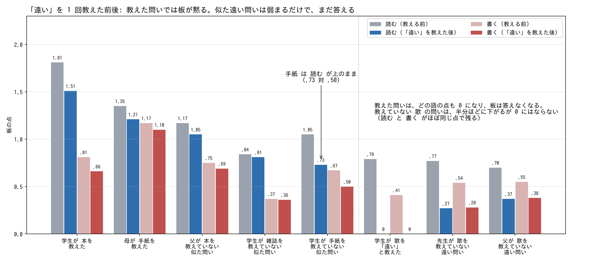

## 50. 本体が聞いていない事を教える場面で、介入の板を数える（I49zzb・I49zzc、`tools/i49zx_teach_board_run.py` の `--unheard`・`--ceiling`、2026-11-25）

49 節の数え（本体が全部の 3 つ組を聞く）では、介入が運ぶ事を本体がもう知っていて、効き目が 0 だった。ここでは、介入が本当に新しい事を運ぶ場面を作った。

- 流れ: 43 節の材料（448 話）を並べ替えて半分に分ける。本体（数えて選ぶ）には前半だけを聞かせる。後半は問うだけで、本体には聞かせない。後半の問いのうち決めた割合でだけ正しい語が届き、介入の板（鍵の形は今まで）に入る。並べ替えは 2 通り。
- 先に決めた物差しは 49 節と同じ（教えた組そのもの・似た組・害・本体の答えが変わらない事）。

| 形 | 並べ替え 1（6,651 問） | 並べ替え 2（6,687 問） |
|---|---|---|
| 本体だけ（後半を聞かない） | .4057 | .3912 |
| 介入の板を付ける（介入 10% / 30% / 100%） | .4057 / .4057 / .4057 | .3912 / .3911 / .3909 |
| 板が答えを持てばいつも板（介入 100%、比べ役） | .3033 | .3022 |
| 本体が後半も聞く・板なし（比べ役） | .4542 | .4438 |

- 外れ: 本体が聞いていない事を教えても、効き目は出なかった。本体が後半を聞けば上がる +.05 を、板は運べていない。害は 0〜2 問、本体の答えは 1 つも変わらない。
- 板だけの当たり（介入 100%）: 教えた組そのものがまた問われた時 .36（本体 .40）、教えていない似た組 .26（本体 .40〜.42）。板が答えを持った問いでは本体の方が多く当たるので、数えて決める形は板を使わない。

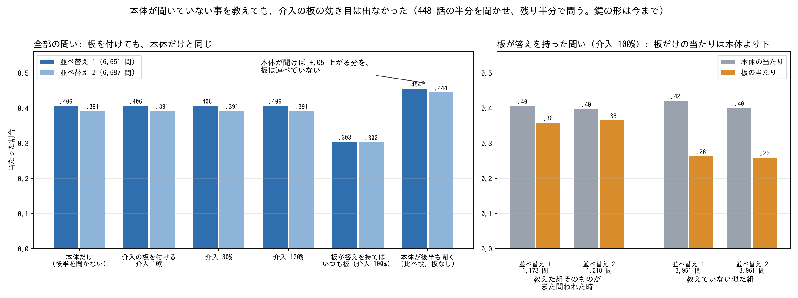

### 50 節の続き: 「2 語の組で覚えて引く」事の上限（I49zzc、`--ceiling`）

板を使わず、後半の問いを「同じ 2 語の組が後半でもう出ていたか」で分けて数えた（並べ替え 1。並べ替え 2 もほぼ同じ）。

| 問い | 数 | 本体（聞かない） | 組で一番多く出た語 | 上限（正解が、その組で前に出た語のどれか） | 本体（聞く） |
|---|---|---|---|---|---|
| 同じ組がもう出ていた | 1,383（21%） | .389 | .223 | .276 | .471 |
| 同じ組がまだ出ていない | 5,268（79%） | .410 | 0 | 0 | .450 |
| 全部 | 6,651 | .406 | .046 | .057 | .454 |

- 理由: この材料では、同じ 2 語の組でも次の語が同じとは限らない。同じ組がもう出ていた問いでも、正解がその組で前に出た語のどれかに入るのは 28%（その組で前に出た語は平均 1.67 種類）。前に出た語を全部知っていても .28 までで、後半を聞いていない本体（.39）より下。全部の問いで見ると、組で覚える事の上限は .057。
- 本体が後半を聞いて上がる分は、同じ組がまだ出ていない問いでも +.04 ある。上がる分の多くは、組の覚えではなく、語ごとの覚え（どの語がどの席でどの語と出るか）から来ていると読める（まだ読み）。
- 49 節の手試し（19 問）が良く見えたのは、私が作った問いが「答えが 1 つに決まる組」だったため。材料の問いは、そうなっていない。
- 読み（まだ読み）: 介入の板の鍵を「2 語の組」にした事が、この材料には合っていない。介入が運ぶ物は、本体と同じ粒（語ごとの覚え）で持つ方が合う。外付けで、外せば元に戻る事は保ったまま、板の中身を本体と同じ形にする案を次に試す。
- 手で置いた値: 半分に分ける事、並べ替えの k（1 と 2）、介入の割合。

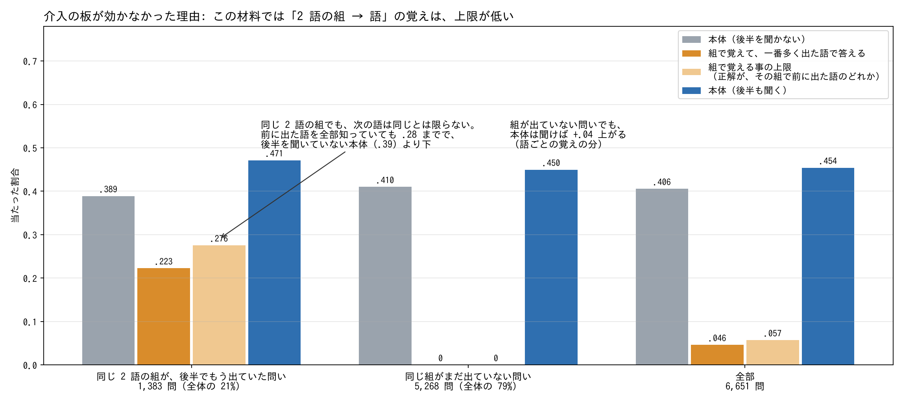

## 51. 介入で教わった事を、本体と同じ形の外付けに持つ（I49zzd、`intervention/i49zzd_taught_body.py`、`tools/i49zx_teach_board_run.py` の `--unheard --ext`、2026-11-25。未確定の試し）

50 節で、介入の板（鍵 = 2 語の組）は本体が聞いていない事を教えても効かず、理由は「2 語の組で覚える事の上限が低い」事だった。ここでは、介入が運ぶ物を本体と同じ粒で持つ。

- 形: 外付け = 本体と同じ形（数えて選ぶ）の、空の物。教えが届いた 3 つ組だけを聞く（見せた 2 語と、教わった正しい語で 3 つ組になる）。聞かせるのは、その 3 つ組の問いが全部終わった後。本体には混ぜない。
- 選び方: 本体の答えと外付けの答えのどちらを使うかは、（本体の答えた段, 外付けの答えた段）ごとに、それまでにどちらが多く当たったかで決める。同じなら本体。数えに使うのは、教えが届いた問いの正解だけ。
- 流れは 50 節と同じ（448 話を並べ替えて半分に分け、本体には前半だけ聞かせ、後半で問う）。並べ替えは 3 通り。

| 形 | 並べ替え 1 | 並べ替え 2 | 並べ替え 3 |
|---|---|---|---|
| 本体だけ（後半を聞かない） | .4057 | .3912 | .4002 |
| 外付けを付ける・介入 10%（教えた 3 つ組は後半の 3 割） | .4106（z +1.8） | .3991（+2.3） | .4083（+2.8） |
| 外付けを付ける・介入 30%（同 8 割強） | .4356（+8.3） | .4298（+10.8） | .4282（+7.8） |
| 外付けを付ける・介入 100% | .4435（+9.9） | .4383（+12.6） | .4431（+11.5） |
| 本体が後半も聞く・外付けなし（比べ役） | .4542 | .4438 | .4502 |
| 介入の板（2 語の組）・介入 100%（50 節） | .4057 | .3909 | 数えていない |

- 当たり: 介入の試しで、初めて当たりが増えた。介入 100% で +.038〜+.047、3 通りとも z +10 前後。本体が後半も聞いた時との差の 78〜90% を埋める。介入 30% でも 56〜73% を埋める。
- 取り消し: 本体の答えが外付けなしの時と違った数は、どの回も 0。外付けを外せば元の数に戻る。
- 害: 外れに変わった問いが 150〜240 ある（当たりに変わった 180〜470 に対して。介入 100% で 3〜4 割）。外付けは教わった分しか知らないので、外付けの答えを使って外す問いが出る。
- 介入 10% は小さい（+.005〜+.008、z +2 前後）。教えが少ないうちは、外付けの答えを使う段が数えで定まらない。
- 外付けだけでいつも答えると .33 前後で、本体だけ（.40）より下。上がるのは、段ごとに当たる方を選んでいるため（例: 本体が「借りる」「もう片方」の段でしか答えられず、外付けが「2語」「片方だけ借りる」で答えられる問いでは、外付けの方が当たる）。
- 数え方の直し: 初めの回（run20）は、介入 10%・30% でも、選ぶための数えに全部の問いの正解を使っていた。教えが届いた問いの分だけに直した（介入 100% の数は変わらない。10% は z +6〜+7 から +2 前後に下がった）。上の表は直した後の数。
- 割合の読み方: 介入 10% は「問いの 1 割で教えが届く」。1 つの 3 つ組には問いが 3 つ有るので、教えが届く 3 つ組は後半の 3 割になる。介入 30% では 8 割強、100% では全部。
- 読み（まだ読み）: 介入が効くかどうかは、教わった事を持つ形で決まった。2 語の組を鍵にした板では運べず、本体と同じ形なら運べる。2 つの覚えに分けても、段ごとに数えて選べば、1 つの本体が全部聞いた時の 8〜9 割まで届く。
- 手で置いた値: 半分に分ける事、並べ替えの k、介入の割合、同じなら本体。

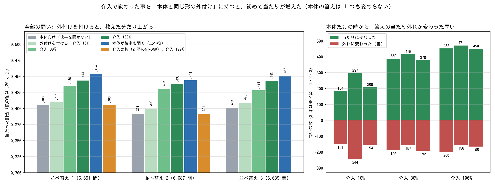

### 51 の続き: 外付けの形を 4 つ確かめた（`--direct`・`--when 外れた時`・`--ks 0`、2026-11-25。未確定の試し）

1. 教わった事を本体へ直に混ぜる形（`Direct`）と比べた。3 通りの並べ替えの平均で、外付け .406 / .431 / .442（介入 10% / 30% / 100%）に対して、直に混ぜる形は .428 / .445 / .449。本体だけは .399、本体が後半も聞くと .449。どの割合でも直に混ぜる方が上で、差は教えが少ない時ほど大きい。
2. 教えを「外れた時だけ」にした。外付けは介入 30% で .4056、100% で .4230（並べ替え 1）で、いつも教える時より下がる。当たりに変わった数の 7〜9 割に当たる数が外れに変わる。直に混ぜる形は .4375 / .4446 で、あまり下がらない。
3. 害の場所を、（本体の答えた段, 外付けの答えた段）の升ごとに数えた。害は「借りる｜解く」の升に集まる（介入 100%・3 通りの合計で、外付けを使った 2,406 問のうち、当たりに変わった 381、外れに変わった 223）。外付けが強い段で答えた升では、害は 1 割ほど。
4. 並べ替えない元の順（k=0）でも数えた。問い 8,106 で、本体だけ .3541、外付け .3732 / .4066 / .4155（z +7.8 / +14.8 / +15.6）、直に混ぜる .3917 / .4148 / .4186、本体が後半も聞くと .4186。並べ替えに頼った結果ではない。

- 読み（まだ読み）: 分けて持つ事の代金は、教えが少ない時と、外れた時だけ教える時に大きい。外付けは「教わった分しか知らない」ので、弱い段どうしの升で外す。直に混ぜれば当たりは上だが、取り消しが利かなくなる。
- 想定外: 外れた時だけ教える形で、外付けがここまで下がる事。外れた問いの 3 つ組だけを覚えると、外付けの段ごとの数えが偏る。
- 手で置いた値: 51 節と同じ。

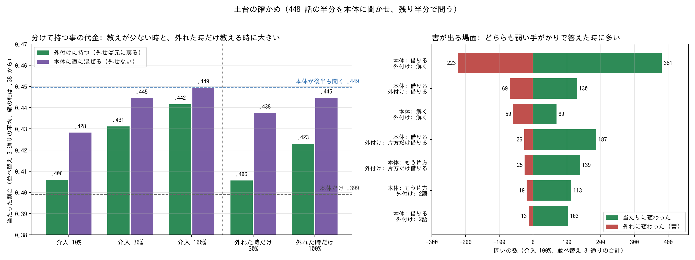

### 51 の続き 2: 話の終わりに本体へ反映する形と、本体のセーブ（`TaughtBody(reflect=True)`・`save`・`restore`、`--reflect`。未確定の試し）

持ち主の案（未確定）:「外付けを短期記憶とかその場の考え・一時的なスキルと考えれば不自然ではないと思うけど、しいて言えば本体への反映と本体からのセーブがあればなおいいかも？」

- 形: 話の間は外付けに持ち、話の終わり（`tick`）に、外付けが聞いた 3 つ組を本体へ聞かせ、外付けを空に戻す。反映の前に本体を丸ごと写しておけば（`save`）、`restore` で反映の前へ戻せる。
- 突っ込み: 反映した後は、外付けを外しても元に戻らない。戻すにはセーブが要り、セーブは本体を丸ごと写すので、本体が大きくなると重い。間違った教えを反映すると、本体の数えに残る（薄れるまで）。反映の時機（話の終わり）は手で置いた値になる。
- 小さな世界では、反映の後に本体だけで教わった語を答え、セーブから戻すと答えなくなる事を確かめた（`tests/test_i49zzd.py`）。実際の材料での数えは下の通り。

実際の材料での数え（run26。場面は 51 節と同じ。3 通りの並べ替えの順に書く）:

| 形 | 介入 10% | 介入 30% | 介入 100% |
|---|---|---|---|
| 外付けのまま | .4106 / .3991 / .4083 | .4356 / .4298 / .4282 | .4435 / .4383 / .4431 |
| 本体へ直に混ぜる | .4360 / .4241 / .4245 | .4487 / .4395 / .4452 | .4542 / .4438 / .4502 |
| 話の終わりに本体へ反映 | .4342 / .4243 / .4273（z +7.9〜+8.8） | .4514 / .4473 / .4493（z +10.4〜+12.5） | .4623 / .4579 / .4587（z +12.5〜+14.5） |

本体だけは .4057 / .3912 / .4002、本体が後半も聞くと .4542 / .4438 / .4502。

- 当たり: 反映する形は、介入 10% で外付けのままより大きく上がり（z +2 前後が +8 前後に）、直に混ぜる形と同じくらい。30%・100% では直に混ぜる形より上。100% では、3 通りとも「本体が後半も聞く」を越えた（+.008〜+.014）。
- 害: 外れに変わった問いは 172〜277 で、外付けのままと同じくらい残る。当たりに変わった数（352〜698）が増えた分、比は 4〜5 割から 3〜5 割へ少し下がっただけ。
- 外付けの答えを使った問いは 737〜1,143（外付けのままでは 1,426〜2,314）。
- セーブ: 反映の前の写しから戻した本体の答えは、9 回とも元と全部同じ（違った数 0）。
- 越えた理由の確かめ（run27・run28、介入 100%）。初めの読み「今の話の分だけを持つ外付けの答えが、聞いた本体より当たる」は、そのままでは外れていた。
  - 「本体が後半も聞く」と問いごとに比べると、外付けの答えを使った問い（906〜1,094）ではほぼ互角（こちらだけ当たり − 聞く方だけ当たり = +2 / +11 / −14）。越えた分は、本体の答えを使った問い（5,545〜5,745）から出ている（+52 / +83 / +70）。
  - 外付けを付けずに、本体が話の終わりにまとめて聞くだけにすると .4511 / .4434 / .4468 で、「後半も聞く」とほぼ同じか少し下（−.000〜−.003）。聞く時機だけでは越えない。
  - すぐ聞くが段の数えを止めると .4429 / .4307 / .4380 で、はっきり下がる（−.011〜−.013）。反映の形は本体の段の数えを後半で進めていないので、ここは損をしている側になる。
  - 読み（まだ読み）: 越えるのは、「今の話をまだ聞いていない本体」と「今の話だけを持つ外付け」の 2 つに分け、升ごとに当たる方を選んでいるため。今の話の事が効く問いは外付けが受け持って互角になり、残りの問いでは、今の話を混ぜていない本体の方が当たる。1 つの本体に今の話をすぐ混ぜると、今の話の語に引かれて外す問いが有る、という事になる。引かれて外す所は、直には数えていない。
  - 反映の時に本体の段の数えも進める形（`tally_body=True`、run32）を試したが、上がらなかった。3 通りの平均で、介入 10% は .4286 → .4281、30% は .4493 → .4518、100% は .4596 → .4599。並べ替えごとの差は −.004〜+.005 で、上がる所と下がる所が混じる。当たりに変わった数も害も両方増える。「余地が有る」という読みは外れ。
  - この回で、本体の作り方を入口（`intervention/i49_foundation.py`）経由に変えても、今までの数が 9 回とも同じになる事を確かめた。
- 数えの揺れ: 同じコミット・同じ引数でも、回ごとに 1 問ずつ数が動く（並べ替え 1 の当たりが .4623 と .4625）。スレッドの設定は同じ。多スレッドの足し算の順で、同点に近い所が倒れる向きが変わると読んでいる（確かめていない）。上の差はどれも数十問なので、結論は変わらない。
- 想定外: 比べ役の上限と思っていた「本体が後半も聞く」を越えた事。越えた分が、外付けの答えではなく本体の答えの側から出ていた事。同じ数えが 1 問ずつ揺れる事。
- 手で置いた値: 51 節の物に加えて、反映の時機（話の終わり）。

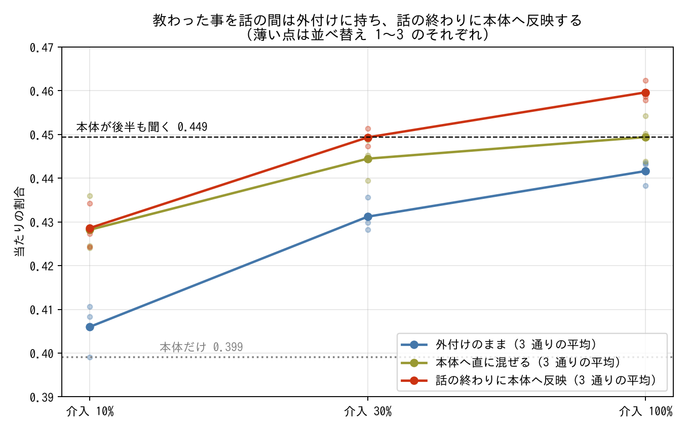

### 51 の続き 3: 害は、数えの差が小さい所で選び損ねているのか（`TaughtBody.seen`、run33。未確定の試し）

外付けのままの形で、本体と外付けの答えが違った問いを、選ぶ時に見ていた数えの差（(外付けの当たり − 本体の当たり) ÷ √(合計)）ごとに分けた。3 通りの並べ替えの合計、介入 100%:

| 数えの差 | −3 より下 | −3〜−2 | −2〜−1 | −1〜0 | 0 | 0〜1 | 1〜2 | 2〜3 | 3 以上 |
|---|---|---|---|---|---|---|---|---|---|
| 外付けだけ当たり | 171 | 136 | 303 | 395 | 101 | 327 | 406 | 274 | 366 |
| 本体だけ当たり | 1,656 | 392 | 628 | 510 | 148 | 199 | 158 | 72 | 92 |

- 境目は 0 の所に出ている。0 以下ではどの区切りも本体だけ当たりが多く、0 より上ではどの区切りも外付けだけ当たりが多い。介入 10%・30% でも同じ。
- 差が小さい区切り（0〜1）でも、外付けを使う方が得（327 対 199）。「差が小さい時は本体にする」という敷居を置くと、害は減るが、当たりの方が多く減る。敷居を足す形は採らない（手で置く値も増えない）。
- 読み（まだ読み）: 今の害は、選び方の甘さではなく、段の組という粒の粗さから来ている。同じ段の組の中に、外付けが当たる問いと本体が当たる問いが混じっていて、数えではそれ以上分けられない。害を減らすには、段の組より細かい手掛かりが要る。逆に、本体を使った側にも外付けだけ当たりの問いが 1,106 有り、細かく選べれば上がる余地は大きい。
- 想定外: 差が 0〜1 の薄い所でも、選びはもう得の側に倒れていた事。
- 手で置いた値: 数えの差の区切り（見るための区切りで、選び方には使っていない）。

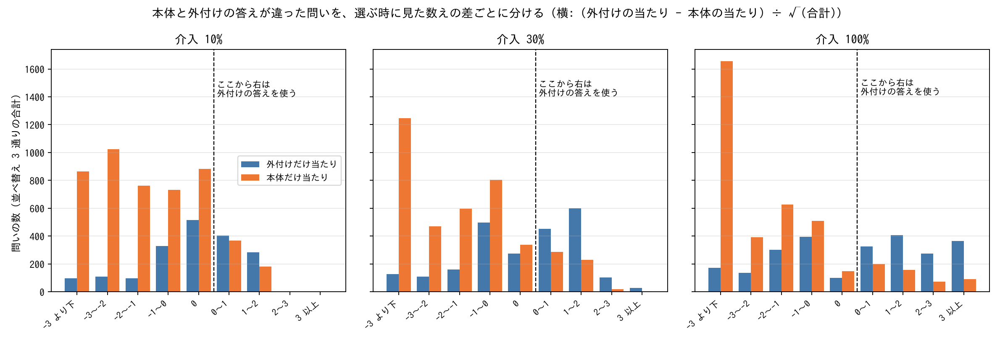

## 52. 語板の属性の帯ごとに、語の近さへの効き方を数える（I49zzf、`tools/i49zzf_attr_bands.py`、2026-11-25。未確定の試し）

持ち主の考え:「語板類の再作成が必要なんじゃないかと思ってる」。作り直す前に、今の語板の近さが何で決まっているかを数えた。

- 数え方: 席ごとに、材料に出た語（属性を持つ語、1 語 1 回）の全部の組で、属性の波の cos を測る。「同じ使われ方の組」（だれが・何を の席では同じ「どうした」の語と一緒に出た 2 語、どうした の席では同じ「何を」の語と一緒に出た 2 語）が、そうでない組より上に来る割合を「見分け」とする（.5 = 見分けられない）。帯ごとに、その帯だけで測った見分けと、その帯を抜いて測った見分けを出す。
- 小さな世界で、使われ方と合う帯は 1.0、合わない帯は .5 より下、どの語も持つ帯は .5 になる事を確かめた（`tests/test_i49zzf.py`）。

| 席（語の数） | 全部の帯 | A だけ / 抜く | B | C | D | E | G |
|---|---|---|---|---|---|---|---|
| だれが（363） | .730 | .585 / .730 | .527 / .732 | .613 / .725 | .694 / .630 | .499 / .718 | .593 / .726 |
| 何を（1,052） | .617 | .595 / .618 | .562 / .599 | .615 / .598 | .594 / .575 | .513 / .633 | .552 / .622 |
| どうした（461） | .632 | .605 / .662 | .676 / .566 | .711 / .572 | .511 / .723 | 無い | .591 / .633 |

- 近さを決めている帯: cos に占める割合は、だれが の席で D が 58%、何を の席で A が 45%・D が 27%、どうした の席で A が 59%。B と C は波の力の 15〜26% を持つのに、cos には 3〜14% しか出ない（属性の数が多く、語どうしで重なりにくい）。
- どうした の席: D を抜くと .632 → .723 に上がる。D だけでは .511。C だけで .711 で、全部の帯より上。B・C を抜くと .57 まで下がる。
- 何を の席: どの帯も弱い（一番良い C だけで .615）。E を抜くと .617 → .633。E だけでは .513（49 節で 本 と 歌 を近付けていた属性は、この帯に有る）。
- だれが の席: D が効いている（D だけで .694、抜くと .630）。
- 読み（まだ読み）: 語板の属性そのものが足りないと言うより、席ごとに効く帯が違うのに、どの席でも全部の帯を同じ重さで足しているために、効かない帯が近さを決めている所が有る。作り直しの前に、席ごとに使う帯を数えて選ぶ形を試す値打ちが有る。ただし 何を の席はどの帯でも .62 止まりなので、ここは語板の側に足りない物が有るかもしれない。
- 気を付ける事: 「同じ使われ方」の決め方は手で置いた物で、448 話の中だけの数え。見分けが当たりにつながるかは、まだ数えていない。
- 想定外: どうした の席で D の帯がここまで見分けを下げていた事。
- 手で置いた値: 「同じ使われ方」の決め方、cos で測る事、1 語 1 回で数える事。

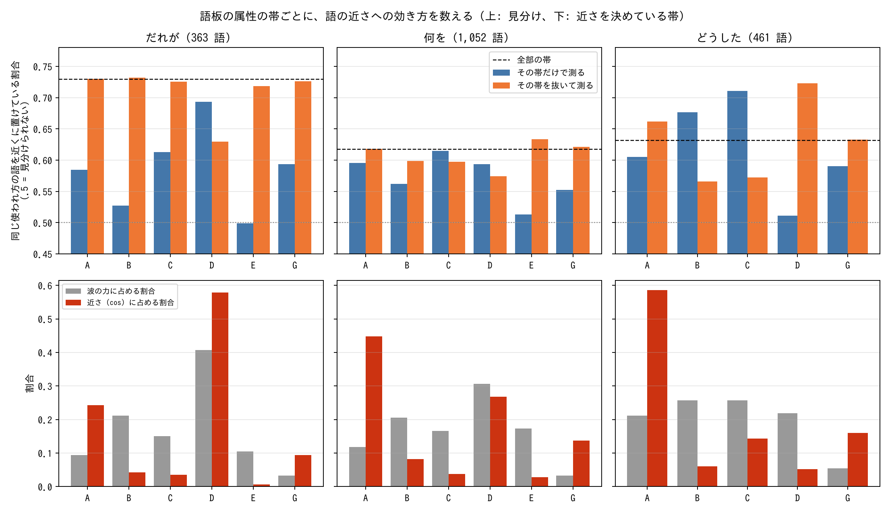

### 52 の続き: 品詞ごとに使う帯を変えて、当たりを数える（`band_filter`、`tools/i49zx_teach_board_run.py` の `--bands`。未確定の試し）

- 前提の確かめ: 材料の 3 つ組は、だれが・何を の席が全部 NOUN、どうした の席が全部 VERB（材料の読み方が席で品詞を決めている）。品詞で分ければ席で分けた事になる。ただし名詞の帯を変えると、だれが と 何を の両方に効く。
- 場面は 51 節と同じ（3 通りの並べ替えの順）。

| 使う帯 | 本体だけ | 本体が後半も聞く | 外付け・介入 100% |
|---|---|---|---|
| 全部の帯（今まで） | .4057 / .3912 / .4002 | .4542 / .4438 / .4502 | .4435 / .4383 / .4431 |
| 動詞から D を抜く | .4055 / .3923 / .4028 | .4569 / .4441 / .4514 | .4437 / .4388 / .4439 |
| 動詞は B と C だけ | .4058 / .3930 / .4017 | .4539 / .4443 / .4511 | .4431 / .4397 / .4452 |
| 名詞から E を抜く | .4054 / .3917 / .4004 | .4545 / .4465 / .4522 | .4435 / .4413 / .4457 |
| 動詞から D、名詞から E を抜く | .4055 / .3926 / .4025 | .4544 / .4467 / .4541 | .4434 / .4403 / .4484 |

- 当たり: ほとんど動かない。一番動いた形（両方抜く）でも、後半も聞く時の平均で +.002（.4494 → .4517）。下がった所はほぼ無いが、数えの揺れ（1 問ほど）より少し大きいだけで、効いたとは言えない。
- 読み（まだ読み）: 見分け（52 節）が .63 → .72 に上がるほどの違いが、当たりには出ない。本体の答えは、数えた表と、一緒に座った語から作る向きで決まる所が大きく、属性の近さそのものの良し悪しは、今の形ではあまり当たりを左右していない。そうだとすると、語板を作り直しても、今の本体のままでは当たりはあまり動かない見込みになる。
- 想定外: 見分けがはっきり上がる形でも、当たりが動かなかった事。
- 手で置いた値: 抜く帯の選び方（52 節の数えを見て人が選んだ）。採るなら、数えて選ぶ形にする必要が有る。

## 53. 足りない物の一覧（2026-11-25、持ち主の頼み「例の足りないものとかの一覧をまた作っといて」）

前の一覧は 10 節（2026-11-23 夜）。そこからの変わり目と、今の姿をまとめる。読みと書いた所は、数えて確かめた物ではない。

### 前の一覧から変わった所

- 「気づいた後に直す仕組みが弱い」（前の問題 7）: 教わった事を短い覚え（外付け）に持ち、話の終わりに本体へ反映する形が出来た。本体が聞いていない事を教える場面で、当たりは .399 から .460 まで上がる（介入 100%、3 通りの平均）。セーブで反映の前へ戻せる。
- 「介入から器への矢印」（前の部品 1）: 器へは無いまま。介入から本体へは、外付けを通る道が出来た。
- 「関係の表の当たりは 4 割台」（前の問題 5）: 切り出しを通さない材料で、数えて選ぶ本体にしても .44〜.46。まだ 4 割台。
- 「手で置いた値が多い」（前の問題 8）: 今の土台の分は 15 個を 1 つの表にした（`i49_foundation.HANDS`）。数えから決められそうな物は 7 個。減らしてはいない。
- 器・思考のループ・話す所（前の問題 1〜4・10、部品 2〜4・6〜9）: 11/23 から手を付けていない。そのまま残っている。

### 問題点（今）

1. 当たりの天井が低い。本体は .45 前後で、後半を全部聞いても .449。介入で上がる分を足しても .46。
2. 外付けを使うと、外れに変わる問いが 170〜280 出る。本体と外付けのどちらを使うかを「段の組」で数えて選んでいて、その粒では、これ以上分けられない。敷居を足しても減らない。
3. 教えが少ない時と、外れた時だけ教える時に、外付けのままでは弱い。少ない時は反映で直った。外れた時だけ教える場面で反映が効くかは、数えていない。
4. 属性の近さの良し悪しが、当たりに出ない。「どうした」の席で見分けを .63 から .72 に上げる帯の選び方をしても、当たりは動かなかった。語板を作り直しても、今の本体のままでは効きにくい見込み（読み）。
5. 「何を」の席は、どの帯でも見分けが .62 止まり。属性を持たない語が、「が」の席で 3 割、「を」の席で 2 割有る。
6. 「違う」「遠い」の教えは、2 語の組を鍵にした板の形でしか作っていない。その板は当たりを上げなかった。当たりが上がった外付けの形では、まだ作っていない。
7. 教えているのは、正解を知っている数えの道具。人や AI が教える形と、答えが割れた時に自分から聞く形は、未着手。
8. 材料が小さく、形が決まっている。448 話、席は 3 つ、席で品詞を決めている。自由な文から 3 つ組を取り出す所が無い。
9. 手で置いた値が 15 個有り、うち 7 個は数えから決められそうなまま置いている。
10. 同じ数えを繰り返すと、1 問ずつ数が揺れる事が有る。原因は確かめていない。
11. 今の土台（本体と外付け）は、器・思考のループ・話す所と繋いでいない。

### 必要な部品

1. 段の組より細かい、選びの手掛かり（害を減らす）
2. 外付けの形での「違う」「遠い」
3. 外れた時だけ教える場面での、反映の確かめ
4. 反映の時機を数えで決める形と、本体を丸ごと写さないセーブ
5. 答えが割れた時に、自分から聞く口
6. 人や AI が教える形（今は数えの道具が教えている）
7. 自由な文から 3 つ組（席）を取り出す所（前の部品 5 のまま）
8. 属性を持たない語の扱いの確かめ
9. 本体と外付けの答えを、思考のループと器へ渡す口（前の部品 2・6・7 のまま）
10. 手で置いた値のうち、減らす候補 7 個の置き換え（段の下がる順、選ぶ粒、反映の時機、薄れる速さ、重さ、解く形の近さ、属性の強さ）
11. 数えの揺れの原因の確かめ

### 繋がり

| 矢印 | 今の状態 |
|---|---|
| 介入 → 外付け（短い覚え） | 繋がっている |
| 外付け → 本体（反映）、本体の写し（セーブ） | 繋がっている |
| 本体と外付け → 答えの選び | 繋がっている（段の組で数えて選ぶ） |
| 「違う」「遠い」 → 外付け | 無い（板の形だけ） |
| 答えが割れた → 聞き返す | 無い |
| 介入 → 器 | 無い（11/23 のまま） |
| 器 → 組立・出力の中身 | 無い（11/23 のまま） |
| 本体の答え → 思考のループ | 無い（11/23 のまま） |
| 当たり外れ → 器 | 無い（11/23 のまま） |
| 思考のループ → 会話 | 繋いでいない（無理に話させない方針） |

読み（数えて確かめた物ではない）: 今いちばん大きい切れ目は 2 つ。1 つは、本体と外付けを選ぶ粒の粗さ（問題 2）。もう 1 つは、今の土台が話す所へ繋がっていない事（問題 11）。前の一覧で大きいとした「器から出る矢印が無い」は、そのまま残っている。

## 54. 数えの揺れの元と、揺らぎを器で育てる初めの試し（I49zzg、`tools/i49zzg_margin.py`、2026-11-25。未確定の試し）

持ち主の進め方: 足りない物の一覧（53 節）の問題を 1 つずつ見る。分け方は「1 原理的に解決できない / 2 原理を変えて解決できた / 3 やり方の調整で上手く行った」。初めは問題 10（同じ数えが 1 問ずつ揺れる）。

### 揺れの元（run35。分け方では 3）

- スレッドの数（16 本と 1 本）と、Python が集まりをたどる順（`PYTHONHASHSEED` を付けない・0 に固定）の 4 通りを 2 回ずつ走らせた。たどる順を固定した回は 2 回とも全く同じ数。固定しない回は、スレッドが 1 本でも 8 か所が 1 ずつ違った。スレッドは関係が無い（私の初めの候補 1 は外れ）。
- 場所: 関係の表（`i49e_relation.Relation`）が、語ごとの 3 つ組を集合で持ち、その順で点を足していた。足す順が変わると下の桁が変わり、同点に近い問いで 1 位が入れ替わる。
- 直し: 聞いた順に並ぶ入れ物に替えた。直した後、固定せずに 2 回走らせた出力は、全く同じになった（run37）。

### 揺らぎを育てる案（持ち主の言葉:「むしろその揺らぎを大きくする方法を考えてほしい」「揺らす元を器（内面の波）にする。これがいいね、簡単に試験して、疑似的に内面波を通すとかして値が変わることがわかったら、その結果次第で深堀するか、次に行くか考えよう」）

見るだけの数えを 2 つ。場面は「本体が後半も聞く」と同じ。3 通りの並べ替えの合計（19,929 問）。本体の答えと学びは変えていない。

1 位と 2 位の点の差の割合ごとの当たり（run36a）:

| 差の割合 | 0（全く同じ） | 〜0.01 | 〜0.05 | 〜0.1 | 〜0.2 | 〜0.5 | それより上 |
|---|---|---|---|---|---|---|---|
| 問い | 340 | 614 | 1,958 | 1,844 | 2,057 | 2,535 | 10,581 |
| 1 位が当たり | 38 | 103 | 373 | 446 | 563 | 832 | 6,623 |
| 2 位が当たり | 39 | 99 | 377 | 344 | 477 | 609 | 593 |

- 差が 0.05 以下の問い（2,912 問、全体の 15%）では、1 位と 2 位の当たりは五分（514 対 515）。ここは、どちらを選んでも損をしない幅になる。0.5 までは 2 位もかなり当たる。0.5 を越えると 1 位が 11 倍当たる。
- 五分の幅では、1 位も 2 位も当たりは 2 割弱。正解がどちらでもない問いが 6 割有る。
- 差が小さい問いは、ほとんどが「解く」の段。

器の向きで選び直した時（run36b）。器（`i49a_inner_vessel.Vessel`）に、聞いた 3 つ組の語の属性の波を聞かせ続け、問いのたびに、1 位との差が幅以下の候補の中から器の向きに一番近い候補を選ぶ。比べ役は、一番遠い候補を選ぶ形:

| 同点と見なす幅 | 0 | 〜0.01 | 〜0.05 | 〜0.1 | 〜0.2 | 〜0.5 |
|---|---|---|---|---|---|---|
| 答えが変わった（近い方） | 160 | 432 | 1,388 | 2,395 | 3,724 | 5,577 |
| 近い方: 当たりに / 外れに | 15 / 19 | 55 / 62 | 212 / 255 | 357 / 475 | 580 / 768 | 778 / 1,226 |
| 遠い方: 当たりに / 外れに | 23 / 14 | 63 / 51 | 253 / 188 | 422 / 405 | 679 / 714 | 944 / 1,291 |

- 値は変わる。幅 0.05 で、答えの 7%（1,388 問）が器の向きで入れ替わる。器は張り付きも死にもしなかった。
- ただし、器の向きに近い候補を選ぶと、少し損（幅 0.05 で 212 対 255）。遠い候補を選ぶ方が、少し得（253 対 188、z +3.1）。幅 0.1 まで、遠い方が近い方より良い。
- 読み（まだ読み）: 器の向きは「今まで聞いた語の属性を足した向き」なので、それに近い候補は、どの語にも有る属性を多く持つ語か、もう話に出た語に寄る。正解はそこから少し外れた語に有る事が多い。どちらの理由かは分けていない。
- 想定外: 近い方より遠い方が当たる事。
- 手で置いた値: 幅の区切り（見るための区切り）、器に聞かせる物（属性の波、長さ 1）、話の終わりに tick、器の既定（波 20 本、いちばん遅い半減期 1,024）。

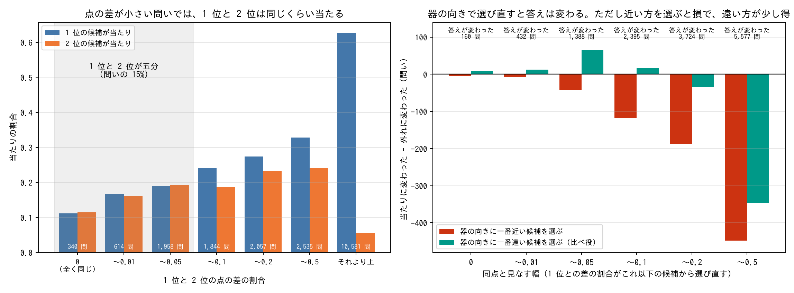

## 55. 外付けを使って外れに変わった問いを、具体的に見る（I49zzh、`tools/i49zzh_harm_examples.py`、2026-11-25。未確定の試し）

持ち主の頼み（問題 2 について）:「具体的な値を２０個ほど出してくれる？」。害の問いを黄金比の並びで 20 個抜き出し、持ち主に見せた。抜き出しには材料の語が入るので、ここには載せない（集計の数だけ）。

- 並べ替え 1・介入 100%・外付けのまま: 問い 6,651、当たりに変わった 452、外れに変わった 200。
- 害の段の組（本体｜外付け）: 借りる｜解く 78、借りる｜借りる 38、解く｜解く 21、述語側｜述語側 11、もう片方｜2語 11、借りる｜片方だけ借りる 9、もう片方｜片方だけ借りる 8、ほか 24。
- 害 200 問のうち 163 問は、外付けが正解の語をその席で聞いた事が有った。知らないのではなく、別の語を上に置いている。
- 20 個を見た読み（数えていない）: (1) 同じ場面のもう 1 人を答える形が一番多い。見せた 2 語だけでは決まらず、話の流れで決まる。(2) 別の正解と言える答えが有る（前に教わった組をそのまま答えている）。(3) 席に合わない語（「だれが」に動詞）を答えた物が 20 個中 2 個。候補に、その話の語が席を問わず入っているため。
- 分け方の読み: (3) はやり方の調整で直せそう（全体の 1 割ほどの見込み）。(1) と (2) は、今の手掛かりでは原理的に決められない側。
- 手で置いた値: 抜き出す数、場面の作り方。

## 56. 外れた時だけ教える場面で、話の終わりの反映は効くか（I49zzd、`tools/i49zx_teach_board_run.py` の `--unheard --ext --direct --reflect --when 外れた時`、2026-11-25。未確定の試し）

持ち主の問い（問題 3 について）:「反映が効くか分からないというのは、実験してないからまだわからないってことでよい？」。その通りで、数えていなかっただけなので 1 回数えた。本体だけ・後半も聞く時の値は、いつも教える時の走りと同じ値で、道具の前提は合っている。

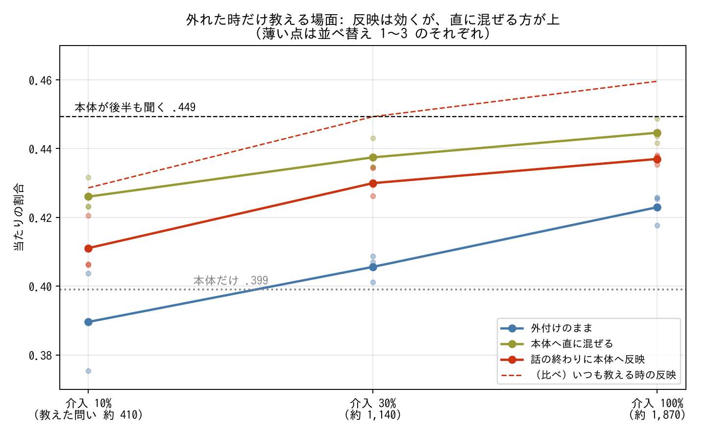

並べ替え 1〜3 の平均（本体だけ .399、本体が後半も聞く .449）:

| 介入の割合 | 教えた問い（平均） | 外付けのまま | 本体へ直に混ぜる | 話の終わりに反映 | （比べ）いつも教える時の反映 |
|---|---|---|---|---|---|
| 10% | 約 410 | .390 | .426 | .411 | .429 |
| 30% | 約 1,140 | .406 | .438 | .430 | .449 |
| 100% | 約 1,870 | .423 | .445 | .437 | .460 |

- 反映は効く。外付けのままと比べて、9 通り全部で上がった（z +1.7〜+9.1。一番小さいのは並べ替え 3 の 10%）。外付けのままだと 10% では本体だけより下がる（.390）が、反映を足すと本体だけより上に戻る。
- ただし、本体が後半も聞く時（.449）には届かない。いつも教える時の反映（.429 / .449 / .460）よりも低い。
- 想定外: いつも教える時は「反映」が「直に混ぜる」より上だったが、外れた時だけ教えると逆になった（.445 対 .437）。読み: 外付けに入るのが本体の外した物だけになり、外付けの数えが片寄る。分けて持って選ぶ得が無くなる。数えて確かめてはいない。
- 本体の段の数えも進める形は、反映だけの形と比べて −.0175〜+.0018。上がったのは 9 通りのうち 1 つだけで、ここでも得は無い。
- 反映された組は教えた数より少し少ない（例: 389 回教えて 380 組）。同じ組を 2 度教わった分。
- 分け方の読み: 「反映が効くか分からない」は解けた（効く）。ただし「外れた時だけ教える」で後半も聞く時に届かない事は残る。教える量が半分以下なので、原理の側の限りと読む。
- 手で置いた値: 介入の割合 3 つ、並べ替え 3 つ、反映の時機（話の終わり）、薄れる速さ（1024）。

## 57. 器（内面の波）に届かない語を数える（I49zzi、`tools/i49zzi_vessel_reach.py`、2026-11-25。内面波の実験の前の下調べ、見るだけ）

器は語の属性の波を受け取るので、属性を持たない語は器を動かせない。内面波の実験の結果を読み違えないよう、先に数えた。

| 席 | 語の種類 | 属性を持つ種類 | 出た回数のうち属性を持つ語 | 属性の数の平均 |
|---|---|---|---|---|
| だれが | 519 | 363（70%） | 79% | 141 |
| 何を | 1,315 | 1,052（80%） | 92% | 140 |
| どうした | 569 | 461（81%） | 95% | 195 |

- 3 つ組 4,464 個のうち、3 席とも届くのは 3,105（69.6%）、2 席は 1,198、1 席は 156、全く届かないのは 5（0.1%）。全く届かない話は 448 話のうち 0。
- 読み: 器が全く動かない場面はほぼ無い。内面波の実験は今の語板のままで始められる。
- 想定外: 届かない語が多いのは「何を」の席だと思っていたが、外れた。一番弱いのは「だれが」の席（回数で 79%）。3 割の 3 つ組では、どこか 1 席が器に届かない。
- 手で置いた値: 無し（数えるだけ）。

## 58. 状況波（時制）の小さな実験（I49zzj、`intervention/i49zzj_tense_wave.py`、`tools/i49zzj_tense_run.py`、2026-11-25。持ち主の案、未確定の試し）

持ち主の案（要点）: 動詞の語板に時制の形（未来・現在・現在進行・過去・過去進行）を属性として並べ、周波数の上でなだらかにつなぐ。状況波（時制）を 1 つ持つ。文は「動詞＋時制の波」で学ぶ。「今」「さっき」のような時の語は、一緒に出た文の時制の波と紐づく。時の語から状況波が決まれば、会話の中で時制がそろう。

作り物の世界で数えた（動詞 6、だれが 6、時の語 8、学習の文 768。素材は使っていない）。時の語は、一緒に出た時制の波を足して覚える。状況波は聞いた波を足し、前の分は薄れる。形を選ぶ時は、状況波に一番近い時制の形を取る。

- 紐づけは出来る。時の語 8 つのうち、山の幅 6 以下では 8 つとも、一番近い時制が世界の決まりに合った。数えて足すだけで、8 文ほど聞けば向きが出る。
- 学習に出ていない動詞 2 つでも、時の語から形を選べた（山の幅 6 で 16 / 16、幅 8 で 12 / 16。当てずっぽうは .35）。ただし形と時制の対応は語板に手で書いてあるので、これは作りから当たり前の結果。
- 想定外 1: 山を広くすると（幅 8 以上、隣との近さ .59 以上）、2 つの時制と出る語が、間に有る別の時制に寄る。「今まで」「ずっと」は現在進行と過去進行の両方と出るが、並びで間に有る「過去」が一番近くなった。なだらかにつなぐ事と、間の時制を取り違えない事がぶつかる。
- 想定外 2: 時の語を「周波数 1 つ」にまとめて持つと、山の幅に関わらず同じ取り違えが出る（8 つのうち 6 つ）。山の形のまま持てば、幅が狭い時は取り違えない。
- 会話: 状況波が薄れるのが速い（半分になるまで 0.5 文以下）と、時の語が変わった直後の文で 8 回とも時制が合った。遅い（2 文）と 2 回しか合わない。前の時制が残って、新しい時の語に付いて行けない。持ち続ける事と、切り替える事がぶつかる。
- 触る場所と変わり方: 山の幅（取り違えに効く）、状況波の薄れる速さ（切り替えに効く）、時の語の持ち方（山の形のまま / 周波数 1 つ）。
- まだ見ていない事: 本体（数えて選ぶ）とつないでいない。動詞の形と時制の対応を、語板に書かずに覚えられるかは見ていない。時制の並びは 1 本の軸だが、時（未来・今・過去）と、続いているかどうかの 2 本に分ける形は試していない。
- 手で置いた値: 時制の並び順（持ち主の言った順）、山の間隔 12 と幅、軸の長さ 64、状況波の薄れる速さ、世界の決まり（どの時の語がどの時制と出るか）、学習と試しの動詞の分け方。

## 59. 時制の波を、手で置かずに学習から作る（I49zzk、`intervention/i49zzk_tense_learned.py`、`tools/i49zzk_tense_run.py`、2026-11-25。持ち主の案、未確定の試し）

持ち主の案（要点）: 時制の波形を手で置かず、学習データから関連付ける。時制が有る語ごとに時制の波を持たせ（時制波ー走る、時制波ー食べる）、文の語板の全体に掛ける。時制に関係の無い語は影響を受けず、関係の有る語は受ける。動詞の後につなぎの語が有れば、そのたびに時制の波を足す。

先に、58 節の仕組みで「状況波を変えると語も変わるか」を確かめた。変わる。学習に出ていない「笑う」で、今 → 笑っている、さっき・昨日 → 笑った、今まで・ずっと → 笑っていた、これから・明日 → 笑うだろう、いつも → 笑う（山の幅 6）。

手で置かない作り方: 時の語は、初めて出た順に軸の席を 1 つもらう（意味の無い席）。文の中の語は、一緒に出た時の語の席に 1 を足す。語の時制の波は、その語の席ごとの割合から、全部の語の割合（平均）を引いた物。形の波は、動詞の波と、つなぎの語の波の足し算。並び順も山の位置も置かない。世界は 58 節と同じで、形だけ「つなぎの語の並び」にした（未来: だろう / 現在: 無し / 現在進行: て・いる / 過去: た / 過去進行: て・い・た）。

- 時制に関係の有る語だけが強くなった。つなぎの語の波の長さは .26〜.64、だれが・動詞は .07。平均を引かないと、だれが・動詞にも .35 の波が乗り、だれがどうしの近さは 1.0、だれがと「た」の近さも .67 になる。「関係の無い語は影響を受けない」には、平均を引く事が要る。
- 手で並べていないのに、形の間の近さが出た。過去進行は過去に .63、現在進行に .21 で近く、未来とは −.81。「て」と「た」を分け合うため。1 本の並びではなく、過去進行が過去と現在進行の両方の隣に来る形。
- つなぎの語で持つと、学習に出ていない動詞でも、8 文目から 16 / 16 で世界の決まりに合う形を選んだ。
- 動詞ごとにひとまとめで持つ形（時制波ー走る の形）は、学習に出た動詞でも 64 文かかり、出ていない動詞では選べない（.25、当てずっぽう .35 より下。波が無いので、いつも先頭の形になる）。
- 想定外: つなぎの語の無い形（現在）は、波がほぼ 0 になり、自分からは選ばれにくい。「いつも」は現在が 3、現在進行が 1 の決まりだが、選んだのは現在進行（決まりの内だが、多い方ではない）。一番多い時制を選べたのは 8 語のうち 7 語。図の「現在」の行の近さも、長さ .07 の波の向きなので当てにならない。
- 平均を引いても、だれが・動詞の波は 0 にならない（.07）。文ごとの語の数が違い、つなぎの語の多い文が平均に多く入るため。
- まだ見ていない事: 時の語の無い文（大半の文はこちら）からは学べていない。本体とつないでいない。本物の文のつなぎの語は、時制でない物（ので、から、など）も多く、ここでは混ぜていない。
- 手で置いた値: 平均を引く事、内積で測る事、世界の決まり、つなぎの語への分け方（作り物）、学習と試しの動詞の分け方。

### 59 の続き: 初めての語を、時の語と 1 回だけ聞いた時の仮の時制

持ち主の問い:「介入で初めての語たとえば飛ぶ、飛んでいるとかを学習していなくても、今がついていれば、飛んでいる、飛ぶが現在形（仮）とわかるかな？」

学習の後、初めての語（つなぎの語に分けない、ひとまとめの形）を時の語と 1 回だけ聞いたとして、その波（時の語の席 − 平均）を、出来ている形の波と比べた。

- 時の語 8 つとも、一番近い時制は世界の決まりの内だった。今 → 現在進行（近さ .60）、さっき・昨日 → 過去（.62）、これから・明日 → 未来（.67）、いつも → 現在（.62）、今まで・ずっと → 過去進行（.38、現在進行も .31）。
- 仮の時制は時の語だけで決まる。「今」と出た語は、「飛ぶ」でも「飛んでいる」でも現在進行の側になる。1 回では、現在と現在進行は分けられない。別の時の語とも聞けば分かれていく。
- 「飛んでいる」が「て・いる」に分かれて聞こえる時は、教わらなくてもつなぎの語から時制が出る（59 節）。
- 手で置いた値: 1 回だけ聞く事、近さを cos で測る事。

### 59 の続き 2: 分け方を決めず、切り出しを全部覚える（`Spans`、`tools/i49zzk_tense_run.py --spans`）

持ち主の案:「飛んでいる、の語板をちょっと力業だけど、飛ん、で、いる、と、飛んで、いる、と飛んでいる、全部を１回の学習でおぼえられないかな？動的に分ける方法がわからないから、全部やるって言う力業なんだけど」

さらに進めて、動詞の形の文字の並びから、続いた切り出しを全部（1 文字からその形の全部まで。5 文字なら 15 個）数えた。分ける道具は使わない。1 回聞くと、全部の切り出しに 1 が足される。

- 出来る。学習に出ていない動詞 2 つで、8 文目から 16 / 16 が世界の決まりの内（図の右、青と赤の実線は重なっている）。つなぎの語に分けて持つ形と同じ。
- どこで切れば良いかは、強さで勝手に出た。時制を運ぶ切り出し（った .69、だろう .54、ている・いる .40、た .45）が強く、動詞の頭の字（食・歩 など）は .11 と弱い。
- 想定外 1: 「歩い」「走っ」のような途中の形も .31 の強さを持った。現在・未来では出ず、他の時制でだけ出るので、時制の手掛かりになっている。
- 想定外 2: 「く」「る」「う」のような終わりの字にも波が付き、つなぎの語の無い形（現在）にも手掛かりが出来た。ただし「う」は「だろう」にも有るので未来に寄る。動詞によって当たり外れが出る。
- 弱い所: 形の波を切り出しの足し算で作るので、長い形ほど足す数が多く、有利になる。「さっき」で「泣いた」ではなく「泣いていた」を選んだ（決まりの内だが、多い方ではない）。一番多い時制を選べた割合は .63 で、分けて持つ形（.75）より少し低い。
- 重さ: 20 種類の形から 85 種類の切り出しを覚えた。形の長さの 2 乗で増える。語板の全部の語に掛けると大きくなる。
- 手で置いた値: 切り出しを全部足す事（長さで割らない）、1 文字から数える事。

## 60. 時制（状況）の波を、青空文庫の会話で数える（I49zzl、`tools/i49zzl_tense_text_run.py`、2026-11-25。持ち主の案、未確定の試し）

59 節の作り方を本物の文に掛けた。材料は青空文庫の会話 150,001 行（著作権の切れた作品。文や表は入れない。図は語尾の切り出しを含むのでリポジトリの外に置いた）。文に切って 230,236 文、同じ文を除いて 205,535 文。分ける道具は使わず、文の終わり 6 文字の切り出しを全部数えた。席の作り方を 2 つ並べた（持ち主:「１も２もどっちもやりたいね」）。

1. 時の語 12 個を席にする（今、さっき、昨日、明日、これから、いつも、ずっと、今まで、もう、まだ、今日、先程。持ち主の「大体の感覚は最初手打ちで OK」。コードに埋めず、引数で渡す。介入で席を作る形の代わり）。
2. 全部の語を席にする（文の終わりより前の 1〜2 文字の切り出しのうち、多い 2,000 個）。

1 回目（run43）は道具の誤りで読めなかった。時の語そのものが文の終わりの 6 文字に入り、それを終わりとして数えていた。時の語より後ろだけを見る形に直して数え直した（run44）。下は直した後の値。

- 時の語の有る文は 8.4%（17,240 文）。残りの 9 割の文からは、この作り方では何も学べない。
- 向きは出た。過去寄りの語（さっき・昨日・今まで）で強い終わりは「〜た」の形、未来寄りの語（これから・明日）は「〜ましょう」「つもり」の形だった。ただし波の強さは .10〜.18 で、作り物の世界（.26〜.69）より弱い。
- 「今」「もう」「まだ」は時制ではなく、決まった言い方に寄った（ところ、しまった、〜のか）。この 3 語は文の数が多く（合わせて 8 割）、時制の印としては働いていない。
- 当てる試しは外れ。並べ替えた後半 8,430 問で、文の終わりから時の語を当てる割合は .261。一番多い語を言い続ける .308 より下。直す前の .335 は、時の語そのものを数えた分だった。
- 独立に動く向きの取り分は、1 で .23、.21、.13、.10 と続く。作り物の世界のように 3 本で足りる形ではない。
- 2 では、強い向きが無い（一番強い向きでも取り分 .009）。上位の向きは時制ではなく、受け答えの決まり文句と、文の頭の助詞の違いに寄った。同じ切り出しどうしの近さを 1 と 2 で比べた相関は .18 で、1 の時制寄りの近さは 2 にはほとんど浮き出ていない。
- 読み: 文の終わりは、時制より先に、丁寧さ・問いかけ・話し手の気持ちで決まる。時制の印は有るが、その下に埋もれている。2 がそのままでは時制を浮き出させないのは、席が多すぎて薄まるためと、席にした 1〜2 文字が語ではなく字のかけらだから。数えて確かめてはいない。
- 手で置いた値: 時の語 12 個、文の終わりの長さ 6、席の数 2,000、数える切り出しの下限 30、同じ文を 1 回だけ数える事、時の語のすぐ後の助詞の字を落とす事、平均を引く事。

## 61. 前の文の終わりを席にして、続く状況を数える（I49zzm、`tools/i49zzm_prev_tail_run.py`、2026-11-25。未確定の試し）

60 節では、時の語を席にすると 9 割の文から学べず、当てる試しも外れた。そこで時の語を使わず、前の文の終わりを席にした。状況がしばらく続くなら、前の文の終わりと今の文の終わりは結び付くはず、という考え。手で打つ語は無い。材料は 60 節と同じ青空文庫の会話 150,001 行（文や表は入れない。図は語尾を含むのでリポジトリの外）。

先に作り物で道具を確かめた。丁寧さが続く世界では、丁寧さの違う 2 つからは 28 / 28 で選べた。何も続かない世界（終わりを乱数で付けた 15 万行）では .50、続き方の倍率は 1.0 になった。

組は 2 通りに分けた。同じ発話の中で続いた 2 文（同じ話し手、81,827 組）と、前の発話の最後の文と次の発話の初めの文（多くは別の話し手、144,382 組）。

| | 同じ発話の中 | 次の発話へ |
|---|---|---|
| 2 つから選ぶ（学んだ波） | .663 | .560 |
| 2 つから選ぶ（同じ終わりを真似るだけ） | .585 | .526 |
| 丁寧が続く倍率 | 2.64 | 1.04 |
| 過去が続く倍率 | 2.30 | 1.95 |
| 問いが続く倍率 | 1.50 | 0.72 |

- 効いた。前の文の終わりから、続く文の終わりを 2 つから選ぶ割合は、同じ発話の中で .663（当てずっぽう .5、真似るだけ .585）。全部の文の組から学べて、手打ちも無い。
- 強い向きが、手で並べていないのに出た。同じ発話の中の 1 本目は丁寧かくだけているか（取り分 .038）、2 本目は丁寧の中の今風か古風か、3 本目は今の事か過去の事か。60 節の「全部の語を席にする」形（一番強い向きで .009、中身は決まり文句）と違い、状況の種類として読める。
- 想定外: 続き方が、話し手をまたぐかどうかで分かれた。丁寧さは同じ話し手の中では 2.64 倍続くが、次の発話へは 1.04 倍で、ほぼ続かない。過去は次の発話へも 1.95 倍続く。問いは次の発話で 0.72 倍に下がる（問いの次は答え）。丁寧さは話し手の持ち物で、時制は場で分け合う物、と読める。
- 私の前の読み「丁寧さは一度決まるとしばらく続く」は、同じ話し手の中でだけ当たりだった。
- 気を付ける事: 次の発話への組の 26.7% は、作品の続きの切れ目をまたいでいる（材料が、続きの単位で混ぜて並べてあるため）。別の作品どうしの組が混ざるので、次の発話への値は薄まっている。切れ目を入れた材料での数え直しはまだ。
- 向きの取り分は一番強くても .038 で、小さい。終わり方の大半は、前の文の終わりでは決まらない。
- 手で置いた値: 文の終わりの長さ 6、席の数 1,000、数える切り出しの下限 30、同じ組を 1 回だけ数える事、3 つの印（丁寧・過去・問い）の決め方（読むためだけで、学習には使わない）、別の組のずらし方。

### 61 の続き: 何個前の発話まで見るか（`--lags`、run46）

持ち主の問い:「よわくても語中にたくさん出てくれば強くならないかな、選択度を語板の連想と切り分けるとか。丁寧さは会話相手が丁寧語じゃないからじゃないかな？１人称、２人称、３人称の相手との関係でかわるから？」

作品の続きの切れ目に空の行を入れた材料で数え直した（続き 40,031、発話 147,555。切れ目はまたがない）。組は、何個か前の発話の最後の文の終わり → 今の発話の初めの文の終わり。作り物の、何も続かない世界では .50、倍率 1.0 になる事を先に確かめた。

| | 1 個前 | 2 個前 | 3 個前 | 4 個前 |
|---|---|---|---|---|
| 丁寧が続く倍率 | 1.08 | 2.42 | 1.06 | 2.42 |
| 過去が続く倍率 | 2.36 | 2.07 | 1.64 | 1.84 |
| 問いが続く倍率 | 0.68 | 1.48 | 0.82 | 1.48 |
| 2 つから選ぶ（その発話 1 つだけ） | .578 | .658 | .555 | .643 |
| 2 つから選ぶ（そこまで全部重ねる） | .578 | .677 | .679 | .697 |

- 重ねると強くなった。1 個前だけの .578 が、4 個前まで重ねると .697。持ち主の見方の通り。重ね方は、何個前かごとに別の波を持ち、点を足すだけ（重さは置いていない）。
- 丁寧さは 1 つ飛ばしで戻る。1 個前・3 個前では続かず（1.08、1.06）、2 個前・4 個前では 2.42 倍。2 人が交互に話すなら偶数個前は同じ話し手なので、丁寧さは話し手ごとに決まっていて、相手には移らない。持ち主の見方（相手との関係で変わる）と合う。問いも同じ形（問う側と答える側が分かれている）。
- 過去は 1 個前が一番強く、離れるほど弱まる（2.36 → 1.64〜1.84）。話し手ではなく、場に付いている。
- 切れ目をまたがない形にすると、1 個前の過去の倍率は 1.95 から 2.36 に上がった。61 節の「次の発話へ」の値は、切れ目の分だけ薄まっていた。
- 気を付ける事: 話し手の印は材料に無い。「偶数個前は同じ話し手」は 2 人が交互に話す時だけ合う。2 文字に満たない発話は道具が落とすので（150,001 のうち 2,446）、そこで偶数と奇数がずれる。3 人以上の場面も混ざる。
- まだ見ていない事: 「選ぶ強さを語板の連想と切り分ける」は、本体とつないでからでないと数えられない。
- 手で置いた値: 見る発話の数 4、発話の最後の文と初めの文を使う事、他は 61 節と同じ。

## 62. 口調から、話し手と、相手との関係を読めるか（I49zzn、`tools/i49zzn_tone_speaker_run.py`、2026-11-25。持ち主の案、未確定の試し）

持ち主の見方:「丁寧さは会話相手が丁寧語じゃないからじゃないかな？１人称、２人称、３人称の相手との関係でかわるから？」「逆説的に口調から関係を特定できる可能性があるってことだね。」

青空文庫の材料には話し手の印が無いので、話し手の印の有る材料で数えた。MRMP（Multi-Relational Multi-Party Chat Corpus、名古屋大学、CC BY-SA 4.0。プロジェクトの共有フォルダに 2026-11-12 に置かれた物。ライセンスはその時に確かめてある）。3 人の文字の雑談 960 会話・99,433 発言で、半分は「家族 2 人 + 初対面 1 人」。だれ宛ての発言かの印が 2 割に有る。材料はリポジトリに入れない。文の終わりの切り出しだけを見る。

- 相手で変わる。家族入りの会話で、家族の側の人が話す時、丁寧な終わりの割合は、家族宛てで 10.9%（2,623 発言）、初対面の人宛てで 74.7%（4,979 発言）。両方に 10 回以上話した 12 人の全員が、家族宛ての方が丁寧でなかった。持ち主の見方の通り。
- 口調から関係は読める。宛先が家族か初対面かを、文の終わりの切り出しの波から当てる試しは .830（多い方を言い続ける .652）。会話を並べ替えた半分で学び、残りの 3,796 発言で試した。
- 口調から話し手は読めない。会話ごとに前半で話し手ごとの終わりの波を作り、後半の発言の話し手を 3 人から当てる試しは .386 と .389 で、一番多く話した人を言い続ける .401 と .404 より下（当てずっぽう .333）。
- 想定外: 61 節の続きで「丁寧さは話し手ごとに決まる」と読んだが、言い過ぎだった。この材料では、丁寧さが同じ話し手の発言の間で続く倍率は 1.0〜1.1 で、ほぼ続かない。丁寧さは「だれが」ではなく「だれがだれに」で決まる。青空文庫で 1 つ飛ばしに戻ったのは、2 人の会話では話し手と相手の組が 1 つ飛ばしで同じになるからと読める。3 人になると、同じ人が相手ごとに切り替える。
- 過去は、話し手が同じでも違っても続く（1 個前で 1.49 倍と 1.96 倍）。場に付いている点は青空文庫と同じ。
- 気を付ける事: 宛先の印が有るのは発言の 2 割で、はっきり名指しした発言に寄っているかもしれない。文字の雑談なので、小説の会話とは口調が違う。
- 手で置いた値: 丁寧・過去・問いの印の決め方（61 節と同じ）、前半と後半の分け方、平均を引く事、数える切り出しの下限 20。

### 61 の続き 2: 状況波が合わなくなった所を、場の切れ目として読めるか（`--breaks`、run48）

持ち主の言葉:「作品の切れ目シチュエーションが変わるからだね。」なら逆に、前の発言との合い方が急に下がった所を、場の切れ目として読めるかもしれない。

続きを並びのまま前半（20,015）と後半（20,016）に分け、前半で 1 個前・2 個前の波を学んだ。後半で、発言ごとに「前の 2 つの発言との合い方」（点の足し算）を出し、切れ目の直後の発言（19,766）と続きの中の発言（33,914）で比べた。

- 読める。続きの中の発言の方が合い方が高い割合は .680（見分けられない時 .5、同じ終わりの数だけで見ると .585）。合い方の真ん中の値は、切れ目の直後 .0015、続きの中 .0562。
- 確かめ: 切れ目の直後の発言は「場の初めの発言」でもあるので、それだけで終わり方が違うのかもしれない。発言はそのままにして、前の発言だけ別の続きの物に替えた時と比べても .686 で、ほぼ同じ。位置のせいではなく、場が違う事を見ている。
- ただし .68 は、1 つの発言だけで切れ目を言い当てるには足りない。3 回に 1 回は逆になる。続けて何度か合わない時に切れ目と読む、のような重ね方が要る（未確認）。
- 手で置いた値: 見る発言の数 2、前半と後半の分け方、他は 61 節と同じ。
