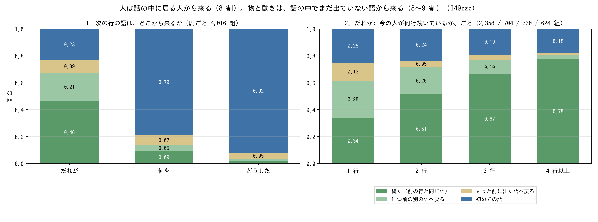

## 77. 次の行の語は、話の中でもう出た語か、初めての語か（I49zzz、`tools/i49zzz_talk_memory_run.py`、2026-11-26。持ち主の案 3-2 の前提の確かめ、数えるだけ）

75 節の続き（組んだ 3 つ組を文にする所）を設計する前に、材料の側を見た。持ち主の文の行はどれも「A が B を C する」の言い切りの形なので、文にする所の数は 76 節（形）と 75 節（3 つ組）でもう出ている。足りないのは「人を引き継ぐか、替えるか」を決める所（輪の ④、内面の器）なので、そちらの前提を先に数えた。

数え方: 話（448 個、平均 10 行、人は 1 話に平均 3 人）の中の続いた 2 行（席ごと 4,016 組）について、次の行の語が、その話のその席にもう出た語かを 4 つに分ける。学びは無い。語は出さず、数だけ。

| 席 | 続く（前の行と同じ） | 1 つ前の別の語へ戻る | もっと前に出た語へ戻る | 初めての語 |
|---|---|---|---|---|
| だれが | .46 | .21 | .09 | .23 |
| 何を | .09 | .05 | .07 | .79 |
| どうした | .02 | .01 | .05 | .92 |

だれが を、今の人が何行続いているかで分けると: 1 行目の後は 続く .34 / 1 つ前の人へ戻る .28、2 行 .51 / .20、3 行 .67 / .10、4 行以上 .78 / .03。

- 見えた事 1: 人は、話の中にもう居る人から来る（8 割近く）。物と動きは逆で、その話でまだ出ていない語から来る（8〜9 割）。席によって、語の出所が正反対。
- 見えた事 2: 人は、替わったばかりの時は、続く（.34）と 1 つ前の人へ戻る（.28）がほぼ同じ。同じ人が長く続くほど、更に続く（.78）。「替わったばかりか、続いているか」が、引き継ぐかどうかの手掛かりになる。
- つながり: 54 節で、器の向きに近い候補（聞いたばかりの語）を選ぶと当たりが下がった。その訳がここで見える。物と動きの正解は 8〜9 割が「まだ聞いていない語」なので、聞いた語へ引っ張ると外れる。持ち主の案 3-2（器は候補と直接比べず、話題を広げるか深掘りするかを決める所に使う）の見立てと合う。
- 読み（まだ読み）: 器の使い道は席で分かれる。人の席では「話の中に居る人」を薄れながら持つ所として使える（候補を 2〜3 人に絞り、続くか戻るかを選ぶ）。物と動きの席では、聞いた語を候補から遠ざける側に使い、中身は連想（遷移と本体）から引く。75 節の「前と同じ物は返さない」の決まりは、この後ろ半分を手で置いた物に当たる。
- 想定外: 人の「1 つ前の別の人へ戻る」が 2 割有る事（A、B、B の次に A）。引き継ぎだけでは拾えない。
- 弱い所: 1 人が書いた、3 人ほどの短い話での数え。話し手の替わる会話や長い話で同じ割合になるかは見ていない。
- 手で置いた値: 分け方の 4 つ、続いた数を 4 でまとめる事。
- まだの事: 人の席を「話の中に居る人から、続いた数を見て選ぶ」形にした時の当たり（74 節の引き継ぎ .46 と比べる）。物と動きの席で、話の中でもう出た語を遠ざけた時の当たり。
