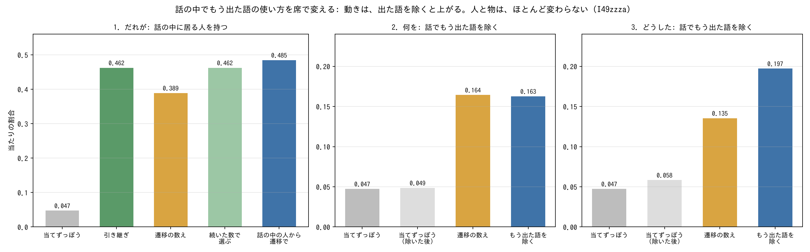

## 78. 話の中でもう出た語を「持つ／遠ざける」形で、次の語を当てる（I49zzza、`tools/i49zzza_talk_state_run.py`、2026-11-26。77 節の続き、数えだけの形。未確定の試し）

77 節の読み（器の使い道は席で分かれる）を、当たりで確かめた。場面は 74 節と同じ（前半を聞き、後半は問うてから聞く）。数えだけの形なので、持ち主の文のクラウドに有る写しで数えた（席ごと 6,085 問。74 節の PC の数え 5,987 問とは、材料の版が少し違う。引き継ぎ .46、遷移の数え .39 は同じ）。

| だれが | 当てずっぽう | 引き継ぎ | 遷移の数え | 続いた数で選ぶ | 話の中の人から遷移で |
|---|---|---|---|---|---|
| 当たり | .047 | .462 | .389 | .462 | .485 |

| 席 | 当てずっぽう（除く前 → 除いた後） | 遷移の数え | 話でもう出た語を除く |
|---|---|---|---|
| 何を | .047 → .049 | .164 | .163 |
| どうした | .047 → .058 | .135 | .197 |

- 当たりの所: 動き（どうした）は、その話でもう出た動きを候補から除くと上がる（.135 → .197。並べ方 3 通りとも同じ向き）。候補が減るだけで上がる分は小さい（当てずっぽう .047 → .058）。正解がもう出た語である事は 8% しか無いのに、除く前の遷移の数えは、もう出た動きをよく答えていた。同じ話に出る動き同士は結び付きが強く、数えがそちらへ引かれる。
- 小さい当たり: 人は、候補を「その話でもう出た人」に絞って遷移で選ぶと、引き継ぎを少し上回る（.462 → .485。3 通りとも同じ向き）。
- 外れの所 1: 続いた数で「続くか、1 つ前の人へ戻るか」を選ぶ形は、引き継ぎと全く同じ答えになった。どの続いた数でも「続く」の方が多い（替わったばかりでも .34 対 .28）ので、いつも「続く」を選ぶ。続いた数だけでは、替わる時を当てられない。
- 外れの所 2: 物（何を）は、もう出た語を除いても変わらない（.164 → .163）。物は正解の 2 割がもう出た語で、除くと、その分をそのまま失う。
- 読み（まだ読み）: 「聞いた語を遠ざける」が効くのは動きの席。人の席は「持つ」が少し効く。物の席はどちらでもない（同じ物が続く事も、替わる事も有る）。器を席ごとに使い分ける、という 77 節の読みは、動きと人では当たり、物では当たらなかった。
- 想定外: 動きで、除くだけで .06 も上がった事。75 節の「前と同じ 3 つ組は返さない」より強い形（その話で出た動きは返さない）の方が、動きの席には合っている。
- 弱い所: 候補が「その話の語」なので、除くと候補が減る。その分は当てずっぽうの行で見えるようにした。1 人が書いた短い話での数え。
- 手で置いた値: 続いた数を 4 でまとめる事、「除く」は全部除くか除かないかの 2 つだけ（薄れる形にはしていない）。
- まだの事: 「除く」を、薄れながら抑える形（器の波）にした時。動きの席の形を 75 節の組み方に入れた時の、丸ごとの当たり（本体と波を使うので PC）。
