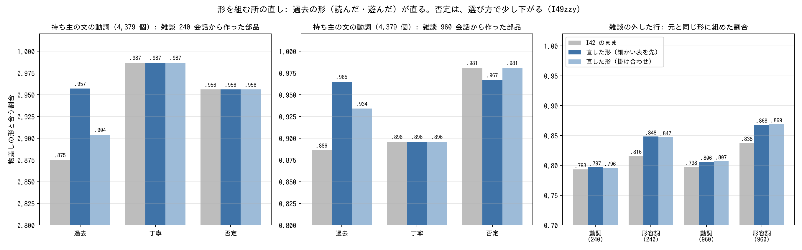

## 76. 文の形に組む前の確かめと、形を組む所の直し（I49zzy、`intervention/i49zzy_form.py`、`tools/i49zzy_form_run.py`、2026-11-26。未確定の試し）

輪の最後（組んだ 3 つ組を文の形にする所）の前に、持ち主の文の動詞（4,464 個、違う語 569。語は出さず、数だけ書く）を、I42 の部品で 過去・丁寧・否定 の形にできるかを確かめた。形を組む部品は雑談（MRMP）の解析済みの会話から作った。

- 物差し: 形態素の辞書（sudachipy）の活用の種類から、決まりで作った形（読む → 読んだ・読みます・読まない）。物差しは数えるためだけで、組む側には使わない。物差しを作れない 85 個は数えない（残り 4,379 個）。
- 先に分かった事: 持ち主の文の動詞のうち、雑談の材料にも出る語は、違う語で 4 割、延べで 8 割ほど。出ない語は、語の類や終わりの字の決まりから組む事になる。

I42 のままだと、過去だけが低い（.88）。訳を見ると 2 つ有った。

1. 流れの選び方: その語でその意味を聞いた事が無い時、動詞全部の表から「た」を取る。語幹が「む・ぶ・ぐ」で終わる語には「だ」が要る。
2. 流れの表記: 「だ」の表記を、次に付く語だけで引くので、断定の「だ」の文の中の形（に・な）と混ざる（読ん + に）。

直し（どちらも数えるだけ。辞書も活用の表も使わない）: 語幹の終わりの 1 字ごとの流れの表（EndFlow）と、前の表記の終わりの 1 字ごとの表記の表（PrevSurface）を足した。流れの選び方は 2 通りを並べて数えた（細かい表を先に見る／語の類の表の割合と掛け合わせる）。

| 物差しの形と合う割合 | 過去 | 丁寧 | 否定 |
|---|---|---|---|
| 雑談 240 会話の部品: I42 のまま | .875 | .987 | .956 |
| 同: 直した形（細かい表を先） | .957 | .987 | .956 |
| 同: 直した形（掛け合わせ） | .904 | .987 | .956 |
| 雑談 960 会話の部品: I42 のまま | .886 | .896 | .981 |
| 同: 直した形（細かい表を先） | .965 | .896 | .967 |
| 同: 直した形（掛け合わせ） | .934 | .896 | .981 |

本物の行での確かめ（雑談の 1 割を外し、外した行の述語を、元と同じ意味の組から組み直して、元の形と同じかを数える。960 会話）: 動詞 .798 → .806 / .807、形容詞 .838 → .868 / .869。直しは本物の行を壊さず、少し上げる。

- 当たりの所: 過去の形が直る（.88 → .96）。む・ぶ で終わる語の過去は 0 → .8〜.9。本物の行でも下がらない。
- 2 通りの違い: 細かい表を先に見る形は過去が一番上がるが、否定が少し下がる（960 会話で .981 → .967）。終わりの字ごとの表に、数回しか出ていない流れ（〜ず）が有ると、それを取ってしまう。掛け合わせは否定を守るが、過去の上がりが半分ほど。どちらが良いかは、まだ決めない。
- 外れの所（残り）: 数える材料が少ない所で、少ない数えに振り回される。見えた型は、ぐ で終わる語の過去（〜いだ が出ない）、る で終わる語で一段か五段か分からない語（〜ます に余分な字が付く、〜った にならない）、その語に 1 回だけ付いた流れを取る（丁寧に「です」）。
- 想定外: 材料を 240 会話から 960 会話に増やすと、丁寧が下がった（.987 → .896）。材料が増えて、その語に 1〜2 回だけ付いた珍しい流れ（〜です）や、敬う語の形（〜います）の決まりが、表に入ったため。材料を増やせば良くなる、とは限らない。
- 読み（まだ読み）: 形を組む所は、持ち主の文の語でも 9 割以上は組める。残りは「少ない数えをどこまで信じるか」の問いで、手で下限を置くより、数えの多さを重みにする形（薄い数えは薄く効く）を探す方が、今までの方針に合う。
- 手で置いた値: 終わりの 1 字を見る事、前の 1 字を見る事、割合を掛ける事、細かい表に広い表の割合を 1 回ぶん足す事、物差しの決まり（音便の表）。
- まだの事: 75 節で組んだ 3 つ組を、この部品で文にして並べる所。青空文庫の材料で作った部品での確かめ（PC）。
