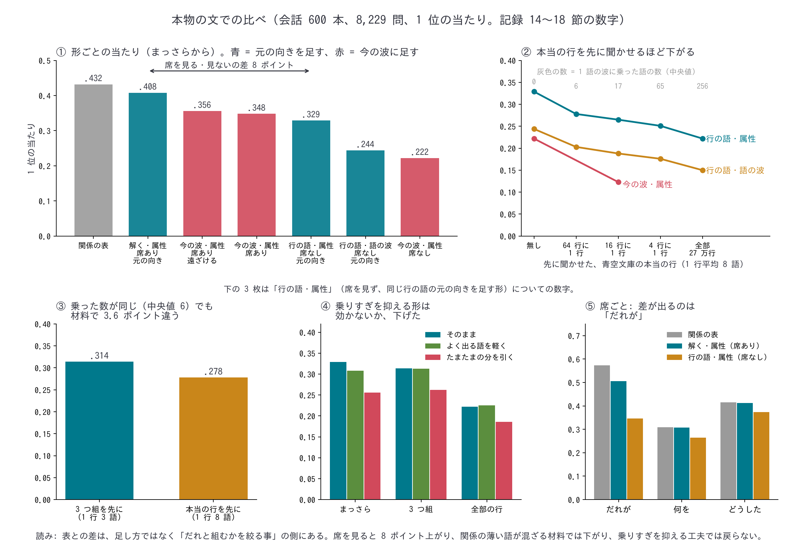
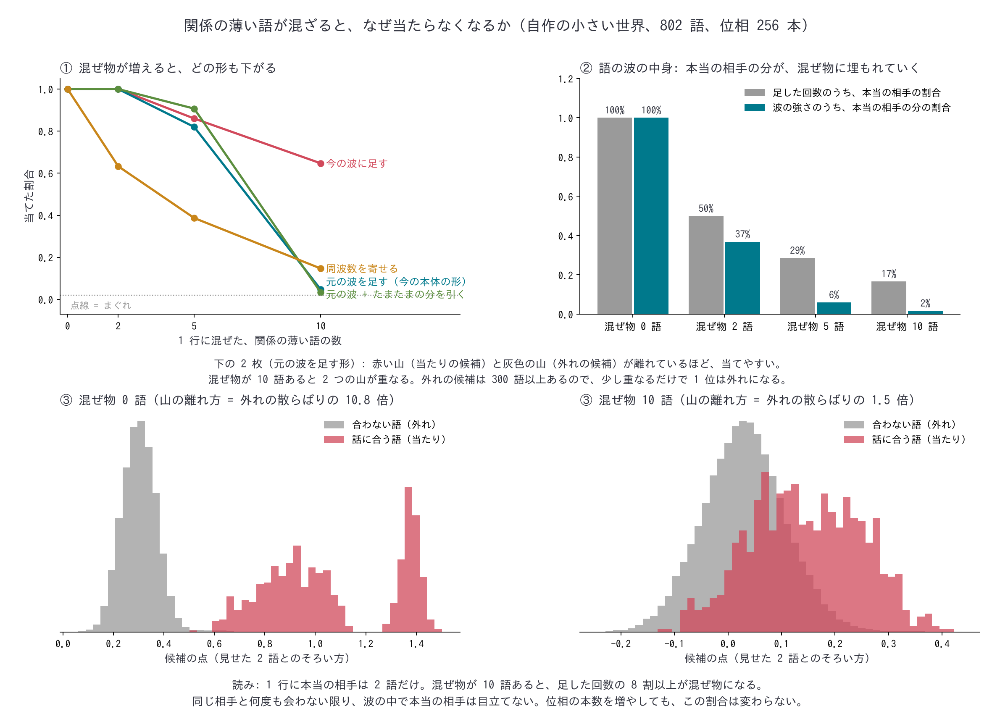
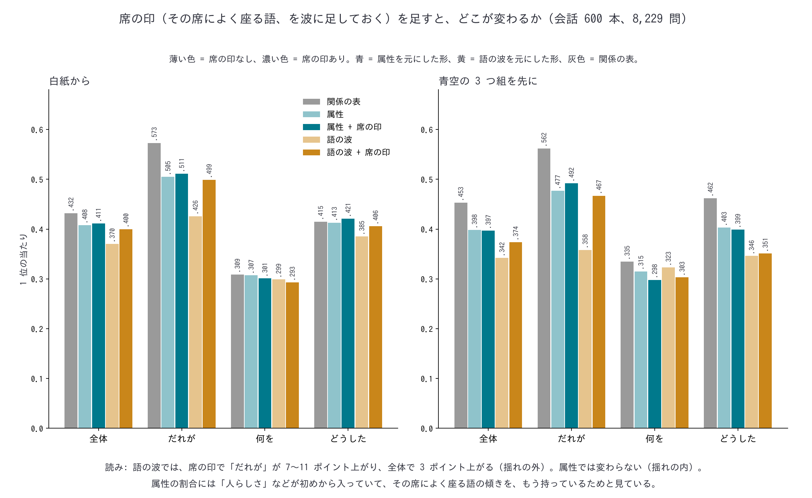
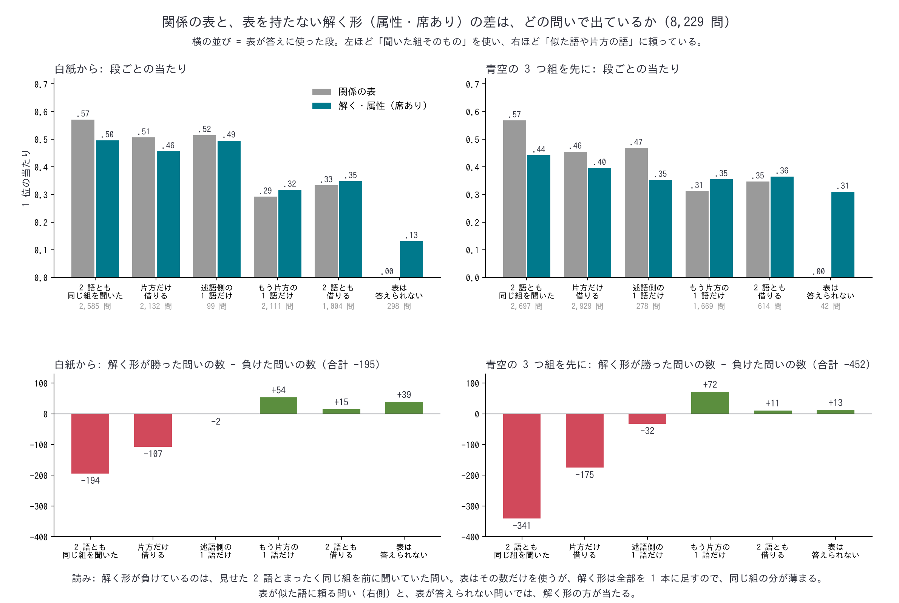
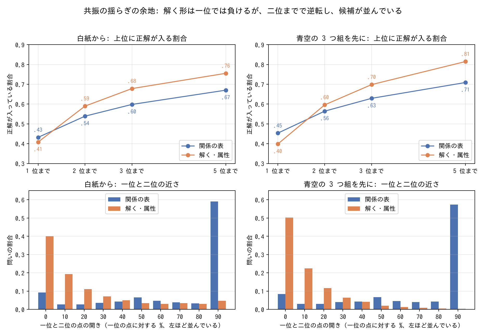
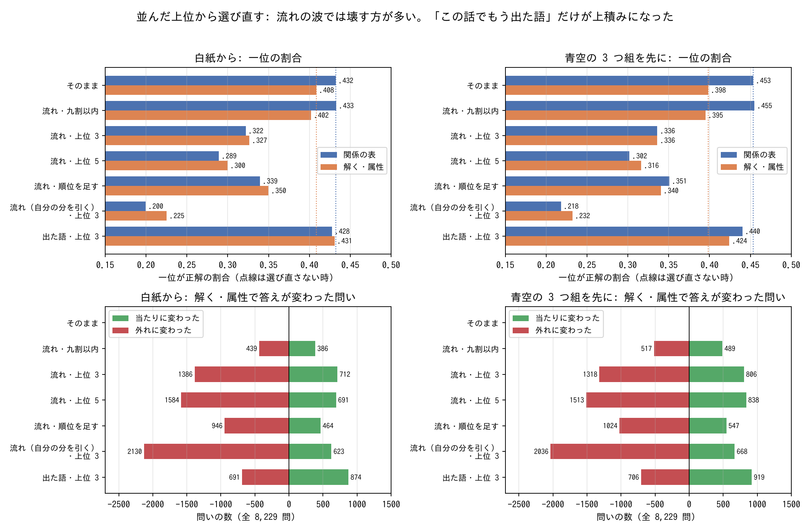

# 2026-11-23 夜のまとめ（I49p〜I49u）

詳しい数と表は `docs/i49_inner_vessel.md` の 18〜23 節に有る。ここは、成果・問題・ツッコミ・想定外を 1 枚にまとめた物。
測り方は全部同じ: 自作の話 600 本、8,229 問。3 つ組（だれが・何を・どうした）の 1 つを隠し、答える前に問う。候補は平均 18 語。

## 1. 一番短いまとめ

- 比べる相手の「関係の表」は .432（まっさらから）と .453（青空の 3 つ組を先に）。波だけで解く形（属性・席あり）は .408 と .398。
- 表との差は「足し方」ではなく、「聞いた組そのものを薄めずに使えるか」で出ている。
- 波で解く形は、正解を上位には入れている（2 位までなら表を越える）。並んだ候補から 1 つ選ぶ所で落としている。
- その選び直しを「話の流れの波」でやる試しは外れた。残った上積みは 2 ポイント強。

## 2. 成果（分かった事）

### 2-1. 席を見ない足し方は、材料と量の両方で崩れる（18・19 節）

- 語の波を聞くたびに動かす形（今の波に足す）は、本物の文で .222 / .185 / .123。元の向きを足す形（.329 / .314 / .222）より悪い。
- 席を入れると 12〜18 ポイント戻る（.348 / .236 / .302）。席が効いている。
- 小さい世界での総当たりでは、位相の数、遠ざける、周波数を寄せる、足す時の関門、のどれも「関係ない語が混ざる」崩れを直せなかった。

### 2-2. 席の印は、語の波の形にだけ効く（20 節）

- 語の波（席あり）: .370 が .400、.342 が .374（主に「だれが」）。
- 属性（席あり）: .408 が .411、.398 が .397。ばらつきの内。

### 2-3. 表との差の出どころ（21 節）

- 解く形が負けるのは、表が「2 語とも同じ組を聞いた」で答えた問い（.571 対 .496、青空を先に .568 対 .442）と「片方だけ借りる」の問い。
- 表が片方の語や似た語に頼る問い、表が答えられない問いでは、解く形が勝つ。
- 組み合わせた時の見込みは .445 / .465（数えから出した目安。試していない）。

### 2-4. 揺らぎの余地は大きい（22 節）

| | 1 位まで | 2 位まで | 3 位まで | 5 位まで |
|---|---|---|---|---|
| まっさらから: 関係の表 | .432 | .539 | .598 | .670 |
| まっさらから: 解く・属性 | .408 | .590 | .679 | .756 |
| 青空を先に: 関係の表 | .453 | .565 | .629 | .709 |
| 青空を先に: 解く・属性 | .398 | .596 | .699 | .815 |

- 解く形は、1 位と 2 位の点の開きが 1 割未満の問いが 40〜50%。表は 1 位だけが抜けている問いが 57〜59%。
- 同じ 2 語と席の問いがまた出た 3,481 問のうち、58.8% は正解が前と違った。2 語だけでは決めきれない問いが、元々それだけ有る。

### 2-5. 流れの波での選び直しは外れ（23 節）

- 話でそれまでに聞いた語の属性を足した波で上位を選び直すと、全部の版で下がった（上位 3 から選ぶ版で .33 前後）。
- 比べ役の「上位 3 の中で、この話で一番最近に出た語」だけが上積みになった（解く形で .408 が .431、.398 が .424）。

## 3. 問題（まだ解けていない事）

1. 聞いた組そのものを覚える力が、波の形に無い。属性の向きは「似た語は同じ向き」なので、語そのものを区別できない。
2. 並んだ上位から選ぶ手がかりが無い。余地は 3 位までで .68〜.70 有るのに、取れたのは 2 ポイント強。
3. 「何を」がいつも一番弱い（表でも .31〜.34）。理由はまだ調べていない。
4. 先に聞かせるほど下がる形が多い（青空を先にすると、解く形の 1 位は .408 から .398）。
5. 外れた時に周波数を足す形は、足し過ぎて表と同じ物になった。似た語どうしで分け合う仕組みが要る。

## 4. ツッコミ（自分の読みと測り方への疑い）

- 表と解く形は、点の物差しが違う（数と、波の重なり）。「1 位と 2 位の開き」の比べには、物差しの違いも混ざっている。順位で数えた「何位までに入るか」は物差しによらない。
- 候補は「その話の内容語」。だから「もう出た語を選ぶ」が効くのは、この測り方に寄った結果かも知れない。
- 流れの波は、内面の波そのものではない。代わりに置いた物が合わなかっただけで、内面の波の案を否定する結果ではない。
- 組み合わせの見込み .445 / .465 は、段ごとの当たりを足し合わせた目安。実際に組んで数えていない。
- 文全体で掛け算にする案は、今の測り方（1 席だけ隠す）では効きを測れない。2 席以上を同時に隠す問いが要る。掛け算は 1 席の点が零に近いと全体が消える点にも注意が要る。
- 小さい世界の結果は、本物の文に 2 回当てはまらなかった。小さい世界は「理由を見る道具」として使い、良し悪しの判断には使わない方が良い。
- 「寄せる学習は方針外」と言い切っていたのは、こちらの読みだった。記録に有るのは「最終的に LLM を目指すわけではない」と「昼は足すだけ、夜に学び直す」まで。夜にどう寄せるかは未決定。

## 5. 想定外

- 今の波に足す形は、3 つ組や会話だけなら良くなると見ていたが、外れた。遠ざけるの効き方は、始め方で逆になる。
- 位相が 1 つだと「両側に引かれてそろえられない」と見ていたが、実際は全部が同じ波に溶けた。
- 青空を先にすると、解く形の 1 位は下がるのに、5 位までは上がる（.756 から .815）。並びが平らになる。
- 表が答えられない問い（青空を先にで 42 問）でも、解く形は 31% を当てる。
- 流れの波から候補自身の分を引くと、さらに 10 ポイントほど悪くなった。効いていたのは「その語自身がもう出た」事だけだったと見ている。
- 数えの穴を疑った所（見せた語が自分自身に重なる）は、数え直して同じ値だった。穴は無かった。

## 6. 手で置いた値

- 席の印: 印の波の作り方、足す重さ 1。
- 揺らぎの数え: 「近い」の区切り（1 位の 9 割）、開きを分ける 10 個の区切り。
- 選び直し: 上位の数 3 と 5、9 割、流れを足す重さ 1、話ごとに波を空に戻す事。
- 今の波: 足す前に長さ 1 にそろえる事、遠ざける強さ、本当の行を飛ばして取る数。

## 7. 持ち主の案（未確定。決定ではない）

- 属性の数だけ周波数を持ち、属性ごとの位相を聞いて動かす。
- 外れが続いたら周波数を足す（学習・違和感・介入に合う）。
- 周波数を少し変えて、うねりを寄せる（値を直に動かすので、方針の変更になる。未決定）。
- 内面の波で揺らぎを入れる。
- 1 位を出さずに、候補を文全体で掛け算にする（計算は、席ごとに上位の数個だけ残せば抑えられる）。

## 8. 次にやる事の候補

1. 選ぶ手がかりを「席と相手を見る物」に替える。属性は広げる役、語そのものの波の束ねは覚える役、の 2 本立て。
2. 2 席を同時に隠す問いを作り、掛け算の効きを測る。
3. 「何を」が弱い理由を数える。
4. 外れた時に足す周波数を、似た語で分け合う形に作り直す。
