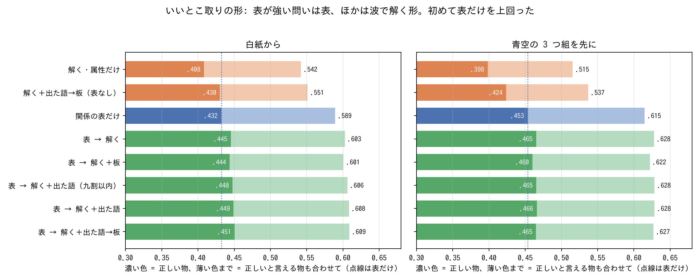
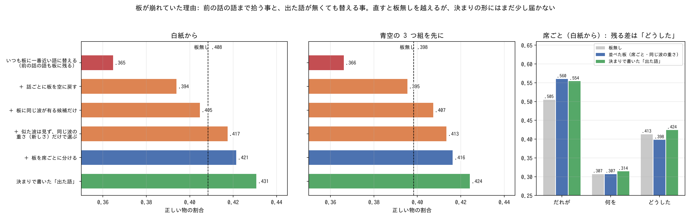
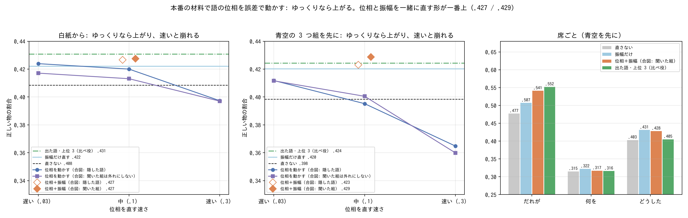
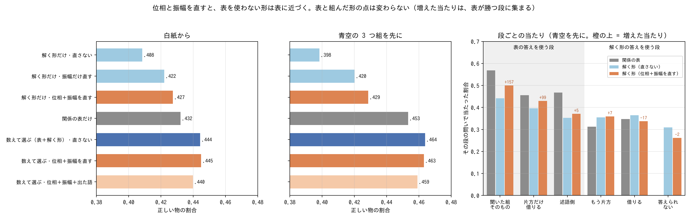

# 2026-11-24 のまとめ（I49z〜I49zk）

詳しい数と表は `docs/i49_inner_vessel.md` の 28〜38 節に有る。過去の試し全体の一覧は `docs/experiments_index.md`。ここは、成果・問題・ツッコミ・想定外を 1 枚にまとめた物。
測り方は全部同じ: 自作の話 600 本、8,229 問。3 つ組（だれが・何を・どうした）の 1 つを隠し、答える前に問う。数は「まっさらから / 青空の 3 つ組を先に」の順。

## 1. 一番短いまとめ

- 今の一番良い形は「数えて選ぶ」（表と解く形を、段ごとの当たりを数えて使い分ける）で .444 / .464。関係の表だけは .432 / .453。
- 表を使わない形（波で解く形）は .408 / .398 から .427 / .429 まで上がった。まっさらからでは表と並んだ。
- ただし、上がった分は「聞いた組を思い出す」力で、表が既に持っている力と同じ物だった。「聞いた事の無い組を当てる」力は増えていない。
- 属性が近い語どうしを選び分けられない問題は、残っている。

## 2. 成果（分かった事）

### 2-1. いいとこ取りの形（30 節）

- 表が強い段（聞いた組そのもの、片方だけ借りる、述語側）は表、ほかは解く形、で .445 / .465。表だけを初めて上回った（z +4.5 / +3.9）。
- 段を手で置かず、段ごとの当たりを数えて決めても .444 / .464。手で置く値は「同じ数なら表」だけ。

### 2-2. 仮の板（28・29・31・32・33 節）

- 属性を持つ薄れる板は +1 ポイント前後。速く薄れるほど良い。
- 板に語の波を持たせても、語を並べて一斉に走査しても、高さは同じ（.417 前後）。
- 板が崩れていた理由は 3 つ: 前の話の語を板に残す事（−3 ポイント）、出た語が無い時も答えを替える事、似た波の分を見る事。
- 波だけで書いた一番良い形は .421 / .416。決まりで書いた「出た語」（.431 / .424）には届かない。差は「どうした」に残る。

### 2-3. 誤差で直す試し（34〜38 節。持ち主の案、段階分け。今までの決まりから外れる試しで、採用は未定）

- 第 1 段、読む時の振幅だけ: .422 / .420（1 周だけ、z +3.8 / +5.6）。覚えた波には手を入れない。
- 第 2 段の下調べ、小さい世界の位相: 動かすと上がる。覚えた波を古いまま残しても崩れない。
- 第 2 段、本番の位相: ゆっくりなら上がる（.424 / .412）。位相と振幅を一緒に直すと .427 / .429。速いと崩れる（.36 まで）。
- 表と組んだ形には積み上がらない（.444 → .445、.464 → .463）。

## 3. 残っている問題

1. 属性が近い語どうしを選び分けられない（25 節）。正解が 2〜3 位に居るのに負ける問いが 3 割近く有り、勝つのは正解と属性が似た語。誤差で直した後に、これがどれだけ減ったかは、まだ数えていない（`tools/i49zl_who_wins_after_run.py` で数える）。
2. 聞いた事の無い組を当てる力が増えていない。表でも解く形でも 3 割前後のまま。
3. 「何を」の席が動かない（.31 前後）。正しいと言える答えが 2 つ以上有る問いが多い席。
4. 誤差で直す形は、直す速さが手で置いた値で、少し速いと効きが消えるか崩れる。数えて決める形になっていない。
5. 波だけの板と、決まりで書いた「出た語」の差（「どうした」）の理由が分かっていない。

## 4. ツッコミ

- 誤差で直す形の上がり幅は、複数の版から一番良い物を選んだ値で、甘めに出ている。
- 位相を足した分は、振幅だけの形との直の比べで z +1.3 / +2.0。揺れの境目で、位相の効き目は振幅ほど確かではない。
- 表を使わない形が表に並んだのは、まっさらからの時だけ。青空を先にでは、まだ 2.5 ポイント下。
- 話をまたいで残る板は、今の材料（同じ語を使い回す 600 本）では逆効果だった。続いた会話の材料なら違う結果になり得る。
- 小さい世界の結果は、本番と向きが逆になった所が有る（直す速さ、合図）。小さい世界は理由を見る道具で、良し悪しの判断には使わない。

## 5. 想定外と、外れた見込み

- 板は「何を」に効くと見込んだが、効いたのは「だれが」だった（28 節）。
- どの話にも出る属性は板の邪魔、と見込んだが、除くと手がかりが消えた（29 節）。
- 足すから似た語に点が入る、と見込んだが、並べても同じ高さだった（32 節）。
- 1 周だけの誤差の直しは効きが小さい、と見込んだが、板より大きく上がった（34 節）。
- 位相を動かすと覚えた波とずれて崩れる、と見込んだが、ゆっくりなら崩れなかった。速く動かした時だけ当たっていた（36・37 節）。
- 解く形が強くなれば表と組んでも上がる、と見込んだが、積み上がらなかった（35・38 節）。

## 6. 手で置いた値（今日の分）

薄れる速さ、九割、上位 3、同じ波と見なす丸めの幅、話の区切り、直す速さ（振幅 .01、位相 .03〜.1）、temp .05、同じ数の時に表を使う事。
