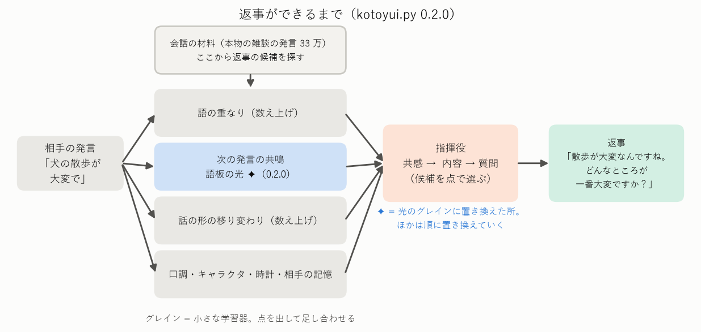
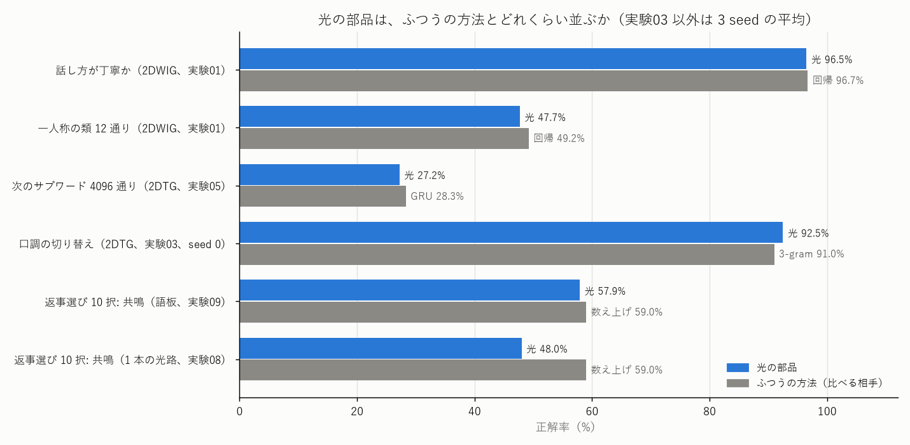
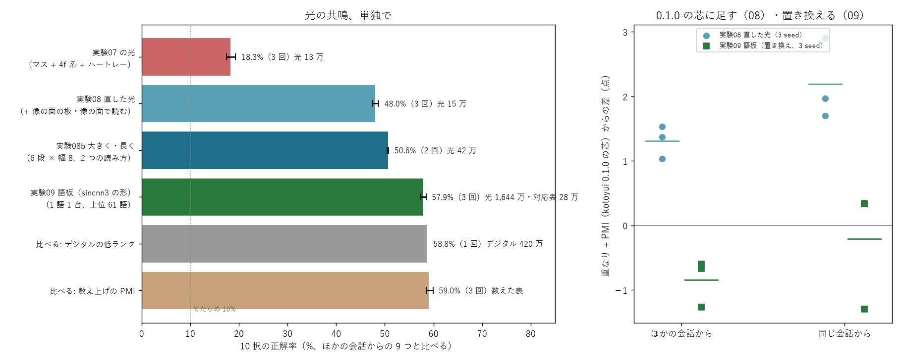
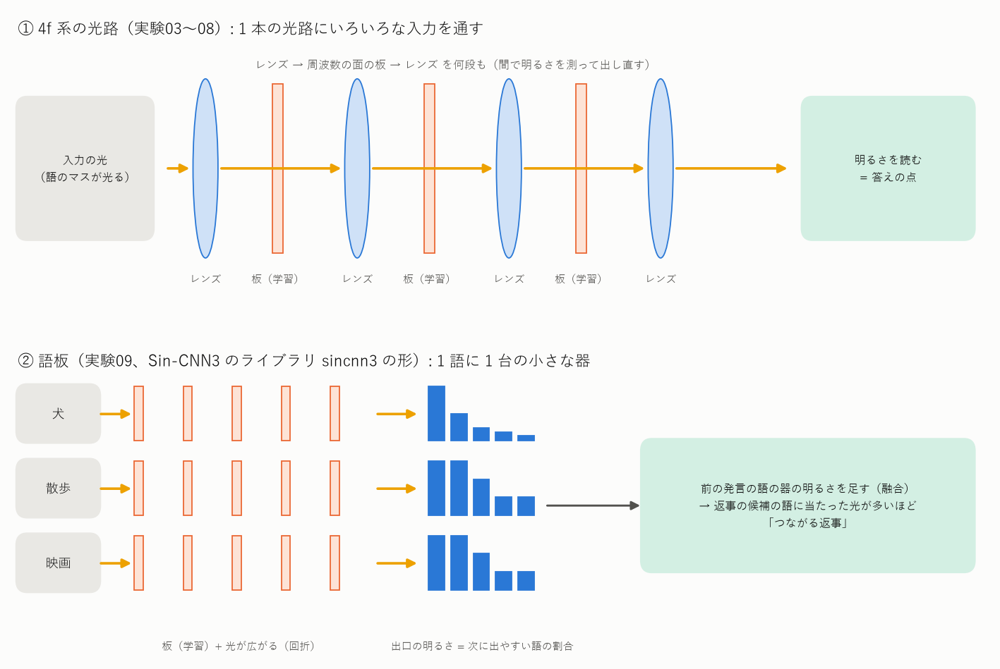
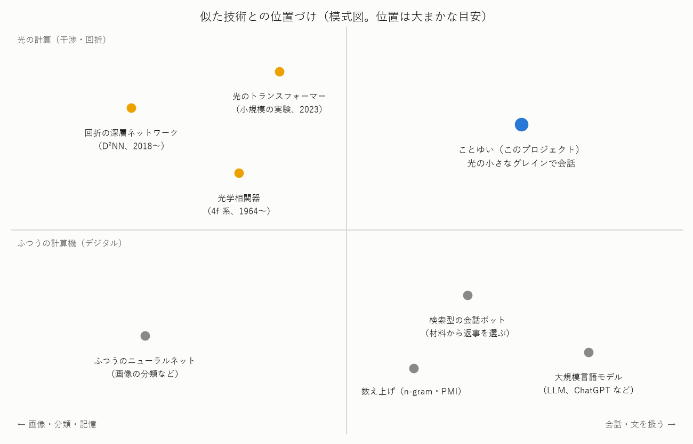

# ことゆい（Project_Kotoyui）の紹介 — 目標・現状・使っている技術・似た技術との違い

> **この文書は最初の段（光の部品と、材料の発言から返事を選ぶ kotoyui.py）の紹介です。** 2026-11-04 からの方向（板とグレイン、自覚と介入の環、記憶、波で読む）は [README](../README.md) にまとめています。

2026-11-03 時点。専門の知識がなくても読めるように書いています。数字の正本は [NOTES.md](../NOTES.md)、実験ごとのやさしい説明は [experiments_guide.md](experiments_guide.md)。
図は `python tools/fig_overview.py` で作り直せます。

## 0. 三行で

- **光の学習器の小さな部品（グレイン）を組み合わせて、日本語でおしゃべりする仕組み**を作っています。
- いまは**短い返事が出る**段階です。返事は一から作らず、本物の雑談の発言の中から、相手の発言に合うものを選びます（10 択の返事選びで約 61%）。
- 返事の選び方を**少しずつ光の部品に置き換えて**います。「次の発言のつながり（共鳴）」は、光の器で数え上げとほぼ同じ成績（57.9% 対 59.0%）になりました。

## 1. 目標

### 1.1 何を目指すか

| | 目指すこと | 目指さないこと |
|---|---|---|
| 大きさ | 会話できる**最小の形**（完全より完成） | 大規模言語モデル（LLM）と同じ大きさ・何でも答える力 |
| 計算 | **光の干渉と回折**で計算できる部品（いまは計算機の中の模擬） | 大量の GPU で動かすこと |
| 作り方 | 小さなグレインを**並べて足す**。1 つずつ確かめて、取り替えられる | 1 つの大きな学習器にまとめること |
| 言葉 | 日本語の**話し方**（一人称・語尾・敬語）を手がかりにする | 外国語・翻訳 |

### 1.2 段階（マイルストーン）

| 段階 | 中身 | 状況 |
|---|---|---|
| M1 | 光の部品の確かめ: 次の言葉を当てる（2DTG）、話し方を見分ける（2DWIG）、口調を切り替える | ✅ ひと通り確かめた（下の 2.2） |
| M2 | 短い返事を出す（文を作り続ける最小の手順） | 🔶 **短い返事が出る**（kotoyui.py 0.1.0〜0.2.0）。選ぶ部分を光に置き換え中 |
| M3 | 会話の中の記憶・話のつながり | 一部（相手の名前・好き・予定を覚える部品は取り込み済み） |
| M4 | 意図・流れ・知識・一貫性 | まだ |
| M5 | 最小版 1.0.0 | まだ |

## 2. 現状

### 2.1 いまの返事の作り方

相手の発言が来ると、小さなグレインがそれぞれ「この返事の候補はどれくらい合うか」の点を出し、指揮役が点を足して返事を選びます。
返事は「共感（〜んですね）→ 内容 → 質問」の形に組み立てます。

実際の返事の例（kotoyui.py 0.2.0、決まった例で動かしたもの。困りごとに秘書の型で答えた例）:

| 相手 | ことゆい |
|---|---|
| 犬を飼っているんですが、散歩が大変で | 散歩が大変なんですね。散歩のどんなところが一番大変ですか？ 何かお手伝いできることがあれば言ってくださいね。 |
| 最近寝不足でつらいよ | 寝不足でつらいんですね。どんなところが一番大変ですか？ 何かお手伝いできることがあれば言ってくださいね。 |

ふだんの話題（旅行・映画・休みの日など）では、「北海道に行くんですね。」のような共感の型のあとに、**材料の雑談の発言がそのまま続きます**。
材料の文はデータのライセンス（CC BY-SA 4.0 など）の都合で、このページには載せていません。
材料の発言をそのまま使うので、話が少しずれることがあります（映画の話に、漫画の話の発言が選ばれるなど）。

### 2.2 光の部品の成績

| 部品 | 何をするか | 光の部品 | ふつうの方法 | 一言 |
|---|---|---|---|---|
| 2DWIG | 発言が丁寧か | 96.5% | 回帰 96.7% | ほぼ同じ |
| 2DWIG | 一人称の類（12 通り） | 47.7% | 回帰 49.2% | 少し下。少ない類に弱い |
| 2DTG | 次のサブワード（4,096 通り） | 27.2% | GRU 28.3%・3-gram 30.9% | 1〜4 点下 |
| 2DTG + 口調のスイッチ | 丁寧・くだけたを切り替えて文を作る | 92.5% | 3-gram 91%・GRU 100% | 数えた表並み |
| 共鳴（語板） | 前の発言に続く返事を 10 択で選ぶ | 57.9% | 数え上げ 59.0% | ほぼ同じ |
| 共鳴（1 本の光路） | 同上 | 48.0% | 数え上げ 59.0% | 11 点下。ただし小さい（光 15 万個） |

光の共鳴の改良の流れ（実験07〜09）:

### 2.3 できないこと・注意点

| できないこと | 理由・状況 |
|---|---|
| 新しい文を一から作る | 返事は材料の中から選ぶ。光の 2DTG で 1 単位ずつ作る力はあるが、まだ会話には使っていない |
| 長い話の流れを追う | 同じ会話の中のほかの発言から正解を選ぶ「難しい版」の 10 択は 38%（でたらめ 10%） |
| 知らない話題を推し量って答える | 似た語から推し量る力はある（新しい語の組を AUC 0.79 で見分けた、実験13）が、返事選びの足しにはまだなっていない |
| 光の装置で動かす | すべて計算機の中の模擬。実際の光の装置では作っていない |
| 語板の大きさ | 数えた表を光で覚えている形なので、光の数が 1,644 万個と大きい。出口がどの語かの対応表（28 万個）はデジタル |

## 3. 使っている技術

### 3.1 光の学習器（SinWave）の基本

光を「模様のついた透明な板」に通すと、板の模様で光の進み方が変わり、広がった光どうしが重なって（干渉・回折）、明るい所と暗い所ができます。
**板の模様を学習で決めて、決まった場所の明るさを答えとして読む**のが光の学習器です。

| 言葉 | 意味 | 例えると |
|---|---|---|
| 板 | 画素ごとに光の波のずれ（位相）を変える薄い板。この模様を学習する | 模様つきのすりガラス |
| 回折 | 光が進むうちに広がって混ざること | 水面の波紋が重なる |
| レンズ | 光を向きごとに 1 点に集める（フーリエ変換） | 光をプリズムで分ける |
| 明るさ | 光の強さ。光の量は板を通っても変わらないので、明るさの割合 = 確率として読める | 光の配分 |
| 4f 系 | レンズ → 板 → レンズ の組。光が通るだけで「畳み込み」（CNN の層と同じ計算）ができる | 光の虫眼鏡の組 |
| グレイン | 小さな光の通り道 1 本（小さな学習器 1 つ） | 専門家 1 人 |

### 3.2 ことゆいの部品

| 部品 | 中身 | 光か | 由来 |
|---|---|---|---|
| 2DWIG（Who am I） | 発言の語尾・言い回しの袋を 64 × 64 の光の場に置き、話し方（丁寧さ・一人称）を当てる | 光 | SN2-Parts-2D・実験01 |
| 2DTG（Token） | 直前の数単位から次の 1 単位を当てる。担当を分けた 4f 系の光路を足し、答えは 2 段で読む | 光 | SN2-Parts-2D・実験03〜05 |
| 口調のスイッチ | 丁寧・くだけたの 2 本の光路の足し合わせで、文の口調を切り替える | 光 | 実験03 |
| 共鳴の語板 | 1 語 = 1 台の小さな器。前の発言の語の器の明るさを足して、次に来やすい語を光らせる | 光 | Sin-CNN3 のライブラリ sincnn3・実験09 |
| 語の重なり・話の形の移り変わり・格の補い | 数え上げの表 | デジタル | Sin-CNN3 のテストボット02 |
| 指揮役 | 共感 → 内容 → 質問、課題があれば秘書の型 | 決まった手順 | Sin-CNN3 のテストボット02 |
| キャラクタ・時計・相手の記憶 | プロフィール「言結 となり」、時間帯・季節、相手の名前・好き・予定 | デジタル | Sin-CNN3 のテストボット02 |

### 3.3 材料（データ）

| データ | 量 | 使い方 | ライセンス |
|---|---|---|---|
| RealPersonaChat | 雑談 1.36 万会話・40.9 万発言 | 返事の候補・数え上げ・光の学習 | CC BY-SA 4.0 |
| JMultiWOZ | 旅行の案内の対話 | 数え上げ・光の学習（返事の候補には使わない） | CC BY-SA 4.0 |
| 青空文庫 | 小説 4,477 作品の会話文 | 話し方の見分け・次の言葉（M1） | 著作権切れ |
| 名大会話コーパス | 雑談の書き起こし 12.8 万発言 | M1 の見積もり（配らない） | CC BY-NC-ND 4.0 |

データはリポジトリに入れていません。出典のくわしくは [README](../README.md) の「ライセンスとデータの出典」。

## 4. 似た既存の技術

| 技術 | 考え方 | ことゆいとの違い |
|---|---|---|
| 大規模言語モデル（LLM） | 巨大なデジタルの学習器で、次の言葉を当て続けて文を作る | ことゆいは小さな部品を並べる。光で計算できる形にこだわる。文を一から作る力はまだ弱い |
| 検索型の会話ボット | 材料の中から、相手の発言に合う返事を探して返す | **いまのことゆいの返事の作り方はこれと同じ形**。違いは、合うかどうかの点を光の部品で出すこと |
| 数え上げ（n-gram・PMI） | 語の並び・語どうしの一緒に出る回数を数えて確率にする | ことゆいの比べる相手。光の語板は、この表を光で持つ形 |
| 回折の深層ネットワーク（D²NN、2018〜） | 学習で決めた板を何枚も重ね、光だけで分類する | **器の形は同じ**（板 + 回折）。D²NN は主に画像の分類で、会話には使っていない |
| 光学相関器（4f 系、1964〜） | レンズ → 板 → レンズで、探す模様の場所に光を集める | 2DTG・共鳴の光路の土台。言葉の予測に使う例は見つけていない |
| 光のトランスフォーマー（2023） | 光の掛け算器で、トランスフォーマーの計算を小規模に実験 | 大きな言語モデルを光だけで動かした例は見つかっていない（Sin-CNN3 の調査） |
| ベクトル記号の計算（HRR・VSA） | 記号をベクトルにして、結ぶ・重ねる・解くで記憶する | Sin-CNN3 の記憶の部品と同じ考え方。ことゆいはまだ使っていない |

先行研究の出典は Sin-CNN3 の docs/prior_art.md にまとめてあります（検索の範囲で、網羅的な調査ではありません）。

## 5. 既存にない（このプロジェクトならではの）技術

見つけた範囲で、ほかに例が見当たらないものです。**網羅的に調べたわけではない**ので、「新しいかもしれない」くらいの強さで読んでください。

| 技術 | 何が新しいか | 確かめたこと | 実験 |
|---|---|---|---|
| 光の小さなグレインを並べて会話を作る | 1 つの大きな学習器ではなく、役割ごとの小さな光の器を足し合わせ、取り替えながら会話を作る | 短い返事が出る（0.1.0〜0.2.0） | 06・09 |
| 共鳴の語板 | 「この語の次に来やすい語」を 1 語 1 台の光の器に持たせ、明るさを足すだけで返事の合い方を出す | 10 択で数え上げとほぼ同じ（57.9% 対 59.0%）。器の明るさと表の差 0.14% | 09 |
| 光の口調のスイッチ | 丁寧・くだけたの 2 本の光路を足し合わせるだけで、文の口調を切り替える | 決めた口調の文になる割合 92.5%（数えた表 91%） | 03 |
| 2 段で読む光の 2DTG | 4,096 通りの答えを「64 組 × 64 番」の 2 段で読み、学習するデジタルの数を約 8,000 分の 1 にする | 正解率は −1 点だけ（27.2 → 26.2%） | 04・05 |
| 似た語の器の融合で推し量る | 見たことのない語の組を、似た語の器の明るさの足し算で推し量る | 新しい組を AUC 0.79 で見分けた（よく出る語というだけの目安 0.66） | 13 |
| 話し方の見分けを光の場で | 語尾・言い回しの袋を光の場に置き、話し方を当てる | 丁寧さ 96.5%（回帰 96.7%） | 01 |

分かったことの中には、効かなかったことも多くあります（くわしくは NOTES.md・[ideas.md](ideas.md)）。

| 効かなかったこと | 結果 |
|---|---|
| 話者の情報（隠し味）で次の言葉の当たりを上げる | +0.4 点だけ。使わないことにした |
| 1 本の大きな光路に語の袋を入れる共鳴（最初の形） | 語 1 つだと、どの語でも同じ答えになっていた（実験07）。直して 48% |
| 語のマスの並べ方を変える | 48.0 → 48.6%、ほとんど変わらない（実験10） |
| 光路で共有すれば推し量れる | 新しい組の AUC 0.57 で、似た語の融合（0.79）に届かない（実験11・13） |

## 6. 次の一手

1. 返事の候補が丁寧かを、光の 2DWIG で判定する（数え上げの判定を置き換える）。
2. 推し量る力が役に立つ場面（知らない話題・珍しい語）を、返事選びの中で探す。
3. 長い話の流れ（難しい版の 10 択 38%）を上げる。

## 7. 関係するプロジェクト

| プロジェクト | 関係 |
|---|---|
| [Sin-CNN2](https://github.com/devaf09/Sin-CNN2) | 1 次元の光の学習器（SinWave）。すべての元 |
| SN2-Parts-2D | 2 次元の光の部品集。2DTG・2DWIG・4f 系の元（vendor/ に写して使う） |
| [Sin-CNN3](https://github.com/devaf09/Sin-CNN3) | 会話の部品（テストボット02）と、ライブラリ sincnn3（語板・融合・関係のたどり）の元 |
