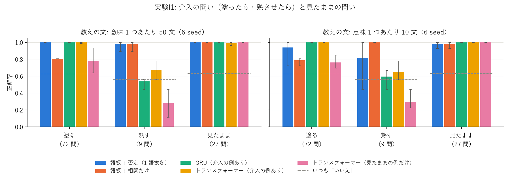
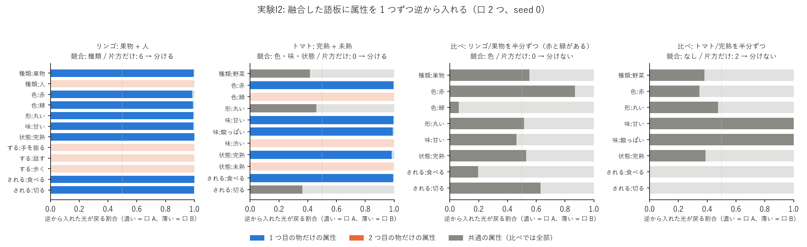

# 介入の研究 実験ノート

目標と物差しは [README.md](README.md)。

## 実験I1: 小さな世界で「既存と違う」の自覚から語板を分け、介入の問いに答える（2026-11-04、i01_small_world.py、sweeps/i01.sh、図 images/i01_qa.png）

### 何を確かめたか

持ち主の案（Sin-CNN3 の学び 51・62 が元）の 3 つを、手で作った小さな世界でつなげて試した。

1. 文を読むだけで、同じ文字列の語が正しい数の語板に分かれるか（果物のリンゴと人のリンゴ、熟したトマトと緑で渋いトマト）。
2. おかしな文（その語のどの意味にもない属性）を、違和感の大きさで見分けられるか。
3. 「赤いトマトを緑に塗ったら渋くなる？」に、相関（緑のトマトは渋い）に引きずられずに「いいえ」と答えられるか。

### 小さな世界

| 語 | 意味（正解） | 属性 |
|---|---|---|
| リンゴ | 果物 | 赤・緑、丸い、甘い、完熟 |
| リンゴ | 人 | 手を振る・話す・歩く |
| トマト | 完熟 / 未熟 | 赤・甘くて酸っぱい / 緑・渋い |
| イチゴ | 完熟 / 未熟 | 赤・甘い / 白・酸っぱい |
| バナナ | 完熟 / 未熟 | 黄・甘い / 緑・渋い |
| レモン | 1 つ | 黄、丸い、酸っぱい、完熟 |

- 文は型から作る（例: 「未熟な 緑の トマト は 渋い 。」「リンゴ が 手を振った 。」）。1 文に属性 2〜4 個。教えは意味 1 つあたり 50 文か 10 文、試しは 20 文。
- 「緑」は緑のリンゴ（甘い）にも、未熟なトマト・バナナ（渋い）にもある。色と味には見かけの相関があるが、本当の原因は熟し具合（交絡）。
- 手で与えたもの（持ち主 2026-11-04「最初の成長段階はきっかけを教える」）: 語と属性の対応、動詞が変える観点（塗る = 色、熟させる = 状態）、分けるしきい値 0.5。

### 仕組み

| 段 | すること |
|---|---|
| 語板 | 1 枚 = 実験09 の光の器を小さくしたもの（縦 32 画素・板 8 枚）。出口の明るさ = 入った属性の割合。文を読むたびに 30 回学ぶ |
| 自覚（違い） | 文の属性のうち、語板が知っている観点（光が届いている）で暗い（その観点の最大の 20% 未満）ものの割合。知らない観点は新しい知識として足す。ただし観点を 2 つ以上知っている語板にまったく重ならない文は 0.5 |
| 分ける | 同じ語のどの語板とも違いが 0.5 以上なら、新しい語板を作る |
| 見直し | 50 文ごとに: 違う観点が 1 つだけの同じ語の語板はまとめる（色違いのリンゴ、動作の違う人）。2 つ以上の観点が一緒に割れている語板は分け直す（早いうちに混ざった語板）。最後に教えの文を読み直す |
| 介入 | 同じ語の語板どうし・1 枚の中の差（観点ごとの明るさの差）から、味の原因を探す。**否定**: 観点 v が違うのに味が変わらない組が 1 つでもあれば、v は原因ではない。残った観点の効き目 = 1。答えは、動詞が変える観点の効き目だけ味を「変えた後の姿の語板」に寄せて読む |
| 1 語抜き | 聞かれた語の組は使わずに効き目を出す（トマトを聞くときは、リンゴ・イチゴ・バナナ・レモンだけから） |

### 結果（6 seed、既定の設定 = 光・しきい値 0.5・分け直し・見直し・読み直しあり）

正解率は seed の平均（括弧は最小〜最大）。比べる相手は同じ文で学んだ GRU・2 層のトランスフォーマー（次の語当て、3,000 回）。「介入の例あり」は、聞かれる語以外の語の介入の問いと答えも文として学んだもの。

| 答え方 | 塗る 50 文 | 熟す 50 文 | 見たまま 50 文 | 塗る 10 文 | 熟す 10 文 | 見たまま 10 文 |
|---|---|---|---|---|---|---|
| **語板 + 否定（1 語抜き）** | **1.00** | 0.98 (0.89〜1) | 1.00 | **0.94** (0.72〜1) | 0.81 (0.44〜1) | 0.98 |
| 語板 + 最小二乗（1 語抜き、Sin3 実験63 の形） | 1.00 | 0.94 | 1.00 | 0.94 | 0.78 | 0.98 |
| 語板 + 相関だけ | 0.81 | 0.98 | 1.00 | 0.79 | 1.00 | 0.98 |
| GRU（介入の例あり） | 1.00 | 0.54 | 1.00 | 1.00 | 0.59 | 1.00 |
| トランスフォーマー（介入の例あり） | 1.00 | 0.67 | 0.99 | 1.00 | 0.65 | 1.00 |
| GRU（見たままの例だけ） | 0.55 | 0.46 | 1.00 | 0.52 | 0.43 | 1.00 |
| トランスフォーマー（見たままの例だけ） | 0.78 | 0.28 | 1.00 | 0.76 | 0.30 | 1.00 |
| いつも「いいえ」 | 0.63 | 0.56 | 0.63 | 0.63 | 0.56 | 0.63 |

分かれ方・振り分け・違和感（6 seed の平均）:

| 設定 | 文 | 語板の数（正解 9） | 純度 | 振り分け | 違和感 AUROC | 否定: 塗る | 否定: 熟す |
|---|---|---|---|---|---|---|---|
| **既定（光）** | 50 | 9, 9, 9, 9, 9, 9 | 0.97 | 1.00 | 1.00 | 1.00 | 0.98 |
| 既定をデジタルで（数えた割合） | 50 | 9 ×6 | 0.97 | 1.00 | 1.00 | 1.00 | 0.98 |
| 分け直しなし | 50 | 8〜9 | 0.94 | 0.96 | 0.99 | 0.96 | 0.94 |
| 見直し（まとめる）なし | 50 | 11〜15 | 0.98 | 1.00 | 0.98 | 1.00 | 1.00 |
| 読み直しなし | 50 | 9 ×6 | 0.97 | 1.00 | 1.00 | 1.00 | 0.98 |
| 3 つともなし | 50 | 12〜15 | 0.94 | 0.96 | 0.97 | 0.96 | 0.96 |
| しきい値 0.34 | 50 | 9 ×6 | 0.97 | 1.00 | 1.00 | 1.00 | 0.98 |
| しきい値 0.67 / 1.0 | 50 | 8〜9 | 0.90 | 0.91 | 1.00 | 1.00 | 1.00 |
| **既定（光）** | 10 | 9 ×6 | 0.95 | 0.98 | 0.99 | 0.94 | 0.81 |
| 既定をデジタルで | 10 | 9〜10 | 0.96 | 0.98 | 0.99 | 0.95 | 0.91 |
| 3 つともなし | 10 | 11〜12 | 0.93 | 0.95 | 0.96 | 0.90 | 0.93 |

### 読み方・考察

- **介入の問いの山場は「塗る」**。相関だけだと「緑のトマトは渋い」に引きずられて 0.81 に落ちる。語板 + 否定は 50 文で 6 seed とも全問正解。
  否定の決め手は、リンゴの語板（1 枚の中に赤と緑があるのに、味は甘いだけ）。Sin-CNN3 の実験63 と同じく、**「色だけ違って味は同じ」例が 1 つあることが、色を原因から外す**。
- 「熟す」は相関だけでも正解できる（熟した語板の味を読めばよい）。この企画の介入の物差しとしては「塗る」が本体。熟すは 9 問しかなく、1 問の差が 0.11 になる。
- GRU・トランスフォーマーは、**ほかの語の「塗ったら」の問いと答えを見せれば、塗る は 100% になる**（「塗っても変わらない」という型を覚える）。でも熟す は「いつも いいえ」並み。
  見たままの例だけだと、塗る は「いつも いいえ」前後で、相関に引きずられる。語板は介入の答えの例を 1 つも見ずに、動詞の規則（塗る = 色）と語板の差だけで答えている。比べる条件が違う（こちらは規則を手で与え、相手は例を与えた）点に注意。
- 分け方では、**見直し（同じ物の幅をまとめる）がないと語板が増えすぎる**（人のリンゴが動作ごとに 3 枚など）。それでも問いの正解率はあまり落ちない（同じ物の語板が増えても、差の比べには害が少ない）。
  **分け直しがないと、早いうちに混ざった語板が残る**（熟したバナナと青いバナナが 1 枚に）。
- 光とデジタルは、50 文ではまったく同じ。10 文では光のほうが熟す で少し悪い（0.81 と 0.91）。

### マイナス点・正直な限界

- **設計を seed 0〜2 を見ながら 2 回直した**（重ならない文を「違うかも」にした、片方にだけある観点も分け直しの手がかりにした、1 枚の中の 2 つ目の値を「暗くない」で数えた）。seed 3〜5 は直した後に初めて回した。50 文では seed 3〜5 も全問正解、10 文では seed 3〜5 のほうが悪い（塗る 0.88、熟す 0.63 前後）。
- **10 文では「否定」が脆い**。1 文の混ざり（未熟なイチゴの文が熟したイチゴの語板に 1 つ入る）で、その語板が「状態は 2 つあるのに味は 1 つ」に見え、本当の原因（状態）まで否定してしまった seed がある（seed 3・5）。
  1 つの反例で否定する規則は、少ない文では混ざりに弱い。反例の強さ（何文あるか）を自覚に入れる必要がある。
- 世界は手作りで小さい（5 語・9 つの意味・属性は手で与えた対応表）。文は型から作ったので、本物の文の揺れはない。
- 原因の比べ（否定・最小二乗）と、分け直し・見直しの判断は、まだデジタル（光の明るさを読んで数える）。光にするのは 2 回目から（持ち主の判断）。
- しきい値（違い 0.5、暗い = 20%、まとめる = 違う観点 1 つ以下）は手で決めた。

### 次の一手（案）

1. **反例の強さを自覚に入れる**: 否定を「1 つでも反例があれば」から「反例の文の数・明るさが、支持より強ければ」に。10 文の脆さを直す。
2. **分け直しを光で**: 持ち主の案「特定のグレインに逆向きに属性を入れると 2 つの光の経路にまとまるなら、2 つの関係を持つから分ける」を、語板の器で試す。手で決めたしきい値（まとめる・分け直す）を光の判断に置き換える。
3. **動詞の規則を学ぶ**: 「塗る = 色だけ変える」を手で与えずに、塗った後の文（「赤い トマト を 緑に 塗った 。 甘くて 酸っぱい 。」）から学ぶ。
4. 世界を少し大きく（語 20〜30、観点を増やす）し、見たことのない組み合わせを「言える」か（生成）も測る。

## 実験I2: 境目の分からない 2 つの物を 1 枚に融合し、属性を 1 つずつ逆から入れる（2026-11-04、i02_reverse.py、図 images/i02_reverse.png）

### 何を確かめたか

持ち主の案: 「リンゴに複数の要素を持たせ、逆から 1 つずつ属性を入れると出力がどうなるか。A と B の境目が分かっていない 2 つの板を融合して、
共通する属性・しない属性を逆から入れ、関連を調べる（特に分離）」「逆向きに属性を入れて 2 つの光の経路にまとまるなら、2 つの関係を持つから分ける」。

### 方法

- 器: I1 の光の器（縦 64 画素・板 8 枚）。入口に「口」（周波数 1〜M の波）を M 個持たせた。
  - 順: 口 m → 板 → レンズ → 属性の明るさ。
  - **逆**: 属性 1 つの点の光をレンズの後ろから入れ、板を逆にたどる（式は順の随伴。数値で一致を確かめた）。入口に戻った光が、どの口にどれだけ戻るかを見る。
  - **往復**: 逆で戻った光を口の成分だけ残してもう一度順に通し、その属性から「一緒に出てくる属性」を見る。
- 融合（境目は教えない。文がどちらの物かは評価にだけ使う）:
  - marg: 口 1 つ、2 つの物の文を混ぜた属性の割合を学ぶ（I1 と同じ形）。
  - mix: 口 M 個（2・3・4）、文ごとに「どの口から来たか」を隠したまま、文の属性の組が出やすくなるように学ぶ（混合のモデル）。
- 組: 果物 + 人（リンゴ）、完熟 + 未熟（トマト・イチゴ・バナナ）、3 つ（果物のリンゴ + 人のリンゴ + レモン）。
  比べ（境目のない融合）: 1 つの物の文を半分ずつにして融合（果物のリンゴ = 赤と緑がある、熟したトマト）。物 1 つあたり 50 文、6 seed、CPU で 1 seed 30 秒。
- 分けるかどうかの判断（口 2 つ）: 両方の口に光がある観点で値の割合が半分以上違う「競合する観点」と、片方の口にしか光がない「片方だけの観点」を数える。
  競合 2 つ以上、または競合 1 つ + 片方だけ 1 つ以上なら「分ける」（I1 の見直しと同じ考え）。

### 結果（6 seed の平均、括弧は最小〜最大）

| 組 | 学び方 | 片方だけの属性を正しく 2 つに分けた割合 | 往復で同じ物の属性に出る割合 | 共通の属性の口の広がり（1 = 両方の口に半分ずつ） | 分けるの判断 |
|---|---|---|---|---|---|
| リンゴ: 果物 + 人 | marg（口 1） | 0.58（入口の場の重なりで分けた） | 0.48 | – | – |
| リンゴ: 果物 + 人 | **mix（口 2）** | **1.00** | **0.99** | （共通なし） | **6/6 分ける**（競合: 種類、片方だけ: 色・形・味・状態・する・される） |
| トマト: 完熟 + 未熟 | marg | 0.60 | 0.45 | – | – |
| トマト: 完熟 + 未熟 | **mix（口 2）** | **1.00** | **0.99** | **0.95** | **6/6 分ける**（競合: 色・味・状態（・される）） |
| イチゴ: 完熟 + 未熟 | mix（口 2） | 1.00 | 0.99 | 0.99 | 6/6 分ける |
| バナナ: 完熟 + 未熟 | mix（口 2） | 1.00 | 0.99 | 0.96 | 6/6 分ける |
| 3 つ: 果物 + 人 + レモン | mix（口 2） | 0.77 | 0.63 | – | 6/6 分ける |
| 3 つ: 果物 + 人 + レモン | mix（口 3） | 0.83（0.60〜1） | 0.74 | – | – |
| 3 つ: 果物 + 人 + レモン | mix（口 4） | 1.00 | 0.87 | – | – |
| 比べ: 果物のリンゴを半分ずつ（赤と緑） | mix（口 2） | – | – | 0.80 | **2/6 分ける（誤り）**、4/6 分けない |
| 比べ: 熟したトマトを半分ずつ | mix（口 2） | – | – | – | **0/6 分ける**（正しい） |

口を増やした場合（2 つの物、口 4）: 片方だけの属性の分け方は 1.00 のまま、往復で同じ物に出る割合は 0.86〜0.96 に少し下がる（余った口が片方の物を 2 つに分けて持つ）。

### 読み方・考察

- **口が 1 つの融合（I1 と同じ形）では、逆から入れても分からない**。入口に戻る場の重なりで分けると、正しさは 0.5〜0.6（当てずっぽう並み）。
  属性の割合だけを学んだ器には、「どの属性がどの属性と一緒に出たか」が入っていないため。
- **口を 2 つ持たせ、文ごとの「一緒に出た組」で学ぶと、境目を教えなくても 2 つの光の経路にまとまる**。片方の物だけの属性は 6 seed とも 100% 正しく片方の口に戻り、
  共通の属性（トマトの「野菜」「丸い」など）は両方の口に半分ずつ戻る（広がり 0.95〜0.99）。持ち主の「2 つの光の経路にまとまる」が、そのまま見えた。
- **往復**: 「甘い」を逆から入れて往復すると「果物・丸い・完熟」が、「手を振る」なら「人・歩く・話す」が出る（同じ物の属性に出る割合 0.99）。逆から入れた属性 1 つから、その物の残りの属性を思い出せる。
- **境目のない融合でも、口 2 つは何かで割れる**（比べの 2 つ）。熟したトマトは「味の文」と「食べた・切ったの文」で割れた（文の型の違い）。
  果物のリンゴは赤と緑で割れた。「割れたかどうか」だけでは分けるかどうかは決められない。**競合する観点を数えると区別できた**:
  文の型で割れただけなら競合 0（6/6 分けない）。2 つの物の融合なら競合 1 + 片方だけ多数、または競合 3〜4（24/24 分ける）。
- 3 つの物は、口 2 つでは足りない（片方の口に 2 つの物が入る）。口 4 つなら 3 つの物を正しく分ける。口の数 > 物の数でも害は小さい。

### マイナス点・正直な限界

- 色違いのリンゴ（同じ物の幅）を、6 seed 中 2 回「分ける」と誤った。たまたま「緑」と「食べた」が同じ口に寄り、競合 2 つ（色・される）に見えた。
  50 文の偶然の偏りで、判断の規則（競合 2 つ以上）が越えられてしまう。反例の強さ（I1 の次の一手 1）と同じく、文の数による確からしさを判断に入れる必要がある。
- 判断の規則（競合・片方だけの数え方としきい値）は seed 0 の結果を見てから決めた。seed 1〜5 では同じ規則のまま。
- 学び方 mix は、文ごとの属性の組（文の中で一緒に出た属性）を使う。I1 の語板は属性の割合だけを持っていたので、そのままでは逆から入れても分からない。
  I1 に入れるには、語板が文ごとの組を学ぶ形（口を持つ）に変える必要がある。
- 判断（競合・片方だけを数える）は、口ごとの明るさを読んでデジタルで数えている。

### 次の一手（案）

1. I1 の語板を「口 2 つ・文の組で学ぶ」形に変え、分け直しと見直しをこの逆からの判断に置き換える（手で決めた I1 の規則を光の判断に）。
2. 判断に文の数を入れる（「競合が偶然でないか」。色違いのリンゴの誤りを直す）。
3. 口の数を自動で決める: 口を 1 つずつ足し、往復で同じ物に出る割合や学びの損失が上がらなくなったら止める。

## 実験I3: 分け方を「口 2 つの板に逆から入れる判断」に置き換え、否定に反例の強さを入れる（2026-11-04、i03_reverse_split.py、sweeps/i03.sh）

### 何を確かめたか

I1 の分け方は手の規則（文ごとの違いのしきい値、50 文ごとの見直し・分け直し）だった。I2 の「口 2 つ・文の組で学ぶ・競合する観点を数える」判断だけで、
同じ語の意味を分けられるか。あわせて、I1 の 10 文での弱点（混ざった 1 文が作る見かけの反例で、本当の原因まで否定する）を、反例の強さで直せるか。

### 方法

- 語ごとに、その語の文を全部読んで口 2 つの板を学ぶ → 競合する観点・片方だけの観点を数える → 「分ける」なら文を口の取り分で 2 つにし、それぞれでやり直す（割れなくなるまで、深さ 3 まで）。
  文の確からしさ（--min_support）: 口ごとに、その観点を含む文（取り分で重みづけ）がこの数未満なら数えない。0・3・6 を比べた。
- 介入の問いは I1 と同じ。原因を比べる組: 板どうし、口どうし（分けなかった板の 2 つの口）、1 枚の中（色が 2 つあるのに味は 1 つ）。
- 否定: deny = 反例が 1 つでもあれば否定（I1 と同じ）。weighted = 反例の両側に文が --min_ref（既定 5）以上あるときだけ否定。
- 6 seed、意味 1 つあたり 50 文・10 文。CPU で 1 回 25 秒。

### 結果（6 seed の平均）

| 文 | 文の確からしさ | 見つけた意味（正解 9） | 純度 | 振り分け | 違和感 | 塗る（否定・全部の組） | 熟す | 塗る（反例の強さ 5） | 熟す |
|---|---|---|---|---|---|---|---|---|---|
| 50 | 0 | 9 ×6 | 0.99 | 1.00 | 1.00 | **1.00** | **1.00** | **1.00** | **1.00** |
| 50 | 3 | 9 ×6 | 0.99 | 1.00 | 1.00 | **1.00** | **1.00** | **1.00** | **1.00** |
| 50 | 6 | 9 ×6 | 0.99 | 1.00 | 1.00 | 1.00 | 1.00 | 1.00 | 1.00 |
| 10 | 0 | 9 ×6 | 0.98 | 0.99 | 0.97 | 0.88 | 0.93 | 0.79 | 0.96 |
| 10 | 3 | 8〜9 | 0.93 | 0.94 | 0.97 | 0.91 | 0.91 | 0.78 | 0.94 |
| 10 | 6 | 5〜6 | 0.57 | 0.58 | 0.98 | 0.71 | 0.65 | 0.71 | 0.65 |
| （I1 既定、光） 50 | – | 9 ×6 | 0.97 | 1.00 | 1.00 | 1.00 | 0.98 | – | – |
| （I1 既定、光） 10 | – | 9 ×6 | 0.95 | 0.98 | 0.99 | 0.94 | 0.81 | – | – |

組の種類の効き目（50 文、6 seed）: 板どうしだけ = 塗る 0.90、+ 口どうし = 0.90、+ 1 枚の中 = 1.00。
10 文で反例の強さの下限を変える（文の確からしさ 3）: 下限 2・3 = 塗る 0.86・熟す 0.94、下限 5 = 0.78・0.94、下限なし（deny） = 0.91・0.91。

### 読み方・考察

- **手の規則（しきい値・50 文ごとの見直し・分け直し・読み直し）を全部外して、逆からの判断だけで 9 つの意味に分かれた**（50 文で 6 seed とも、純度 0.99 は I1 の 0.97 より高い）。
  果物のリンゴは、色の競合 1 つと片方だけの観点で、赤と緑の 2 枚にもう 1 段分かれることがある（9〜11 枚）。意味の数（9）は保たれ、問いには害がない。
- **塗るの否定には「1 枚の中」（色違いのリンゴ）が要る**。板どうし・口どうしだけだと 0.90（リンゴが 1 枚のままの seed で、色の反例がない）。
  口どうしの比べは、口が色ではなく文の型で割れることが多く、反例にならなかった。
- **10 文では、反例の強さで「見かけの反例」と「本当の少ない反例」を区別できない**。緑のリンゴの文が 10 文中 2〜4 しかないため、下限を上げると本物の反例（色）も捨て、
  下げると混ざりの反例（熟し具合）も拾う。どの下限でも塗る・熟すの両方を 0.95 以上にはできなかった。少ない文では、文の数だけでは決まらない。
- 文の確からしさ 6 は 10 文では強すぎ、ほとんど分けなくなる（5〜6 枚）。

### マイナス点・正直な限界

- 分けた後の板は、文を口の取り分で切り分けてから学び直している（切り分けはデジタル）。判断（競合の数え方）もデジタル。
- 1 枚の中の組は、I1 と同じく文に出た値の数を数えている（光の明るさだけでは「2 つ目の値の文の数」が分からない）。
- 10 文での弱さは直っていない。次は「反例の数」ではなく「反例が説明できるか」（混ざりなら、その 1 文は別の板の起こりやすさのほうが高い）を自覚に入れる案がある。

### 追加: 見かけの反例を「ほかの板の主な値」で見分ける（同じ日、同じプログラムの「全部（読み直し）」と --loose）

- 1 文ずつの起こりやすさで読み直す形は**効かなかった**。混ざった文を学んだ板のほうが、その文を起こりやすく覚えてしまう（例: 「完熟の トマト を 切った」は、
  熟したトマトの板に「切る」が無いため、混ざった先の未熟なトマトの板のほうが起こりやすい）。
- 代わりに「反例を作る 2 つ目の値（熟したトマトの板の中の『未熟』など）が、同じ語のほかの板の主な値なら、その板からの混ざりとして反例に使わない」にした。
  緑のリンゴ（ほかのリンゴの板に色が無い）は反例として残り、未熟なイチゴの混ざり（未熟なイチゴの板の主な値）は外れる。
- さらに --loose: 板どうしの組に、色と味だけ分かっている板も使う（10 文では「形」「状態」が一度も出ない板があり、色違いのリンゴの 2 枚が組にならなかった）。

| 文 | 設定 | 塗る | 熟す | 見たまま |
|---|---|---|---|---|
| 10 | 否定（I3 の最初） | 0.88 | 0.93 | 0.98 |
| 10 | 反例の強さ 5 | 0.79 | 0.96 | 0.98 |
| 10 | 否定 + 見かけの反例を外す | 0.88 | **0.96** | 0.98 |
| 10 | **否定 + 見かけの反例を外す + loose** | **0.94** | **0.96** | 0.98 |
| 10 | 相関だけ | 0.79 | 0.96 | 0.98 |
| 10 | （I1 既定、光） | 0.94 | 0.81 | 0.98 |
| 50 | どの設定でも（相関だけ以外） | 1.00 | 1.00 | 1.00 |

（文の確からしさ 0、6 seed。10 文で塗るの最低は 0.71: 緑のリンゴの文が 1 つも無い seed で、色を否定する手がかりがそもそも無い。）

- **10 文でも、塗る・熟すの両方を 0.94 以上にできた**（I1 は熟すが 0.81）。見かけの反例は「文の数」ではなく「その値がほかの物の値か」で見分けるほうがよかった。
- 注意: この 2 つの追加も、10 文の seed 0〜5 の失敗を見てから作った。新しい seed での確かめはまだ。

### 次の一手（案）

1. 新しい seed（6〜11）と、属性や物を変えた別の小さな世界で、I3 の最終形を確かめる（ここまでの直しが seed に合わせすぎていないか）。
2. 口の数を自動で決める（I2 の次の一手 3）と、3 つ以上の意味を持つ語。
3. 「塗る = 色だけ」を手で与えずに、塗った後の文から学ぶ（I1 の次の一手 3）。
