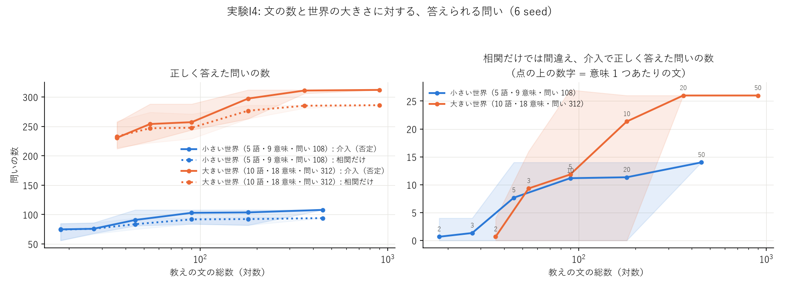
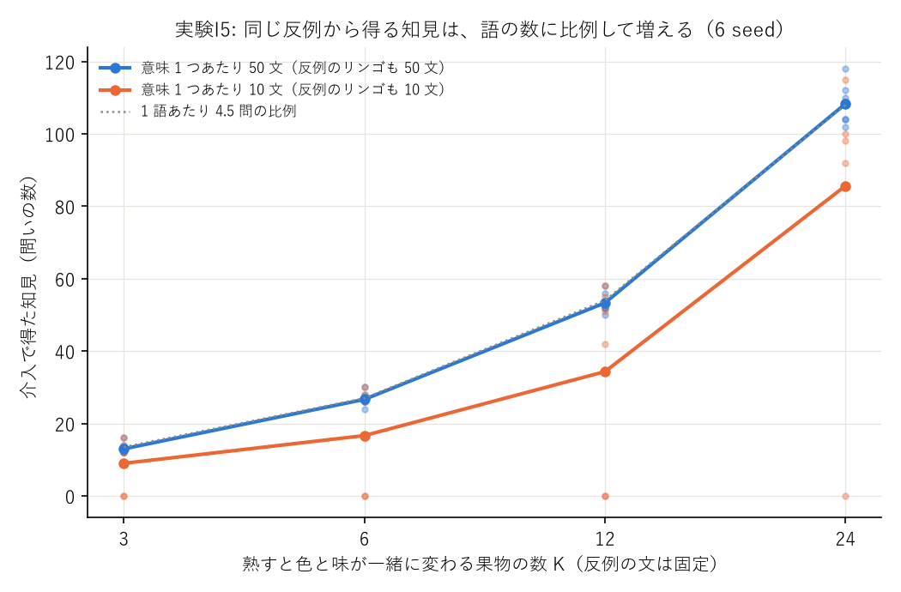
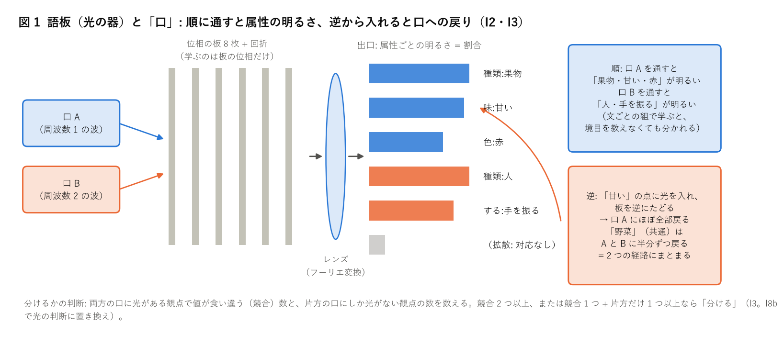
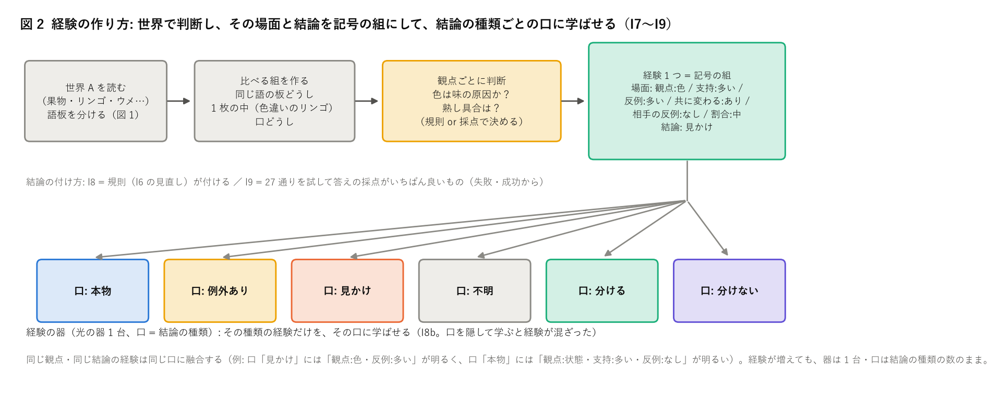
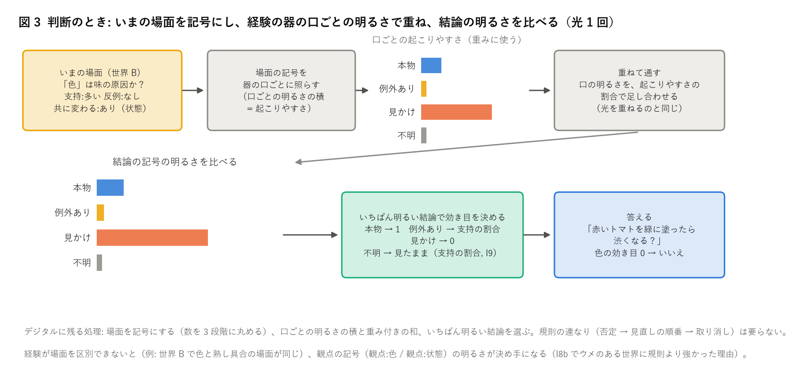
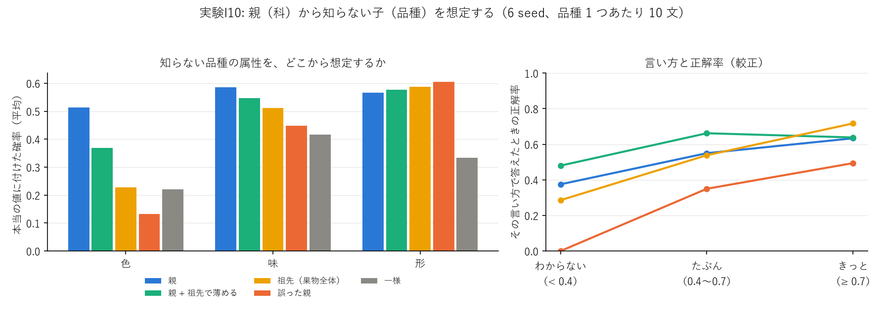

# 介入の研究 実験ノート

目標と物差しは [README.md](README.md)。

## 実験I1: 小さな世界で「既存と違う」の自覚から語板を分け、介入の問いに答える（2026-11-04、i01_small_world.py、sweeps/i01.sh、図 images/i01_qa.png）

### 何を確かめたか

持ち主の案（Sin-CNN3 の学び 51・62 が元）の 3 つを、手で作った小さな世界でつなげて試した。

1. 文を読むだけで、同じ文字列の語が正しい数の語板に分かれるか（果物のリンゴと人のリンゴ、熟したトマトと緑で渋いトマト）。
2. おかしな文（その語のどの意味にもない属性）を、違和感の大きさで見分けられるか。
3. 「赤いトマトを緑に塗ったら渋くなる？」に、相関（緑のトマトは渋い）に引きずられずに「いいえ」と答えられるか。

### 小さな世界

| 語 | 意味（正解） | 属性 |
|---|---|---|
| リンゴ | 果物 | 赤・緑、丸い、甘い、完熟 |
| リンゴ | 人 | 手を振る・話す・歩く |
| トマト | 完熟 / 未熟 | 赤・甘くて酸っぱい / 緑・渋い |
| イチゴ | 完熟 / 未熟 | 赤・甘い / 白・酸っぱい |
| バナナ | 完熟 / 未熟 | 黄・甘い / 緑・渋い |
| レモン | 1 つ | 黄、丸い、酸っぱい、完熟 |

- 文は型から作る（例: 「未熟な 緑の トマト は 渋い 。」「リンゴ が 手を振った 。」）。1 文に属性 2〜4 個。教えは意味 1 つあたり 50 文か 10 文、試しは 20 文。
- 「緑」は緑のリンゴ（甘い）にも、未熟なトマト・バナナ（渋い）にもある。色と味には見かけの相関があるが、本当の原因は熟し具合（交絡）。
- 手で与えたもの（持ち主 2026-11-04「最初の成長段階はきっかけを教える」）: 語と属性の対応、動詞が変える観点（塗る = 色、熟させる = 状態）、分けるしきい値 0.5。

### 仕組み

| 段 | すること |
|---|---|
| 語板 | 1 枚 = 実験09 の光の器を小さくしたもの（縦 32 画素・板 8 枚）。出口の明るさ = 入った属性の割合。文を読むたびに 30 回学ぶ |
| 自覚（違い） | 文の属性のうち、語板が知っている観点（光が届いている）で暗い（その観点の最大の 20% 未満）ものの割合。知らない観点は新しい知識として足す。ただし観点を 2 つ以上知っている語板にまったく重ならない文は 0.5 |
| 分ける | 同じ語のどの語板とも違いが 0.5 以上なら、新しい語板を作る |
| 見直し | 50 文ごとに: 違う観点が 1 つだけの同じ語の語板はまとめる（色違いのリンゴ、動作の違う人）。2 つ以上の観点が一緒に割れている語板は分け直す（早いうちに混ざった語板）。最後に教えの文を読み直す |
| 介入 | 同じ語の語板どうし・1 枚の中の差（観点ごとの明るさの差）から、味の原因を探す。**否定**: 観点 v が違うのに味が変わらない組が 1 つでもあれば、v は原因ではない。残った観点の効き目 = 1。答えは、動詞が変える観点の効き目だけ味を「変えた後の姿の語板」に寄せて読む |
| 1 語抜き | 聞かれた語の組は使わずに効き目を出す（トマトを聞くときは、リンゴ・イチゴ・バナナ・レモンだけから） |

### 結果（6 seed、既定の設定 = 光・しきい値 0.5・分け直し・見直し・読み直しあり）

正解率は seed の平均（括弧は最小〜最大）。比べる相手は同じ文で学んだ GRU・2 層のトランスフォーマー（次の語当て、3,000 回）。「介入の例あり」は、聞かれる語以外の語の介入の問いと答えも文として学んだもの。

| 答え方 | 塗る 50 文 | 熟す 50 文 | 見たまま 50 文 | 塗る 10 文 | 熟す 10 文 | 見たまま 10 文 |
|---|---|---|---|---|---|---|
| **語板 + 否定（1 語抜き）** | **1.00** | 0.98 (0.89〜1) | 1.00 | **0.94** (0.72〜1) | 0.81 (0.44〜1) | 0.98 |
| 語板 + 最小二乗（1 語抜き、Sin3 実験63 の形） | 1.00 | 0.94 | 1.00 | 0.94 | 0.78 | 0.98 |
| 語板 + 相関だけ | 0.81 | 0.98 | 1.00 | 0.79 | 1.00 | 0.98 |
| GRU（介入の例あり） | 1.00 | 0.54 | 1.00 | 1.00 | 0.59 | 1.00 |
| トランスフォーマー（介入の例あり） | 1.00 | 0.67 | 0.99 | 1.00 | 0.65 | 1.00 |
| GRU（見たままの例だけ） | 0.55 | 0.46 | 1.00 | 0.52 | 0.43 | 1.00 |
| トランスフォーマー（見たままの例だけ） | 0.78 | 0.28 | 1.00 | 0.76 | 0.30 | 1.00 |
| いつも「いいえ」 | 0.63 | 0.56 | 0.63 | 0.63 | 0.56 | 0.63 |

分かれ方・振り分け・違和感（6 seed の平均）:

| 設定 | 文 | 語板の数（正解 9） | 純度 | 振り分け | 違和感 AUROC | 否定: 塗る | 否定: 熟す |
|---|---|---|---|---|---|---|---|
| **既定（光）** | 50 | 9, 9, 9, 9, 9, 9 | 0.97 | 1.00 | 1.00 | 1.00 | 0.98 |
| 既定をデジタルで（数えた割合） | 50 | 9 ×6 | 0.97 | 1.00 | 1.00 | 1.00 | 0.98 |
| 分け直しなし | 50 | 8〜9 | 0.94 | 0.96 | 0.99 | 0.96 | 0.94 |
| 見直し（まとめる）なし | 50 | 11〜15 | 0.98 | 1.00 | 0.98 | 1.00 | 1.00 |
| 読み直しなし | 50 | 9 ×6 | 0.97 | 1.00 | 1.00 | 1.00 | 0.98 |
| 3 つともなし | 50 | 12〜15 | 0.94 | 0.96 | 0.97 | 0.96 | 0.96 |
| しきい値 0.34 | 50 | 9 ×6 | 0.97 | 1.00 | 1.00 | 1.00 | 0.98 |
| しきい値 0.67 / 1.0 | 50 | 8〜9 | 0.90 | 0.91 | 1.00 | 1.00 | 1.00 |
| **既定（光）** | 10 | 9 ×6 | 0.95 | 0.98 | 0.99 | 0.94 | 0.81 |
| 既定をデジタルで | 10 | 9〜10 | 0.96 | 0.98 | 0.99 | 0.95 | 0.91 |
| 3 つともなし | 10 | 11〜12 | 0.93 | 0.95 | 0.96 | 0.90 | 0.93 |

### 読み方・考察

- **介入の問いの山場は「塗る」**。相関だけだと「緑のトマトは渋い」に引きずられて 0.81 に落ちる。語板 + 否定は 50 文で 6 seed とも全問正解。
  否定の決め手は、リンゴの語板（1 枚の中に赤と緑があるのに、味は甘いだけ）。Sin-CNN3 の実験63 と同じく、**「色だけ違って味は同じ」例が 1 つあることが、色を原因から外す**。
- 「熟す」は相関だけでも正解できる（熟した語板の味を読めばよい）。この企画の介入の物差しとしては「塗る」が本体。熟すは 9 問しかなく、1 問の差が 0.11 になる。
- GRU・トランスフォーマーは、**ほかの語の「塗ったら」の問いと答えを見せれば、塗る は 100% になる**（「塗っても変わらない」という型を覚える）。でも熟す は「いつも いいえ」並み。
  見たままの例だけだと、塗る は「いつも いいえ」前後で、相関に引きずられる。語板は介入の答えの例を 1 つも見ずに、動詞の規則（塗る = 色）と語板の差だけで答えている。比べる条件が違う（こちらは規則を手で与え、相手は例を与えた）点に注意。
- 分け方では、**見直し（同じ物の幅をまとめる）がないと語板が増えすぎる**（人のリンゴが動作ごとに 3 枚など）。それでも問いの正解率はあまり落ちない（同じ物の語板が増えても、差の比べには害が少ない）。
  **分け直しがないと、早いうちに混ざった語板が残る**（熟したバナナと青いバナナが 1 枚に）。
- 光とデジタルは、50 文ではまったく同じ。10 文では光のほうが熟す で少し悪い（0.81 と 0.91）。

### マイナス点・正直な限界

- **設計を seed 0〜2 を見ながら 2 回直した**（重ならない文を「違うかも」にした、片方にだけある観点も分け直しの手がかりにした、1 枚の中の 2 つ目の値を「暗くない」で数えた）。seed 3〜5 は直した後に初めて回した。50 文では seed 3〜5 も全問正解、10 文では seed 3〜5 のほうが悪い（塗る 0.88、熟す 0.63 前後）。
- **10 文では「否定」が脆い**。1 文の混ざり（未熟なイチゴの文が熟したイチゴの語板に 1 つ入る）で、その語板が「状態は 2 つあるのに味は 1 つ」に見え、本当の原因（状態）まで否定してしまった seed がある（seed 3・5）。
  1 つの反例で否定する規則は、少ない文では混ざりに弱い。反例の強さ（何文あるか）を自覚に入れる必要がある。
- 世界は手作りで小さい（5 語・9 つの意味・属性は手で与えた対応表）。文は型から作ったので、本物の文の揺れはない。
- 原因の比べ（否定・最小二乗）と、分け直し・見直しの判断は、まだデジタル（光の明るさを読んで数える）。光にするのは 2 回目から（持ち主の判断）。
- しきい値（違い 0.5、暗い = 20%、まとめる = 違う観点 1 つ以下）は手で決めた。

### 次の一手（案）

1. **反例の強さを自覚に入れる**: 否定を「1 つでも反例があれば」から「反例の文の数・明るさが、支持より強ければ」に。10 文の脆さを直す。
2. **分け直しを光で**: 持ち主の案「特定のグレインに逆向きに属性を入れると 2 つの光の経路にまとまるなら、2 つの関係を持つから分ける」を、語板の器で試す。手で決めたしきい値（まとめる・分け直す）を光の判断に置き換える。
3. **動詞の規則を学ぶ**: 「塗る = 色だけ変える」を手で与えずに、塗った後の文（「赤い トマト を 緑に 塗った 。 甘くて 酸っぱい 。」）から学ぶ。
4. 世界を少し大きく（語 20〜30、観点を増やす）し、見たことのない組み合わせを「言える」か（生成）も測る。

## 実験I2: 境目の分からない 2 つの物を 1 枚に融合し、属性を 1 つずつ逆から入れる（2026-11-04、i02_reverse.py、図 images/i02_reverse.png）

### 何を確かめたか

持ち主の案: 「リンゴに複数の要素を持たせ、逆から 1 つずつ属性を入れると出力がどうなるか。A と B の境目が分かっていない 2 つの板を融合して、
共通する属性・しない属性を逆から入れ、関連を調べる（特に分離）」「逆向きに属性を入れて 2 つの光の経路にまとまるなら、2 つの関係を持つから分ける」。

### 方法

- 器: I1 の光の器（縦 64 画素・板 8 枚）。入口に「口」（周波数 1〜M の波）を M 個持たせた。
  - 順: 口 m → 板 → レンズ → 属性の明るさ。
  - **逆**: 属性 1 つの点の光をレンズの後ろから入れ、板を逆にたどる（式は順の随伴。数値で一致を確かめた）。入口に戻った光が、どの口にどれだけ戻るかを見る。
  - **往復**: 逆で戻った光を口の成分だけ残してもう一度順に通し、その属性から「一緒に出てくる属性」を見る。
- 融合（境目は教えない。文がどちらの物かは評価にだけ使う）:
  - marg: 口 1 つ、2 つの物の文を混ぜた属性の割合を学ぶ（I1 と同じ形）。
  - mix: 口 M 個（2・3・4）、文ごとに「どの口から来たか」を隠したまま、文の属性の組が出やすくなるように学ぶ（混合のモデル）。
- 組: 果物 + 人（リンゴ）、完熟 + 未熟（トマト・イチゴ・バナナ）、3 つ（果物のリンゴ + 人のリンゴ + レモン）。
  比べ（境目のない融合）: 1 つの物の文を半分ずつにして融合（果物のリンゴ = 赤と緑がある、熟したトマト）。物 1 つあたり 50 文、6 seed、CPU で 1 seed 30 秒。
- 分けるかどうかの判断（口 2 つ）: 両方の口に光がある観点で値の割合が半分以上違う「競合する観点」と、片方の口にしか光がない「片方だけの観点」を数える。
  競合 2 つ以上、または競合 1 つ + 片方だけ 1 つ以上なら「分ける」（I1 の見直しと同じ考え）。

### 結果（6 seed の平均、括弧は最小〜最大）

| 組 | 学び方 | 片方だけの属性を正しく 2 つに分けた割合 | 往復で同じ物の属性に出る割合 | 共通の属性の口の広がり（1 = 両方の口に半分ずつ） | 分けるの判断 |
|---|---|---|---|---|---|
| リンゴ: 果物 + 人 | marg（口 1） | 0.58（入口の場の重なりで分けた） | 0.48 | – | – |
| リンゴ: 果物 + 人 | **mix（口 2）** | **1.00** | **0.99** | （共通なし） | **6/6 分ける**（競合: 種類、片方だけ: 色・形・味・状態・する・される） |
| トマト: 完熟 + 未熟 | marg | 0.60 | 0.45 | – | – |
| トマト: 完熟 + 未熟 | **mix（口 2）** | **1.00** | **0.99** | **0.95** | **6/6 分ける**（競合: 色・味・状態（・される）） |
| イチゴ: 完熟 + 未熟 | mix（口 2） | 1.00 | 0.99 | 0.99 | 6/6 分ける |
| バナナ: 完熟 + 未熟 | mix（口 2） | 1.00 | 0.99 | 0.96 | 6/6 分ける |
| 3 つ: 果物 + 人 + レモン | mix（口 2） | 0.77 | 0.63 | – | 6/6 分ける |
| 3 つ: 果物 + 人 + レモン | mix（口 3） | 0.83（0.60〜1） | 0.74 | – | – |
| 3 つ: 果物 + 人 + レモン | mix（口 4） | 1.00 | 0.87 | – | – |
| 比べ: 果物のリンゴを半分ずつ（赤と緑） | mix（口 2） | – | – | 0.80 | **2/6 分ける（誤り）**、4/6 分けない |
| 比べ: 熟したトマトを半分ずつ | mix（口 2） | – | – | – | **0/6 分ける**（正しい） |

口を増やした場合（2 つの物、口 4）: 片方だけの属性の分け方は 1.00 のまま、往復で同じ物に出る割合は 0.86〜0.96 に少し下がる（余った口が片方の物を 2 つに分けて持つ）。

### 読み方・考察

- **口が 1 つの融合（I1 と同じ形）では、逆から入れても分からない**。入口に戻る場の重なりで分けると、正しさは 0.5〜0.6（当てずっぽう並み）。
  属性の割合だけを学んだ器には、「どの属性がどの属性と一緒に出たか」が入っていないため。
- **口を 2 つ持たせ、文ごとの「一緒に出た組」で学ぶと、境目を教えなくても 2 つの光の経路にまとまる**。片方の物だけの属性は 6 seed とも 100% 正しく片方の口に戻り、
  共通の属性（トマトの「野菜」「丸い」など）は両方の口に半分ずつ戻る（広がり 0.95〜0.99）。持ち主の「2 つの光の経路にまとまる」が、そのまま見えた。
- **往復**: 「甘い」を逆から入れて往復すると「果物・丸い・完熟」が、「手を振る」なら「人・歩く・話す」が出る（同じ物の属性に出る割合 0.99）。逆から入れた属性 1 つから、その物の残りの属性を思い出せる。
- **境目のない融合でも、口 2 つは何かで割れる**（比べの 2 つ）。熟したトマトは「味の文」と「食べた・切ったの文」で割れた（文の型の違い）。
  果物のリンゴは赤と緑で割れた。「割れたかどうか」だけでは分けるかどうかは決められない。**競合する観点を数えると区別できた**:
  文の型で割れただけなら競合 0（6/6 分けない）。2 つの物の融合なら競合 1 + 片方だけ多数、または競合 3〜4（24/24 分ける）。
- 3 つの物は、口 2 つでは足りない（片方の口に 2 つの物が入る）。口 4 つなら 3 つの物を正しく分ける。口の数 > 物の数でも害は小さい。

### マイナス点・正直な限界

- 色違いのリンゴ（同じ物の幅）を、6 seed 中 2 回「分ける」と誤った。たまたま「緑」と「食べた」が同じ口に寄り、競合 2 つ（色・される）に見えた。
  50 文の偶然の偏りで、判断の規則（競合 2 つ以上）が越えられてしまう。反例の強さ（I1 の次の一手 1）と同じく、文の数による確からしさを判断に入れる必要がある。
- 判断の規則（競合・片方だけの数え方としきい値）は seed 0 の結果を見てから決めた。seed 1〜5 では同じ規則のまま。
- 学び方 mix は、文ごとの属性の組（文の中で一緒に出た属性）を使う。I1 の語板は属性の割合だけを持っていたので、そのままでは逆から入れても分からない。
  I1 に入れるには、語板が文ごとの組を学ぶ形（口を持つ）に変える必要がある。
- 判断（競合・片方だけを数える）は、口ごとの明るさを読んでデジタルで数えている。

### 次の一手（案）

1. I1 の語板を「口 2 つ・文の組で学ぶ」形に変え、分け直しと見直しをこの逆からの判断に置き換える（手で決めた I1 の規則を光の判断に）。
2. 判断に文の数を入れる（「競合が偶然でないか」。色違いのリンゴの誤りを直す）。
3. 口の数を自動で決める: 口を 1 つずつ足し、往復で同じ物に出る割合や学びの損失が上がらなくなったら止める。

## 実験I3: 分け方を「口 2 つの板に逆から入れる判断」に置き換え、否定に反例の強さを入れる（2026-11-04、i03_reverse_split.py、sweeps/i03.sh）

### 何を確かめたか

I1 の分け方は手の規則（文ごとの違いのしきい値、50 文ごとの見直し・分け直し）だった。I2 の「口 2 つ・文の組で学ぶ・競合する観点を数える」判断だけで、
同じ語の意味を分けられるか。あわせて、I1 の 10 文での弱点（混ざった 1 文が作る見かけの反例で、本当の原因まで否定する）を、反例の強さで直せるか。

### 方法

- 語ごとに、その語の文を全部読んで口 2 つの板を学ぶ → 競合する観点・片方だけの観点を数える → 「分ける」なら文を口の取り分で 2 つにし、それぞれでやり直す（割れなくなるまで、深さ 3 まで）。
  文の確からしさ（--min_support）: 口ごとに、その観点を含む文（取り分で重みづけ）がこの数未満なら数えない。0・3・6 を比べた。
- 介入の問いは I1 と同じ。原因を比べる組: 板どうし、口どうし（分けなかった板の 2 つの口）、1 枚の中（色が 2 つあるのに味は 1 つ）。
- 否定: deny = 反例が 1 つでもあれば否定（I1 と同じ）。weighted = 反例の両側に文が --min_ref（既定 5）以上あるときだけ否定。
- 6 seed、意味 1 つあたり 50 文・10 文。CPU で 1 回 25 秒。

### 結果（6 seed の平均）

| 文 | 文の確からしさ | 見つけた意味（正解 9） | 純度 | 振り分け | 違和感 | 塗る（否定・全部の組） | 熟す | 塗る（反例の強さ 5） | 熟す |
|---|---|---|---|---|---|---|---|---|---|
| 50 | 0 | 9 ×6 | 0.99 | 1.00 | 1.00 | **1.00** | **1.00** | **1.00** | **1.00** |
| 50 | 3 | 9 ×6 | 0.99 | 1.00 | 1.00 | **1.00** | **1.00** | **1.00** | **1.00** |
| 50 | 6 | 9 ×6 | 0.99 | 1.00 | 1.00 | 1.00 | 1.00 | 1.00 | 1.00 |
| 10 | 0 | 9 ×6 | 0.98 | 0.99 | 0.97 | 0.88 | 0.93 | 0.79 | 0.96 |
| 10 | 3 | 8〜9 | 0.93 | 0.94 | 0.97 | 0.91 | 0.91 | 0.78 | 0.94 |
| 10 | 6 | 5〜6 | 0.57 | 0.58 | 0.98 | 0.71 | 0.65 | 0.71 | 0.65 |
| （I1 既定、光） 50 | – | 9 ×6 | 0.97 | 1.00 | 1.00 | 1.00 | 0.98 | – | – |
| （I1 既定、光） 10 | – | 9 ×6 | 0.95 | 0.98 | 0.99 | 0.94 | 0.81 | – | – |

組の種類の効き目（50 文、6 seed）: 板どうしだけ = 塗る 0.90、+ 口どうし = 0.90、+ 1 枚の中 = 1.00。
10 文で反例の強さの下限を変える（文の確からしさ 3）: 下限 2・3 = 塗る 0.86・熟す 0.94、下限 5 = 0.78・0.94、下限なし（deny） = 0.91・0.91。

### 読み方・考察

- **手の規則（しきい値・50 文ごとの見直し・分け直し・読み直し）を全部外して、逆からの判断だけで 9 つの意味に分かれた**（50 文で 6 seed とも、純度 0.99 は I1 の 0.97 より高い）。
  果物のリンゴは、色の競合 1 つと片方だけの観点で、赤と緑の 2 枚にもう 1 段分かれることがある（9〜11 枚）。意味の数（9）は保たれ、問いには害がない。
- **塗るの否定には「1 枚の中」（色違いのリンゴ）が要る**。板どうし・口どうしだけだと 0.90（リンゴが 1 枚のままの seed で、色の反例がない）。
  口どうしの比べは、口が色ではなく文の型で割れることが多く、反例にならなかった。
- **10 文では、反例の強さで「見かけの反例」と「本当の少ない反例」を区別できない**。緑のリンゴの文が 10 文中 2〜4 しかないため、下限を上げると本物の反例（色）も捨て、
  下げると混ざりの反例（熟し具合）も拾う。どの下限でも塗る・熟すの両方を 0.95 以上にはできなかった。少ない文では、文の数だけでは決まらない。
- 文の確からしさ 6 は 10 文では強すぎ、ほとんど分けなくなる（5〜6 枚）。

### マイナス点・正直な限界

- 分けた後の板は、文を口の取り分で切り分けてから学び直している（切り分けはデジタル）。判断（競合の数え方）もデジタル。
- 1 枚の中の組は、I1 と同じく文に出た値の数を数えている（光の明るさだけでは「2 つ目の値の文の数」が分からない）。
- 10 文での弱さは直っていない。次は「反例の数」ではなく「反例が説明できるか」（混ざりなら、その 1 文は別の板の起こりやすさのほうが高い）を自覚に入れる案がある。

### 追加: 見かけの反例を「ほかの板の主な値」で見分ける（同じ日、同じプログラムの「全部（読み直し）」と --loose）

- 1 文ずつの起こりやすさで読み直す形は**効かなかった**。混ざった文を学んだ板のほうが、その文を起こりやすく覚えてしまう（例: 「完熟の トマト を 切った」は、
  熟したトマトの板に「切る」が無いため、混ざった先の未熟なトマトの板のほうが起こりやすい）。
- 代わりに「反例を作る 2 つ目の値（熟したトマトの板の中の『未熟』など）が、同じ語のほかの板の主な値なら、その板からの混ざりとして反例に使わない」にした。
  緑のリンゴ（ほかのリンゴの板に色が無い）は反例として残り、未熟なイチゴの混ざり（未熟なイチゴの板の主な値）は外れる。
- さらに --loose: 板どうしの組に、色と味だけ分かっている板も使う（10 文では「形」「状態」が一度も出ない板があり、色違いのリンゴの 2 枚が組にならなかった）。

| 文 | 設定 | 塗る | 熟す | 見たまま |
|---|---|---|---|---|
| 10 | 否定（I3 の最初） | 0.88 | 0.93 | 0.98 |
| 10 | 反例の強さ 5 | 0.79 | 0.96 | 0.98 |
| 10 | 否定 + 見かけの反例を外す | 0.88 | **0.96** | 0.98 |
| 10 | **否定 + 見かけの反例を外す + loose** | **0.94** | **0.96** | 0.98 |
| 10 | 相関だけ | 0.79 | 0.96 | 0.98 |
| 10 | （I1 既定、光） | 0.94 | 0.81 | 0.98 |
| 50 | どの設定でも（相関だけ以外） | 1.00 | 1.00 | 1.00 |

（文の確からしさ 0、6 seed。10 文で塗るの最低は 0.71: 緑のリンゴの文が 1 つも無い seed で、色を否定する手がかりがそもそも無い。）

- **10 文でも、塗る・熟すの両方を 0.94 以上にできた**（I1 は熟すが 0.81）。見かけの反例は「文の数」ではなく「その値がほかの物の値か」で見分けるほうがよかった。
- 注意: この 2 つの追加も、10 文の seed 0〜5 の失敗を見てから作った。新しい seed での確かめはまだ。

### 確かめ: 設計に使っていない seed 6〜11（sweeps/i03_fresh.sh、results/i03_fresh.jsonl・i01_fresh.jsonl）

I3 の最終形（否定 + 見かけの反例を外す + loose、文の確からしさ 0）と I1 の既定を、新しい 6 seed で回した。平均（最小〜最大）。

| 文 | 方法 | 見つけた意味 | 純度 | 振り分け | 違和感 | 塗る | 熟す | 見たまま |
|---|---|---|---|---|---|---|---|---|
| 50 | **I3 最終形** | 9 ×6 | 0.98 | 1.00 | 1.00 | **1.00** (1〜1) | **1.00** (1〜1) | 1.00 |
| 50 | I1 既定 | 9〜10 | 0.97 | 0.99 | 1.00 | 0.99 (0.92〜1) | 0.91 (0.44〜1) | 0.99 |
| 50 | 相関だけ（I3 の板） | – | – | – | – | 0.81 | 1.00 | 1.00 |
| 10 | **I3 最終形** | 9 ×6 | 0.98 | 0.99 | 0.97 | **0.96** (0.78〜1) | **1.00** (1〜1) | 0.99 |
| 10 | I1 既定 | 9 ×6 | 0.95 | 0.97 | 0.99 | 0.94 (0.88〜1) | 0.85 (0.22〜1) | 0.95 |
| 10 | 相関だけ（I3 の板） | – | – | – | – | 0.79 | 1.00 | 0.99 |

- **新しい seed でも I3 の最終形は崩れなかった**（50 文で全問正解、10 文で塗る 0.96・熟す 1.00）。直しが seed 0〜5 に合わせすぎていた心配は小さい。
- I1 は新しい seed で熟すが 0.91（50 文）・0.85（10 文）に落ち、手の規則の脆さが見えた。I3 のほうが少ない文に強い。
- 違和感（おかしな文の見分け）だけは 10 文で I1 のほうがわずかに高い（0.99 と 0.97）。

### 次の一手（案）

1. 属性や物を変えた別の小さな世界（例: 天気と服、動物の種類と鳴き声）で、I3 の最終形を確かめる。
2. 口の数を自動で決める（I2 の次の一手 3）と、3 つ以上の意味を持つ語。
3. 「塗る = 色だけ」を手で与えずに、塗った後の文から学ぶ（I1 の次の一手 3）。

## 実験I4: 文の数と世界の大きさに対して、答えられる問いがどう増えるか（2026-11-04、i04_scale.py、sweeps/i04.sh、図 images/i04_scale.png）

### 何を確かめたか

持ち主（2026-11-04）「原理的には、関連する分野では資料に対して指数関数的に知見が得られるかもしれない」。
1 つの反例（色違いのリンゴ）から出た否定は、ほかの全部の語の「塗る」問いに効く。資料（文）を増やしたとき、世界を広げたときに、答えられる問いがどう増えるかを測った。

### 方法

- 世界: small（I1 と同じ、5 語・9 意味・色 4・問い 108）と large（10 語・18 意味・色 6・問い 312。ブドウ・ミカン・カキ・メロン・モモ（果物と人）を足した、同じ果物の分野）。
  large では色違いでも味が同じ物が 2 つ（リンゴ: 赤・緑、ブドウ: 紫・緑）。
- 文: 意味 1 つあたり 2・3・5・10・20・50。方法は I3 の最終形。比べ: 相関だけ。6 seed。
- 「介入で得た知見」= 相関だけでは間違え、介入（否定）で正しく答えた問いの数。

### 結果（6 seed の平均、括弧は最小〜最大）

| 世界 | 文/意味 | 文の総数 | 見つけた意味 | 正しく答えた問い（介入） | （相関だけ） | 介入で得た知見 | 塗る | 熟す | 見たまま |
|---|---|---|---|---|---|---|---|---|---|
| small | 2 | 18 | 6〜7 / 9 | 75 / 108 | 74 | 0.7 (0〜4) | 0.69 | 0.57 | 0.73 |
| small | 3 | 27 | 7〜9 | 76 | 76 | 1.3 | 0.67 | 0.80 | 0.75 |
| small | 5 | 45 | 9 | 91 | 84 | 7.7 (0〜14) | 0.83 | 0.78 | 0.88 |
| small | 10 | 90 | 9 | 103 | 92 | 11.2 (0〜14) | 0.94 | 0.96 | 0.98 |
| small | 20 | 180 | 9 | 104 | 92 | 11.3 | 0.95 | 1.00 | 0.98 |
| small | 50 | 450 | 9 | **108** | 94 | **14** (14〜14) | 1.00 | 1.00 | 1.00 |
| large | 2 | 36 | 13〜16 / 18 | 231 / 312 | 233 | 0.7 (0〜4) | 0.75 | 0.47 | 0.77 |
| large | 3 | 54 | 15〜18 | 254 | 247 | 9.3 | 0.81 | 0.73 | 0.85 |
| large | 5 | 90 | 16〜18 | 257 | 248 | 11.8 (0〜27) | 0.82 | 0.76 | 0.87 |
| large | 10 | 180 | 18 | 297 | 277 | 21.3 (0〜26) | 0.95 | 0.97 | 0.97 |
| large | 20 | 360 | 18 | **311** | 285 | **26** (26〜26) | 1.00 | 1.00 | 1.00 |
| large | 50 | 900 | 18 | **312** | 286 | 26 | 1.00 | 1.00 | 1.00 |

### 読み方・考察

- **文に対しては指数ではなく、S 字（しきい値 + 頭打ち）**。意味 1 つあたり 2〜3 文では、意味の分け方も反例もそろわず、介入の得は 0〜1 問。5〜10 文で急に増え、20 文で頭打ち。
  頭打ちの高さは「相関だけでは間違える問いの数」（small 14、large 26）で決まる。世界の中の問いを全部答えれば、それ以上は増えない。
- **世界の広さに対しては掛け算で増える**。同じ「色は味の原因ではない」という 1 つの否定が、small では 14 問、large では 26 問の答えを変える。
  反例を作るのはリンゴとブドウの数十文だけなのに、効く問いの数は「語の数 × 色の数」で増える。持ち主の「関連する分野では知見が掛け算で広がる」は、この意味では見えた。
  ただし、文の総数も世界と一緒に増やしているので、「同じ反例の文のまま、語だけ足すと知見が増えるか」はまだ測っていない（次の一手 1）。
- 介入で得た知見の幅が大きい（10 文で 0〜26）。反例（緑のリンゴ・緑のブドウ）の文が偶然 0 の seed では、得がまったく無い。知見は「反例の 1 文があるか」で 0 か全部かに分かれる。
- 文が少ないと（2〜3）、相関だけと同じかやや悪い。少ない文では、介入の仕組みが働く前に意味の分け方が崩れる。

### マイナス点・正直な限界

- 問いは「塗る」「熟す」「見たまま」の 3 種類だけ。知見の数は、この型の問いの数で決まっている（問いの型を増やせば頭打ちは上がるはず）。
- 世界は手作りで、関連する分野（果物）の中で広げただけ。別の分野へ知見が移るか（例: 「服を着替えても体温は変わらない」）は見ていない。

### 次の一手（案）

1. 反例の文を固定したまま、ほかの語だけを増やす（10 語 → 20 → 40）。知見が語の数に比例して増えるかを、文の数とは切り離して測る。
2. 別の分野の小さな世界（天気と服など）で、同じ仕組み（否定 → 原因の観点）が通じるか。2 つの分野を同時に学んで、「見た目を変えても中身は変わらない」が移るか。
3. 問いの型を増やす（「焼いたら」「冷やしたら」など、変える観点が違う動詞）。

## 実験I5: 反例の文を固定したまま、ほかの語だけを増やす（2026-11-04、i05_more_words.py、sweeps/i05.sh、図 images/i05_more_words.png）

### 何を確かめたか

I4 では文の総数と世界の大きさを一緒に増やしたので、「同じ反例のまま、語が増えると知見が増えるか」を切り分けられなかった。

### 方法

- 固定: 反例を作る語はリンゴだけ（果物: 赤と緑で味は同じ、人のリンゴ）。意味 1 つあたり 10 文か 50 文。
- 増やす: 熟すと色と味が一緒に変わる果物を K 個（3・6・12・24）。名前は実在の果物から借りたが、属性は作り物（乱数、seed ごとに違う）:
  完熟 = 赤・黄・橙・紫・白のどれか・甘い（4 つに 1 つは甘くて酸っぱい）、未熟 = 緑・渋いか酸っぱい。
- 方法は I3 の最終形、比べは相関だけ。6 seed。1 回 30 秒（K 3）〜 2.5 分（K 24）、CPU。

### 結果（6 seed）

| K | 意味の数 | 問い（塗る / 熟す / 見たまま） | 見つけた意味 | 介入で得た知見 50 文: 平均（seed ごと） | 10 文: 平均（seed ごと） | 失った問い（10 文） |
|---|---|---|---|---|---|---|
| 3 | 8 | 120 / 9 / 24 | 全部 | **13.0**（12〜16） | 9.0（0, 0, 12〜16） | 0 |
| 6 | 14 | 210 / 18 / 42 | 全部 | **26.7**（24〜30） | 16.7（0, 0, 16〜30） | 0〜1 |
| 12 | 26 | 390 / 36 / 78 | 全部 | **53.3**（50〜58） | 34.3（0, 0, 42〜58） | 0〜1 |
| 24 | 50 | 750 / 72 / 150 | 全部 | **108.3**（102〜118） | 85.7（0, 92〜115） | 0〜4、1 seed で 56 |

### 読み方・考察

- **同じ反例（リンゴの 50 文）から得る知見は、語の数にほぼ正確に比例して増えた**（1 語あたり約 4.5 問。K を 2 倍にすると 13 → 27 → 53 → 108）。
  知見の元は増えず、効く先だけが増える。持ち主の「関連する分野では資料に対して知見が大きく増える」は、「1 つの反例が、関連する物の数だけ効く」という形で確かめられた。
  資料（反例の文）に対しては指数ではなく、一度見つければ物の数に比例して効く（I4 の S 字と合わせると: 反例を見つけるまでは 0、見つけたら物の数だけ）。
- 10 文では、緑のリンゴの文が偶然 0〜1 の seed で知見が丸ごと 0（6 seed 中 1〜2）。
- **悪い知見も同じように広がる**: 10 文・K 24 の 1 seed で、熟し具合が見かけの反例で否定され、熟すの問い 72 問中 56 問を失った（熟す 0.18）。
  混ざりを外す仕組み（I3）でも、語が多いと見かけの反例の機会も増える。否定の 1 つの誤りが、物の数だけ答えを壊す。

### マイナス点・正直な限界

- 交絡した果物は乱数で作った作り物で、どれも同じ型（熟すと色と味が変わる）。型の違う物（ウメのように熟しても酸っぱいまま）が混ざると、「熟し具合は味の原因」も否定されうる。
- 知見の数は問いの型（塗る・熟す・見たまま）で決まる。

### 次の一手（案）

1. 否定の誤りが広がるのを防ぐ: 否定を 1 つの組で決めず、否定した後に「その否定で説明できなくなる組」がいくつあるかを自覚して、多ければ否定を取り消す（否定の見直し）。
2. 型の違う物（熟しても味が変わらないウメなど）を混ぜて、原因が「いつも」ではなく「たいてい」の場合に、否定と効き目がどう振る舞うか。
3. 「塗る = 色だけ」を手で与えずに、少数の「塗った後の文」から学ぶ。GRU・トランスフォーマーにも同じ文を与えて、公平に比べ直す。

## 実験I6: 誤った否定が広がるのを防ぐ（否定の見直し・最小二乗）と、熟しても味の変わらないウメ型を混ぜる（2026-11-04、i06_revise.py、sweeps/i06.sh）

### 何を確かめたか

I5 で、否定 1 つの誤りが物の数だけ答えを壊した。本当の世界には、熟しても味の変わらない物（ウメ: 未熟 = 緑・酸っぱい、完熟 = 黄・酸っぱい）がある。
これは「熟し具合 → 味」の本物の反例で、「1 つでも反例があれば否定」だと、ほかの全部の果物の「熟させたら」を壊す。

### 方法

- 世界: I5 と同じ（反例のリンゴ + 交絡した果物 K = 12・24）に、ウメ型を P = 0・2・6 個足す。意味 1 つあたり 10 文・50 文、6 seed。
- 効き目の出し方: deny（I3 の最終形）、**revise = 否定の見直し**（否定した観点を「支持 / (支持 + 反例)」の高い順に見て、
  その観点でしか説明できない支持の組（いま認めている観点では説明できない、味の変わった組）が反例の組より多ければ否定を取り消す。効き目 = 支持の割合）、
  lsq（最小二乗）、corr（相関だけ）。
- 正解: 塗る = 味は変わらない。熟させる = その物の完熟の味（ウメは酸っぱいまま）。
- 見直しの 1 回目は、色と熟し具合を両方取り消してしまった（順番の不具合。色が先に取り消されると、熟し具合の支持は色で説明できてしまう）。
  支持の割合の高い順に見るように直して回し直した（results/old/i06_v1.jsonl が 1 回目）。

### 結果（6 seed の平均、熟すの括弧は最低）

| 文 | K | ウメ型 | deny 塗る / 熟す | **revise** 塗る / 熟す | lsq 塗る / 熟す | 相関だけ 塗る / 熟す |
|---|---|---|---|---|---|---|
| 50 | 12 | 0 | 1.00 / 1.00 | 1.00 / 1.00 | 1.00 / 1.00 | 0.86 / 1.00 |
| 50 | 12 | 2 | 1.00 / **0.37** | **1.00 / 1.00** | 1.00 / 0.99 | 0.88 / 1.00 |
| 50 | 12 | 6 | 1.00 / 0.51 | 1.00 / 0.78 | 1.00 / 0.79 | 0.91 / 1.00 |
| 50 | 24 | 2 | 1.00 / 0.31 | **1.00 / 1.00** | 1.00 / 1.00 | 0.87 / 1.00 |
| 50 | 24 | 6 | 1.00 / 0.40 | 1.00 / 0.93 | 1.00 / 0.94 | 0.88 / 1.00 |
| 10 | 12 | 0 | 0.92 / 0.96 | 0.92 / 0.96 | 0.92 / 0.76 | 0.84 / 0.96 |
| 10 | 12 | 2 | 0.96 / 0.37 | 0.93 / 0.79 (0.38) | 0.93 / 0.79 | 0.85 / 0.97 |
| 10 | 24 | 0 | 0.95 / 0.83 (0.18) | 0.91 / 0.83 (0.18) | 0.91 / 0.63 | 0.84 / 0.96 |
| 10 | 24 | 2 | 0.97 / 0.31 | 0.93 / 0.74 | 0.92 / 0.62 | 0.85 / 0.97 |
| 10 | 24 | 6 | 0.97 / 0.40 | 0.92 / 0.66 | 0.92 / 0.55 | 0.86 / 0.97 |

### 読み方・考察

- **1 つの反例で否定する規則は、本物の例外（ウメ）に弱い**: ウメ型が 2 つ入るだけで、熟すが 1.00 → 0.31〜0.37。
- **否定の見直しで、50 文なら直る**（ウメ型 2 つで熟す 1.00、塗るも 1.00 のまま）。色の否定（リンゴ・ウメ）は保ち、熟し具合の否定（ウメ）は「熟し具合でしか説明できない変化が多い」ので取り消す。
  最小二乗もほぼ同じ（説明し尽くしで同じことをしている）。ウメ型が 6 つ（12 種類の 3 分の 1）になると、熟し具合の効き目が 0.67 まで下がり、答えが揺れる（0.78）。
- 10 文では、見直しは deny より熟すを大きく良くする（0.31〜0.37 → 0.74〜0.79）が、相関だけ（0.97）には届かない。少ない文では板の分け方や組の揺れが大きい。
  10 文・ウメ型なしでは、I5 で見えた「熟し具合の誤った否定」（最低 0.18）を見直しでも直せない seed が残った（支持の組が少なく、反例の組より多くならない）。
- 相関だけは、熟すにはいつも強い（完熟の板の味を読むだけなので、ウメ型でも正しい）。塗るでは 0.84〜0.91 のまま。

### マイナス点・正直な限界

- 見直しの規則（支持の割合の順・組の数の比べ）は手で決めた。持ち主の方向（2026-11-04）では、こうした判断を経験の器に通す光の判断に置き換えたい（I8）。
- 10 文では、どの効き目の出し方も「塗る」「熟す」の両方で相関だけを上回るものは無い（塗るは介入、熟すは相関が強い）。

## 実験I7: 経験の器 — 前提が崩れた場面を覚え、似た推論で思い出して否定や「たぶん」を返す（2026-11-04、i07_experience.py、sweeps/i07.sh）

### 何を確かめたか

持ち主の案: 「これまでの前提が崩れるとき、同じように関係する属性で介入が必要かもしれない、という経験を思い出す光の器。
似たような状況で、緑だから未熟とは限らない、熟しているから酸っぱくないとは限らない、を重ねて通すと否定や思い出しをする」。

### 方法

1. 世界 A（果物 6 + 反例のリンゴ + ウメ型 0 か 2、意味 1 つあたり 50 文）を I3 の最終形で学び、原因の比べで起きたことを経験にする。
   経験 1 つ = 記号の組。例: {原因候補:色, 結果:味, 共に変わる:状態, 結論:見かけ, 例:リンゴ}、{原因候補:状態, 結果:味, 共に変わる:色, 結論:例外あり, 例:ウメ}、{…, 結論:本物}。
2. 経験の器 = 口 4 つの光の器（I2 と同じ学び方）。思い出し = いまの推論の形（原因候補・結果・共に変わる観点）を入れて、口ごとの起こりやすさで重ねた明るさから、
   「結論:見かけ / 本物 / 例外あり」と「例:…」を読む。
3. 世界 B（A に出てこない果物 6 つ。反例のリンゴもウメも無い。意味 1 つあたり 10 文か 50 文）。B の中だけでは色と熟し具合がいつも一緒に変わり、どちらが味の原因か区別できない。
   経験あり: 区別できない観点を器に通し、「見かけ」が「本物」より明るければ否定。否定しなかった観点で「例外あり」が明るければ、その観点を使う答えに「たぶん」。
   比べ: 経験なし（I3 の最終形のまま）、経験を表で引く（デジタルの辞書）。6 seed。

### 結果（世界 B、6 seed の平均）

| 世界 A のウメ型 | B の文 | 方法 | 塗る | 熟す | 見たまま | 「たぶん」を付けた答えの正解率 |
|---|---|---|---|---|---|---|
| 0 | 10 | 経験なし | 0.86 | 0.94 | 0.98 | – |
| 0 | 10 | **経験の器（光）** | **0.96** | 0.94 | 0.98 | –（例外の経験が無いので付けない） |
| 0 | 10 | 経験の表 | 0.96 | 0.94 | 0.98 | – |
| 0 | 50 | 経験なし | 0.85 | 1.00 | 1.00 | – |
| 0 | 50 | **経験の器（光）** | **1.00** | 1.00 | 1.00 | – |
| 2 | 10 | 経験なし | 0.84 | 0.97 | 0.99 | – |
| 2 | 10 | 経験の器（光） | **0.99** | 0.84 | 0.99 | 0.97（熟すの 18 問に付けた。5/6 seed） |
| 2 | 10 | 経験の表 | 0.99 | 0.97 | 0.99 | 0.97 |
| 2 | 50 | 経験の器（光） | **1.00** | 0.87 | 1.00 | 1.00（5/6 seed） |
| 2 | 50 | 経験の表 | 1.00 | 1.00 | 1.00 | 1.00 |

思い出しの例（seed 0、ウメ型 2）: 色 → 味（共に変わる: 熟し具合）を通すと「見かけ 0.19・本物 0.003」、例は「ウメ・カリン」。
熟し具合 → 味 を通すと「例外あり 0.14・本物 0.08」、例は「カリン・ウメ」。

### 読み方・考察

- **反例の無い新しい世界でも、前の世界の経験を通すだけで「色は味の原因ではない」と判断できた**（塗る 0.84〜0.86 → 0.96〜1.00）。B の中のデータでは決められない（区別できない）ところを、経験が決めた。
- ウメ型を経験した後は、「熟させたら」の答えに「たぶん」が付く（熟し具合 → 味 には例外がある）。付けた答えの正解率は 0.97〜1.00 で、
  B にはウメ型が無いので「たぶん」は外れていない。持ち主の「熟しているから酸っぱくないとは限らない」を、答えの確からしさとして持てた。
- 経験を思い出す例が正しい: 色の否定には「リンゴ」（ウメ型ありならウメ・カリンも。ウメも色が変わって味が変わらない例）、熟し具合の例外には「ウメ・カリン」。
- **光の器は 6 seed 中 1 seed で、経験が口に分かれず混ざった**（seed 3: どの問いを通しても「見かけ」が一番明るい）。その seed では熟し具合まで否定し、熟すの問いを落とした（光の熟す 0.84〜0.87 はこの 1 seed のため）。
  表で引けば起きない。経験が 6 つと少なく、口 4 つの学びが偶然の局所解に落ちた。何度か学び直して起こりやすさの最も高いものを選ぶ、経験の数を増やす、などが要る。

### マイナス点・正直な限界

- 経験の記号（原因候補・共に変わる・結論）は、私が決めた型で書いている。経験を何で表すか自体を学ぶのは、まだ先。
- 世界 A と B は同じ観点（色・状態・味）を使っている。観点の名前が違う分野（花の色と香りなど）への移りは試していない。
- 「区別できるか」の判断と、明るさの比べはデジタル。

### 次の一手（案、持ち主 2026-11-04 の方向）

1. 経験の種類を増やす（失敗・見直し・同じ物の色違い・文の型で割れた、など、判断のたびに 1 つずつ足す）。
2. 判断（原因か・分けるか）を、デジタルの規則ではなく経験の器に 1 回通した明るさで決める。デジタルの処理がどれだけ減り、正解率が保てるか。
3. 同じ観点に関わる経験が光で 1 つの口に融合するか。経験が増えても通す回数は 1 回のままか。光の器が混ざる問題（seed 3）も合わせて直す。

## 実験I8: 判断（原因か・分けるか）を、経験の器に 1 回通す光の判断に置き換える（2026-11-04〜05、i08_light_judge.py、sweeps/i08.sh）

### 何を確かめたか

持ち主（2026-11-04）: 「経験の種類を増やし、デジタルの判断を光に一度通すだけのきっかけにして判断の重みを減らす。同じ属性に拘る経験は光で融合できないか」。

### 方法

- 経験を集める: 世界 A を 6 つ（果物 6・ウメ型 0/2/6・文 10/50）学び、判断のたびに経験を 1 つ足す（1 seed で約 375 個）。
  - 原因の判断: 場面 = {観点, 支持の数, 反例の数, 共に変わる観点の有無, 相手の反例の有無, 支持の割合}（3 段階に丸めた記号）、結論 = 本物・例外あり・見かけ・不明（I6 の見直しの規則の答え）。
  - 分けるかの判断: 場面 = {競合の数, 片方だけの観点の有無, 文の多少}、結論 = 分ける・分けない（I3 の規則の答え）。
- 経験の器 = 口 8 つの光の器（I2 と同じ学び方。I7 で口が混ざった対策に 3 回学んで起こりやすさの最も高いものを使う）。
- 世界 B（A に無い果物 12・ウメ型 0/2・文 10/50）で、分けるか・原因かの判断を全部「場面を器に 1 回通して、いちばん明るい結論」にした。比べ: デジタルの規則。6 seed。

### 結果（6 seed の平均）

| ウメ型 | 文 | 規則 塗る / 熟す / 見たまま | 光の判断 塗る / 熟す / 見たまま | 原因の判断の一致 | 分けるかの一致 |
|---|---|---|---|---|---|
| 0 | 10 | 0.84 / 0.74 / 0.98 | 0.84 / 0.52 / 0.86 | 0.61 | 0.64 |
| 0 | 50 | 0.85 / 1.00 / 1.00 | 0.85 / 0.53 / 0.88 | 0.56 | 0.64 |
| 2 | 10 | 0.88 / 0.63 / 0.97 | 0.86 / 0.48 / 0.86 | 0.56 | 0.64 |
| 2 | 50 | 0.87 / 0.35 / 1.00 | 0.90 / 0.46 / 0.90 | 0.57 | 0.64 |

seed ごと（ウメ型 0・文 50）: 分けるかの判断は 4/6 seed で規則と 91〜100% 一致、2/6 seed で 0%（一度も分けず、意味が 24 → 12）。
原因の判断は 2/6 seed で 100% 一致、4/6 seed で熟し具合まで「見かけ」と答えた（熟すが 0.5 前後に落ちる）。

光の器の口に融合した記号（seed 0、うまくいった器）: 「観点:状態・支持:多い・反例:なし・結論:本物」「観点:色・反例:多い・結論:見かけ」「競合:2+・結論:分ける」「競合:0・結論:分けない」
のように、同じ観点・同じ結論の経験が 1 つの口にまとまった。

### 読み方・考察

- **うまくいった器では、判断を光 1 回に置き換えても正解率は規則と同じ**（seed 0: 原因 100%・分けるか 93〜98% 一致）。判断 1 回 = 器に 1 回通すだけで、規則の比べ（数え上げ・比較の連なり）は要らない。
  同じ観点・同じ結論の経験は、光の口にまとまった（持ち主の「同じ属性に拘る経験は光で融合」）。
- **しかし 6 seed では 2〜4 seed で器が混ざり、規則より大きく悪い**。経験の数は約 375 と多いのに、種類（場面の組み合わせ）は少なく偏っている（「分けない」の経験が多い）。
  学びが多い種類に引っ張られ、少ない種類（「本物」「分ける」）が口を持てずに埋もれた。I7 と同じ「口に分かれず混ざる」問題が、経験が増えてもっと目立った。
- 場面の記号には「区別できるか」が入っていないので、ウメ型があり反例のリンゴが無い世界 B では、色と熟し具合が同じ場面になり、規則も光も見分けられない（熟す 0.35〜0.46）。
  これは I7 の世界の経験（色は見かけ）を一緒に持てば解ける。

### マイナス点・正直な限界

- 光の判断は、規則の答えをまねしているだけ（経験の結論は規則が付けた）。規則より賢くはならない。規則を減らすための形の確かめ。
- 学びが重い（経験を集めるのに 1 seed 25 分、CPU）。

### 次の一手（案）

1. 器が混ざる問題: 経験の種類ごとの数をそろえて学ぶ（多い種類を間引く）、口を増やす、口ごとに 1 種類ずつ学ばせてから融合する（持ち主の「融合」をそのまま手順にする）。
2. 判断の経験（I8）と世界の経験（I7: 色は見かけ・熟し具合には例外あり）を 1 つの器に入れ、反例の無い世界でも区別できない場面を経験で決める。
3. 経験の結論を規則ではなく、問いの答えが合ったか（成功・失敗）で付ける（持ち主の「失敗や反映で増える経験」）。

## 実験I8b: 器が混ざる問題 — 口ごとに 1 種類ずつ学んでから融合する（2026-11-05、i08_light_judge.py --mem、sweeps/i08b.sh）

### 方法

I8 と同じ経験（seed ごとに保存した約 375 個、results/i08_episodes_s*.json）と同じ世界 B で、器の学び方だけを変えた。6 seed。
- mix（I8）: 口を隠したまま学ぶ。
- balanced: 結論の種類ごとの数をそろえる（多い種類の重みを下げる）。
- **labeled**: 結論の種類（本物・例外あり・見かけ・不明・分ける・分けない）ごとに口を 1 つ決め、その口にはその種類の経験だけを学ばせる。
  思い出しは I8 と同じ（場面を通し、口ごとの起こりやすさで重ねた明るさから結論を読む）。持ち主の「口ごとに 1 種類ずつ学んでから融合」をそのまま手順にした形。

### 結果（世界 B、6 seed の平均）

| ウメ型 | 文 | 規則 塗る / 熟す / 見たまま | mix（I8） | balanced | **labeled** | labeled: 原因の一致 / 分けるの一致 |
|---|---|---|---|---|---|---|
| 0 | 10 | 0.84 / 0.74 / 0.98 | 0.84 / 0.52 / 0.86 | 0.79 / 0.65 / 0.88 | **0.84 / 0.84 / 0.98** | 0.95 / 0.97 |
| 0 | 50 | 0.85 / 1.00 / 1.00 | 0.85 / 0.53 / 0.88 | 0.79 / 0.93 / 0.88 | **0.85 / 1.00 / 1.00** | 1.00 / 0.94 |
| 2 | 10 | 0.88 / 0.63 / 0.97 | 0.86 / 0.48 / 0.86 | 0.80 / 0.70 / 0.87 | **0.93 / 0.94 / 0.97** | 0.72 / 0.96 |
| 2 | 50 | 0.87 / 0.35 / 1.00 | 0.90 / 0.46 / 0.90 | 0.82 / 0.81 / 0.90 | **0.98 / 0.99 / 1.00** | 0.40 / 0.95 |

見つけた意味（labeled）: 6 seed とも全部（ウメ型 2・文 10 の 1 seed だけ 26/28）。mix・balanced は 1〜2 seed で一度も分けない器になった。

### 読み方・考察

- **口ごとに 1 種類ずつ学ばせると、器は混ざらなくなった**（6 seed とも、分けるかの判断が規則と 94〜97% 一致、意味を全部見つける）。
  ウメ型なしでは、光の判断は規則と同じ正解率（50 文で全問正解）。判断 1 回 = 器に 1 回通すだけ。
- **ウメ型ありの世界 B では、光の判断が規則より良かった**（50 文: 熟す 0.35 → 0.99、塗る 0.87 → 0.98）。規則は「色か熟し具合か」を決められず（反例のリンゴが無い世界）、
  たまたまの順番で色を残し熟し具合を否定した。光の判断は、場面の記号に入っている「観点:色」「観点:状態」から、世界 A の経験（色はたいてい見かけ、熟し具合は本物か例外あり）を思い出して決めた。
  規則との一致率が低い（0.40）のは、規則のほうが間違っているため。I8 の次の一手 2（判断の経験と世界の経験を 1 つの器に）は、観点の記号を通して半分ほど自然に起きていた。
- balanced（数をそろえるだけ）は効かなかった。口を決めずに学ぶと、数をそろえても混ざる。

### マイナス点・正直な限界

- labeled は「結論の種類 = 口」を決めて学ぶので、口の割り当てはデジタル（教え手つき）。光の中で口が自然に分かれたわけではない。
- 結論はまだ規則が付けたもの（I8 と同じ）。世界 A で規則が正しかったから、器も正しい結論を覚えた。
- 経験を集めるのが重い（1 seed 25 分）。

### 次の一手（案）

1. 経験の結論を、規則ではなく「問いの答えが合ったか」で付ける（成功・失敗の経験。規則がいらなくなる）。
2. 結論の種類が新しく出てきたら口を 1 つ足す（経験の種類が増えるにつれて器が育つ）。
3. 「塗る = 色だけ」を少数の文から学ぶ（I9）。

## 実験I9: 経験の結論を、規則ではなく「答えが合ったか」で付ける（2026-11-05、i09_feedback.py、sweeps/i09.sh）

### 方法

- 世界 A（I8 と同じ 6 つ）で、色・熟し具合・形の結論（本物・例外あり・見かけ）の 27 通りを全部試し、その語の問い（塗る・熟す）に答えて採点を受け、
  いちばん多く合った組み合わせを経験にする（規則は使わない）。器は I8b の labeled、世界 B も I8 と同じ。6 seed。
- 採点が同じ組み合わせが複数あるときの決め方を 3 通り比べた:
  - appearance: 「見かけ」を多く含むもの（原因を少なく見積もる）。
  - appearance + まとめ: 同じ場面で語によって「本物」と「見かけ」に分かれたら、その場面を「例外あり」にまとめる。
  - unknown: 採点で決まらない観点は「不明」とし、世界 B で「不明」を思い出したら見たまま（支持の割合）を信じる。

### 結果（世界 B、6 seed の平均。塗る / 熟す / 見たまま）

| ウメ型 | 文 | 規則 | I8b（規則で付けた経験） | **I9 appearance** | I9 + まとめ | **I9 unknown** |
|---|---|---|---|---|---|---|
| 0 | 10 | 0.84 / 0.74 / 0.98 | 0.84 / 0.84 / 0.98 | **0.98** / 0.50 / 0.98 | 0.96 / 0.50 / 0.99 | 0.86 / **0.96** / 0.98 |
| 0 | 50 | 0.85 / 1.00 / 1.00 | 0.85 / 1.00 / 1.00 | **1.00** / 0.51 / 1.00 | 1.00 / 0.63 / 1.00 | 0.88 / **1.00** / 1.00 |
| 2 | 10 | 0.88 / 0.63 / 0.97 | 0.93 / 0.94 / 0.97 | **0.97** / 0.85 / 0.97 | 0.95 / 0.53 / 0.97 | 0.93 / **0.94** / 0.97 |
| 2 | 50 | 0.87 / 0.35 / 1.00 | 0.98 / 0.99 / 1.00 | **1.00 / 1.00** / 1.00 | 1.00 / 0.77 / 1.00 | 0.98 / 0.99 / 1.00 |

世界 A で、採点で付けた結論が規則の結論と同じだった割合: 0.64〜0.72。

### 読み方・考察

- **採点で付けた経験（appearance）は、反例の無い世界 B でも塗るをほぼ全問正解にした**（0.98〜1.00。規則・I8b は 0.84〜0.85）。
  「色を原因にすると、塗った問いで間違える」という失敗の経験が、色を「見かけ」にした。規則で付けた経験（I8b）より、塗るには強い。
- **しかし熟すが 0.50 に落ちた**。採点で決まらない観点（熟すの問いは 1 語 3 問しかなく、板の分け方によっては熟し具合の結論で答えが変わらない）に
  「見かけ」を付けたため、「熟し具合も見かけ」という経験が多くなり、ウメ型の無い世界でも熟し具合を否定した（広げすぎ）。
- unknown（決まらない観点は「不明」、B では見たままを信じる）は、熟すを 0.96〜1.00 に戻したが、塗るも 0.86〜0.88 に戻った（色の結論も「不明」が増え、見たままの相関を信じた）。
  「採点で決まらないとき、どちらに倒すか」が塗ると熟すの取り合いになっている。
- 「まとめ」（場面が同じで結論が分かれたら例外あり）は効かなかった。場面の記号が細かく、同じ場面がほとんど重ならない。
- 持ち主の指摘（2026-11-05）「自覚や不安感は確率で持つべき」がそのまま当てはまる: 結論を 1 つ選ぶ（いちばん明るい口）のではなく、
  採点の結果の分布（どの結論で何問合ったか）を確率として経験に持てば、「たぶん見かけ（7 割）」のように取り合いを和らげられるはず（I11）。

### マイナス点・正直な限界

- 世界 A の採点は、問いの正解を知っている先生がいる前提。
- 熟すの問いが少なく（1 語 3 問）、採点の手がかりが塗る（30 問）に偏っている。
- 経験を集めるのが重い（27 通り × 語 × 世界 6 つ、1 seed 40 分）。

## 仕組みの図（2026-11-05、tools_fig_mechanism.py）

持ち主の依頼で、経験の仕組みと判断のときの光の通し方を図にした。

## 次の予定（2026-11-05、持ち主の案から）

- I10: 属性に向き（親子）を作る。リンゴ科 → 品種（フジ: 赤・甘い、紅玉: 赤・酸っぱい、王林: 緑・甘酸っぱい）、日本 → 宮崎 → 日南（日本の文化:寿司は宮崎にも多少）、
  「○○の△△」は △△ が ○○ を親に持つ。親は子の属性を集めた幅（甘い・酸っぱい・甘酸っぱい・赤・緑）を持ち、知らない子（新種のリンゴ）は親から「たぶん甘酸っぱい（確率つき）」を想定する。
  別の親（トマト科）の子には広げない（誤反応を防ぐ）。
- I11: 「たぶん」を確率で持つ（何でも「たぶん」にしない）。経験の結論を分布で持ち、答えに確率を付けて、確率と正解率が合うか（較正）を測る。

## 実験I10: 属性に向き（親子）を作り、知らない子（新しい品種）を親から確率つきで想定する（2026-11-05、i10_hierarchy.py、sweeps/i10.sh、図 images/i10_hierarchy.png）

### 何を確かめたか

持ち主の案（2026-11-05）: リンゴ科 → 品種、日本 → 宮崎 → 日南 のような親子の向き。「○○の△△」なら △△ は ○○ を親に持つ。
親は子の属性の幅を持ち（甘い・酸っぱい・赤・緑…）、知らない子は親から確率つきで想定する（「たぶん甘酸っぱい」）。別の科の子には広げない。

### 方法

- 世界: 科 4 つ（リンゴ・ブドウ・カンキツ・カキ）× 品種 5 つ。品種の属性は実在の品種を参考にした簡略版（例: フジ = 赤・甘い、紅玉 = 赤・酸っぱい、王林 = 緑・甘酸っぱい、平核無 = 橙・渋い）。
- 文: 「リンゴ の フジ は 赤い 。」「フジ は 甘い 。」など。「X の Y」で X が科の語なら Y の親を X とする（手の規則）。品種 1 つあたり 10 文か 3 文。
- 子の語板 = 光の器（口 1 つ）。**親の語板 = 子の器の明るさの和（光の融合）**。祖先（果物全体）= 全部の科の和。
- 科ごとに品種を 1 つ隠し（「リンゴ の シナノ」の 1 文だけ見る）、親から属性を想定する。5 回 × 6 seed = 品種 120 回。
  比べ: 親 + 祖先で薄める（知っている子が少ない親ほど言い切らない）、祖先から、誤った親（別の科）から、一様。
- 言い方: 確率 ≥ 0.7 → きっと、0.4〜0.7 → たぶん、< 0.4 → わからない。言い方ごとの正解率（較正）を測る。

### 結果（6 seed、品種 1 つあたり 10 文）

| 想定のもと | 本当の値に付けた確率 色 / 味 / 形 | 1 位が正解 色 / 味 / 形 | きっと の正解率 | たぶん | わからない |
|---|---|---|---|---|---|
| **親（科）** | **0.51** / **0.58** / 0.57 | **0.58** / 0.57 / 0.62 | 0.63（172 回） | 0.55（180） | 0.38（8） |
| 親 + 祖先で薄める | 0.37 / 0.55 / 0.58 | 0.58 / 0.56 / 0.75 | 0.64（94） | **0.66**（216） | 0.48（50） |
| 祖先（果物全体） | 0.23 / 0.51 / 0.59 | 0.28 / 0.48 / 0.75 | 0.72（92） | 0.54（156） | 0.29（112） |
| 誤った親（別の科） | 0.13 / 0.45 / 0.61 | 0.11 / 0.43 / 0.69 | 0.49（172） | 0.35（180） | 0.00（8） |
| 一様 | 0.22 / 0.42 / 0.33 | 0.15 / 0.65 / 0.75 | – | – | 0.52（360） |

3 文でもほぼ同じ（親: 色 0.49・味 0.55・形 0.58）。例: 隠したフジ → 色「たぶん 赤（0.49）」、ウンシュウ（カンキツ）→ 味「きっと 酸っぱい（0.83）」（外れ。カンキツの多くが酸っぱいため）。

住所の例（形の確かめ）: 親から子へ深さごとに 0.5 倍で受け継ぐと、日南 = {魚:カツオ 1.0, 料理:チキン南蛮 0.5, 文化:寿司 0.25}、宮崎 = {チキン南蛮 1.0, 寿司 0.5}。

### 読み方・考察

- **親から想定すると、色は祖先（果物全体）の 2 倍以上の確率を本当の値に付ける**（0.51 と 0.23）。別の科から想定すると 0.13 まで落ちる（誤反応）。
  親子の向きで「どこから想定するか」を絞るのが効いている（持ち主の「別のリンゴ科の想定で誤反応を防ぐ」）。
- 味は差が小さい（親 0.58、祖先 0.51）。カンキツは酸っぱい・カキは渋い・甘いが混ざり、科の中のばらつきが大きいため。
- **較正（言い方と正解率）は、まだ合っていない**。親だけだと「きっと」でも正解 0.63（言い切りすぎ）。知っている子は 4 つしかないのに、その偏りをそのまま信じるため。
  祖先で薄めると「たぶん」の正解率が 0.66 になり、「わからない」も増える（言い切りが減る）が、色の確率は下がる（0.37）。
  持ち主の「確率で持つ」は、親だけでは足りず、「親がいくつの子から作られたか」（経験の量）も確率に入れる必要がある。
- 親の融合は、子の器の明るさの和（光で足すだけ）。親の器を別に学ばなくてよい。

### マイナス点・正直な限界

- 品種の属性は簡略化した手作り（本物の品種の性質とは違う）。科 4 つ・品種 5 つと小さい。
- 親子の向きは「X の Y」の手の規則で決めた。文から向きを学ぶのは、まだ。
- 較正の区切り（0.4・0.7）は手で決めた。

### 次の一手（案）

1. 確率に経験の量を入れる（子の数・文の数から、確からしさの幅を出す）。較正（言い方と正解率）が合うかを I11 で測る。
2. I9 の経験の結論も分布（確率）で持ち、塗ると熟すの取り合いを和らげる。
3. 親子と介入をつなぐ: 「カキ科の新しい品種を熟させたら甘くなる？」に、親の経験（熟し具合 → 味、例外: 渋柿）から確率つきで答える。
